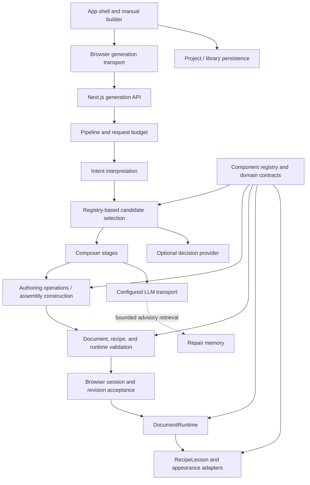
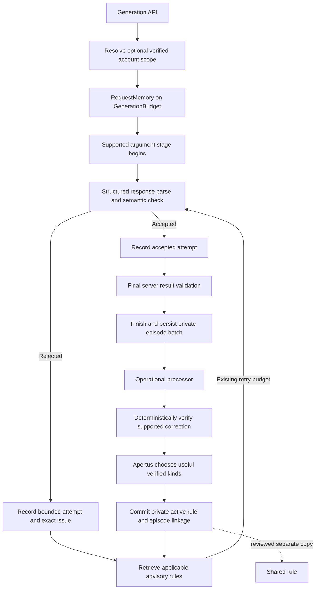

# pAperSim / Apertus: technical implementation and agent handoff

Inspection date: **2026-10-14**. Audience: an agent implementing, debugging, or extending this repository. Repository root: `project/`. HEAD observed during inspection: `09f0941cde0bd73a7414951670f837a38a153000`.

This is a source-based explanation of the current working tree, including uncommitted changes. It is not a release certification. The working tree was changing during inspection, particularly around HTML component authoring and controls. Treat paths and ownership as navigation aids, and reread the affected source before editing. Historical documents sometimes use directories that no longer exist.

The task that produced this guide changed documentation only. Application tests, builds, live inference, browser flows, databases, and Raspberry Pi hardware were not exercised. Registry metadata was enumerated with the repository's existing TypeScript loader; that enumeration is not a test-suite pass. No private environment-file values are reproduced here.

## Contents

1. [Product and execution model](#1-product-and-execution-model)
2. [Repository, technologies, and processes](#2-repository-technologies-and-processes)
3. [Current architecture and ownership](#3-current-architecture-and-ownership)
4. [Component vocabulary and registry](#4-component-vocabulary-and-registry)
5. [Documents, recipes, identities, and revisions](#5-documents-recipes-identities-and-revisions)
6. [Validation and graph contracts](#6-validation-and-graph-contracts)
7. [Authoring operations and transactions](#7-authoring-operations-and-transactions)
8. [Runtime state, commands, and clocks](#8-runtime-state-commands-and-clocks)
9. [Learner rendering and presentation](#9-learner-rendering-and-presentation)
10. [Manual builder implementation](#10-manual-builder-implementation)
11. [Generation HTTP protocol and browser acceptance](#11-generation-http-protocol-and-browser-acceptance)
12. [Fresh simulation creation](#12-fresh-simulation-creation)
13. [Follow-up editing](#13-follow-up-editing)
14. [Open component composition and compatibility](#14-open-component-composition-and-compatibility)
15. [Inference transport and model adapters](#15-inference-transport-and-model-adapters)
16. [Decision selection and Laya](#16-decision-selection-and-laya)
17. [Composer repair memory](#17-composer-repair-memory)
18. [Simulation domains and mechanics](#18-simulation-domains-and-mechanics)
19. [Runtime AI agents and debates](#19-runtime-ai-agents-and-debates)
20. [Authentication and application persistence](#20-authentication-and-application-persistence)
21. [Projects and community publication](#21-projects-and-community-publication)
22. [Imported HTML components and authoring](#22-imported-html-components-and-authoring)
23. [HTTP endpoint reference](#23-http-endpoint-reference)
24. [Configuration, local development, and deployment](#24-configuration-local-development-and-deployment)
25. [Benchmark runner and evaluation application](#25-benchmark-runner-and-evaluation-application)
26. [Verification and historical evidence](#26-verification-and-historical-evidence)
27. [How to extend the implementation](#27-how-to-extend-the-implementation)
28. [Debugging map and important limits](#28-debugging-map-and-important-limits)
29. [Related documentation and reading order](#29-related-documentation-and-reading-order)

Appendices: [A — domain models](#appendix-a-complete-domain-model-declaration-inventory), [B — prepared recipes](#appendix-b-complete-prepared-recipe-source-inventory), [C — built-in reusable recipes](#appendix-c-registered-built-in-reusable-recipes), and [D — change ownership](#appendix-d-quick-source-navigation-by-change).

## 1. Product and execution model

pAperSim is the product name visible in the web application. Apertus is the default language-model integration and part of the repository's earlier naming. The product is an interactive teaching laboratory: users open prepared experiments, build compositions manually, describe experiments in natural language, issue follow-up changes, save their work, and publish reusable content.

The normal native creation pipeline does not ask the language model to write a new simulation engine. It asks the model to interpret the request using the capabilities of registered application components. The application then constructs and validates a graph of existing models, controls, displays, and visual adapters. Scientific calculations run in TypeScript providers in the browser.

There are three distinct execution paths:

| Path | What supplies the experiment | What executes it |
| --- | --- | --- |
| Prepared lesson | Checked-in recipe or a preserved demonstration | Existing model providers and renderers |
| Manual builder | User edits the authored component graph | The same document runtime and learner renderer |
| Native AI authoring | Model selections, settings, and typed operations | Application-owned assembly, validation, and runtime |

Imported HTML is a separate, explicit extension path. A contributor can supply a complete HTML component with JavaScript, an embedded manifest, and a versioned host API. That code executes in an isolated iframe. It does not change the native composer's operation vocabulary into unrestricted code generation. Section 22 explains the isolation and its limits.

Several concepts that sound similar have different owners:

- A **learner lesson** is the simulation content and instructional text in a recipe.
- A **repair-memory lesson** is short advice for a later inference stage.
- A **recipe** is a portable component graph plus reusable metadata.
- A **project** is an owner's mutable saved record containing an experiment or recipe.
- A **publication** is a versioned public snapshot of a project.
- An **agent run** is server-owned conversation/action history, separate from a saved simulation recipe.

The main user-facing routes are `/`, `/experiments`, `/experiments/builder`, `/projects`, `/community`, `/community/<publicationId>`, `/community/components/new`, and the authentication screens. `/playground` is retained as a compatibility redirect. Query parameters such as `experiment`, `resume`, `lesson`, and `remix` choose a starting workspace or saved artifact.

## 2. Repository, technologies, and processes

```text
project/
├── Makefile
├── README.md
├── docs/
│   ├── COMPONENT_ARCHITECTURE.md
│   ├── MANUAL_EXPERIMENT_BUILDER.md
│   ├── PROMPT_CATALOG.md
│   └── agent-only/
│       ├── features/             Feature specifications and current walkthroughs
│       ├── implementation/       Plans, implementation reports, validation evidence
│       ├── rules/                Creation-pipeline change requirements
│       ├── design/               Component, builder, simulation, and UX philosophy
│       ├── benchmark/            Fixed prompt list and result reports
│       └── deployment/           Pi deployment guidance
├── src/
│   ├── web/                      Next.js frontend and server endpoints
│   │   ├── src/app/              Routes and application shell
│   │   ├── src/lib/              Auth, storage, projects, repair memory, agent services
│   │   ├── src/simulations/
│   │   │   ├── creation-and-editing/
│   │   │   ├── registry/
│   │   │   ├── builder/
│   │   │   ├── domains/
│   │   │   ├── legacy/
│   │   │   ├── pre-made/
│   │   │   └── lessons/
│   │   ├── scripts/              Recipe generation and focused verification
│   │   ├── public/component-authoring/v1/
│   │   └── migrations/repair-memory/
│   ├── inference/                Apertus MLX entry point and Laya HTTP wrapper
│   ├── playwright/               Fixed generation benchmark and artifact publisher
│   └── eval/                     Standalone screenshot comparison/voting app
└── deploy/
    ├── raspberry-pi/             ARM64 offline inference/web deployment
    └── repair-memory/            PostgreSQL and local embedding-service setup
```

The web package declares Next.js 16.3.8, React 19.2.8, TypeScript, Three.js 0.186.1, React Three Fiber, Drei, Framer Motion, Zustand, MongoDB, NextAuth v4, `parse5`, and `pg`. Those versions are declarations in [package.json](../../src/web/package.json), not claims about the latest external releases. The package manager is pinned to pnpm 10.14.0.

Responsibilities of the main dependencies:

| Technology | Implementation role |
| --- | --- |
| Next.js App Router | Pages, server rendering, deployment policy, API routes |
| React | Builder and learner interfaces, subscriptions to accepted runtime snapshots |
| Three.js / Fiber / Drei | Spatial scenes and 3D appearance adapters |
| SVG and ordinary DOM | Graphs, diagrams, controls, tables, 2D scientific scenes |
| Framer Motion | UI/illustration motion with reduced-motion support |
| Zustand | Preserved demonstration/session stores; the canonical document runtime also has its own external-store interface |
| MongoDB | Accounts, projects, public snapshots, migrated libraries, durable agent runs |
| PostgreSQL / pgvector | Optional repair evidence and retrieved correction lessons |
| parse5 | Structural parsing of imported HTML rather than regex-only markup inspection |
| Python / FastAPI | Local decision service and local embedding helper |
| MLX / mlx-lm | Apple Silicon Apertus text generation and optional Laya MLX inference |
| PyTorch CPU | ARM64 Laya backend in the Pi image |
| Playwright | Real-browser generation benchmark and focused UI verification |
| Biome | Formatting and lint tooling |

The processes are deliberately separate. Next.js calls configured inference endpoints; it does not load Apertus weights. Laya runs its own model. The optional embedding helper runs another model. The evaluator serves static assets and browser-local votes independently of the application database.

Default development ports from the root Makefile are web `43100`, Apertus `43101`, and Laya `43102`. The embedding helper uses `43104`; the evaluator uses `43110`. Individual tools have different standalone defaults, so read the command that launches a service rather than assuming every entry point uses the Makefile's values.

## 3. Current architecture and ownership

The October 13 structural refactor moved orchestration into `simulations/creation-and-editing`, promoted native declarations into `simulations/registry`, and preserved older scientific implementations under `simulations/legacy`. The directories formerly described as `components`, `runtime/authoring`, and `lib/planner` in older material are not the current production ownership map.

The [031 implementation report](implementation/031-SIMULATION-PIPELINE-REFACTOR.md) documents that migration. Its reported deterministic passes and historical real-model failures are separate kinds of evidence.



The important owners are:

| Owner | Files / directory | What belongs there |
| --- | --- | --- |
| Public declarations | [registry/index.ts](../../src/web/src/simulations/registry/index.ts), `registry/contracts`, `registry/definitions` | Identities, schemas, defaults, ports, commands, lifecycle metadata |
| Domain contracts | [domainContribution.ts](../../src/web/src/simulations/registry/contracts/domainContribution.ts), `domains` | Model meaning, equations/provider functions, assumptions, actions, limits |
| Server orchestration | [pipeline.ts](../../src/web/src/simulations/creation-and-editing/pipeline.ts), [budget.ts](../../src/web/src/simulations/creation-and-editing/budget.ts) | Admission, cancellation, deadlines, aggregate budgets, final result validation |
| Input boundary | `creation-and-editing/input` | Request/result formats, API byte parsing, browser transport, NDJSON |
| Meaning and selection | `intent-interpreter`, `component-selection` | Compact interpreted intent and selections from executable capabilities |
| Composer | `creation-and-editing/composer` | Creation stages, selected fields/arguments, open composition |
| Authoring engine | `creation-and-editing/authoring-engine` | Graph mutations, insertion, remapping, transaction receipts, layout operations |
| Validators | `creation-and-editing/validator` | Structural, configuration, scope, runtime, coverage, and imported-package checks |
| Runtime engine | `creation-and-editing/runtime-engine` | Live state, accepted commands, provider integration, agent/HTML execution adapters |
| Simulation UI | `creation-and-editing/simulation` | Shared learner renderer, board, component presentation, construction preview protocol |
| Editor UI | `simulations/builder` | Selection, settings, graph gestures, history, saving, import/export |
| Server infrastructure | `src/lib` | Sessions, storage authorization, publication, repair-memory database, agent HTTP services |
| Preserved implementations | `simulations/legacy` | Domain mechanics, visuals, older sessions and migration/resolution code still used today |

`legacy` is not an instruction to delete its contents. Many current providers import mechanics, visuals, teaching contracts, and scene adapters from that directory. The boundary distinguishes ownership and compatibility, not live versus dead code.

The repository checks import boundaries in its contract runner: the registry must not pull in React scenes, server inference configuration, or eager built-in recipe registration; browser consumers must not reach server inference transport/configuration or private repair-memory infrastructure. Some type-only references cross those folders, but type imports do not load runtime dependencies.

Next.js-specific work has additional instructions in [src/web/AGENTS.md](../../src/web/AGENTS.md): read the relevant installed Next.js guide before changing code because this version can differ from older conventions. Current dynamic route handlers receive promise-valued `params`; the root layout obtains deployment policy on the server.

## 4. Component vocabulary and registry

### 4.1 Nine responsibilities versus runtime categories

The architectural vocabulary has nine component types. It describes responsibility; it does not imply nine independent frameworks or a universal ECS library.

| Responsibility | Meaning | Examples in this implementation |
| --- | --- | --- |
| Resource | Shared data, presets, definitions, assets | Gravity/default presets, datasets, themes, schedules |
| Trait | Configuration or changing state associated with an instance | Launch settings, transforms, gas state, resident/agent state |
| Behavior | Declarative decisions and supported sequences | Schedules, trips, agent activation, routines |
| System | Mechanics and calculations | Ballistics, ideal gas, navigation, conserved transfers |
| Visual | Mapping model state into appearance | Citizen, beam, projectile, scientific-process illustration |
| View | Presentation on a rendering surface | World view, chart, table, inspector, SVG scene |
| Control | User input converted into a typed command | Slider, toggle, select, grouped form, action button |
| Prefab | Reusable entity or model assembly | Projectile, pendulum, citizen, truss, investigation model |
| Composition | Full experiment arranged from reusable parts | Prepared recipe, authored multi-component lab |

An **entity** is one instance. A **world** is the running model context. The **runtime** validates, instantiates, routes commands, and advances enabled dynamics. A factory is an implementation helper rather than a tenth public component responsibility.

The canonical public authoring contract groups definitions into eight practical categories: `models`, `controls`, `displays`, `canvases`, `appearance`, `behaviors`, `resources`, and `layout`. Older trait/system/visual declarations are preserved and projected into those public contracts where needed. Do not confuse the nine design responsibilities with the `PublicDefinition.category` enum.

### 4.2 Enumerated implementation inventory

Metadata enumeration during this inspection produced:

| Inventory | Count / meaning |
| --- | --- |
| Registered public definitions | 458 |
| Models | 126 |
| Controls | 52 |
| Displays | 29 |
| Canvases | 5 |
| Appearance definitions | 119 |
| Resources | 103 |
| Layout definitions | 8 |
| Behavior definitions | 16 |
| Explicit domain contributions | 16 |
| Models exported by those domain contributions | 92 |
| Prepared `recipe.json` entries | 92 |
| Built-in composite recipes | 49 |
| Prepared experiments in the active catalog | 40 |
| Component identities admitted to current catalog scope | 135 |

Imported HTML is resolved dynamically from its manifest and is not another statically registered entry in the 458-definition map. Older reports mention 90 prepared recipes; the current generated source inventory has 92.

### 4.3 PublicDefinition

[publicDefinition.ts](../../src/web/src/simulations/registry/contracts/publicDefinition.ts) is the contract to understand before adding a component. A definition contains:

- Stable `id`, supported `version`, title, description, category, and tags.
- Optional discovery and teaching metadata: concepts, interactions, observations, limitations.
- A configuration schema and registered defaults.
- Named typed input and output ports.
- Named commands with argument schemas and execution timing.
- Placement rules and provider identities.
- Lifecycle metadata distinguishing authored fields, presentation fields, clock support, reset semantics, and capture support.
- Assumptions and optional same-scope configuration references.
- Presentation hints such as `learnerLayout` and `presentedOutputs`.

The registry combines native controls/displays/canvases, authored object projections, domain-model projections, and preserved declarations. Duplicate identities throw during registration. Definitions are cloned, integration patches are applied, discovery metadata is derived, and registered definitions are recursively frozen.

`publicDefinition(instance)` matters for dynamic components: it resolves both the instance's version and, for imported HTML, the interface derived from its source. Passing only a string loses the source-specific manifest information.

### 4.4 Schema language

[parameterSchema.ts](../../src/web/src/simulations/registry/contracts/parameterSchema.ts) implements a small application schema language rather than importing a general validator package. It supports bounded numbers/integers, booleans, strings, enumerated values, bounded arrays, and object properties with optional fields. Object validation rejects unknown keys and recursively checks declared values.

Numeric fields preserve units and finite bounds. `SchemaValidationError` carries a stable code and path, allowing the repair loop to classify a rejected response without asking the language model to explain what a schema means. JSON Schema projections in `input/inference/structuredSchema.ts` are a provider-facing representation; the application schema remains authoritative after the provider returns.

### 4.5 Domain projections, presets, and discovery

[domainModels.ts](../../src/web/src/simulations/registry/models/domainModels.ts) projects each `DomainModel` into a public model definition, a resource preset, and an appearance definition. It exposes outputs such as `configuration` and `appearance`, adds an authored reset command, and attaches real runtime/presentation identifiers. Action metadata identifies safe absolute setters that can be continuous controls.

`discovery.ts` creates summaries and placements for the component picker. Retired control aliases and generated `resources/prefabs-*` presets remain resolvable for stored content while leaving ordinary discovery.

[catalogScope.ts](../../src/web/src/simulations/registry/catalogScope.ts) is an additional scope restriction shared by the experiment catalog, builder discovery, and AI retrieval. It derives admitted component IDs from the selected 40 experiments plus explicit retained extras. `catalogRecipeAllowed` requires a fully expanded recipe whose definitions all belong to that scope. Registration therefore does not imply discoverability or AI availability.

The active catalog restriction is an explicit product resource scope. It is not a semantic prompt router. The creation rules require the model to decide what the request means using the available contracts.

## 5. Documents, recipes, identities, and revisions

### 5.1 Canonical authored graph

[authoring-engine/document.ts](../../src/web/src/simulations/creation-and-editing/authoring-engine/document.ts) defines `AuthoredDocument`, currently `formatVersion: 3`.

| Field | Role |
| --- | --- |
| `nodes` | Model, control, display, appearance, canvas, behavior instances |
| `resources` | Resource instances included in the graph |
| `connections` | Value, command, and attachment relationships |
| `scopes` | Named runtime contexts for commands and relationships |
| `layout` | Learner-facing layout tree |
| `presentation` | Flow mode or board rectangles, navigation, groups, responsive/immersive metadata |
| `groups` | Composite membership and exposed interfaces |
| `lesson` | Title, instruction, explanation/limitations |
| `editor` | Graph positions, zoom, and pan |
| `compatibility` | Preserved original representation and migration notices where needed |

Each `ComponentInstance` has `id`, `definition`, `version`, `label`, `scope`, and `configuration`. A definition is reusable; an instance owns a separate state entry. Two pendulums can share one definition while having different IDs, parameters, controls, and live snapshots.

Graph coordinates, board coordinates, and scientific coordinates are separate. `editor.positions` moves a graph card. A presentation rectangle changes the space allotted to a renderer. A model's position, geometry, or physical dimension changes its configuration/state. Edits must target the appropriate representation.

### 5.2 CompositeRecipe

`CompositeRecipe` packages the graph with `recipeVersion`, identity/version, title/description/tags, exposed parameters, external ports, dependencies, assumptions, optional discovery/catalog metadata, and older `nested` references.

Current finalized recipes use `recipeVersion: 2`, have no nested recipes, declare exactly the used definition/version dependencies, and keep recipe title and lesson title consistent. Exposed parameter defaults must agree with the actual authored configuration. External ports must point to a real child port or command with a matching contract.

Version 1 remains an import/compatibility format. Some programmatically built source recipes are version 1 and become current expanded recipes during insertion/finalization. `parseRecipe` also migrates retired control identities and normalizes older standalone HTML recipes into version 2.

The recipe's `version` is the reusable artifact version. It is independent of `recipeVersion`, the structural format version.

### 5.3 ExperimentDocument

[builder/document/types.ts](../../src/web/src/simulations/builder/document/types.ts) defines the broader builder persistence envelope with `documentVersion: 1 | 2 | 3`. It can contain a canonical `authored` graph, `recipeMetadata`, or older scene/template/recipe representations. It also contains lesson, presentation, and editor fields used by compatibility/editor flows.

[serialization.ts](../../src/web/src/simulations/builder/document/serialization.ts) is the shared entry point for importing those representations. It unwraps community exports, migrates controls and drawings, recognizes raw authored graphs and current recipes, expands older recipes, and adapts supported legacy gas/spatial/assembly/elementary formats. When metadata is available, export can preserve the native recipe rather than forcing every artifact into the wider builder envelope.

Migration is not a promise that every historical or arbitrary file is accepted. Unsupported versions, missing bindings, invalid topology, or unknown identities still reject. Compatibility data can preserve a recoverable source without making that source executable.

### 5.4 Distinct identity and revision layers

| Identifier / revision | Owner | What it protects |
| --- | --- | --- |
| Definition `id` and `version` | Registry | Supported component implementation and contract |
| Node `id` / scope `id` | Authored graph | Instance identity and explicit relationships |
| Recipe `id` / `version` | Portable artifact | Reusable content identity |
| `formatVersion`, `recipeVersion`, `documentVersion` | Parsers | Structural representation compatibility |
| Generation `requestId` | Browser/API protocol | Correlation with the pending request |
| Learner `sessionId` | RecipeSession | Current active experiment |
| `authoredRevision` | RecipeSession | Changes to authored content/history |
| `interactionRevision` | RecipeSession | Accepted learner interactions and asynchronous accepted effects |
| Draft revision / operation ID | AuthoringTransaction | Atomic/idempotent authoring mutations |
| Project `saveRevision` | MongoDB project record | Concurrent saved-content updates |
| Series version number | Publication transaction | Immutable public versions |
| Agent run revision / fence | AgentRunner | Reserved inference work and stale-result rejection |
| Memory occurrence / contract key | Repair memory | Independent evidence and compatible guidance |

Never replace one with another merely because both are integers or strings. A save revision does not prove that a pending generation still matches a learner's live state.

## 6. Validation and graph contracts

### 6.1 Data and document bounds

[validator/document.ts](../../src/web/src/simulations/creation-and-editing/validator/document.ts) provides `assertData`, `validateAuthoredDocument`, and `validateConnection`.

`assertData` admits plain finite JSON data, rejects prototype-related keys (`__proto__`, `prototype`, `constructor`), and bounds nesting/complexity. Canonical documents permit at most 512 nodes/resources, 1,024 connections, layout depth 12, and a 1,000,000-character serialized-data budget. The underlying walk bounds data depth at 40 and visited values at 100,000. These are distinct from HTTP byte limits.

Document validation checks supported definitions and versions, unique identities, existing scopes, configuration schemas, same-scope configuration references, group membership/ancestry, exposed interfaces, layout placement and conditional bindings, editor geometry, board metadata, and each domain's maximum independent instances.

Editing validation can admit an incomplete workspace. Running/finalizing asks for stricter checks: required inputs must exist and controls must have real command bindings. This distinction lets a user add a component before connecting it without presenting that draft as a complete playable lesson.

### 6.2 Port kinds and relationships

A port may carry `value`, `dataset`, `grid`, `event`, `command`, `attachment`, or `layout` data. Stored connections have only three relationship kinds:

| Stored kind | Typical relationship | Validation concerns |
| --- | --- | --- |
| `value` | Model output to display, data operation, or model input | Kind, units, schema where required, cardinality, scope, immediate cycles |
| `command` | Control event to supported target command | Command existence, argument contract, control binding, same scope |
| `attachment` | Model to appearance, object to canvas, visual to scene | Compatible host/interface, scope, placement |

Single-cardinality non-command inputs reject multiple writers. Immediate value dependencies reject cycles. There is no implicit general-purpose feedback-loop solver that makes any cyclic graph meaningful.

For ordinary values/attachments crossing scopes, both relevant port contracts must allow it. Commands stay in the target's explicit scope. Imported HTML connections additionally require matching schema shape and bounds; matching only the text of the units is insufficient.

`argumentBindings` on a command can read a current output and apply a small declared transform: identity, boolean negation, multiplication, or a lower bound. Source paths and operands are validated. This supports actions such as play/pause based on current state without a language-model call.

### 6.3 Stronger recipe and runtime gates

[validator/recipe.ts](../../src/web/src/simulations/creation-and-editing/validator/recipe.ts) checks the reusable envelope and dependency/interface consistency. [finalizeRecipe.ts](../../src/web/src/simulations/creation-and-editing/authoring-engine/finalizeRecipe.ts) requires learner content, validates a runnable document, requires bridge topology/load attachments, serializes current dependencies, reparses the result, and performs runtime validation.

[validator/runnable.ts](../../src/web/src/simulations/creation-and-editing/validator/runnable.ts) checks required connections, a model/imported component, real providers, and an inspectable runtime. It also suggests legal connections and can connect an unambiguous required endpoint. Suggested wires are not permission to guess a scientific relationship or select among multiple legitimate sources.

Coverage and explicit-quantity checks are additional safeguards. A structurally valid graph can still answer the wrong question. Coverage text and generated narrative are not a scientific proof or an independent semantic evaluator.

## 7. Authoring operations and transactions

### 7.1 Operation vocabulary

[operations.ts](../../src/web/src/simulations/creation-and-editing/authoring-engine/operations.ts) implements the finite authoring tool vocabulary:

| Tool | Effect |
| --- | --- |
| `insert_recipe` | Expand a registered recipe, remap IDs/scopes, apply exposed overrides |
| `insert_component` | Create a registered component with validated configuration |
| `configure` | Patch a target's supported authored configuration |
| `add_control` | Add a real control bound to a supported command/field |
| `add_observation` | Add a display bound to a supported output |
| `connect` | Create a validated relationship between existing endpoints |
| `regenerate_truss` | Rebuild supported bridge topology through the shared truss owner |
| `remove` | Remove requested nodes and reconcile their references/layout |
| `arrange` | Change learner geometry/order without altering model quantities |
| `resize` | Resize an unlocked board item and keep adjacent content reachable |
| `set_lesson` | Replace the declared instructional text fields |

Every tool has an exact argument envelope. Unknown/missing arguments reject. Aliases are short draft handles; they do not become a way for the model to invent registry IDs or select an arbitrary object outside the accepted plan.

`configure` validates the patch and resulting configuration. Nested-field edits use [configurationPatch.ts](../../src/web/src/simulations/creation-and-editing/authoring-engine/configurationPatch.ts) to clone the current nested object and preserve untouched siblings before producing the patch. A width-only or height-only change must not accidentally replace the other dimension.

After an accepted operation, the document and board are reconciled and validated. Control `initial` values are projected from accepted target configuration where appropriate, using a runtime inspection. This keeps authored control defaults aligned with the model instead of letting stale form JSON reset unrelated values.

### 7.2 Atomic transaction semantics

[transaction.ts](../../src/web/src/simulations/creation-and-editing/authoring-engine/transaction.ts) owns an isolated cloned document and handle map. Its envelope includes `draftId`, `expectedRevision`, `operationId`, and one operation or a bounded batch.

The execution sequence is:

1. Validate the envelope and identity.
2. Canonicalize the operation payload for duplicate detection.
3. Return the earlier receipt when the same operation ID and payload repeat.
4. Reject reuse of the same operation ID with a different payload.
5. Reject stale draft revisions or exhausted operation/receipt limits.
6. Clone the transaction state and apply the whole batch to that clone.
7. Commit the staged state and increment revision only if every operation succeeds.
8. Return a receipt with status, current revision, handles, summary, and issues.

Default transaction limits are 12 operations and 24 receipts; a batch has at most 12 requests. The constructor accepts bounded overrides up to 48 operations/64 receipts. Required-Laya open composition currently uses 32 operations/48 receipts. `fork()` gives semantic validation a trial transaction without committing the real draft.

### 7.3 Insertion and reusable groups

`recipes.ts`, `composites.ts`, and `insertion.ts` expand reusable content and remap node, scope, connection, layout, group, parameter, exposed-port, and configuration-reference identities. Independent copied groups must keep distinct state and valid references. Host compatibility and singleton constraints are checked before inserting into an existing canvas.

Groups can expose child parameters and ports. An exposed composite interface is a projection of real child contracts, not another hidden runtime. The builder can collapse/expand it while preserving the underlying graph.

## 8. Runtime state, commands, and clocks

### 8.1 Provider interface

[runtime-engine/providers/index.ts](../../src/web/src/simulations/creation-and-editing/runtime-engine/providers/index.ts) integrates runtime providers. A provider implements:

```ts
initialize(node)                       // authored starting state
apply(state, command, arguments, node) // one validated command
measure(state, node)                   // outputs for readers/renderers
step?(state, delta)                    // optional dynamics
synchronize?(state, inputs, node)      // value-graph inputs
capture?(state)                        // current reusable configuration
reinitialize?(state, node)             // domain-owned configuration edit behavior
```

Domain models are adapted into that interface. Authored objects, spatial models, pure data operators, exploration models, and agent sessions have their own provider registrations. Imported HTML has a special provider that manages host state and communication while the iframe computes its declared behavior.

### 8.2 DocumentRuntime

[DocumentRuntime.ts](../../src/web/src/simulations/creation-and-editing/runtime-engine/DocumentRuntime.ts) owns `document`, `snapshot.state`, `snapshot.outputs`, normal subscriptions, and interaction subscriptions. State is indexed by instance ID. The constructor validates the graph, initializes providers, and computes observations.

Observation evaluation recursively evaluates upstream value sources, supplies input arrays to synchronizing providers, and measures model outputs. Missing/unavailable inputs suppress dependent ordinary outputs. Native nonfinite derived values can become an explicit unavailable observation instead of rendering `NaN` as a meaningful measurement. Domain output measurement also checks the declared output set and finite bounded data shape.

Attachment relationships feed appearance/canvas adapters; they are not interpreted as arbitrary executable callbacks. Pure operations such as line intersection and fraction comparison derive results from their connected models.

`dispatch(commands)` stages a cloned snapshot. It resolves every node, command, and provider, validates arguments, applies the batch, validates captured configuration when available, recomputes outputs, and commits only on success. Rejection returns `{ accepted: false, error }`. Reset initializes the selected model from authored configuration. A successful dispatch publishes the snapshot and advances the interaction channel.

`submit(controlId, args)` resolves command wires. For scalar widgets, it reads sibling arguments from current accepted target state at submission time, writes only the bound field, and sends the full supported command arguments. This matters when a second control or drag interaction changed the model after the form originally mounted.

`updateDocument` preserves live state when definition, scope, and authored configuration are unchanged. Presentation-only fields can update without restarting mechanics. When authored configuration changes, the provider decides whether to reconfigure existing state or initialize afresh. Failed recomputation restores the previous document rather than accepting a broken replacement.

`capture()` asks providers for reusable current configuration and validates the resulting document. It does not serialize every animation frame, particle position, conversation transport, or transient pending action into the lesson's starting configuration.

### 8.3 RecipeSession and acceptance

[RecipeSession.ts](../../src/web/src/simulations/creation-and-editing/runtime-engine/RecipeSession.ts) wraps a parsed recipe and its runtime with session identity, authored/interaction revisions, provenance, coverage, and authored undo/redo history.

The learner session's request context contains a serialized recipe built from captured current settings plus a compact runtime context. Large token/member/joint/response arrays are excluded; deeply nested or long arrays are omitted. Follow-ups consequently see relevant live settings without receiving the full animation/topology dump.

An update is accepted only if the expected session and authored revision match, and, when supplied, the expected interaction revision also matches. A runtime action additionally checks the original authored revision and current interaction revision. Candidate loading precedes activation; a rejected or stale candidate leaves the active session intact.

Session history holds at most 20 authored checkpoints. Undo/redo update the existing runtime and increment authored revision. Learner animation ticks do not create authored history entries.

### 8.4 One clock and reduced motion

`RecipeSession.start()` uses `requestAnimationFrame`, clamps ordinary frame deltas to 0.1 seconds, and advances only when the graph has clock-enabled content. `DocumentRuntime.step` rejects invalid deltas outside `(0, 1]`. Domain systems can apply smaller substeps internally.

The shared renderer can own a runtime for a builder preview, or receive the learner session's existing runtime. It avoids starting a second clock when a supplied runtime is authoritative. Reduced-motion preferences pause automatic motion unless the user enables animation; explicit timestep controls remain available.

Model playback state, the host animation clock, and agent inference are different mechanisms. A visible renderer subscription does not invoke the language model on every frame.

### 8.5 Data operators

[providers/data.ts](../../src/web/src/simulations/creation-and-editing/runtime-engine/providers/data.ts) provides bounded literals, own-property field selection, expression trees, registered unit conversions, and themes.

`data/Expression` evaluates a JSON expression tree with `x`, `y`, numeric literals, and supported arithmetic operations. It does not evaluate a JavaScript string. Evaluation permits at most 128 visits/depth 12, rejects division by zero, and bounds finite results. Field paths have at most eight segments and reject prototype access. Conversion providers apply registered scale/offset pairs, including absolute-temperature checks. Dataset resources require bounded records with unique stable keys.

## 9. Learner rendering and presentation

### 9.1 Shared renderer

[RecipeLesson.tsx](../../src/web/src/simulations/creation-and-editing/simulation/RecipeLesson.tsx) is shared by generated lessons, authored previews, and reusable recipes. It subscribes through `useSyncExternalStore`, supplies snapshot/authoring/motion contexts, hosts the board/layout renderer, and exposes reset/capture/motion controls.

[NodeView.tsx](../../src/web/src/simulations/creation-and-editing/simulation/recipe/NodeView.tsx) dispatches by definition/category:

- Model nodes remain logic and do not render directly.
- Controls use the common control presenter or activity-specific panels.
- Displays read validated bound observations.
- Appearance nodes use concrete scene adapters.
- Canvases render compatible spatial objects.
- Agent, science, cycle, collective, Earth/atmosphere, and imported-HTML interfaces use dedicated adapters.

`RecipeAppearance.tsx` connects accepted snapshots to preserved domain renderers. `snapshotAdapters.ts` supplies typed projections. `formatObservation.ts` handles instructional formatting such as line equations and unavailable values. Rendering should communicate the accepted state rather than calculate an independent competing result.

### 9.2 Controls and action timing

The basic control family includes number input, slider, toggle, select, action button, and grouped form. Common controls emit a `submit` event with typed arguments; the runtime resolves the actual command.

`commandPresentation.ts` and `controlContract.ts` supply labels, editable parameter leaves, current command arguments, widget compatibility, and activity presets. Command `timing` (`live`, `relaunch`, `rebuild`) is separate from `submission` (`continuous`, `explicit`). An absolute setter may be safe while dragging; an additive action such as adding titrant, rebuilding topology, or advancing a step should remain explicit.

Forms and controls cannot invent a broader schema to make a widget fit. If the current command needs structured data, the form uses the declared structure. Unsupported conversions require a real data/conversion component.

### 9.3 Layout versus board

The authored layout tree supports stacks, rows, grids, panels, disclosures, tabs, splits, and repeaters. Conditional visibility/disabled state and themes bind to validated outputs.

Board presentation assigns rectangles to learner content and stores opening view, navigation bounds, grouping, responsive information, and immersive options. `authoring-engine/presentation/arrangement.ts`, `board.ts`, and `responsiveLayout.ts` own geometry decisions. `simulation/board/SpatialBoard.tsx` implements rendering and manipulation.

[learnerLayout.ts](../../src/web/src/simulations/creation-and-editing/simulation/layout/learnerLayout.ts) arranges the selected investigation without making another semantic selection. Compatible object canvases can share axes, while instances/controls stay distinct. The helper remaps scope/attachment hosts, differentiates compared objects visually, preserves meaningful tabs/disclosures/bindings, and applies automatic arrangement where needed.

The scene-first hints and declared `presentedOutputs` help prevent duplicate readouts for information already visible in the scene. Optional control/readout count guidance is currently soft; it is traced and does not justify removing a required input.

### 9.4 UX requirements

[IMPORTANT.md](implementation/IMPORTANT.md) requires a clear initial action, teaching visuals, and manageable controls. A correct graph with an overwhelming interface is unfinished. Desktop/mobile geometry, keyboard/focus behavior, reduced motion, and readable accepted-state feedback need review through the actual user flow. Type checks and tidy screenshots alone cannot establish usability.

## 10. Manual builder implementation

### 10.1 Outer workflow and authoritative state

[Builder.tsx](../../src/web/src/simulations/builder/Builder.tsx) owns setup, saved/recovery loading, explicit save/import/export, project metadata, revision expectations, dirty-state transitions, and the outer history workflow. [CompositionBuilder.tsx](../../src/web/src/simulations/builder/composition/CompositionBuilder.tsx) owns the current component workspace, settings, graph/board interactions, component library, and lesson preview.

The authored document is the source of truth. The graph UI is derived by `graph/authoredGraph.ts`; `deriveGraph.ts` preserves the older scene projection. Editing a wire or component updates the document rather than a disconnected second graph store.

Important editor owners include:

| Area | Files |
| --- | --- |
| Component selection/removal | `editor/selection.ts` |
| New component insertion | `editor/insertionPlan.ts`, `composition/useComponentCatalog.ts` |
| Connections | `editor/connectionCommands.ts`, `authoring-engine/connections.ts` |
| Objects and composites | `editor/objectCommands.ts`, `editor/compositeCommands.ts` |
| Clipboard and remapping | `editor/boardClipboard.ts`, authoring recipe remappers |
| Canvas/settings/appearance | `CanvasSettings`, `ObjectSettings`, `DecorationSettings`, `ComponentSettings` |
| Controls/displays | `ControlSettings`, `ControlTypeSettings`, `DataDisplaySettings`, `BindingSettings` |
| Reusable interfaces | `CompositeInterfaceEditor`, `SaveCompositeDialog` |
| Graph movement | `CompositionGraph`, `useGraphMotion`, connection viewport/node components |
| Drawing tools | `simulation/board/DrawingEditor`, `DrawingInspector`, authoring drawing validation |

Some older scene/object command paths remain for migration and compatibility. They are not a separate desired replacement architecture.

### 10.2 Editing and history

[useDocumentHistory.ts](../../src/web/src/simulations/builder/history/useDocumentHistory.ts) clones before applying a mutation, validates canonical changes, synchronizes lesson/editor fields, and rejects an invalid edit without changing the accepted document. It groups repeated interactions such as dragging, tracks up to 100 previous snapshots, and supports keyboard undo/redo while excluding text-editing targets.

The builder can keep an editable draft alongside the last valid representation used for preview. A playable export/publication asks for stronger validation than a partially wired editable workspace.

### 10.3 AI inside the builder

[useBuilderAi.ts](../../src/web/src/simulations/builder/composition/useBuilderAi.ts) projects the document into the generation protocol, assigns a `builder-*` session identity, tracks document fingerprint/revision, and chooses create versus edit based on graph content.

It sends `destination: "builder"` and `construction: "live"`. Construction updates render an intermediate preview; they are not accepted history entries. Manual mutation is locked during the request. Before final commit, the hook checks that the latest workspace fingerprint still matches the starting content. A successful result becomes one normal editor/history mutation. Cancellation removes the preview and retains the prompt.

The builder does not apply learner runtime actions to authored state. If the server returns `runtime_action`, it directs the user to Try lesson instead of silently treating a live command as a saved edit.

### 10.4 Local recovery and component library

Draft recovery is separate from explicit library save. It stores the current and last valid document, save identity/revision, project type, sharing permission, source attribution, and any preserved recovery text. Account drafts use owner-suffixed local keys, while guest drafts use the base key.

The reusable recipe library supports saving a validated composite/interface locally or to an account. It retains independent recipe identity and version. Browser `navigator.locks` is required for coordinated local component saves; saved experiments use a lock when available and compare their expected record against storage. Section 20 covers the storage behavior in detail.

## 11. Generation HTTP protocol and browser acceptance

### 11.1 Input and API ownership

[app/api/apertus/route.ts](../../src/web/src/app/api/apertus/route.ts) is a thin Node runtime route. [input/api.ts](../../src/web/src/simulations/creation-and-editing/input/api.ts) owns byte-bounded body reading, UTF-8 decoding, JSON parsing, correlation, tracing, optional memory creation, and response streaming.

[input/contracts.ts](../../src/web/src/simulations/creation-and-editing/input/contracts.ts) defines protocol version 1:

```text
GenerationRequest
  protocolVersion: 1
  requestId
  prompt
  purpose?: create | edit
  clarification?: original prompt + asked question
  destination?: lesson | builder
  construction?: live                    (builder only)
  viewport: width + height
  active: null OR
    sessionId
    authoredRevision
    interactionRevision
    complete expanded recipe
    bounded runtimeContext
```

The HTTP request limit is 1,100,000 bytes; prompt length is at most 4,000 characters; viewport dimensions are bounded integers. Runtime context is plain bounded JSON with limits on depth, entry counts, strings, and arrays. Active recipes must be expanded version-2 documents. Editing requires an active experiment.

The browser supplies session/revision information for consistency, not authorization to account storage or repair memory. Private identity comes from the verified server session.

### 11.2 Results

[input/results.ts](../../src/web/src/simulations/creation-and-editing/input/results.ts) defines:

| Status | Meaning / payload |
| --- | --- |
| `created` | Complete new recipe; expected authoring dependency is null |
| `updated` | Complete replacement recipe with expected current session/revisions |
| `runtime_action` | Bounded scoped command batch with expected interaction dependency |
| `unsupported` | Capability limitation explanation; no graph activation |
| `clarification` | Request for missing meaning/details; no graph activation |
| `failed` | Error message and retryability; no graph activation |

Creation coverage contains `full`/`partial`, covered concepts, omissions, and an explanation. Partial limitations must be persisted in lesson explanation text, so they survive saving/reopening. Results must correlate with the original request, contain learner content, and satisfy recipe/document checks before activation.

### 11.3 NDJSON streaming

If the browser asks for `application/x-ndjson`, the API emits progress, construction, and one terminal result event. Headers include `X-Request-ID`, no-store caching, and streaming-buffer suppression. A nonstreamed client receives ordinary JSON.

[eventStream.ts](../../src/web/src/simulations/creation-and-editing/input/eventStream.ts) applies backpressure to construction/result sends; best-effort progress can be omitted when a slow consumer has no buffer room. It avoids returning the running producer promise from stream `start`, which would prevent `pull` and deadlock backpressure. Cancellation wakes pending sends and cancels the owned work.

The construction protocol bounds each frame at 2,200,000 bytes, a stream at 64,000,000 bytes, and construction updates at 256. Every construction frame has request ID, increasing sequence, nondecreasing draft revision, phase, document, affected identities, and bounded activity text.

[ConstructionPublisher](../../src/web/src/simulations/creation-and-editing/simulation/construction/publisher.ts) owns valid draft projection and final geometry. Live construction is enabled for initial builder creation/empty content, not arbitrarily for all edits. The API briefly yields after sends so the browser can display a frame before the terminal result.

### 11.4 Browser safeguards

[input/browser.ts](../../src/web/src/simulations/creation-and-editing/input/browser.ts) checks response-header correlation before reading events, validates each request ID and frame, rejects events after the terminal result, verifies construction order, bounds stream bytes, and reparses the final result against the request.

The application shell also owns a pending `AbortController` and request reference. A new request cancels the previous one; a late response cannot activate after ownership changes. `RecipeSession` performs the final session/revision checks.

These layers address different races: network correlation, pending-request ownership, graph validation, session replacement, authored edits, and learner interactions. Passing the server validator alone does not prove that the browser accepted or displayed the response.

## 12. Fresh simulation creation

### 12.1 Entry and budget

`pipeline.planPrompt` reparses input, creates a `GenerationBudget`, performs process-local planner admission, and chooses editing first unless purpose is create. It records a terminal outcome for memory after final server checks. `server.ts` exposes server entry points without duplicating orchestration.

`composer/create.ts` obtains teaching intent. For a fresh request, or explicit `purpose: "create"`, it enters **`createFromAssemblies` directly**. Older walkthroughs focused on a single-recipe or open-component loop; that is not the whole current fresh-creation path.

### 12.2 Interpreting the request

[interpretCreation.ts](../../src/web/src/simulations/creation-and-editing/intent-interpreter/interpretCreation.ts) asks for a compact teaching intent: goal, concepts, interactions, observations, requested inputs, explicitly grounded constraints, suggested single/comparison structure, instance count, comparison conditions, and a learning question.

Explicit constraint references point to source spans supplied by the application. The model does not invent a source quote to make its own interpretation appear grounded. The original prompt remains available downstream; inferred questions do not replace it.

### 12.3 Retrieving activity candidates

[assemblyCandidates.ts](../../src/web/src/simulations/creation-and-editing/component-selection/assemblyCandidates.ts) combines prepared recipes and built-in assemblies, filters by current catalog scope, and ranks them using names, tags, descriptions, command/output vocabulary, and frequency-weighted token overlap. Original prompt terms get extra weight; shorter assemblies break equal-score ties. The shortlist is at most eight candidates.

The candidate projection includes actual model instances, command argument leaves, output meaning/units, existing input bindings, and assumptions. Retrieval is a compacting/ranking aid. It cannot establish semantic support merely because a title or variable matches.

### 12.4 Selecting an activity and preserving required inputs

[assemblyPlan.ts](../../src/web/src/simulations/creation-and-editing/component-selection/assemblyPlan.ts) optionally obtains a decision-provider recommendation in hybrid mode, then asks the text model to select one supplied activity at a time and say whether the original request is complete. An activity can already contain an entire comparison, so inferred instance counts are hints rather than a demand to duplicate it.

Selection calls [resolveInputRequirements](../../src/web/src/simulations/creation-and-editing/component-selection/inputRequirements.ts). The supplied context contains executable model meaning, commands, argument fields, units, outputs, limitations, and bound instances. The model decides whether those capabilities support the requested system/outcome and selects distinct supplied input IDs.

Registered scalar commands count as capabilities even if a source recipe omitted their controls. `withAvailableInputs` creates valid candidate controls from the command contracts before requirement resolution. Missing mandatory bindings cause candidate rejection and a bounded alternative selection; the code permits at most three rejected activity candidates.

Once resolved, the application preserves the exact model, command, field, capability ID, and per-instance wires. Outputs cannot substitute for commands when the user asked to adjust a quantity.

### 12.5 Selecting presentation

[choosePresentation.ts](../../src/web/src/simulations/creation-and-editing/composer/choosePresentation.ts) retains resolved required inputs and necessary playback. Additional controls and observations are chosen through small sequential decisions, each returning one supplied candidate or `done`.

Scenes declare the outputs they already communicate. Observation cards identify output sources and equivalent measurements across comparison instances. Choosing a needed observation retains its equivalent bindings on the compared instances. Optional presentation cannot remove required interactions.

The code traces a soft guidance threshold of three controls/one observation. It does not enforce that by discarding requested functionality. This is why technically valid generated interfaces can still need UX refinement.

### 12.6 Setting authored starting values

[configureAssembly.ts](../../src/web/src/simulations/creation-and-editing/composer/configureAssembly.ts) separates selecting a setting from supplying its value. Each selection says `done` or names one exposed setting; each value response contains only `{ value: ... }` under that setting's schema.

An adjustable quantity does not automatically request a changed starting value. The model should keep registered defaults unless the prompt specifies a start or a comparison needs distinguishing conditions. Recipes with no exposed parameters skip setting inference.

For different-condition comparisons, verification checks the relevant accepted command values or parameter values against prior instances. Changing only a label or unrelated configuration does not satisfy the different-condition requirement. Explicit values/units must be preserved.

### 12.7 Application-owned assembly

[createFromAssemblies.ts](../../src/web/src/simulations/creation-and-editing/composer/createFromAssemblies.ts) applies overrides before pruning, removes unselected optional controls/displays, keeps required/playback functionality, prefixes inserted instance IDs (`activity_1`, etc.), preserves selected wires, gathers assumptions, writes lesson metadata, and applies learner arrangement.

This direct assembly path constructs a cloned graph through shared insertion/removal/finalization helpers. It is not the same multi-turn `AuthoringTransaction` loop used by open composition. Before finalization, it explicitly checks every resolved required input, requested command wire, and selected observation wire still exists on the intended target. It then returns a complete created recipe and coverage.

Do not debug a fresh assembly selection failure by editing an unused legacy prompt router or only the open-composition loop. Follow the actual call path first.

## 13. Follow-up editing

### 13.1 Current-state capture and candidates

The learner calls `RecipeSession.requestContext()`, which captures accepted current configuration and compact runtime context. Builder edits use their own authored document projection. [editCandidates.ts](../../src/web/src/simulations/creation-and-editing/component-selection/editCandidates.ts) builds target-specific operations and schemas from that context.

Candidates distinguish runtime actions, authored configuration, lesson text, presentation arrangement/size, insertion/removal, and supported topology operations. Private candidate IDs are short inference wires; application code maps them back to real operation/target identities.

### 13.2 Target selection and field planning

[selectEditTargets.ts](../../src/web/src/simulations/creation-and-editing/component-selection/selectEditTargets.ts) asks for an actionable mode and supplied candidate IDs. Modes include edit, runtime, new, clarification, and unsupported. `interpretEdit.ts` validates consistency between mode and selected candidates.

[editPlan.ts](../../src/web/src/simulations/creation-and-editing/composer/editPlan.ts) plans exact editable fields and optional numeric adjustments. It projects bounded field choices and current values rather than asking the model to return a whole replacement document.

Relative arithmetic is application-owned:

```text
set    => operand
scale  => captured current value × operand
offset => captured current value + operand
```

The computed result must satisfy the selected field's schema. Missing/nonfinite current values permit absolute set or clarification, not invented arithmetic from registered defaults. Selecting a parent field and its child simultaneously rejects as an overlapping patch.

`all_matching` expansion applies only to configuration operations on matching definitions, with at most eight affected components. The application expands matching instances; it does not trust the model to produce extra unconstrained target IDs.

### 13.3 Values and execution

[editArguments.ts](../../src/web/src/simulations/creation-and-editing/composer/editArguments.ts) narrows schemas to accepted fields and maps flat `arg1`, `arg2`, etc. values to the selected operations. Targets and command envelopes come from the plan. Fully computed numeric changes, removals, empty argument objects, and mirrored settings can avoid another model value call.

Configuration patches preserve live nested siblings. A partial board resize fills unchanged geometry from the current item and respects aspect ratio, minimum size, neighboring content, and locked items. Lesson patches preserve unselected text fields.

`validateEditResult` runs the operations in an isolated transaction, serializes/reparses the original recipe with the candidate document, and finalizes it. Runtime-command validation builds an isolated runtime, overlays bounded captured state, and checks the proposed commands. The server does not mutate the active browser session.

### 13.4 Bounded repair and reselection

[composer/edit.ts](../../src/web/src/simulations/creation-and-editing/composer/edit.ts) raises an edit budget to at least 12 calls/10 repairs, selects targets, plans fields, and obtains arguments. If the target selection means new, it restores the prior limits and falls through to creation.

Only a resulting-document/recipe rejection (`invalid_result` or `invalid_recipe`) can trigger one target reselection, and only while calls/repairs remain. Syntax errors, invalid scalar values, unavailable providers, and identical rejected target sets do not start an unlimited outer loop.

Stage transport repairs the current wire/schema and exact issue. It keeps earlier accepted target/field decisions authoritative. Updates include expected session, authored revision, and interaction revision, followed by the normal browser acceptance checks.

A failed edit should preserve the whole active recipe/session. Historical E01/E02 failures demonstrate why safe rejection and request fidelity need to be assessed separately.

## 14. Open component composition and compatibility

The repository retains additional creation paths for active-topic replacement, selected recipes, compatible additions, and open graph composition.

`composer/create.ts` can select a single prepared recipe for some active-request paths, configure independent instances, verify explicit quantities/coverage, insert them through transactions, and optionally extend them. Builder composite modification and required-composition conditions can route to [composeFromComponents.ts](../../src/web/src/simulations/creation-and-editing/composer/composeFromComponents.ts).

The open loop retrieves a component bucket, optionally requires an accepted Laya strategy, builds available tools from the current document, and repeatedly asks for focused supported operations. It tracks executed payloads, receipts, unchanged revisions, and turn budgets. It terminates repeated operations/stalls rather than replaying a relative adjustment indefinitely.

After operations, it can connect unambiguous required relationships, attach available appearance/interaction support, reconcile learner layout, check runnability, compute coverage, retain assumptions, and finalize a current recipe. Requested control extension has a concrete completion condition: create the command wiring before declaring success.

[normalizeOperations.ts](../../src/web/src/simulations/creation-and-editing/authoring-engine/normalizeOperations.ts) contains substantial older syntax/envelope/reference/configuration normalization. It is not a second validator or permission to accept arbitrary wrong values. Likewise, older quantity/wording helpers are not proof that all natural language is correctly interpreted.

The [creation-pipeline rules](rules/CREATION-PIPELINE-RULES.md) explicitly require the model to decide meaning and warn that historical deterministic name/request-span mechanisms need review. Existing helpers such as `namedInputRequirements`, `inputRequestSpans`, and the old `resolveExperimentPrompt` are present in source. Their presence does not justify adding new benchmark-specific regex routing.

Compatibility resolvers and preserved session types still load gas, spatial, assembly, math, and elementary formats. The canonical runtime path is shared where possible; old scientific code remains under the legacy ownership boundary.

## 15. Inference transport and model adapters

### 15.1 Configuration and provider identity

[input/inference/config.ts](../../src/web/src/simulations/creation-and-editing/input/inference/config.ts) chooses `apertus`, `openai`, or `anthropic`. Apertus is a transport family that can connect locally or to a Hugging Face chat-completions endpoint; a hosted benchmark using Llama/Qwen through that adapter is not an Apertus-weight run merely because `LLM_PROVIDER=apertus`.

`GenerationBudget.llmConfig` freezes resolved configuration for the request. Provider, endpoint, model, context capacity, timeout, concurrency, structured-output mode, output cap, and optional reasoning effort are server-only settings.

Offline mode restricts generation to local Apertus endpoints and decisions to local Laya. URL validation rejects embedded credentials/query/fragment; endpoint locality is checked under offline policy.

### 15.2 Provider wire formats

[adapters.ts](../../src/web/src/simulations/creation-and-editing/input/inference/adapters.ts) translates the shared messages/schema into concrete provider requests:

| Provider | Wire |
| --- | --- |
| OpenAI | `/responses`, `input`, `max_output_tokens`, `store: false`, nonstreaming output, optional reasoning, strict `text.format` schema |
| Anthropic | `/messages`, separate system text, `max_tokens`, API-version header, optional `output_config` schema |
| Apertus local/HF | `/chat/completions`, messages, temperature 0, output cap, nonstreaming content, optional response format |
| llama.cpp variation | Its supported schema envelope, no reasoning, configured server alias |

For supported local MLX/llama.cpp and the provider-qualified Qwen3 Featherless route, the adapter disables thinking through chat-template settings. Native provider envelopes are normalized into content, finish reason, actual model, and usage. Refusals and HTTP/provider failures stay failures rather than being treated as malformed composer JSON.

Cloud schemas may require optional fields represented with null or a root object wrapper. The adapter projects that wire contract and restores the application shape afterward. The restored value still passes application validation.

### 15.3 Stage context and output bounds

[stage.ts](../../src/web/src/simulations/creation-and-editing/input/inference/stage.ts) and `messages.ts` construct fresh bounded stage context: task, original request, accepted intent where useful, contract, schema, and relevant state. They avoid a growing conversation transcript/full-catalog dump.

Limits in [transport.ts](../../src/web/src/simulations/creation-and-editing/input/inference/transport.ts):

| Bound | Value / behavior |
| --- | --- |
| Stage user context | 24,000 characters |
| Full inference message context | 28,000 serialized characters |
| Provider response body | 128,000 bytes |
| Extracted content | 16,000 characters |
| Ordinary stage reserve | Usually 64–1,024 output tokens, capped by provider configuration |
| Reasoning-enabled OpenAI reserve | Uses the configured output ceiling because reasoning shares that ceiling |
| Request concurrency | Process-local active count; default one |
| Provider deadline | Configured, combined with request cancellation and pipeline deadline |

Actual reported prompt tokens plus the output reserve are checked against configured context capacity when usage exists. Character bounds are not exact tokenizer counts. Unknown usage stays unknown.

### 15.4 Structured output and repairs

In `auto` mode, cloud adapters use supported native schemas. Apertus support is probed once per provider/endpoint/model using a response instruction that deliberately conflicts with a supplied schema. HTTP 200 or ordinary valid JSON does not establish constrained decoding. The result is cached; unsupported models continue with strict JSON plus deterministic validation.

The repair loop obtains one bounded response, parses it, then performs optional semantic verification. It distinguishes schema versus semantic failures, retains the rejection cause, classifies feedback, and rebuilds the original stage plus the current issue. It does not accumulate previous answers as an expanding transcript.

Default repairs are bounded by three per-stage attempts to repair and by the shared request budget; selected stages use a different smaller/per-issue limit. Repeating the same issue and invalid response terminates. HTTP errors, outages, cancellation, and configuration failures do not become composer repair advice.

Known stage/argument wrappers can be normalized at bounded depth. `parseArgumentJson` has a narrowly scoped stray-parenthesis cleanup; it does not complete truncated JSON or reinterpret invalid values.

### 15.5 Aggregate generation budget

`GenerationBudget` begins with maximum six calls, three repairs, ten turns, and one decision call. Composition mode uses 14 calls/10 turns under ordinary policy or 28 calls/24 turns under required-Laya policy, retaining three repairs. Edit paths can use their own bounded limits described earlier.

Total default deadline is 120 seconds under optional composition policy or 240 seconds under required-Laya; explicit configuration is bounded at 600 seconds. Pi deployment chooses that longer ceiling. Stage calls, probes, repairs, and some deterministic-repair accounting consume the shared budget; raw call count therefore needs diagnostics to interpret.

Admission counters and capability caches live in the web process. They are not a distributed queue/rate limiter across a horizontally scaled deployment.

## 16. Decision selection and Laya

### 16.1 Role and acceptance

Decision inference is independent of text generation. `DECISION_PROVIDER` chooses local `laya` or hosted `jev`; `PLANNER_MODE` chooses hybrid selection versus text-only Apertus mode. The provider returns a choice distribution rather than a complete authored recipe.

[decisions/acceptance.ts](../../src/web/src/simulations/creation-and-editing/component-selection/decisions/acceptance.ts) requires:

- A choice from the supplied criteria.
- Exactly the expected probability keys with finite values in `[0, 1]`.
- A probability sum within 0.025 of one.
- The chosen value to be maximal and above the configured probability gate.
- A valid confidence value when a nonzero confidence gate is configured.
- A meaningful choice rather than `unclear`.

The creation probability gate defaults to 0.75. Laya confidence defaults to disabled (0); Jev defaults to 0.75. The older general acceptance gate remains configuration validation and is not the active creation threshold.

### 16.2 Policy differs by path

`required-laya` validates that planner mode is hybrid and decision provider is Laya. In **open component composition**, `selectCompositionStrategy` requires an accepted actual Laya answer and rejects contrast-only/unavailable capabilities; it does not silently broaden the selected scope.

In the current **assembly-selection path**, `selectAssemblyPlan` treats a rejected/unavailable decision recommendation as a retrieval hint and still lets the text model resolve the activity. This differs from the stronger open-composition gate. Do not infer that every fresh request enforces identical decision acceptance solely from the environment setting or deployment README; inspect the path and trace events.

### 16.3 Local Python service

[src/inference/laya](../../src/inference/laya) contains strict request schemas, configuration, runtime, app, and module entry point.

`create_app` starts model loading in a daemon thread during lifespan. `/api/status` reports loading/ready/error, model, device/dtype, and load/warmup timings. `/api/decide` rejects until ready, validates the request, and returns result/model/timing. POST bodies are bounded at 64 KB; the request allows up to eight questions, with bounded criteria/instructions. Prediction is serialized under a threading lock.

The MLX backend loads `aac6fef/laya-multilingual-mlx` by default. The CPU backend uses pinned upstream Laya and CPU float32, sets bounded PyTorch thread counts, and performs a warmup prediction. In Docker the wrapper is installed as `laya_service` so it does not shadow the upstream Python package also named `laya`.

Jev uses the same decision abstraction through HTTPS, server-only TypeSafe credentials, a configured model, bounded transport, normalized response checks, and acceptance gates. It is not another generic planner framework.

## 17. Composer repair memory

This section explains both the requested [COMPOSER_REPAIR_MEMORY.md](features/COMPOSER_REPAIR_MEMORY.md) and its actual implementation. That feature document describes the intended lifecycle and staged rollout; [033](implementation/033-COMPOSER-REPAIR-MEMORY.md) contains the implementation/evidence history; [the operations runbook](../../deploy/repair-memory/README.md) covers provisioning and privileged commands.

### 17.1 What memory changes

Memory preserves bounded evidence from rejected composer responses, verifies a correction, optionally turns it into a private reusable rule, and retrieves applicable rules for a later argument stage. It changes inference context. It does not train Apertus weights, create another planner, change the operation vocabulary, increase retries, or override the user's request/current schema.

MongoDB still owns the rest of the application. PostgreSQL with pgvector is added specifically for repair episodes and lessons. A memory outage is handled by skipping capture/retrieval and continuing the existing generation path.

The default is **off**. Offline deployments force it off. Source implementation and local provisioning reports do not imply a deployed backend is currently recording, processing, retrieving, or improving results.

### 17.2 Module map

| Owner | Implementation |
| --- | --- |
| Browser-safe/type boundary | [memory/contracts.ts](../../src/web/src/simulations/creation-and-editing/memory/contracts.ts) |
| Stable hashes, issue families, correction verifier, trusted guidance | [memory/context.ts](../../src/web/src/simulations/creation-and-editing/memory/context.ts) |
| Mode and endpoint/scope validation | [lib/repair-memory/config.ts](../../src/web/src/lib/repair-memory/config.ts) |
| Request capture, retrieval allowance, optional failure behavior | [lib/repair-memory/runtime.ts](../../src/web/src/lib/repair-memory/runtime.ts) |
| Embedding HTTP adapter | [embeddings.ts](../../src/web/src/lib/repair-memory/embeddings.ts) |
| PostgreSQL queries and lifecycle | [postgres.ts](../../src/web/src/lib/repair-memory/postgres.ts) |
| Apertus proposals and bounded processing | [extraction.ts](../../src/web/src/lib/repair-memory/extraction.ts) |
| Privileged operational entry point | [scripts/repair-memory.cjs](../../src/web/scripts/repair-memory.cjs) |
| Schema | [001 SQL](../../src/web/migrations/repair-memory/001-repair-memory.sql), [002 SQL](../../src/web/migrations/repair-memory/002-shared-review-metadata.sql) |
| Local infrastructure | [Compose](../../deploy/repair-memory/compose.yaml), [embedding helper](../../deploy/repair-memory/serve_embeddings.py) |
| Regression coverage | [verify-repair-memory.cjs](../../src/web/scripts/recipes/verify-repair-memory.cjs) |

### 17.3 Capture lifecycle



`createRequestMemory` runs at the HTTP/server boundary. It reads the configured mode and obtains identity through `getLibrarySession`, with a 250 ms optional identity deadline. Client account IDs, request IDs, and recipe session IDs never select private memory scope.

A valid account scope has form `account:<verified-user-id>`. A resolved guest session has no private scope and can read reviewed shared rules. A failed/timed-out identity lookup skips the feature for that request; a late identity result cannot change its scope.

`RepairMemory` assigns a random **occurrence** per generation. Each eligible stage gets a random episode ID. These are independent of caller-supplied correlation IDs, so replaying a request identifier cannot manufacture independent evidence.

Supported stages include `edit_arguments`, `assembly_setting_value`, `configure_selected_recipe`, `authoring_arguments`, `runtime_command_arguments`, `compatible_additions`, and numbered open-composition turns normalized to `authoring_arguments`. Intent interpretation, general retrieval, provider smoke tests, and the extractor's own inference are not indiscriminately recorded as learnable composer stages.

Capture is bounded at eight episodes/request and eight attempts/episode. If an ordinary accepted episode with no issue or injection occupies a slot, a later useful episode can replace it. Source content is bounded at 6,000 bytes/attempt, schemas at 8,000 serialized characters, context projections at 2,000, and episode capture around 22 KB. Truncation, excessive attempts, or NUL replacement mark evidence incomplete rather than certifying a correction from a partial record.

Only episodes with a rejection or an actually injected lesson are flushed. Raw ordinary successes are not stored as a conversation archive. `finish` is idempotent and stores the final request outcome; guests do not flush private episodes.

### 17.4 Evidence fields and outcome meaning

An episode records scope, occurrence, stage, compatible contract key, provider/model identity, a bounded semantic field/tool projection, schema, attempts, used lesson IDs/revisions, completeness, and terminal outcome.

An attempt records response content, schema/semantic issue where rejected, accepted status, and whether a semantic verification callback ran. Raw argument text can contain user-specific values and therefore stays private. This structure is not a full prompt/conversation store. Development traces separately contain prompt/debug material and have their own restricted endpoint.

The terminal outcome is established by existing server validation. `created`, `updated`, or `runtime_action` supports a final server success; `failed`, `cancelled`, `unsupported`, and `clarification` do not support activating a corrected lesson. Browser session/revision acceptance, scientific correctness, and satisfaction are not reported back as proven memory outcomes by this implementation.

### 17.5 Identity, failure families, and compatibility

`canonical` sorts object keys and preserves array order. `fingerprint` applies SHA-256. `MEMORY_REVISION` is currently `composer-repair-v2`; changing verification semantics without changing the response schema must still bump that revision.

`contractKey` combines the verifier revision, context revision, sorted tools, field identities, required/optional status, schemas, and remaining schema shape. When a semantic wire mapping is supplied, generated keys such as `arg1` map back to their real field meaning before hashing. This prevents a superficial field renumbering from becoming a new correction family while retaining the actual contract.

`classifyIssue` uses structured schema/edit codes where possible, falls back to conservative issue classes, bounds messages, maps semantic paths, and normalizes incidental array indices. The failure family includes stage, compatible contract, issue code, and normalized path. It does not use the entire natural-language prompt as the reusable identity.

A lesson key adds the verified correction kind. Generated wording is not identity. Repeat processing of one episode must not add support; independent occurrence IDs matter for preventive promotion.

### 17.6 Actual automatic verifier

The current verifier deliberately supports only two patterns:

| Kind | What must be proven | Trusted guidance |
| --- | --- | --- |
| `flat_arguments` | Rejected response has exactly one unsupported `operations`, `arguments`, `changes`, or `schema` wrapper; its contents equal the accepted argument object | Return the current schema's argument keys directly; application owns envelopes/targets |
| `evaluated_numbers` | Same top-level keys, unchanged other fields, and every changed field is a numeric-schema field whose decimal string parses to exactly the accepted number | Return concrete JSON numbers under numeric fields |

For example, an applicable rejected `{ "arguments": { "arg1": 2 } }` and accepted `{ "arg1": 2 }` can prove an envelope mistake when that wrapper is outside the actual schema. A rejected `"2.5"` and accepted `2.5` can prove a number-encoding mistake. A string `"5 * 2"` changed to `10` does **not** satisfy the numeric verifier. Neither does choosing an unrelated field/default or dropping requested behavior.

Additional activation gates include a complete account episode, final successful server outcome, a last accepted attempt, an object schema with `additionalProperties: false`, valid required keys, and a recorded schema-phase rejection supporting the pattern. At most two correction kinds are emitted for an episode.

The `semanticChecked` flag is recorded evidence; it is not a generic proof mechanism for scientific or intent corrections. Unsupported semantic claims remain private evidence and processing can mark them skipped. Although the table schema supports `candidate`, the current processor does not automatically create arbitrary candidate prose for every unknown failure.

### 17.7 Apertus proposal versus application authority

`proposeCorrections` first calls `verifiedCorrections`. If no supported proof exists, it makes no model proposal call. Otherwise it explicitly resolves Apertus configuration even when interactive generation currently uses OpenAI/Anthropic, clears an unrelated `LLM_MODEL`, and supplies de-identified proof/kind/guidance data.

The proposal schema allows at most two distinct kinds from the already verified set, or an empty array. It does not permit the model to supply identity, private scope, confidence, a new correction category, executable instructions, or arbitrary trusted prose.

The stored/retrieved guidance is rendered from the application's fixed `GUIDANCE` constants. Apertus chooses which proven patterns are useful. It cannot certify its own explanation.

Processing handles at most 20 pending finalized episodes sequentially. Provider/embedding work has a 30-second per-episode deadline, proposal output reserve 128 tokens, and a bounded repair attempt. Failures increment a capped counter; the third failure makes the episode skipped.

The repository does not schedule the processor. An operator must invoke or schedule `pnpm repair-memory process` using existing operational infrastructure. The web request's finalization inserts evidence; it does not launch an unrestricted asynchronous extraction service.

### 17.8 PostgreSQL schema and transaction behavior

`composer_repair_episodes` stores UUID identity/occurrence, private scope, stage/contract, JSONB evidence, outcome, processing state, failure count, supporting lesson IDs, creation time, and expiry. Default evidence retention is 30 days. SQL additionally constrains scopes, outcomes, hashes, and JSONB size.

`composer_repair_lessons` stores private/shared scope, stable key, stage/contract/family, supported kind, short guidance/proof, lifecycle status, preventive flag, `vector(384)`, embedding version, revision, review fields, retirement reason, and timestamps. `(scope_key, lesson_key)` is unique. Active shared rows require reviewer, review time, and a valid reviewed digest.

`commitCorrections` locks the relevant unexpired pending episode inside a SQL transaction. It upserts verified private lessons, collects IDs, and changes the episode's processing/linkage atomically. Reprocessing an already committed episode returns without another effect. An upsert only updates a timestamp on compatible nonretired rows; it does not resurrect retired guidance or silently overwrite an incompatible embedding version.

Runtime pool size is two with short connection/query/statement/lock deadlines. Web database failure is optional and logged using bounded event labels. Operational commands use separate credentials and less aggressive operation timeouts.

### 17.9 Retrieval filters before vector ranking

The four modes are:

| Mode | Behavior |
| --- | --- |
| `off` | No memory identity lookup, embedding requests, or PostgreSQL work |
| `record` | Capture private evidence; inject no guidance |
| `repair` | Also retrieve after the current stage rejects |
| `prevent` | Also retrieve explicitly eligible lessons before an eligible argument stage |

SQL applies private account-or-shared scope, active status, exact stage, exact contract, exact failure family for repairs, preventive eligibility where requested, and matching embedding model/revision. Similarity is only ranking/filtering after authorization/applicability.

The initial search uses exact cosine distance through pgvector's `<=>`; maximum accepted distance is 0.45. It selects at most eight ranked rows, validates stored guidance against the fixed trusted constant, deduplicates lesson keys, and returns at most two lessons. No approximate vector index or separate reranker is introduced.

Per-request retrieval has a total allowance initialized at 750 ms, reserves time for database work, and caches requests by stage/contract/family or preventive context. Guidance is bounded at 1,200 combined characters. The query embeds a concise stage/tool/issue summary, not the raw prompt or rejected output.

Transport only records an injection when guidance actually fits the existing 28,000-character inference bound. Retrieval availability does not grant another repair or expand the stage context limit. Each repair is rebuilt with the current applicable advice rather than a growing lesson transcript.

### 17.10 Embedding contract

`embed` accepts an OpenAI-compatible `/v1/embeddings` endpoint, one input, configured model, and float output. Input is at most 2,400 characters; response body at most 64 KB. Model/index/vector shape are checked. Vectors have exactly 384 finite dimensions, bounded values, and at least one nonzero entry. This does not require every coordinate to be nonzero.

The embedding identity includes the configured model and deployed revision. Changing weights behind the same revision would defeat compatibility checks; changing the dimension needs an explicit database/re-embedding migration. Remote endpoints require HTTPS, and redirects are rejected.

The local MiniLM helper loads pinned tokenizer/ONNX files, truncates at 256 tokens, performs attention-mask mean pooling, normalizes the result, and serves on loopback `43104`. Its `--check` asserts dimensionality, normalization, repeatability, and expected relative similarity. It is a local operations helper, not automatically provisioned by application startup.

### 17.11 Private activation, reviewed sharing, and preventive use

Automatic private activation follows application proof and the final server success. It does not require ordinary users to manage a memory dashboard or approve every private correction.

Shared promotion is a privileged separate copy. An operator inspects the rule's sanitized guidance/proof and content digest, supplies a reviewer identity, and explicitly confirms the reviewed digest. Shared creation is idempotent and leaves raw private evidence private. Existing shared copies are not automatically overwritten.

Retirement changes status, clears preventive use, records a bounded reason, and increments revision. Retired keys cannot be revived through routine extraction. Contract/verifier/embedding incompatibility also excludes a rule without relying only on retirement.

Preventive eligibility is stronger: a private active lesson requires at least three distinct supporting generation occurrences in processed evidence, plus an explicit operator declaration that held-out evaluation passed. The SQL verifies independent support; the declaration is operational authorization, not a fabricated model score. Shared copies initially remain repair-only.

### 17.12 Operational commands and rollback

From `src/web`, with the appropriate separately provisioned credentials:

```sh
pnpm repair-memory migrate
pnpm repair-memory process
pnpm repair-memory list account:ACCOUNT_ID
pnpm repair-memory list shared
pnpm repair-memory inspect LESSON_UUID account:ACCOUNT_ID
pnpm repair-memory share LESSON_UUID account:ACCOUNT_ID CONTENT_DIGEST reviewed-sanitized
pnpm repair-memory retire LESSON_UUID account:ACCOUNT_ID "Verified contradiction"
pnpm repair-memory prevent LESSON_UUID account:ACCOUNT_ID held-out-evaluation-passed
pnpm repair-memory cleanup
pnpm repair-memory purge account:ACCOUNT_ID delete-private-memory
```

These are reference commands, not actions run for this guide. Migration uses a transaction/advisory lock, installs the initial schema when absent, reapplies the review constraint, and checks the vector dimension. Runtime, worker, admin, and migration roles have different grants. Do not give a web deployment the privileged URLs merely because all commands use one repository module.

Scope isolation is enforced in application SQL predicates; this schema is not claiming PostgreSQL row-level security. Operator credential access is the review boundary. Account deletion has no current HTTP flow to attach to; administrative deletion must explicitly include private-memory purge. MongoDB and PostgreSQL do not form a distributed transaction.

Rollback sets memory mode off, restarts the backend, and stops extraction invocations. It does not require deleting evidence or resetting unrelated accounts/projects.

### 17.13 Evaluation limits

The design calls for comparison of structured feedback alone, repair retrieval, and preventive retrieval on held-out requests with frozen lessons/settings. Relevant measures are first-pass validity, final request-correct success, repeated issue rate, calls/tokens, and latency. Merely using a retrieved rule before a successful result does not establish causation.

The current seven-model screenshot campaign explicitly requires memory off to prevent cross-model contamination. It is not a repair-memory effectiveness study. Current memory evidence establishes implementation/contracts/local infrastructure to the extent reported in 033, not a proven production improvement.

## 18. Simulation domains and mechanics

### 18.1 Domain boundary and integration

[DomainModel](../../src/web/src/simulations/registry/contracts/domainContribution.ts) exports its name/meaning, configuration schema/defaults, assumptions, outputs, actions, dependencies, presentation adapter, required observations, independent-instance limit, and provider functions. Optional functions support live configuration capture, reconfiguration, and shared-clock stepping.

[legacy/runtime/assembly.ts](../../src/web/src/simulations/legacy/runtime/assembly.ts) has the explicit 16-contribution integration list. Contributions export data/functions; they must not mutate a global registry on import. The assembly owner checks duplicate references/action contracts, implemented presentation adapters, maximum instances, output consistency, required controls/observations, and compatible view bindings.

The complete 92-model declaration inventory is in Appendix A. Besides those models, native/legacy authored objects, projectile/bridge/town, learning boards, pure operations, and exploration/agent models account for the rest of the public model inventory.

### 18.2 Core mathematical and spatial models

Authored lines, squares, fraction bars, buildings, roads, ground, people, and gas containers have definitions in `registry/objects`. Their property/action/output contracts are projected into the public registry. Geometry and observations come from shared systems, so direct manipulation and command-driven changes use the same accepted model.

Ballistic projectile motion uses closed-form equations in [BallisticMotionSystem.ts](../../src/web/src/simulations/legacy/components/systems/BallisticMotionSystem.ts): flight time `2v sin(theta)/g`, range `v² sin(2theta)/g`, maximum height `(v sin(theta))²/(2g)`, and time-dependent position/velocity. Trajectories are sampled from those equations. Illustrations do not numerically integrate a different trajectory.

The ideal gas calculation in [IdealGasSystem.ts](../../src/web/src/simulations/legacy/components/systems/IdealGasSystem.ts) validates amount/volume/temperature and has one conversion boundary: mmol to mol, litres to cubic metres, pascals to kilopascals. Particle dots illustrate the accepted state; their collisions are not the pressure solver.

The bridge uses [HeuristicBridgeResponseSystem.ts](../../src/web/src/simulations/legacy/components/systems/HeuristicBridgeResponseSystem.ts), topology validation, and truss regeneration. Stress-like scores depend on midpoint/load proximity, member kind, damage, density, and span scale. Tension/compression classification is schematic. It is **not** a finite-element structural solver and cannot honestly claim exact deflection in millimetres or certified load capacity.

Town navigation uses walkability/obstacles, authored schedules, route search, and path following. [RouteSearchSystem.ts](../../src/web/src/simulations/legacy/components/systems/RouteSearchSystem.ts) uses a sampled grid and breadth-first search, then simplifies visible segments. Authored and premade policies differ in neighbor connectivity and start handling. Schedule helpers choose the latest eligible departure or the first matching routine predicate. This is navigation/behavior execution, not autonomous LLM inference for every resident/frame.

Elementary counting, arithmetic, groups, and fractions have task-specific accepted state and exact fraction helpers. Activities separate initial task configuration from steps/shading/token actions. Shared schemas prevent contradictory numerator/denominator states; reset restores the authored task.

### 18.3 Mathematics domains

`math-foundations` has equation operations, line slope/intercept, and circle geometry. Equality-preserving operations maintain a step history; line/circle observations are direct calculations rather than a clocked animation model.

`math-geometry` has decimal place value, Pythagorean ladder geometry, tree-height trigonometry, scale drawings, rigid transformations, regular tilings, cube nets, cylinder packaging, box packing, and fixed-fence optimization. Units and assumptions are explicit. Examples of meaningful limits: place value stores thousandths as integers, cube nets validate face coverage rather than collision-free folding, and box packing only calls a result proven best when it reaches the volume bound.

`math-analysis` covers discrete feasible choices, mean/median/outliers, spread, seeded surveys, regression, conditional probability, permutations/combinations, amortization, velocity, and accumulated flow. Stable data IDs survive sorting; degenerate statistics become unavailable. The loan model is a fictional fixed-rate teaching schedule with bounded term and capped final payment, not a lender-specific financial product. Accumulated-water calculations integrate piecewise-linear inflow and compare rectangle approximations.

### 18.4 Physics, thermal/optical, and electrical models

The mechanics contribution exposes lever, pulley, gear drive, tipping, collision, buoyancy, pressure, hydraulic lift, pipe flow, and parachute models. Calculations live in the corresponding files under `legacy/components/systems/physics` and their schemas/meaning in `domains/physics`.

Thermal/optical models cover cooling, RC charging/discharging, lenses, fibre optics, Doppler shift, string modes, turning, latent heat, induction, and conduction. They are bounded instructional models with explicit assumptions, not a general physics engine that accepts arbitrary mechanisms.

`physical-systems` includes:

- Nonlinear ideal pendulum motion using elliptic time coordinates, with period `4 sqrt(L/g) K(sin(amplitude/2))`; the small-angle expression is a limit, not the whole implementation.
- Rolling-track motion with accepted launch height/resistance/gravity and calculated speed, distance, stopping time/distance.
- Resistive series/parallel circuits using accepted topology/voltage/resistance and power/current readouts; power is the brightness proxy.

Changing a dynamical starting condition can restart the model; appearance/camera changes should not. Several thermal/optical models are static relationships or explicit time-parameter investigations and do not use `DomainModel.step`. A moving visual alone is not evidence that the host advances a physical solver.

### 18.5 Chemistry, natural systems, and dynamic systems

Chemistry includes conserved dissolved mass, atom bookkeeping, Arrhenius first-order reaction rate, acid/base titration, gas equilibrium, material phase boundaries, Beer-Lambert absorption, and galvanic/Nernst relationships. The contracts declare units and model-specific assumptions. An unbalanced reaction is a legitimate editing state in atom bookkeeping, while claiming it is a feasible chemical process would exceed that model.

Natural-system mechanics in [natural-systems/models.ts](../../src/web/src/simulations/legacy/components/systems/natural-systems/models.ts) include finite-volume diffusion with no-flux mass conservation and a stable timestep, predator/prey integration using RK4, and plant growth limited by accepted resource availability. Comparisons preserve reference conditions and current configuration deliberately; visuals read authoritative concentrations/populations.

Dynamic systems include compound/simple interest, ring traffic, and checkout queues. Ring traffic uses an Intelligent Driver Model with periodic positions, synchronous substeps up to 0.05 seconds, bounded acceleration, and nonnegative speed. The FIFO checkout scheduler generates seeded arrivals/service durations and reuses them when comparing one/two cashiers. It is an explicit schedule calculation, not necessarily a `step`-driven animation. Seeded reproducibility does not imply a short run estimates the long-run average reliably.

### 18.6 Ecology, social production, and science investigations

Ecology includes nutrient limitation, wildfire/fuel treatment, and food-web relationships. Social production compares craft versus assembly-line structure through bounded specialization, delay, and disruption settings. `domains/comparisonModel.ts` supplies common schema/setter/capture plumbing while keeping domain calculations in the provider's measurement function.

The science contribution contains nine staged investigations: cell division, immune defense, genome-to-organism, pollination, invasive spread, Earth interior, plate boundaries, volcano cycle, and water cycle. Shared investigation state separates accepted settings, stage, selected object, inspection, timeline, overlays, speed, and baseline. Domain-specific mechanics live under `legacy/components/systems/science`; illustrative scenes render the same state.

These processes have specific instructional scope: a kinematic tectonic scene is not a hazard forecast, schematic mantle circulation is not a geodynamic solver, and ecosystem interventions have bounded rules. Narrative/scene stages and quantitative inventories must remain consistent.

### 18.7 Conserved biogeochemical transfers

Oxygen, nitrogen, and carbon models have separate chemistry/carrier state but share [transfers.ts](../../src/web/src/simulations/legacy/components/systems/biogeochemistry/transfers.ts).

Each reaction declares donor carriers, product carriers, coefficients, and a bounded reaction extent. Carrier weights count the conserved element. The transfer helper computes simultaneous donor demand, scales competing reaction extents so no store is overdrawn, applies balanced products, and audits nonnegative finite stores and total elemental balance. Only tiny floating-point residuals are clamped.

The audit compares current weighted stores against initial total plus explicit inputs minus exports. This prevents a plausible animation from silently creating matter. Particle/arrow illustrations are downstream views of those accepted fluxes.

### 18.8 Collective and Earth/atmosphere processes

Collective models cover shared fishing stock, crowd movement/exit obstacles, alternate voting rules, and natural selection. State declares seeds, cohort/stock limits, policies, and intervention parameters. Fishing/selection can advance discrete days/generations on the host clock; voting is an explicit rule/round calculation.

Earth/atmosphere models cover earthquake, tsunami, atmospheric layers/ozone, greenhouse effect, lightning, rainbow, and weather formation. Their scenes and stage controls share accepted process state. Assumptions distinguish qualitative teaching progressions from a calibrated atmospheric, electromagnetic, or hazard solver.

Economics models implement market equilibrium/price controls, demand elasticity/revenue, cost/profit optimization, trade/tariffs, and monopoly/deadweight loss through explicit bounded curves and algebraic observations. Model titles do not establish support for a different intervention such as arbitrary quotas; check actual actions and outputs.

## 19. Runtime AI agents and debates

### 19.1 Separate from authoring and repair memory

Agent-session components run language-model decisions during learner interaction. They do not author the native graph on every turn. Their per-actor memory/plan is also separate from composer repair memory.

`runtime-engine/agents` owns client projections/effects, execution policies, repository contracts, guest storage, queueing, and scenarios. `lib/agents` owns HTTP identity, MongoDB integration, and the model adapter. Generic observation/proposal validation lives in `legacy/components/systems/AgentSystems.ts`.

The generic proposal vocabulary includes `speak` and `setMetric`, bounded references, memory notes, and a short plan. The public HTTP endpoint currently admits only **speech** capabilities. Internal read-only tool/retrieval abstractions are not an unrestricted public tool API.

### 19.2 Authoritative server run

An `AgentRun` stores owner, run ID, revision, fence, configuration, status, public/private-audience events, per-actor memory/plans, metrics, pending reservation, attempts, model identity, accepted receipts, attempt receipts, and timestamp.

[AgentRunner](../../src/web/src/simulations/creation-and-editing/runtime-engine/agents/runner.ts) uses compare-and-swap repository writes:

1. Read the scoped run and check expected revision, completion/cancellation, action/attempt budget, and pending reservation.
2. Select the actor through application policy.
3. Reserve the work with a new fence/revision and a 125-second lease.
4. Persist a working attempt receipt before inference.
5. Run inference outside the database write/transaction, under a 120-second cancellation/deadline.
6. Reread and check revision, reservation ID/fence, and unexpired lease.
7. Validate/apply the proposal to the environment, persist accepted event/memory/plan/receipt atomically, and select the next actor/status.
8. On failure, update only if the reservation still belongs to that work; never overwrite newer accepted work with a late failure.

Cancellation clears the pending reservation, increments the fence/revision, and marks working receipts cancelled. Attempt limits are at most three times the configured accepted step budget. A completed step can be recovered by reading the server run after an uncertain network failure instead of blindly resending inference.

### 19.3 Model identity and accounting

[lib/agents/model.ts](../../src/web/src/lib/agents/model.ts) freezes provider/model/connection and a nonsecret settings fingerprint. A changed configuration requires a new run. It reuses the structured transport, validates visible references/action bounds, and reports usage/time for all attempts/probes/repairs where available.

Incomplete usage is represented as unknown, not zero. `runView` aggregates only complete receipt coverage, filters events to public audience, and omits internal actor memories/plans from that projection. Model output is still unverified natural-language content; there is no automatic scientific citation check or live research service.

### 19.4 Storage, access, and scheduling

Account runs use [MongoRunRepository](../../src/web/src/lib/agents/mongoRepository.ts), scoped by owner and ID, with revision predicates and majority write concern. The bounded run aggregate is at most 1 MB.

Guests use [MemoryRunRepository](../../src/web/src/simulations/creation-and-editing/runtime-engine/agents/memoryRepository.ts): process-local storage, default capacity 200, one-hour inactivity TTL, lost on process restart. The API returns a random bearer token; the stored owner includes its SHA-256 digest. Tab storage caches handles for resume but is not authoritative accepted history.

`AgentWorkQueue` has default concurrency one/capacity 16, FIFO admission, work-ID deduplication, cancellation before execution, and explicit full-queue rejection. It is process-local. `AgentEffects` starts work only after validated runtime commands, manages generation tokens/cancellation, projects server results into the current session, and refreshes after uncertain failures. A renderer mount or frame tick does not itself ask the model to speak.

### 19.5 Debate scenario

[debate/protocol.ts](../../src/web/src/simulations/legacy/components/systems/debate/protocol.ts) and [environment.ts](../../src/web/src/simulations/legacy/components/systems/debate/environment.ts) implement three Proposition and three Opposition agents, with opening, rebuttal, and closing rounds totaling 18 speeches.

Team/seat/order derive from frozen profiles. The application selects the next speaker. Opening alternates teams, rebuttal reverses the alternation, and closing uses opening order. Rebuttal requires a visible earlier opposing speech reference. The scenario validates word/output bounds, topic scope, speech-only capability, version, and sequential-public visibility.

The default speech range is 80–150 words, with a 1,024-token output reserve. The prompt explicitly states that factual claims are unverified and live research is unavailable. Protocol compliance does not establish argument truth, quality, or balanced persuasion.

## 20. Authentication and application persistence

### 20.1 Deployment/account boundary

[app/layout.tsx](../../src/web/src/app/layout.tsx) reads the server's offline policy and supplies only the boolean through `DeploymentProvider`. `AuthProvider` bypasses account networking offline; online it uses NextAuth's session provider and keys the workspace by verified user ID/guest so account changes dispose stale in-memory ownership/revision state.

[lib/auth/server.ts](../../src/web/src/lib/auth/server.ts) requires database URI/name, NextAuth URL, and a sufficiently long secret to enable authentication. Google OAuth is enabled only when both configured credentials exist. Sessions use JWTs with a 30-day maximum, backed by a database check of the current user's `sessionVersion`.

Password login normalizes email, applies a database-backed per-email rate limit, derives the password even for a missing user, and requires verified email. Scrypt uses a random salt and timing-safe comparison. A password reset increments sessionVersion so old JWTs stop resolving a valid account ID.

### 20.2 Account flow implementation versus exposed functionality

[account-http.ts](../../src/web/src/lib/auth/account-http.ts) implements bounded same-origin register/resend/verify/forgot/reset logic with an injected `DeliverLink`. It stores hashed random tokens, expiry, consumes valid links atomically, limits requests, avoids exposing account existence through successful generic responses, and removes an issued token when delivery fails.

However, the current route inventory has no wired `/api/auth/account/<action>` handler/delivery implementation, and `app/auth/[screen]/page.tsx` explicitly passes `emailFlowsReady={false}`. The screens exist, but password signup/recovery/verification are not a completed deployed email flow. Do not advertise them as working simply because their helper functions are implemented.

### 20.3 MongoDB connection and collections

[database/client.ts](../../src/web/src/lib/database/client.ts) retains one connection promise globally across development reloads, validates required configuration, uses a five-second selection timeout, initializes collections/indexes, and clears/closes a failed connection so a later request can retry. Offline policy rejects database access before connecting.

Current collections include:

| Collection | Role |
| --- | --- |
| `users`, `accounts`, `sessions` | NextAuth/user/password records and lookup indexes |
| `authLimits` | Database-backed rate-limit buckets with TTL expiry |
| `projects` | Authoritative current private experiment/composition saves |
| `communityPublications` | Public snapshots/version records |
| `publicationSeries` | Transactional series version allocation |
| `communityReports` | Per-reporter publication report records |
| `agentRuns` | Durable scoped runtime-agent aggregates |
| `simulations`, `components` | Older library collections retained for migration |

New project writes do not continue duplicating content into old library collections. [LibraryRepository.ts](../../src/web/src/lib/database/LibraryRepository.ts) is a compatibility adapter over current projects; it migrates the owner, converts DTOs, and preserves expected-revision behavior. [migration.ts](../../src/web/src/lib/projects/migration.ts) performs owner-scoped legacy migration with validation/recovery handling and private-sharing defaults.

### 20.4 Guest/local storage

Saved experiments use `apertus-builder-library-v1`; draft recovery uses `apertus-builder-draft-v1`, owner-suffixed for account drafts. Accepted-recipe session storage remembers the latest saved ID, not a global authoritative runtime snapshot.

`saveEntry` validates content, checks normalized local names, compares the current stored record with the caller's expected record, and replaces the complete local library atomically through `localStorage.setItem`. A cross-tab lock is used where supported. Conflicts ask the user to preserve/export their edits instead of overwriting another tab's changes.

Component recipe saves use their own repository/key and require a browser lock for coordinated mutation. Community-source IDs can be retained alongside local recipe attribution. Local libraries belong to a browser origin/device; a Pi disk backup does not contain a phone's localStorage.

`persistRecipe` serializes accepted authored content through normal library conflict handling, queues saves per owner/recipe, assigns/reuses a saved ID, normalizes unique title suffixes, records receipts, and writes the last accepted saved ID. It does not persist every animation timestep as a new project revision.

### 20.5 Remote save boundaries

Library and project endpoints require the verified server session. The optional `x-library-owner` header is a stale-account check, not authentication. Mutations compare Origin with the configured application origin and use bounded JSON readers. Owner predicates apply to repository queries.

Project updates and deletions require expected save revisions. An unavailable save leaves current workspace/recovery available and returns a bounded message. Signing in does not automatically grant permission to upload every existing guest record or share it publicly.

## 21. Projects and community publication

### 21.1 Saved record and derived content kind

[projects/types.ts](../../src/web/src/lib/projects/types.ts) preserves `ProjectType = "experiment" | "composition"`. An experiment stores `ExperimentDocument`; a composition stores `CompositeRecipe`.

The current HTML authoring work adds a derived `contentKind` (`experiment`, `component`, `composition`) for discovery/display. A standalone component is a validated single ImportedHTML node with no resources/nested recipes. It still uses the existing composition project storage type. There is no third database payload type or arbitrary caller-controlled classification.

Private metadata includes name/description/tags, explicit sharing permission, timestamps, save revision, source attribution, and optional last-publication metadata. DTOs omit private database internals such as owner predicates, normalized names, retry hashes, and recovery text where not explicitly requested.

### 21.2 Normalization, save, and idempotency

[validation.ts](../../src/web/src/lib/projects/validation.ts) normalizes names with Unicode NFKC, trims/collapses whitespace, rejects control/format characters, bounds character counts, limits tags, and rejects unexpected fields. Private payloads are validated in their existing native format; imported source validity is not guessed from a filename.

`ProjectRepository.save` has two paths:

- Create uses null expected revision, validated identity/payload, explicit sharing permission, and optional owner-scoped idempotency key/hash.
- Update matches owner, project ID/type, and expected save revision, then increments saveRevision. A missed match returns a conflict rather than an overwrite.

Unique indexes protect owner/type/project identity and normalized names. Reusing a create key with different content rejects. Server-side attribution resolves publication IDs against public records; a client cannot freely invent the credited author details.

### 21.3 Publication transaction

[Repository.ts](../../src/web/src/lib/projects/Repository.ts) implements publication as a MongoDB transaction:

1. Validate expected revision, public metadata, idempotency key, and explicit license acceptance.
2. Derive publication ID from owner + retry key and a request hash from the exact candidate request.
3. Return the existing publication if the same retry already committed; reject mismatched reuse.
4. Read the private project inside the transaction and verify expected revision and sharing permission.
5. Check version naming and derive the stable series identity.
6. Recheck imported-component evidence for the exact source/input/settings where applicable.
7. Create a portable/runnable public payload, strip private compatibility material, and require expanded recipes.
8. Increment the series version atomically, insert the public snapshot/hash/license/attribution, and update last-publication metadata on the private project.

Content hashing canonicalizes sorted object keys and dates before SHA-256. Payload content does not mutate when the private project is later edited. Version naming currently requires a different name from the latest version and is protected by the author's normalized public-name index.

Publication requires a MongoDB replica set/Atlas transaction capability. Standalone MongoDB can handle private saves but publication returns `transactions_unavailable`. Application logic does not degrade publication into several nontransactional writes.

### 21.4 Public reads, remix, and moderation

Public GET requests do not require sign-in. Listings are bounded/cursor-paginated, filter by type/kind/tag/author/series, and escape search input used in regex matching. Public detail queries require `visibility: "published"`.

Withdrawal matches publication and author and changes visibility; it does not rewrite its snapshot or silently delete an author's private project. Reporting requires an account and stores a per-reporter/publication record. Reports are operational data, not an implemented automatic moderation/review dashboard.

Community exports wrap a native payload with publication provenance/version/license/hash/attributions. [portable.ts](../../src/web/src/lib/projects/portable.ts) validates the wrapper before unpacking. Remix/adding a component creates independent private/local content while preserving source references; it does not mutate the original public artifact.

## 22. Imported HTML components and authoring

### 22.1 Contributor workflow

The current working tree adds `/community/components/new` through [ComponentAuthoring.tsx](../../src/web/src/app/community/components/new/ComponentAuthoring.tsx). A contributor enters name/description, downloads a tailored Markdown brief, asks an external AI to produce the HTML, uploads it, runs technical checks, tries connections/actions, and explicitly downloads/saves/publishes it.

[componentAuthoring.ts](../../src/web/src/lib/projects/componentAuthoring.ts) assembles the brief from the requested behavior, versioned guide, and starter. Preparing that brief does not invoke a paid model in the application. File reading validates extension/byte size and fatal UTF-8 decoding.

The browser-authoring contract lives in four static assets:

- [component-authoring-v1.md](../../src/web/public/component-authoring/v1/component-authoring-v1.md)
- [component-starter-v1.html](../../src/web/public/component-authoring/v1/component-starter-v1.html)
- [component-api-v1.d.ts](../../src/web/public/component-authoring/v1/component-api-v1.d.ts)
- [component-manifest-v1.schema.json](../../src/web/public/component-authoring/v1/component-manifest-v1.schema.json)

The existing [029 infrastructure report](implementation/029-IMPORTED-HTML-COMPONENT-INFRASTRUCTURE.md) describes the earlier import foundation. [037](implementation/037-HTML-COMPONENT-AUTHORING-AND-COMMUNITY.md) was still marked in progress during inspection; source existence is not a claim that its full browser/account acceptance is finished.

### 22.2 Manifest and package validation

[runtime-engine/imported/contract.ts](../../src/web/src/simulations/creation-and-editing/runtime-engine/imported/contract.ts) parses the complete source with parse5 and requires exactly one `script#apertus-component` of type `application/json`, plus a doctype. Manifest format/API are both version 1.

The manifest declares namespace/name ID, artifact version, name/description, settings with defaults, inputs with schemas/units/required/default semantics, outputs, actions with object arguments, and whether the host clock is used. Interface declarations are bounded and reject reserved/prototype keys. Optional inputs need a default; settings defaults and schemas must agree.

Source size is at most 256 KiB. External navigation/resource markup, nested frames/objects/embeds, link/form/base elements, and HTTP-equivalent metadata reject. Embedded raster images are the allowed image-resource form. HTML is not scraped to guess ports, actions, or scientific behavior.

`importedDefinition(instance)` derives a PublicDefinition from that manifest under `displays/ImportedHTML`. Manifest inputs become value ports and `set:<input>` commands; declared actions become commands; outputs become schema-carrying ports. Its placement/category is a panel/display even though it can perform self-contained model logic. Runnable validation explicitly accounts for this extension.

### 22.3 Isolated host runner

[runner.ts](../../src/web/src/simulations/creation-and-editing/runtime-engine/imported/runner.ts) constructs a new iframe with `sandbox="allow-scripts"`, without same-origin permission. It parses/serializes source, adds nonce-bearing script authorization and its self-contained bootstrap, and applies a CSP denying network connections, frames, workers, objects, base URLs, and form submissions. Styles stay inline; images use data URLs.

The ready handshake checks the iframe's window source and a per-instance session token, then transfers a MessageChannel. Thereafter requests/results carry API version, session, sequence/request ID, kind, and payload. The host serializes handler calls rather than allowing overlapping state mutations.

Supported handler requests include initialization, input update, reset, resize, action, clock step, and disposal. Registration/required handler presence are checked. Initialize/reset must emit every declared output before acknowledgement. Outputs are validated against declared schemas and only a complete initial output set is published downstream. Invalid or undeclared outputs stop the runner and clear accepted outputs.

Runtime limits include five-second startup, two-second handler deadline, 64 queued requests, 256 KiB message payload, and 1,024 received messages/second. Diagnostics include code, stage, path, expected/received value, request ID, and reproduction context where available. Close/dispose reject pending work and remove channel listeners/frame.

These controls reduce ambient access and bound cooperative protocol behavior. They are not hard CPU/memory isolation: an infinite loop or resource abuse can prevent cooperative acknowledgement and may affect browser responsiveness. Native timers alone cannot certify arbitrary script safety.

### 22.4 Runtime integration

`imported/provider.ts` stores source/settings/generation, accepted inputs/manual overrides, outputs, action queue, errors, and time. Connected values take precedence over manual/default inputs. A missing/invalid required input suppresses outputs and host stepping instead of letting stale results flow downstream.

[ImportedHTMLView.tsx](../../src/web/src/simulations/creation-and-editing/simulation/recipe/ImportedHTMLView.tsx) starts the runner for the current source/settings, forwards accepted input/clock/action/resize updates, and sends validated output snapshots to `DocumentRuntime.acceptImported`. The runtime rejects a stale generation token. Source/settings changes restart the isolated instance; disposal stops its owned effects.

Native downstream displays/controls use the same public ports and command validation. Imported value connections require schema compatibility including bounds; no automatic text-to-number or record-to-list guessing is inserted.

### 22.5 Verification report and publication

[validator/imported.ts](../../src/web/src/simulations/creation-and-editing/validator/imported.ts) performs technical checks: package/input validity, initialize, input update, resize, numeric input endpoints, host-clock behavior when declared, reset, restored resize, dispose, and remount. Every declared action initially has a manual-action check marked not run; the contributor must exercise it for that action's evidence.

The report includes exact SHA-256 source hash, input/settings values, API/verifier versions, time, per-check status, and diagnostics. `componentEvidence` requires passed lifecycle checks and matching settings/inputs. [componentVerification.ts](../../src/web/src/lib/projects/componentVerification.ts) recomputes the source hash on the server before publication. Changed source/input/settings invalidate the report. The publish UI can rerun checks and submit source-bound reports for imported nodes in either experiments or compositions.

Those browser reports are **contributor-reported technical evidence**, not a trusted server execution certificate. A malicious client can manufacture a report envelope; hashing and shape checks establish linkage, not that a trusted isolated verifier ran it. Manual actions can remain untested while required lifecycle checks pass. Scientific correctness, accessibility, and universal JavaScript safety remain outside this gate.

### 22.6 Standalone recipe and trial connections

`htmlRecipe` stores one ImportedHTML node in a version-2 recipe with manifest identity/version, input/settings/source/report, external input/action/output interfaces, and the dynamic definition dependency. The contributor does not need to author a full composite to save one component.

[componentTrial.ts](../../src/web/src/simulations/creation-and-editing/authoring-engine/componentTrial.ts) builds a separate trial document, preserving the original standalone artifact. Manifest inputs suggest numeric/toggle/select/structured controls; actions suggest buttons or declared forms; scalar outputs suggest readouts and structured outputs inspectors. In a builder workspace, it also offers existing endpoints only when `validateConnection` accepts them.

Applying selected suggestions creates normal native controls/displays and uses `connectAuthored`; the resulting trial is validated for running. It does not silently save the trial widgets into the standalone component. Trying, downloading HTML, saving a private/local artifact, and publishing remain separate explicit user actions.

## 23. HTTP endpoint reference

Routes are thin adapters; shared modules own validation and effects. All relative paths in this table are below `src/web/src`.

| Endpoint | Methods / operation | Owner / important boundary |
| --- | --- | --- |
| `/api/apertus` | POST create/edit request | `creation-and-editing/input/api.ts`; bounded protocol/correlation, JSON or NDJSON; generation can be used by guests |
| `/api/agents` | POST `create`, `read`, `step`, `cancel` | `lib/agents/http.ts`; same origin; verified account or scoped guest bearer handle; speech-only public capability |
| `/api/auth/[...nextauth]` | GET/POST NextAuth | `lib/auth/server.ts`; configured auth; empty guest session response when unavailable |
| `/api/library/simulations` | GET list/detail, PUT save | `lib/library/http.ts`; owner session, stale-account check, same-origin mutation, project compatibility adapter |
| `/api/library/components` | GET list/detail, PUT save | Same boundary for reusable recipes |
| `/api/projects` | GET list, POST create | `lib/projects/http.ts`; owner-scoped current projects |
| `/api/projects/<id>` | GET, PUT update, DELETE | Expected revision on mutations; explicit project type |
| `/api/projects/name-check` | GET availability | Private/public name namespace according to query |
| `/api/projects/recovery` | GET recoverable records | Verified current owner |
| `/api/projects/<id>/publications` | POST publish | Explicit license/sharing, expected revision, idempotency, MongoDB transaction |
| `/api/community` | GET published list | Public reads; type/kind/search/tag/author/cursor filters |
| `/api/community/<publicationId>` | GET detail | Published visibility only |
| `/api/community/series/<seriesId>` | GET versions | Published series listing |
| `/api/community/<id>/withdraw` | POST | Verified author mutation |
| `/api/community/<id>/report` | POST | Verified reporter, bounded reason |
| `/api/health` | GET | Web readiness and offline boolean; does not test database/model readiness |
| `/api/planner-diagnostics?id=<requestId>` | GET | Explicit development flag, nonproduction, loopback hostname; contains detailed prompt/trace material |
| `/api/benchmark` | GET metadata/measurements, POST explicit setup smoke | Explicit measurement flag, nonproduction, loopback hostname; removes credential fields |

Offline policy disables auth/account/community/database features and cloud inference, while local generation, prepared lessons, manual editing, local saves, and guest agent execution remain possible. The exact configured local services still need to be reachable.

No public repair-memory dashboard or mutation endpoint is added. Review/migration/processing/purge use the privileged operational command. The account-helper functions do not constitute a wired `/api/auth/account` route.

## 24. Configuration, local development, and deployment

### 24.1 Reference configuration

Use [src/web/.env.example](../../src/web/.env.example) for names/defaults, then keep actual values in the existing ignored environment mechanism. Restart the backend after provider, memory, or policy changes; a running request keeps a frozen model configuration.

| Group | Important variables |
| --- | --- |
| Deployment | `OFFLINE` |
| Text provider | `LLM_PROVIDER`, `LLM_MODEL`, `LLM_TIMEOUT_MS`, `LLM_MAX_TOKENS`, `LLM_MAX_CONCURRENT_REQUESTS`, `LLM_STRUCTURED_OUTPUT`, `LLM_CONTEXT_TOKENS` |
| OpenAI/Anthropic | `OPENAI_API_KEY`, `OPENAI_REASONING_EFFORT`, `ANTHROPIC_API_KEY` |
| Apertus connection | `APERTUS_PROVIDER`, `APERTUS_LOCAL_RUNTIME`, `APERTUS_LOCAL_BASE_URL`, `APERTUS_LOCAL_MODEL`, `APERTUS_HF_BASE_URL`, `APERTUS_HF_MODEL`, `HF_TOKEN` |
| Apertus bounds | `APERTUS_TIMEOUT_MS`, `APERTUS_MAX_TOKENS`, `APERTUS_MAX_CONCURRENT_REQUESTS`, `APERTUS_STRUCTURED_OUTPUT`, `APERTUS_CONTEXT_TOKENS` |
| Pipeline | `PLANNER_MODE`, `COMPOSITION_DECISION_POLICY`, `PLANNER_TIMEOUT_MS`, `PLANNER_MAX_CONCURRENT_REQUESTS` |
| Decision | `DECISION_PROVIDER`, `DECISION_TIMEOUT_MS`, creation probability/confidence gates, `LAYA_BASE_URL`, `LAYA_TIMEOUT_MS`, `TYPESAFE_API_KEY`, `JEV_BASE_URL`, `JEV_MODEL` |
| MongoDB/auth | `MONGODB_URI`, `MONGODB_DB_NAME`, `NEXTAUTH_SECRET`, `NEXTAUTH_URL`, Google OAuth configuration |
| Memory | `REPAIR_MEMORY_MODE`, runtime/worker/admin/migration database URLs, embedding URL/model/revision/key, reviewer identity |
| Diagnostics | `PLANNER_DIAGNOSTICS`, `NEXT_PUBLIC_EXPERIMENT_DIAGNOSTICS`, `BENCHMARK_MEASUREMENTS` |
| Build isolation | `APERTUS_BROWSER_TEST_DIR` |

Absent/false offline configuration is online mode. Invalid nonboolean `OFFLINE` values reject. The server sends the deployment boolean to the browser; there is no need to rebuild the frontend to flip a `NEXT_PUBLIC_OFFLINE` flag.

Default text provider is Apertus. Cloud providers require credentials; Anthropic additionally requires a model. The current OpenAI fallback model in code is `gpt-5.6-luna`, distinct from benchmark profiles. A verified model context capacity is optional and defaults to unknown; do not assume the Pi's 8,192-token choice is every provider's configured capacity.

### 24.2 Existing startup commands

The root [Makefile](../../Makefile) provides:

```sh
make install
make run-web
make run-apertus
make run-laya
make run-realistic
make build
make start
make stop
make eval
```

`run-web`/default `make` install the pinned web dependencies and start development on port 43100. Inference services run separately. `run-realistic` sets hybrid/Laya/Apertus and required-Laya configuration with a longer decision timeout; its services must already be running. `stop` identifies configured listening ports/project development lock and stops those services rather than being a task scheduler.

Web scripts currently include `dev`, `build`, `start`, `lint`, `format`, `test`, `recipes:generate`, and `repair-memory`. They do not include every test script referenced by older guides. In particular, the inference Makefile's `planner-smoke` refers to `test:generation:live`, absent from the current web package. Treat stale commands as documentation drift; confirm current entry points before running them.

### 24.3 Apple Silicon inference

`src/inference/Makefile` installs separate Apertus and Laya virtual environments. The MLX setup checks Darwin ARM64 and uses the pinned requirements lock. [serve_apertus.py](../../src/inference/serve_apertus.py) supplies the tokenizer compatibility fix (`fix_mistral_regex`) through a ModelProvider subclass rather than editing installed packages/model caches.

The configured local Apertus default is the text MLX MXFP4 adaptation of v1.5 8B. Server CLI defaults and per-request adapter settings are different layers: the web adapter supplies its own temperature/output options for structured stages.

The root Makefile supplies Laya port 43102. Direct `python -m laya` has its own environment/default port, so use the configured launcher or explicitly set `LAYA_PORT`. Loading/warmup readiness is exposed by `/api/status`; an HTTP listener alone does not mean the decision model is ready.

### 24.4 Web build and dependency constraints

[next.config.ts](../../src/web/next.config.ts) enables the React compiler, standalone production output, configurable build directory, and restrictive download headers for starter HTML. [tsconfig.json](../../src/web/tsconfig.json) enables strict no-emit checking, bundler module resolution, JSON modules, and the `@/*` source alias. Historical test-build paths are included in that file.

[pnpm-workspace.yaml](../../src/web/pnpm-workspace.yaml) pins `motion-dom`/`motion-utils` compatibility because newer internals remove an API the installed Framer Motion version uses. Avoid changing these pins independently of actual runtime compatibility.

The production web image builds with Node 22/pnpm, copies `.next/standalone`, static assets, and public files, runs as the nonroot Node user, and checks `/api/health`. Its runtime image is not an operations host with the TypeScript compiler/repair-memory administration tooling. Privileged commands need a checkout with installed dependencies.

### 24.5 Raspberry Pi stack

[deploy/raspberry-pi/compose.yaml](../../deploy/raspberry-pi/compose.yaml) targets Linux ARM64 with four services:

| Service | Runtime / role |
| --- | --- |
| Apertus | Pinned llama.cpp `llama-server`, v1.5 text Q4_K_M GGUF, CPU, one parallel slot |
| Laya | Pinned CPU PyTorch backend with local weights/offline model loading |
| Web | Standalone Next.js with offline policy and configured Docker-local inference endpoints |
| Proxy | Caddy with internal CA/HTTPS for phones |

Model mounts are read-only, the inference network is internal, web waits for inference health, the proxy waits for web health, and logs rotate. The web port is exposed on Pi loopback `43100` for checks; phones use the HTTPS proxy.

[models.lock.json](../../deploy/raspberry-pi/models.lock.json) pins model repositories/revisions/files/sizes/SHA-256 values. [provision_models.py](../../deploy/raspberry-pi/provision_models.py) downloads to partial files, verifies size/hash before replacement, checks GGUF metadata/architecture/quantization/chat template, and normalizes Laya tokenizer configuration. It does not silently substitute another model or missing chat template.

Pi defaults use 8,192 context tokens, three Apertus CPU threads, one Laya thread, one active generation, and ten-minute pipeline/provider deadlines. These are starting configuration values. Pi speed/memory/thermal suitability must be measured on the actual device, and the Q4_K_M artifact is not output-equivalent to the Mac MXFP4 artifact merely because both derive from v1.5.

The [deployment README](../../deploy/raspberry-pi/README.md) covers provisioning, persistent volumes, certificate trust, browser locks, and phone checks. The [native deployment guide](deployment/raspberry-pi-native-deployment.md) covers a separate systemd setup without Docker. Neither is a claim that this documentation task deployed the application.

### 24.6 Meaning of offline and backups

Offline mode means the server restricts storage/cloud integrations and uses local inference. It is not a PWA/service-worker cache for a disconnected phone. A phone still needs LAN access to the Pi. Initial package/image/model provisioning requires access to the relevant artifacts.

Browser libraries depend on a stable origin and secure-context support. Trust the Caddy CA correctly so Web Crypto/browser locks behave as needed; merely bypassing a certificate warning is not the tested deployment contract.

Model files, Caddy CA state, PostgreSQL memory, MongoDB application records, and phone exports are separate backup responsibilities. The repository does not implement offline cross-device synchronization or server-side copies of every phone's browser library.

## 25. Benchmark runner and evaluation application

### 25.1 Fixed browser campaign

[src/playwright](../../src/playwright) is a separate Node/Playwright package. Its prompt source is [final-benchmark-list.md](benchmark/final-benchmark-list.md). `benchmarks.mjs` parses exactly 40 unique ordered prompts and asserts against a partial/changed input format.

The Playwright configuration uses one worker, no test retries, no repetition, Chromium, a 1440 × 1000 viewport, and a 300-second per-case timeout. Every case has a fresh context and submits the real application's prompt flow. Optional account storage state must resolve before submission.

`benchmark.spec.mjs` records requests, HTTP failures, network errors, browser exceptions, console errors, terminal status, screenshots, and visible error alerts. Known successful stream/navigation cancellations are distinguished from failures. Next's route-announcer alert is excluded from user-error detection.

A PASS means a generated workspace became visible and completed without observed startup/render errors after a brief settling observation. The test **does not operate learner controls or establish request fidelity, scientific correctness, usability, or repair-memory learning**. A misleading-but-renderable model can pass this campaign.

### 25.2 Model batch ownership

[run-model.mjs](../../src/playwright/run-model.mjs) resolves one selected profile, owns an isolated web process on a temporary loopback port/build directory, records source revision/dirty status/fingerprint and hardware/configuration, checks readiness, and runs the suite. It does not own or stop unrelated inference services.

Current profiles are Apertus 1.5 8B, Llama 3.1 8B, Qwen3 8B, GPT-6 Luna, GPT-6.1 Sol, Qwen3 32B, and Mistral Small 3.1 24B. This is the repository's configured lineup. Profile routing/availability history belongs to the campaign reports; it is not a timeless external-provider availability guarantee.

Hugging Face profiles use the existing chat-completions adapter and server credentials; GPT profiles use the Responses adapter. Apertus defaults to HF for the benchmark, with a documented local exception flag. The Mistral profile chooses its explicit HF Featherless URL unless a custom endpoint is supplied. Qwen3's provider-qualified route disables thinking for bounded JSON stages.

Campaign setup requires memory off. Full batches perform an unscored provider smoke call; schema probes can also consume calls/tokens. `--first` and `--cases=...` are focused development trials, skip the extra smoke, and do not become full forty-prompt scores. The runner does not provision paid hosting or silently substitute an accessible model.

### 25.3 Measurement meanings

[BenchmarkMeasurements](../../src/web/src/simulations/creation-and-editing/benchmark.ts) tracks validation outcomes separately from the development trace's event cap:

| Measurement | Implementation meaning |
| --- | --- |
| `validationReached` | At least one instrumented application validation ID observed |
| `firstValidatorOutcomes` | First result for each validation ID, retained even after a retry passes |
| `validationChecks` | All instrumented validation events, including repeated checks |
| `composerFeedback` | Semantic repair calls |
| `schemaRepairs` | Schema/JSON repair calls |
| `deterministicRepairs` | Counted application repair operations |
| `inference` | Bounded provider/model/stage timing and reported usage |
| `terminal`, `elapsedMs` | First terminal server event and elapsed server request time |
| Browser generation time | Generation request submission to observed completed/rendered outcome |

The current `firstPass` formula requires a created/updated terminal outcome, all first instrumented validator outcomes true, and no composer feedback. It does **not** explicitly require zero schema/deterministic repairs. Zero-repair completion is separately computed using all three repair counters. Those metrics must not be relabeled as equivalent first-attempt semantic success.

Artifact summary computes success and first-pass rates over all rows, also reports validation-reached denominator, unknown measurement count, and successful latency samples. Median/p95 use successful finite timings; failures/timeouts are not silently treated as fast successful generations.

### 25.4 Durable and public artifacts

[reporter.mjs](../../src/playwright/reporter.mjs) writes progress log, Markdown report, and atomic `run.json` after each case. Unattempted/interrupted rows remain visible. Evidence stays under `src/playwright/runs/<run-id>` with screenshots/events/failure traces.

[artifacts.mjs](../../src/playwright/artifacts.mjs) validates identity, fixed prompt hash, row order, configuration, source ownership, and paths before publishing evaluator assets. Completed archived batches cannot be silently replaced with different content. JSON/screenshot replacements use temporary files plus rename.

Public evaluator manifests omit failure traces/raw error details. Failed rows remain recorded but cannot be voted on as successful screenshots. `publish.mjs` can republish preserved evidence without rerunning billed generations.

The current model gallery updates one attempted row per model/question; a focused newer trial can replace that row while preserving other rows. Each row carries its source run/time/configuration. A current gallery can therefore contain results from different development runs/source versions. Use row provenance or a homogeneous archived batch for controlled comparisons rather than assuming the gallery header describes every row identically.

### 25.5 Standalone evaluator

[src/eval](../../src/eval) uses ordinary browser JavaScript and a Node standard-library server; no application database/provider credentials are required. The server accepts GET/HEAD, confines files by resolved path and realpath to the static asset roots, limits MIME types, and applies CSP/no-store headers. It supports a static `dist` build for root-origin hosting.

`public/state.js` validates forty-row manifests and matching prompt sets, chooses current/latest datasets, creates persistent randomized candidate orders, validates ballots, synchronizes new models, and exports votes. Evaluators can select several preferred images or none; missing/failed screenshots are unavailable.

Candidate order is randomized once and stored, so refresh does not reshuffle a ballot. A replacement image creates a new evaluation session/history rather than treating an old vote as a review of new pixels. Adding models marks earlier incomplete exposure for review. Votes and evaluator identity remain in browser storage until JSON export; this is not a centralized research-participant account system.

The UI hides model labels for preference review, but asset paths contain model names. This is presentation-level blinding, not cryptographic anonymity. Screenshot preference is distinct from scientific correctness and interaction testing.

The static build copies current validated manifests/images rather than every archive/log. `make eval` runs locally on loopback; LAN serving is an explicit host configuration. Public static hosting is not performed by this guide.

## 26. Verification and historical evidence

### 26.1 Existing entry points

The smallest relevant verification depends on the changed boundary. The current web `pnpm test` enters [verify-contract.cjs](../../src/web/scripts/recipes/verify-contract.cjs), using `scripts/test-loader.cjs` to transpile TypeScript and exercise actual contracts with deterministic fixtures/in-memory provider responses.

The runner covers prepared recipe loads/round trips, copied instances, accepted-state preservation, domain interactions, current catalog scope, imported boundaries, pipeline stages, and repair-memory checks to the extent visible in its calls. It includes mocked transport checks; those are not live model understanding tests.

Other focused scripts exist for selection/capability context, benchmark measurements, control disclosures, cooling timeline, water level, gas equilibrium, lever behavior, and HTML community. Some are standalone entry points rather than automatically included in `pnpm test`; inspect the package/runner before claiming coverage.

Reference commands, **not run for this guide**:

```sh
# From src/web
pnpm test
pnpm exec tsc --noEmit
node scripts/recipes/generate-registry.cjs --check
pnpm lint
pnpm build

# From the root, for the separate standard-library suites
node --test src/playwright/tests/*.test.mjs
npm --prefix src/eval test

# From src/inference with its installed development environment
.venv-laya/bin/python -m pytest tests -q
```

Browser/model campaigns are separate from those deterministic commands. They can consume provider resources and should be scoped to the task. Pi API benchmarking does not prove phone rendering; evaluator screenshots do not prove controls.

### 26.2 Memory database test safety

Repair-memory database checks require the dedicated disposable test endpoint on loopback port 55447/database `repair_memory_test`, plus `REPAIR_MEMORY_TEST_CONFIRM=disposable` and the explicit test URL. They reject production-like URLs. Database integration checks cover transaction/idempotency/isolation/sharing/retirement/preventive support, not actual inference improvement.

An ordinary application test command should not silently migrate or reset a production database. Runtime generation never runs schema migration SQL.

### 26.3 Historical reports and current uncertainty

| Report | Useful evidence | How to interpret it |
| --- | --- | --- |
| [031 pipeline refactor](implementation/031-SIMULATION-PIPELINE-REFACTOR.md) | Ownership migration, deterministic checks, specific real browser creations/edits | Its E01 removal/E02 arithmetic follow-ups failed safely; E03 resize succeeded. These are historical outcomes, not rerun on today's changing tree. |
| [032 presentation](implementation/032-AUTOMATIC-LEARNER-PRESENTATION.md) | Automatic layout and sequential inference design/status | Read later current-implementation sections rather than treating early proposal text as the current call path. |
| [033 memory](implementation/033-COMPOSER-REPAIR-MEMORY.md) | Supported verifier, local provisioning, isolation/lifecycle evidence | Deployment activation and held-out quality benefit remain separate claims. |
| [034 benchmark](implementation/034-FORTY-EXPERIMENT-BENCHMARK-LOOP.md) | Original fixed browser loop/evidence contract | PASS scope is completion/render, not universal semantic correctness. |
| [035 creation repairs](implementation/035-CREATION-BENCHMARK-REPAIR-LOOP.md) | Shared capability/binding repair history | Does not authorize per-prompt production branches or declaring all follow-ups fixed. |
| [036 model/evaluator work](implementation/036-MULTI-MODEL-BENCHMARK-AND-EVALUATION-APP.md) | Campaign design and separate implementation/evidence reports | Actual providers/configuration/current rows must come from recorded run metadata. |
| [037 HTML authoring](implementation/037-HTML-COMPONENT-AUTHORING-AND-COMMUNITY.md) | New contributor/community scope | In progress during inspection; distinguish local/component checks from account/database publication checks. |

Some linked validation assets are deliberately ignored and may only exist in the current workspace. A cloned checkout need not contain every screenshot/provider response mentioned in a historical report.

This guide verified documentation navigation and enumerated source metadata. It did not rerun the historical outcomes, audit every equation, certify scientific validity, prove model routing availability, or check deployment state.

## 27. How to extend the implementation

### 27.1 Add a domain model

Follow an existing domain rather than inventing another plugin framework:

1. Implement the model state/initialization/actions/observations in the relevant existing domain/system layer.
2. Declare `DomainModel` schema/defaults, units, descriptions, assumptions, limits, presentation ID, capture/reconfigure/step behavior.
3. Export it from the domain contribution and integrate only through the explicit contribution list.
4. Add a real appearance adapter and register its presentation contract before advertising the capability.
5. Keep command timing/submission and current configuration capture accurate.
6. Add a prepared recipe if the model needs a curated lesson, including correct dependencies and learner arrangement.
7. Regenerate the prepared registry; update deliberate catalog scope only when the product scope requires it.
8. Verify meaningful interaction/edge cases, rejection preservation, reset, independent instances, and round trip at the affected boundary.

Schema bounds alone do not supply scientific semantics. A default curve may be illustrative, a conserved model may have exact balance, and a heuristic may only support relative observations; declare that honestly.

### 27.2 Add a control, output, or visual

A command already registered may only need a bound control/presentation contract. Use common scalar/form/action widgets and preserve accepted sibling arguments. Avoid adding another bespoke state store to control a model already owned by DocumentRuntime.

A new output needs a declared quantity/schema/meaning, provider measurement, and a compatible display/binding. A visual change should read the existing accepted output/state. If it calculates a derived quantity, put the calculation in a shared provider/system rather than independently in a scene and a readout.

Update `presentedOutputs` when the scene actually communicates that observation, so optional inference can avoid duplicating it. Preserve accessibility and reduced motion; hiding required controls to meet a count target is not simplification.

### 27.3 Change AI selection or editing

Read the original request path and [creation rules](rules/CREATION-PIPELINE-RULES.md). Trace the first wrong transition: intent, shortlist, capability decision, required input, selected field, argument mapping, transaction, or browser acceptance.

Supply better executable context at the correct owner. Preserve original prompt, real capability identities, selected scopes, units, current accepted values, and required wires. Fix shared contracts/state handling rather than selecting a recipe by failed-prompt wording. A different model or more retries does not repair a stale-state mutation.

Fresh creation currently enters `createFromAssemblies`; active open composition and follow-up editing have different gates. A fix to one path must be inspected for its affected callers without assuming every request uses that path.

### 27.4 Extend repair memory

Adding another correction category requires a deterministic verifier of the rejected-to-accepted relationship, bounded proof, compatible identity/version changes, safe trusted guidance, SQL kind support, and regression/isolation coverage. Free-form model confidence or scientific prose cannot stand in for proof.

Keep private evidence and sharing review separate. Do not change the dimension/model revision without the appropriate migration/re-embedding lifecycle. Preventive promotion requires independent evidence and held-out evaluation, not merely another row in the vector table.

### 27.5 Extend publication or imported components

For publication changes, reach payload validators, repository transaction, client review/idempotency, API, source attribution, and local/account ownership paths. Public snapshots must remain portable and independent from private edits.

For HTML changes, reach manifest/package schemas, runner/bootstrap, provider, verification report, source hash boundary, trial connections, importer/author page, and publication recheck. Version the host API rather than guessing a new interface from markup. A changed verifier/report contract must consider stored older artifacts.

## 28. Debugging map and important limits

### 28.1 Locate the first wrong transition

| Symptom | Inspect first | Key distinction |
| --- | --- | --- |
| Fresh prompt chooses the wrong investigation | `assemblyCandidates`, `assemblyPlan`, `inputRequirements`, intent trace | Similar title/output is not the requested physical/mathematical system |
| Requested variable has no control | Real command contract, `withAvailableInputs`, resolved requirement/wire checks | An output/configuration field alone does not establish a learner command |
| Initial value changes unexpectedly | `configureAssembly`, source exposed parameters, instance comparison checks | Adjustability differs from a specified starting value |
| Relative follow-up doubles the wrong value | Session capture, `editPlanHelpers`, argument mapping/current configuration | Captured live value differs from registry default |
| Follow-up selects lesson text instead of model configuration | Edit candidate catalog, selected mode/fields, command meaning | Structural acceptance does not establish operation fidelity |
| Invalid JSON repairs overflow context | Stage projection and repair feedback in `transport` | Keep the current schema/issue, not repeated catalog/topology/transcript |
| Result validates on server but does not open | Header/request ownership, RecipeSession expectations, current revisions | Server validity differs from browser acceptance |
| Learner readout disagrees with drawing | Provider output, snapshot adapter, bound observation, appearance | A visual must not run a second competing calculation |
| Changing one control resets another | `acceptedCommandArguments`, scalar field mapping, current-state merge | Read sibling values at submission time |
| Preview advances too fast | Supplied-runtime/clock ownership, lifecycle.clock, domain substeps | Prevent two render/session clocks for one model |
| Model disappears during incomplete editing | Draft versus runnable validation, layout/group references | An editable workspace need not yet be a lesson |
| Save conflict | Account boundary/header, expected save revision, local expected record | Preserve current work; do not overwrite a newer tab/account save |
| Publication fails on local database | Replica-set capability, sharing/license/revision checks | Private save capability differs from transactional publication |
| HTML output goes missing | Required inputs, runner diagnostics/schema, generation token | Missing input/error invalidates downstream output |
| HTML publish requires recheck | Exact source hash, current inputs/settings, report shape/lifecycle checks | Old evidence cannot certify changed source |
| Agent response arrives twice/stale | Run revision, reservation fence/lease, client refresh | Inference is outside CAS; only the matching reservation commits |
| Memory produces no rules | Mode, verified account, eligible stage, complete proof, final outcome, processor | Most semantic failures intentionally have no automatic verifier |
| Memory retrieves nothing | Stage/contract/family/embedding revision, private/shared scope, preventive flag | Authorization/applicability precede similarity |
| Benchmark looks successful but lesson is wrong | Original prompt, controls/outputs, semantic interaction review | PASS measures startup/render completion |

### 28.2 Diagnostics

`diagnostics.ts` keeps at most 50 development traces and 240 detailed events per trace. It records resolved nonsecret model configuration, stage/selection/budget/failure events, and a separate measurement accumulator. Memory tracing uses IDs/revisions and bounded labels; raw private evidence is not exposed through a new learner UI.

Browser snapshot hooks such as `__experimentSnapshot` and `__builderLessonSnapshot` are explicitly gated. They are useful for inspecting accepted state and persistence in a real browser, not a replacement for runtime acceptance. Production/development policy and loopback endpoint restrictions still apply.

### 28.3 Boundaries another agent must preserve

- Registered definitions can remain loadable while excluded from current discovery. Removing them can break stored recipes.
- Semantic fidelity is still a real model limitation. Valid IDs, successful rendering, and generated coverage explanations do not prove the requested experiment was built.
- Source rules reject prompt-specific routing fixes, even though older lexical helpers remain in the tree.
- Private drafts, explicit private saves, public snapshots, conversation history, and correction evidence have separate retention/authorization contracts.
- Repair memory currently proves formatting/value-encoding patterns only. It has no generic scientific/intent verifier or demonstrated deployed quality gain.
- Imported scripts have sandbox/protocol constraints but not hard resource containment or trusted server-run certification.
- Email/password delivery routes remain unwired; OAuth/private storage still depend on real configured infrastructure.
- Counters, queues, caches, and guest runs are process-local. Their limits are not distributed across several web instances.
- Offline saves are browser-local, not Pi-side synchronized records; secure origin/device storage matter.
- Pi performance, phone usability, real provider availability, and account/database publication flows must be checked in the environment where they will run.

## 29. Related documentation and reading order

For a new agent, read this guide's sections 3–8 for ownership/data/runtime, then the section matching the task. The following documents add context but vary in age/status:

| Document | Why read it / status caveat |
| --- | --- |
| [Current creation/editing walkthrough](features/SIMULATION_GENERATION_AND_EDITING_PIPELINE.md) | Detailed pipeline narrative; confirm current fresh assembly path against source |
| [Composer repair memory feature](features/COMPOSER_REPAIR_MEMORY.md) | Agreed lifecycle, private/shared boundary, staged preventive rollout |
| [Memory implementation](implementation/033-COMPOSER-REPAIR-MEMORY.md) | Actual verifier/evidence/provisioning history |
| [Memory operations](../../deploy/repair-memory/README.md) | Credentials/roles, migrations, processing, review, retention/rollback |
| [Component architecture](../COMPONENT_ARCHITECTURE.md) | Responsibility vocabulary and target principles; older physical paths |
| [Component contracts](COMPONENT_CONTRACTS.md) | Contract design background; source declares current schemas/interfaces |
| [Manual builder guide](../MANUAL_EXPERIMENT_BUILDER.md) | Authoring workflows and user expectations |
| [Builder processes](features/MANUAL_BUILDER_PROCESSES.md) | Graph/save/import interactions and shared ownership |
| [Domain composition](features/MANUAL_BUILDER_DOMAIN_COMPOSITION.md) | Domain integration and reusable assembly background |
| [Refactor plan](features/SIMULATION_PIPELINE_REFACTOR_PLAN.md) / [manifest](features/SIMULATION_PIPELINE_REFACTOR_FILE_MANIFEST.md) | Migration context; proposed trees do not override current paths |
| [031 refactor report](implementation/031-SIMULATION-PIPELINE-REFACTOR.md) | Completed ownership moves and bounded historical outcomes |
| [Creation-pipeline rules](rules/CREATION-PIPELINE-RULES.md) | Required meaning/execution boundary and evidence discipline |
| [Permanent UX requirements](implementation/IMPORTANT.md) | Simplicity and interaction acceptance across all UI work |
| [Component design](design/002-COMPONENT-DESIGN-PHILOSOPHY.md) / [simulation design](design/003-SIMULATION-DESIGN-PHILOSOPHY.md) | Reusability and instructional model presentation |
| [Public HTML authoring guide](../../src/web/public/component-authoring/v1/component-authoring-v1.md) | Exact contributor API/manifest contract |
| [HTML infrastructure](implementation/029-IMPORTED-HTML-COMPONENT-INFRASTRUCTURE.md) / [new authoring/community work](implementation/037-HTML-COMPONENT-AUTHORING-AND-COMMUNITY.md) | Import foundation versus current in-progress contributor workflow |
| [Web README](../../src/web/README.md) / [root README](../../README.md) | Setup/product context; several paths/counts are older than this snapshot |
| [Web agent instructions](../../src/web/AGENTS.md) | Installed Next.js guide requirement before code edits |
| [Benchmark README](../../src/playwright/README.md) / [evaluator README](../../src/eval/README.md) | Campaign commands, artifact/provenance/measurement limits |
| [Pi Docker guide](../../deploy/raspberry-pi/README.md) / [native guide](deployment/raspberry-pi-native-deployment.md) | Offline deployment and actual-device verification |
| [Product overview](OVERVIEW.md) / [prompt catalog](../PROMPT_CATALOG.md) | Broader ambitions; not an inventory of guaranteed shipped capabilities |

The source code, current package scripts, registered contracts, and accepted runtime state resolve disagreements with older plans. Preserve observed failures and distinguish inspection, deterministic assertions, live model behavior, browser acceptance, and deployment evidence in any follow-up handoff.

## Appendix A. Complete domain-model declaration inventory

This inventory is generated from the explicit contributions, not inferred from lesson titles. Parameter names list top-level configuration keys; nested shape, defaults, units, and action argument schemas remain in the linked owner. Commands below are the domain declarations; the public projection additionally exposes authored reset and configuration/appearance outputs. Clock means the domain implements `step`, not merely that a visual animates.

### math-foundations — 3 models

Declaration owner: [math-foundations/index.ts](../../src/web/src/simulations/domains/math-foundations/index.ts).

| Model / exact definition ID | Configuration fields | Declared outputs | Declared commands | Clock / max instances |
| --- | --- | --- | --- | --- |
| Solve an equation<br>`prefabs/math-foundations/Equation` | `coefficient`, `constant`, `right` | `equation`, `solution`, `substitution`, `leftCoefficient`, `leftConstant`, `right`, `steps` | `SUBTRACT_BOTH`, `DIVIDE_BOTH`, `UNDO` | No / 1 |
| Explore line slope<br>`prefabs/math-foundations/Line` | `slope`, `intercept`, `xMin`, `xMax` | `equation`, `points`, `yAtZero`, `yAtOne`, `rise`, `run`, `marker`, `xMin`, `xMax` | `SET_SLOPE`, `SET_INTERCEPT` | No / 4 |
| Why π stays constant<br>`prefabs/math-foundations/Circle` | `radius` | `radius`, `diameter`, `circumference`, `ratio` | `SET_RADIUS` | No / 4 |

### math-analysis — 10 models

Declaration owner: [math-analysis/models.ts](../../src/web/src/simulations/domains/math-analysis/models.ts).

| Model / exact definition ID | Configuration fields | Declared outputs | Declared commands | Clock / max instances |
| --- | --- | --- | --- | --- |
| Affordable notebooks and pens<br>`prefabs/math-analysis/feasible-choices` | `budget`, `notebookPrice`, `penPrice`, `notebookStock`, `penStock`, `minimumNotebooks`, `minimumPens`, `notebooks`, `pens` | `cost`, `remaining`, `affordable`, `exclusion`, `choices` | `MA_FEASIBLE-CHOICES_SET_BUDGET`, `MA_FEASIBLE-CHOICES_SET_NOTEBOOKPRICE`, `MA_FEASIBLE-CHOICES_SET_PENPRICE`, `MA_FEASIBLE-CHOICES_SET_NOTEBOOKSTOCK`, `MA_FEASIBLE-CHOICES_SET_PENSTOCK`, `MA_FEASIBLE-CHOICES_SET_MINIMUMNOTEBOOKS`, `MA_FEASIBLE-CHOICES_SET_MINIMUMPENS`, `MA_FEASIBLE-CHOICES_SET_NOTEBOOKS`, `MA_FEASIBLE-CHOICES_SET_PENS` | No / 2 |
| Average house price: mean, median and outliers<br>`prefabs/math-analysis/house-prices` | `houses` | `mean`, `median` | `MA_HOUSE-PRICES_SET_HOUSES`, `MA_HOUSE-PRICES_PRICE` | No / 2 |
| Same average, different spread<br>`prefabs/math-analysis/score-spread` | `first`, `second`, `formula` | `firstMean`, `secondMean`, `firstDeviation`, `secondDeviation`, `firstVariance`, `secondVariance` | `MA_SCORE-SPREAD_SET_FIRST`, `MA_SCORE-SPREAD_SET_SECOND`, `MA_SCORE-SPREAD_SET_FORMULA`, `MA_SCORE-SPREAD_SPREAD` | No / 2 |
| Survey size and uncertainty<br>`prefabs/math-analysis/survey-sampling` | `probability`, `sampleSize`, `selection`, `biasedProbability`, `seed`, `batch` | `estimates`, `standardError`, `selectedProbability`, `population` | `MA_SURVEY-SAMPLING_SET_PROBABILITY`, `MA_SURVEY-SAMPLING_SET_SAMPLESIZE`, `MA_SURVEY-SAMPLING_SET_SELECTION`, `MA_SURVEY-SAMPLING_SET_BIASEDPROBABILITY`, `MA_SURVEY-SAMPLING_SET_SEED`, `MA_SURVEY-SAMPLING_SET_BATCH`, `MA_SURVEY-SAMPLING_DRAW` | No / 2 |
| Study hours, scores and outliers<br>`prefabs/math-analysis/study-regression` | `students`, `predictionHours` | `slope`, `intercept`, `residuals`, `squaredError`, `prediction`, `extrapolation` | `MA_STUDY-REGRESSION_SET_STUDENTS`, `MA_STUDY-REGRESSION_SET_PREDICTIONHOURS`, `MA_STUDY-REGRESSION_SCORE` | No / 2 |
| Blue marbles and hidden origins<br>`prefabs/math-analysis/conditional-bags` | `blueA`, `redA`, `blueB`, `redB`, `prior`, `revealed` | `blueFromA`, `blueFromB`, `blue`, `posterior`, `prior` | `MA_CONDITIONAL-BAGS_SET_BLUEA`, `MA_CONDITIONAL-BAGS_SET_REDA`, `MA_CONDITIONAL-BAGS_SET_BLUEB`, `MA_CONDITIONAL-BAGS_SET_REDB`, `MA_CONDITIONAL-BAGS_SET_PRIOR`, `MA_CONDITIONAL-BAGS_SET_REVEALED`, `MA_CONDITIONAL-BAGS_REVEAL` | No / 2 |
| Teams versus podiums<br>`prefabs/math-analysis/teams-and-podiums` | `people`, `selected`, `mode` | `ordered`, `teams`, `ordersPerTeam` | `MA_TEAMS-AND-PODIUMS_SET_PEOPLE`, `MA_TEAMS-AND-PODIUMS_SET_SELECTED`, `MA_TEAMS-AND-PODIUMS_SET_MODE`, `MA_TEAMS-AND-PODIUMS_TOGGLE` | No / 2 |
| Where each loan payment goes<br>`prefabs/math-analysis/loan-payments` | `principal`, `annualPercent`, `months`, `extra`, `month` | `payment`, `balance`, `baselineBalance`, `interest`, `capital`, `paid`, `totalInterest`, `baselineInterest`, `payoffMonth`, `baselinePayoff`, `timeline` | `MA_LOAN-PAYMENTS_SET_PRINCIPAL`, `MA_LOAN-PAYMENTS_SET_ANNUALPERCENT`, `MA_LOAN-PAYMENTS_SET_MONTHS`, `MA_LOAN-PAYMENTS_SET_EXTRA`, `MA_LOAN-PAYMENTS_SET_MONTH`, `MA_LOAN-PAYMENTS_NEXT` | No / 2 |
| Average and instantaneous velocity<br>`prefabs/math-analysis/instantaneous-velocity` | `time`, `increment`, `preset` | `position`, `nextPosition`, `averageVelocity`, `velocity`, `speed` | `MA_INSTANTANEOUS-VELOCITY_SET_TIME`, `MA_INSTANTANEOUS-VELOCITY_SET_INCREMENT`, `MA_INSTANTANEOUS-VELOCITY_SET_PRESET`, `MA_INSTANTANEOUS-VELOCITY_SHRINK` | No / 2 |
| Water accumulated from changing flow<br>`prefabs/math-analysis/accumulated-water` | `knots`, `start`, `end`, `partitions`, `rule`, `initial`, `capacity` | `exact`, `estimate`, `error`, `tank` | `MA_ACCUMULATED-WATER_SET_KNOTS`, `MA_ACCUMULATED-WATER_SET_START`, `MA_ACCUMULATED-WATER_SET_END`, `MA_ACCUMULATED-WATER_SET_PARTITIONS`, `MA_ACCUMULATED-WATER_SET_RULE`, `MA_ACCUMULATED-WATER_SET_INITIAL`, `MA_ACCUMULATED-WATER_SET_CAPACITY`, `MA_ACCUMULATED-WATER_REFINE` | No / 2 |

### math-geometry — 10 models

Declaration owner: [math-geometry/index.ts](../../src/web/src/simulations/domains/math-geometry/index.ts).

| Model / exact definition ID | Configuration fields | Declared outputs | Declared commands | Clock / max instances |
| --- | --- | --- | --- | --- |
| Decimal place value with base-ten blocks<br>`prefabs/math-geometry/PlaceValue` | `start`, `counts`, `before`, `lastAction` | `value`, `text`, `counts`, `before`, `change` | `PLACE_TIMES_TEN`, `PLACE_DIVIDE_TEN`, `PLACE_BREAK_ONE`, `PLACE_BREAK_TENTH`, `PLACE_TIDY`, `set:placeStart` | No / 2 |
| Ladder length and the Pythagorean theorem<br>`prefabs/math-geometry/Pythagorean` | `distance`, `height` | `distance`, `height`, `ladderLength`, `distanceSquare`, `heightSquare`, `ladderSquare` | `set:distance`, `set:height` | No / 2 |
| Measuring a tree's height with an angle<br>`prefabs/math-geometry/TreeHeight` | `observerDistance`, `sightAngle`, `eyeHeight`, `treeHeight` | `lineHeight`, `rise`, `aimedAtTop`, `miss`, `topAngle`, `treeHeight`, `observerDistance`, `sightAngle`, `eyeHeight` | `set:observerDistance`, `set:sightAngle`, `set:eyeHeight`, `set:treeHeight` | No / 2 |
| Scaling a floor plan<br>`prefabs/math-geometry/ScaleDrawing` | `roomWidth`, `roomLength`, `scaleFactor`, `roomShape` | `scaleFactor`, `areaFactor`, `originalArea`, `scaledArea`, `originalPerimeter`, `scaledPerimeter`, `scaledWidth`, `scaledLength`, `outline` | `set:scaleFactor`, `set:roomWidth`, `set:roomLength`, `set:roomShape` | No / 2 |
| Flip, turn and slide a shape<br>`prefabs/math-geometry/RigidMotion` | `operations` | `vertices`, `previous`, `operations`, `orientation`, `sidesPreserved`, `lastOperation` | `MOTION_FLIP`, `MOTION_TURN`, `MOTION_SLIDE`, `MOTION_UNDO`, `MOTION_RESTART` | No / 2 |
| Which regular tiles fit around a corner<br>`prefabs/math-geometry/RegularTiling` | `tileSides` | `tileSides`, `shapeName`, `interiorAngle`, `fitAtCorner`, `angleSum`, `gap`, `overlap`, `fitsExactly` | `set:tileSides` | No / 2 |
| Which nets fold into a cube<br>`prefabs/math-geometry/CubeNet` | `preset`, `cells`, `folded` | `shapeName`, `squares`, `valid`, `duplicateFaces`, `openFaces`, `folded`, `oppositeOfA` | `NET_FOLD`, `NET_NEXT`, `NET_SET_CELLS` | No / 2 |
| Can shape and the least metal<br>`prefabs/math-geometry/CanPackaging` | `canVolume`, `canRadius`, `canClosed` | `canRadius`, `canHeight`, `wallArea`, `endsArea`, `surfaceArea`, `bestRadius`, `bestHeight`, `leastArea`, `extraPercent`, `curvePoints` | `set:canRadius`, `set:canVolume`, `set:canClosed` | No / 2 |
| Packing boxes into a bin<br>`prefabs/math-geometry/BoxPacking` | `binLength`, `binWidth`, `binHeight`, `boxLength`, `boxWidth`, `boxHeight`, `orientation`, `mixed` | `count`, `volumeLimit`, `uniformCount`, `bestUniform`, `mixedCount`, `boxDimensions`, `binDimensions`, `zones`, `provenBest`, `fillPercent`, `mixed` | `PACK_TURN`, `PACK_MIX` | No / 2 |
| Fixed fence, largest garden<br>`prefabs/math-geometry/FencedGarden` | `fenceLength`, `gardenWidth`, `againstWall` | `gardenWidth`, `gardenDepth`, `gardenArea`, `bestWidth`, `bestDepth`, `largestArea`, `fenceLength`, `againstWall`, `curvePoints` | `set:gardenWidth`, `set:fenceLength`, `set:againstWall` | No / 2 |

### chemistry — 8 models

Declaration owner: [chemistry/index.ts](../../src/web/src/simulations/domains/chemistry/index.ts).

| Model / exact definition ID | Configuration fields | Declared outputs | Declared commands | Clock / max instances |
| --- | --- | --- | --- | --- |
| Diluting salt water<br>`prefabs/chemistry/Dilution` | `saltMass`, `volume` | `saltMass`, `volume`, `concentration` | `CHEM_ADD_WATER` | No / 4 |
| Balancing chemical equations<br>`prefabs/chemistry/Conservation` | `reactionId`, `coefficients` | `equation`, `balanced`, `atoms`, `molecules` | `CHEM_SET_COEFFICIENTS`, `CHEM_BALANCE` | No / 1 |
| Temperature and reaction rate<br>`prefabs/chemistry/ReactionRate` | `initialConcentration`, `temperature`, `referenceRate`, `activationEnergy`, `duration` | `temperature`, `comparisonTemperature`, `rateConstant`, `halfLife`, `comparisonRate`, `comparisonHalfLife`, `elapsed`, `concentrationA`, `concentrationB`, `totalConcentration`, `playing`, `points`, `productPoints`, `comparisonPoints` | `CHEM_SET_TEMPERATURE`, `CHEM_RESTART_RATE`, `CHEM_SET_RATE_PLAYING`, `CHEM_STEP_RATE` | Yes / 4 |
| Acid-base titration and pH neutralization<br>`prefabs/chemistry/AcidBaseTitration` | `analyteVolume`, `acidConcentration`, `baseConcentration`, `titrantVolumeAdded`, `acidType` | `analyteVolume`, `acidConcentration`, `baseConcentration`, `titrantVolumeAdded`, `acidType`, `equivalenceVolume`, `currentPH`, `hConcentration`, `ohConcentration`, `indicatorColor`, `neutralized`, `points` | `CHEM_ADD_TITRANT`, `CHEM_SET_TITRANT_VOLUME`, `CHEM_RESET_TITRATION`, `CHEM_SET_ACID_CONC`, `CHEM_SET_ACID_TYPE` | No / 2 |
| Gas equilibrium and Le Chatelier's principle<br>`prefabs/chemistry/GasEquilibrium` | `temperature`, `volume`, `initialN2O4`, `initialNO2` | `temperature`, `volume`, `initialN2O4`, `initialNO2`, `reactionQuotient`, `equilibriumConstant`, `molesN2O4`, `molesNO2`, `concN2O4`, `concNO2`, `totalPressure`, `gasColorIntensity`, `shiftDirection`, `points` | `CHEM_SET_EQ_TEMP`, `CHEM_SET_EQ_VOLUME`, `CHEM_ADD_GAS` | No / 2 |
| Phases of matter and supercritical fluids<br>`prefabs/chemistry/PhaseChange` | `material`, `temperature`, `pressure` | `material`, `materialName`, `formula`, `temperature`, `pressure`, `phase`, `isSupercritical`, `transitionState`, `density`, `triplePointTemp`, `triplePointPressure`, `criticalPointTemp`, `criticalPointPressure`, `normalBoilingTemp`, `normalMeltingTemp`, `points` | `CHEM_SET_MATERIAL`, `CHEM_SET_PHASE_TEMP`, `CHEM_SET_PHASE_PRESSURE` | No / 2 |
| Beer-Lambert law and spectrophotometry<br>`prefabs/chemistry/BeerLambert` | `concentration`, `pathLength`, `molarAbsorptivity` | `concentration`, `pathLength`, `molarAbsorptivity`, `absorbance`, `transmittance`, `transmittanceFraction`, `transmittedIntensity`, `colorIntensity`, `points` | `CHEM_SET_BEER_CONCENTRATION`, `CHEM_SET_BEER_PATH_LENGTH`, `CHEM_SET_BEER_EPSILON`, `CHEM_RESET_BEER` | No / 2 |
| Galvanic cell and Nernst equation<br>`prefabs/chemistry/GalvanicCell` | `znConcentration`, `cuConcentration` | `znConcentration`, `cuConcentration`, `temperature`, `standardPotential`, `cellPotential`, `reactionQuotient`, `deltaG`, `isSpontaneous`, `electronFlowDirection`, `electronFlowRate`, `znColorIntensity`, `cuColorIntensity`, `points` | `CHEM_SET_ZN_CONC`, `CHEM_SET_CU_CONC`, `CHEM_RESET_CELL` | No / 2 |

### physical-systems — 3 models

Declaration owner: [physical-systems/index.ts](../../src/web/src/simulations/domains/physical-systems/index.ts).

| Model / exact definition ID | Configuration fields | Declared outputs | Declared commands | Clock / max instances |
| --- | --- | --- | --- | --- |
| Compare pendulum lengths<br>`prefabs/physical-systems/Pendulum` | `length`, `gravity`, `amplitude`, `playing` | `period`, `angle`, `elapsed`, `cycles`, `lastPeriod`, `x`, `y`, `points` | `PHYS_PLAY`, `PHYS_RESTART`, `PHYS_STEP`, `PEND_SET_LENGTH`, `PEND_SET_GRAVITY`, `PEND_SET_AMPLITUDE` | Yes / 4 |
| Smooth and rough floors<br>`prefabs/physical-systems/RollingTrack` | `height`, `resistance`, `gravity`, `playing` | `entrySpeed`, `deceleration`, `stopTime`, `stoppingDistance`, `distance`, `speed`, `elapsed`, `stopped`, `points` | `PHYS_PLAY`, `PHYS_RESTART`, `PHYS_STEP`, `ROLL_SET_HEIGHT`, `ROLL_SET_RESISTANCE`, `ROLL_SET_GRAVITY`, `ROLL_SCALE_RESISTANCE` | Yes / 4 |
| Bulbs in a circuit<br>`prefabs/physical-systems/ResistiveCircuit` | `voltage`, `resistance`, `bulbs`, `topology` | `totalCurrent`, `equivalentResistance`, `bulbVoltage`, `bulbCurrent`, `bulbPower`, `totalPower`, `bulbReadings` | `CIRC_ADD_BULB`, `CIRC_SET_BULBS`, `CIRC_SET_TOPOLOGY`, `CIRC_SET_VOLTAGE`, `CIRC_SET_RESISTANCE` | No / 2 |

### physics — 10 models

Declaration owner: [physics/index.ts](../../src/web/src/simulations/domains/physics/index.ts).

| Model / exact definition ID | Configuration fields | Declared outputs | Declared commands | Clock / max instances |
| --- | --- | --- | --- | --- |
| Crowbar and pivot<br>`prefabs/physics/Lever` | `length`, `pivotPercent`, `loadForce`, `lifted` | `angle`, `loadArm`, `effortArm`, `loadMomentArm`, `effortMomentArm`, `mechanicalAdvantage`, `effortForce`, `loadTorque`, `effortTorque`, `loadTravel`, `effortTravel`, `inputWork`, `outputWork` | `LEVER_SET_PIVOT`, `LEVER_SET_LENGTH`, `LEVER_SET_LOAD_FORCE`, `LEVER_LIFT` | No / 2 |
| Supporting rope strands<br>`prefabs/physics/Pulley` | `loadForce`, `strands`, `pull` | `tension`, `rise`, `inputWork`, `outputWork` | `PULLEY_STRANDS`, `PULLEY_PULL` | No / 2 |
| Bicycle chain drive<br>`prefabs/physics/BicycleGears` | `front`, `rear`, `wheelRadius`, `pedalTorque`, `turns` | `ratio`, `torqueRatio`, `wheelTorque`, `wheelTurns`, `distancePerTurn`, `distance` | `GEARS_REAR`, `GEARS_FRONT`, `GEARS_TURNS` | No / 2 |
| Cabinet stability<br>`prefabs/physics/Tipping` | `width`, `height`, `bodyMass`, `loadMass`, `loadHeight`, `tilt` | `centreHeight`, `criticalAngle`, `gravityX`, `restoringTorque`, `tipped` | `TIPPING_TILT`, `TIPPING_LOADHEIGHT`, `TIPPING_HEIGHT` | No / 2 |
| Two-cart collision<br>`prefabs/physics/Collision` | `mass1`, `mass2`, `speed1`, `speed2`, `restitution`, `collided` | `approaching`, `velocity1`, `velocity2`, `momentum`, `finalMomentum`, `initialEnergy`, `kineticEnergy`, `internalEnergy` | `COLLISION_SPEED1`, `COLLISION_SPEED2`, `COLLISION_COLLIDED` | No / 2 |
| Steel hull and block<br>`prefabs/physics/Buoyancy` | `mass`, `cargo`, `volume`, `materialVolume`, `hullHeight`, `density`, `flooded` | `requiredVolume`, `displacedVolume`, `availableVolume`, `weight`, `buoyantForce`, `floats`, `draft`, `solidFloats` | `BUOYANCY_CARGO`, `BUOYANCY_FLOODED` | No / 2 |
| Bottle outlet<br>`prefabs/physics/WaterPressure` | `surfaceHeight`, `holeHeight`, `density` | `depth`, `gaugePressure`, `speed`, `flightTime`, `range` | `PRESSURE_SURFACEHEIGHT`, `PRESSURE_HOLEHEIGHT` | No / 2 |
| Two-piston hydraulic lift<br>`prefabs/physics/HydraulicLift` | `inputArea`, `outputArea`, `inputForce`, `loadForce`, `stroke` | `pressureChange`, `outputForce`, `requiredInputForce`, `canLift`, `inputTravel`, `outputTravel`, `displacedVolume`, `inputWork`, `outputWork`, `loadWork` | `HYDRAULICS_OUTPUTAREA`, `HYDRAULICS_INPUTFORCE`, `HYDRAULICS_STROKE` | No / 2 |
| Water pipe constriction<br>`prefabs/physics/PipeFlow` | `wideArea`, `narrowArea`, `flowRate`, `referencePressure`, `density`, `time` | `wideSpeed`, `narrowSpeed`, `pressureDifference`, `narrowPressure` | `FLOW_NARROWAREA`, `FLOW_TIME` | No / 2 |
| Parachute descent<br>`prefabs/physics/Parachute` | `mass`, `area`, `dragCoefficient`, `density`, `height`, `speed`, `distance`, `time`, `landed` | `terminalSpeed`, `support`, `speed`, `distance`, `time`, `weight`, `drag`, `acceleration`, `landed` | `PARACHUTE_AREA`, `PARACHUTE_ADVANCE`, `PARACHUTE_RESTART` | No / 2 |

### physics-thermal-optics — 10 models

Declaration owner: [physics/thermalOptics.ts](../../src/web/src/simulations/domains/physics/thermalOptics.ts).

| Model / exact definition ID | Configuration fields | Declared outputs | Declared commands | Clock / max instances |
| --- | --- | --- | --- | --- |
| Cooling a hot drink<br>`prefabs/physics/Cooling` | `initial`, `ambient`, `coefficient`, `time` | `temperature`, `rate` | `PT_COOLING_TIME`, `PT_COOLING_AMBIENT` | No / 3 |
| Charging and discharging<br>`prefabs/physics/Capacitor` | `resistance`, `capacitance`, `source`, `voltage`, `mode`, `time` | `voltage`, `current`, `charge`, `energy`, `timeConstant` | `PT_CAPACITOR_MODE`, `PT_CAPACITOR_ADVANCE`, `PT_CAPACITOR_RESTART` | No / 3 |
| Magnifying glass images<br>`prefabs/physics/Lens` | `focal`, `distance`, `height` | `imageDistance`, `magnification`, `imageHeight`, `kind` | `PT_LENS_DISTANCE`, `PT_LENS_FOCAL` | No / 3 |
| Light in a fibre<br>`prefabs/physics/Fibre` | `core`, `cladding`, `entry`, `external` | `direction`, `incidence`, `critical`, `confined`, `transmittedAngle`, `reflectance` | `PT_FIBRE_ENTRY`, `PT_FIBRE_CLADDING` | No / 3 |
| Passing ambulance siren<br>`prefabs/physics/Doppler` | `frequency`, `speed`, `soundSpeed`, `offset`, `time` | `received`, `radialVelocity`, `emissionTime`, `sourceX` | `PT_DOPPLER_TIME`, `PT_DOPPLER_SPEED` | No / 3 |
| Guitar string modes<br>`prefabs/physics/String` | `length`, `tension`, `density`, `harmonic`, `phase` | `waveSpeed`, `fundamental`, `frequency` | `PT_STRING_LENGTH`, `PT_STRING_PHASE`, `PT_STRING_HARMONIC` | No / 3 |
| Speed and sharp turns<br>`prefabs/physics/Turning` | `speed`, `radius`, `mass`, `friction` | `acceleration`, `requiredForce`, `availableForce`, `limit`, `lean`, `feasible` | `PT_TURNING_SPEED`, `PT_TURNING_RADIUS` | No / 3 |
| Heating ice and water<br>`prefabs/physics/LatentHeat` | `mass`, `initial`, `power`, `time` | `temperature`, `solid`, `liquid`, `vapour`, `addedEnergy`, `enthalpy` | `PT_LATENT_TIME`, `PT_LATENT_POWER` | No / 3 |
| Moving magnet and coil<br>`prefabs/physics/Induction` | `position`, `speed`, `turns`, `polarity`, `resistance`, `peakFlux`, `width` | `flux`, `fluxRate`, `emf`, `current`, `dissipation` | `PT_INDUCTION_POSITION`, `PT_INDUCTION_SPEED`, `PT_INDUCTION_ADVANCE` | No / 3 |
| Heat through a spoon<br>`prefabs/physics/Conduction` | `conductivity`, `density`, `capacity`, `length`, `area`, `initial`, `bath`, `time`, `boundary` | `temperatures`, `diffusivity`, `handle`, `mean`, `energyChange`, `heatInput` | `PT_CONDUCTION_TIME` | No / 3 |

### natural-systems — 3 models

Declaration owner: [natural-systems/index.ts](../../src/web/src/simulations/domains/natural-systems/index.ts).

| Model / exact definition ID | Configuration fields | Declared outputs | Declared commands | Clock / max instances |
| --- | --- | --- | --- | --- |
| Dye diffusion in water<br>`prefabs/natural-systems/DiffusionField` | `diffusionCoefficient`, `width`, `gridSize`, `dyeMass`, `duration` | `diffusionCoefficient`, `comparisonCoefficient`, `elapsed`, `totalMass`, `centerConcentration`, `midwayConcentration`, `edgeConcentration`, `comparisonCenter`, `stableTimestep`, `field`, `gridSize`, `playing` | `DIFF_SCALE_COEFFICIENT`, `DIFF_SET_COEFFICIENT`, `DIFF_SET_PLAYING`, `DIFF_RESTART`, `DIFF_STEP` | Yes / 2 |
| Fox and rabbit populations<br>`prefabs/natural-systems/PredatorPrey` | `initialRabbits`, `initialFoxes`, `rabbitGrowth`, `predationRate`, `conversionRate`, `foxDeathRate`, `duration`, `integrationStep` | `elapsed`, `rabbits`, `foxes`, `rabbitDerivative`, `foxDerivative`, `initialRabbitDerivative`, `initialFoxDerivative`, `comparisonInitialRabbits`, `points`, `comparisonPoints`, `playing` | `ECO_SET_INITIAL_RABBITS`, `ECO_SCALE_INITIAL_RABBITS`, `ECO_SET_PLAYING`, `ECO_RESTART`, `ECO_STEP` | Yes / 3 |
| Plant limiting resources<br>`prefabs/natural-systems/PlantGrowth` | `initialBiomass`, `maximumGrowthRate`, `light`, `water`, `nutrients`, `duration` | `elapsed`, `biomass`, `growthRate`, `comparisonGrowthRate`, `comparisonLight`, `limitingResources`, `points`, `comparisonPoints`, `playing` | `PLANT_SET_LIGHT`, `PLANT_SET_WATER`, `PLANT_SET_NUTRIENTS`, `PLANT_SET_PLAYING`, `PLANT_RESTART`, `PLANT_STEP` | Yes / 3 |

### dynamic-systems — 3 models

Declaration owner: [dynamic-systems/index.ts](../../src/web/src/simulations/domains/dynamic-systems/index.ts).

| Model / exact definition ID | Configuration fields | Declared outputs | Declared commands | Clock / max instances |
| --- | --- | --- | --- | --- |
| Compound and simple interest<br>`prefabs/dynamic-systems/CompoundGrowth` | `principal`, `annualRate`, `years` | `principal`, `annualRate`, `years`, `compoundTotal`, `simpleTotal`, `compoundInterest`, `simpleInterest`, `compoundPoints`, `simplePoints` | `GROW_SET_SCENARIO`, `GROW_SET_PRINCIPAL`, `GROW_SET_RATE`, `GROW_SET_YEARS` | No / 1 |
| Stop-and-go traffic on a closed road<br>`prefabs/dynamic-systems/RingTraffic` | `vehicleCount`, `roadLength`, `desiredSpeed`, `desiredHeadway`, `minimumGap`, `maximumAcceleration`, `comfortableBraking`, `seed`, `playing` | `elapsed`, `playing`, `vehicleCount`, `averageSpeed`, `minimumSpeed`, `slowVehicles`, `minimumGap`, `desiredHeadway`, `density`, `disturbanceActive`, `vehicles`, `points` | `TRAFFIC_BRAKE`, `TRAFFIC_SET_HEADWAY`, `TRAFFIC_SET_PLAYING`, `TRAFFIC_STEP`, `TRAFFIC_RESTART` | Yes / 2 |
| One or two checkout cashiers<br>`prefabs/dynamic-systems/CheckoutQueue` | `arrivalRate`, `serviceRate`, `duration`, `cashiers`, `seed` | `arrivals`, `completed`, `waiting`, `inService`, `averageWait`, `maximumQueue`, `cashiers`, `duration`, `arrivalRate`, `serviceRate`, `seed`, `customers`, `points` | `QUEUE_SET_CASHIERS`, `QUEUE_SET_ARRIVAL_RATE`, `QUEUE_SET_SERVICE_RATE` | No / 1 |

### ecology — 3 models

Declaration owner: [ecology/index.ts](../../src/web/src/simulations/domains/ecology/index.ts).

| Model / exact definition ID | Configuration fields | Declared outputs | Declared commands | Clock / max instances |
| --- | --- | --- | --- | --- |
| Nutrients & plant growth<br>`prefabs/ecology/Nutrients` | `nitrogen`, `phosphorus`, `potassium` | `scene`, `limiter`, `biomass`, `height`, `health`, `conclusion` | `NUTRIENT_SET_NITROGEN`, `NUTRIENT_SET_PHOSPHORUS`, `NUTRIENT_SET_POTASSIUM` | No / 4 |
| Wildfire & fuel treatment<br>`prefabs/ecology/Wildfire` | `coverage`, `wind`, `moisture`, `custom`, `patches` | `scene`, `untreatedArea`, `treatedArea`, `untreatedPeak`, `treatedPeak`, `reduction`, `community`, `conclusion` | `FIRE_SET_COVERAGE`, `FIRE_SET_WIND`, `FIRE_SET_MOISTURE`, `FIRE_SET_CUSTOM`, `FIRE_TOGGLE_PATCH`, `FIRE_CLEAR_PATCHES` | No / 4 |
| Food-web connections<br>`prefabs/ecology/FoodWeb` | `selection`, `pressure`, `cougar`, `lynx`, `eagle`, `hawk`, `owl`, `coyote`, `fox`, `grizzly`, `blackbear`, `raven`, `magpie`, `elk`, `deer`, `bison`, `hare`, `vole`, `squirrel`, `grasses`, `willow`, `berries`, `pine`, `carrion`, `fungi` | `scene`, `selectedPopulation`, `affectedCount`, `predator`, `herbivore`, `producer`, `generalist`, `specialist`, `decomposer`, `directChange`, `indirectChange`, `conclusion` | `WEB_SET_SELECTION`, `WEB_SET_PRESSURE`, `WEB_SET_COUGAR`, `WEB_SET_LYNX`, `WEB_SET_EAGLE`, `WEB_SET_HAWK`, `WEB_SET_OWL`, `WEB_SET_COYOTE`, `WEB_SET_FOX`, `WEB_SET_GRIZZLY`, `WEB_SET_BLACKBEAR`, `WEB_SET_RAVEN`, `WEB_SET_MAGPIE`, `WEB_SET_ELK`, `WEB_SET_DEER`, `WEB_SET_BISON`, `WEB_SET_HARE`, `WEB_SET_VOLE`, `WEB_SET_SQUIRREL`, `WEB_SET_GRASSES`, `WEB_SET_WILLOW`, `WEB_SET_BERRIES`, `WEB_SET_PINE`, `WEB_SET_CARRION`, `WEB_SET_FUNGI`, `WEB_SET_POPULATION` | No / 4 |

### social-systems — 1 models

Declaration owner: [social-systems/index.ts](../../src/web/src/simulations/domains/social-systems/index.ts).

| Model / exact definition ID | Configuration fields | Declared outputs | Declared commands | Clock / max instances |
| --- | --- | --- | --- | --- |
| Craft or assembly line?<br>`prefabs/social-systems/Production` | `specialization`, `delay`, `disruption` | `scene`, `craftCompleted`, `assemblyCompleted`, `unfinished`, `idle`, `defects`, `conclusion` | `PRODUCTION_SET_SPECIALIZATION`, `PRODUCTION_SET_DELAY`, `PRODUCTION_SET_DISRUPTION` | No / 4 |

### science — 9 models

Declaration owner: [science/index.ts](../../src/web/src/simulations/domains/science/index.ts).

| Model / exact definition ID | Configuration fields | Declared outputs | Declared commands | Clock / max instances |
| --- | --- | --- | --- | --- |
| Cell division<br>`prefabs/science/CellDivision` | `settings`, `seed` | `scene`, `stage`, `summary`, `explanation`, `inspection`, `timeline` | `SCI_CELL_STEP`, `SCI_CELL_PLAY`, `SCI_CELL_PAUSE`, `SCI_CELL_RESTART`, `SCI_CELL_SET`, `SCI_CELL_SELECT`, `SCI_CELL_SPEED`, `SCI_CELL_OVERLAY`, `SCI_CELL_BASELINE`, `SCI_CELL_SET_ERROR` | Yes / 4 |
| Immune defense<br>`prefabs/science/ImmuneDefense` | `settings`, `seed` | `scene`, `stage`, `summary`, `explanation`, `inspection`, `timeline` | `SCI_IMMUNE_STEP`, `SCI_IMMUNE_PLAY`, `SCI_IMMUNE_PAUSE`, `SCI_IMMUNE_RESTART`, `SCI_IMMUNE_SET`, `SCI_IMMUNE_SELECT`, `SCI_IMMUNE_SPEED`, `SCI_IMMUNE_OVERLAY`, `SCI_IMMUNE_BASELINE`, `SCI_IMMUNE_EXPOSE`, `SCI_IMMUNE_SET_ANTIGEN`, `SCI_IMMUNE_SET_DOSE` | Yes / 4 |
| Genome to organism<br>`prefabs/science/GenomeOrganism` | `settings`, `seed` | `scene`, `stage`, `summary`, `explanation`, `inspection`, `timeline` | `SCI_GENOME_STEP`, `SCI_GENOME_PLAY`, `SCI_GENOME_PAUSE`, `SCI_GENOME_RESTART`, `SCI_GENOME_SET`, `SCI_GENOME_SELECT`, `SCI_GENOME_SPEED`, `SCI_GENOME_OVERLAY`, `SCI_GENOME_BASELINE`, `SCI_GENOME_SET_TRAIT`, `SCI_GENOME_SET_ZOOM`, `SCI_GENOME_SET_ENVIRONMENT`, `SCI_GENOME_SET_PARENTA`, `SCI_GENOME_SET_PARENTB`, `SCI_GENOME_SET_MUTATION`, `SCI_GENOME_SET_RECOMBINE` | Yes / 4 |
| Pollination network<br>`prefabs/science/PollinationNetwork` | `settings`, `seed` | `scene`, `stage`, `summary`, `explanation`, `inspection`, `timeline` | `SCI_POLLINATION_STEP`, `SCI_POLLINATION_PLAY`, `SCI_POLLINATION_PAUSE`, `SCI_POLLINATION_RESTART`, `SCI_POLLINATION_SET`, `SCI_POLLINATION_SELECT`, `SCI_POLLINATION_SPEED`, `SCI_POLLINATION_OVERLAY`, `SCI_POLLINATION_BASELINE`, `SCI_POLLINATION_SET_OVERLAP`, `SCI_POLLINATION_SET_PATCH`, `SCI_POLLINATION_SET_POLLINATORS`, `SCI_POLLINATION_SET_RESOURCES` | Yes / 4 |
| Invasive species spread<br>`prefabs/science/InvasiveSpread` | `settings`, `seed` | `scene`, `stage`, `summary`, `explanation`, `inspection`, `timeline` | `SCI_INVASIVE_STEP`, `SCI_INVASIVE_PLAY`, `SCI_INVASIVE_PAUSE`, `SCI_INVASIVE_RESTART`, `SCI_INVASIVE_SET`, `SCI_INVASIVE_SELECT`, `SCI_INVASIVE_SPEED`, `SCI_INVASIVE_OVERLAY`, `SCI_INVASIVE_BASELINE`, `SCI_INVASIVE_INTRODUCE`, `SCI_INVASIVE_REMOVE`, `SCI_INVASIVE_RESTORE`, `SCI_INVASIVE_SET_SUITABILITY`, `SCI_INVASIVE_SET_BARRIER`, `SCI_INVASIVE_SET_RESIDUAL`, `SCI_INVASIVE_SET_REPEAT`, `SCI_INVASIVE_SET_RANGE` | Yes / 4 |
| Inside Earth<br>`prefabs/science/InsideEarth` | `settings`, `seed` | `scene`, `stage`, `summary`, `explanation`, `inspection`, `timeline` | `SCI_EARTH_STEP`, `SCI_EARTH_PLAY`, `SCI_EARTH_PAUSE`, `SCI_EARTH_RESTART`, `SCI_EARTH_SET`, `SCI_EARTH_SELECT`, `SCI_EARTH_SPEED`, `SCI_EARTH_OVERLAY`, `SCI_EARTH_BASELINE`, `SCI_EARTH_SET_CLASSIFICATION`, `SCI_EARTH_SET_PEEL` | Yes / 4 |
| Plate boundaries<br>`prefabs/science/PlateBoundaries` | `settings`, `seed` | `scene`, `stage`, `summary`, `explanation`, `inspection`, `timeline` | `SCI_PLATES_STEP`, `SCI_PLATES_PLAY`, `SCI_PLATES_PAUSE`, `SCI_PLATES_RESTART`, `SCI_PLATES_SET`, `SCI_PLATES_SELECT`, `SCI_PLATES_SPEED`, `SCI_PLATES_OVERLAY`, `SCI_PLATES_BASELINE`, `SCI_PLATES_SET_BOUNDARY`, `SCI_PLATES_SET_MOTION` | Yes / 4 |
| Volcano’s life cycle<br>`prefabs/science/VolcanoCycle` | `settings`, `seed` | `scene`, `stage`, `summary`, `explanation`, `inspection`, `timeline` | `SCI_VOLCANO_STEP`, `SCI_VOLCANO_PLAY`, `SCI_VOLCANO_PAUSE`, `SCI_VOLCANO_RESTART`, `SCI_VOLCANO_SET`, `SCI_VOLCANO_SELECT`, `SCI_VOLCANO_SPEED`, `SCI_VOLCANO_OVERLAY`, `SCI_VOLCANO_BASELINE`, `SCI_VOLCANO_SET_PRESET`, `SCI_VOLCANO_SET_SUPPLY` | Yes / 4 |
| Water cycle<br>`prefabs/science/WaterCycle` | `settings`, `seed` | `scene`, `stage`, `summary`, `explanation`, `inspection`, `timeline` | `SCI_WATER_STEP`, `SCI_WATER_PLAY`, `SCI_WATER_PAUSE`, `SCI_WATER_RESTART`, `SCI_WATER_SET`, `SCI_WATER_SELECT`, `SCI_WATER_SPEED`, `SCI_WATER_OVERLAY`, `SCI_WATER_BASELINE`, `SCI_WATER_SET_RAIN`, `SCI_WATER_SET_PAVING`, `SCI_WATER_SET_VEGETATION`, `SCI_WATER_SET_PERMEABILITY`, `SCI_WATER_SET_SUNLIGHT` | Yes / 4 |

### biogeochemistry — 3 models

Declaration owner: [biogeochemistry/index.ts](../../src/web/src/simulations/domains/biogeochemistry/index.ts).

| Model / exact definition ID | Configuration fields | Declared outputs | Declared commands | Clock / max instances |
| --- | --- | --- | --- | --- |
| Oxygen cycle<br>`prefabs/biogeochemistry/OxygenCycle` | `activity`, `variant`, `seed` | `scene` | `CYCLE_OXYGEN_ADVANCE`, `CYCLE_OXYGEN_ACTIVITY`, `CYCLE_OXYGEN_RESTART` | No / 4 |
| Nitrogen cycle<br>`prefabs/biogeochemistry/NitrogenCycle` | `activity`, `variant`, `seed` | `scene` | `CYCLE_NITROGEN_ADVANCE`, `CYCLE_NITROGEN_ACTIVITY`, `CYCLE_NITROGEN_RESTART` | No / 4 |
| Carbon cycle<br>`prefabs/biogeochemistry/CarbonCycle` | `activity`, `variant`, `seed` | `scene` | `CYCLE_CARBON_ADVANCE`, `CYCLE_CARBON_ACTIVITY`, `CYCLE_CARBON_RESTART` | No / 4 |

### collective — 4 models

Declaration owner: [collective/index.ts](../../src/web/src/simulations/domains/collective/index.ts).

| Model / exact definition ID | Configuration fields | Declared outputs | Declared commands | Clock / max instances |
| --- | --- | --- | --- | --- |
| Shared fishing lake<br>`prefabs/collective/fishing` | `initialStock`, `arrangement`, `visibility`, `policy`, `quota` | `scene`, `caption` | `COL_FISHING_RUN`, `COL_FISHING_STEP`, `COL_FISHING_PAUSE`, `COL_FISHING_RESTART`, `COL_FISHING_COMPLETE`, `COL_FISHING_SET_initialStock`, `COL_FISHING_SET_arrangement`, `COL_FISHING_SET_visibility`, `COL_FISHING_SET_policy`, `COL_FISHING_SET_quota` | Yes / 4 |
| Crowd flow and obstacles<br>`prefabs/collective/crowd` | `count`, `seed`, `placement`, `friction`, `radius` | `scene`, `caption` | `COL_CROWD_RUN`, `COL_CROWD_STEP`, `COL_CROWD_PAUSE`, `COL_CROWD_RESTART`, `COL_CROWD_COMPLETE`, `COL_CROWD_SET_count`, `COL_CROWD_SET_seed`, `COL_CROWD_SET_placement`, `COL_CROWD_SET_friction`, `COL_CROWD_SET_radius` | Yes / 4 |
| Alternate voting systems<br>`prefabs/collective/voting` | `groups`, `candidateCount`, `ballots`, `rule`, `seed` | `scene`, `caption` | `COL_VOTING_RUN`, `COL_VOTING_STEP`, `COL_VOTING_PAUSE`, `COL_VOTING_RESTART`, `COL_VOTING_COMPLETE`, `COL_VOTING_SET_groups`, `COL_VOTING_SET_candidateCount`, `COL_VOTING_SET_ballots`, `COL_VOTING_SET_rule`, `COL_VOTING_SET_seed` | No / 4 |
| Natural selection<br>`prefabs/collective/selection` | `initialCount`, `habitat`, `mutationRate`, `mutationSize`, `uniform`, `initialTrait`, `selection`, `cap`, `seed` | `scene`, `caption` | `COL_SELECTION_RUN`, `COL_SELECTION_STEP`, `COL_SELECTION_PAUSE`, `COL_SELECTION_RESTART`, `COL_SELECTION_COMPLETE`, `COL_SELECTION_SET_initialCount`, `COL_SELECTION_SET_habitat`, `COL_SELECTION_SET_mutationRate`, `COL_SELECTION_SET_mutationSize`, `COL_SELECTION_SET_uniform`, `COL_SELECTION_SET_initialTrait`, `COL_SELECTION_SET_selection`, `COL_SELECTION_SET_cap`, `COL_SELECTION_SET_seed` | Yes / 4 |

### earth-atmosphere — 7 models

Declaration owner: [earth-atmosphere/index.ts](../../src/web/src/simulations/domains/earth-atmosphere/index.ts).

| Model / exact definition ID | Configuration fields | Declared outputs | Declared commands | Clock / max instances |
| --- | --- | --- | --- | --- |
| How earthquakes form<br>`prefabs/earth-atmosphere/earthquake` | `fault`, `locking`, `speed` | `scene`, `caption` | `EA_EARTHQUAKE_RUN`, `EA_EARTHQUAKE_ADVANCE`, `EA_EARTHQUAKE_PAUSE`, `EA_EARTHQUAKE_RESTART`, `EA_EARTHQUAKE_SET_fault`, `EA_EARTHQUAKE_SET_locking`, `EA_EARTHQUAKE_SET_speed` | Yes / 2 |
| How tsunamis form<br>`prefabs/earth-atmosphere/tsunami` | `depth`, `displacement`, `speed` | `scene`, `caption` | `EA_TSUNAMI_RUN`, `EA_TSUNAMI_ADVANCE`, `EA_TSUNAMI_PAUSE`, `EA_TSUNAMI_RESTART`, `EA_TSUNAMI_NEXT_WAVE`, `EA_TSUNAMI_SET_depth`, `EA_TSUNAMI_SET_displacement`, `EA_TSUNAMI_SET_speed` | Yes / 2 |
| Atmosphere layers and ozone<br>`prefabs/earth-atmosphere/atmosphere` | `altitude`, `ozone`, `uv`, `speed` | `scene`, `caption` | `EA_ATMOSPHERE_RUN`, `EA_ATMOSPHERE_ADVANCE`, `EA_ATMOSPHERE_PAUSE`, `EA_ATMOSPHERE_RESTART`, `EA_ATMOSPHERE_SHOW_OZONE`, `EA_ATMOSPHERE_SET_altitude`, `EA_ATMOSPHERE_SET_ozone`, `EA_ATMOSPHERE_SET_uv`, `EA_ATMOSPHERE_SET_speed` | Yes / 2 |
| The greenhouse effect<br>`prefabs/earth-atmosphere/greenhouse` | `absorption`, `albedo`, `solar`, `speed` | `scene`, `caption` | `EA_GREENHOUSE_RUN`, `EA_GREENHOUSE_ADVANCE`, `EA_GREENHOUSE_PAUSE`, `EA_GREENHOUSE_RESTART`, `EA_GREENHOUSE_SET_absorption`, `EA_GREENHOUSE_SET_albedo`, `EA_GREENHOUSE_SET_solar`, `EA_GREENHOUSE_SET_speed` | Yes / 2 |
| How lightning forms<br>`prefabs/earth-atmosphere/lightning` | `intracloud`, `distance`, `speed` | `scene`, `caption` | `EA_LIGHTNING_RUN`, `EA_LIGHTNING_ADVANCE`, `EA_LIGHTNING_PAUSE`, `EA_LIGHTNING_RESTART`, `EA_LIGHTNING_SHOW_THUNDER`, `EA_LIGHTNING_SET_intracloud`, `EA_LIGHTNING_SET_distance`, `EA_LIGHTNING_SET_speed` | Yes / 2 |
| How rainbows form<br>`prefabs/earth-atmosphere/rainbow` | `elevation`, `observer`, `secondary`, `speed` | `scene`, `caption` | `EA_RAINBOW_RUN`, `EA_RAINBOW_ADVANCE`, `EA_RAINBOW_PAUSE`, `EA_RAINBOW_RESTART`, `EA_RAINBOW_SET_elevation`, `EA_RAINBOW_SET_observer`, `EA_RAINBOW_SET_secondary`, `EA_RAINBOW_SET_speed` | Yes / 2 |
| How weather forms<br>`prefabs/earth-atmosphere/weather` | `moisture`, `scenario`, `speed` | `scene`, `caption` | `EA_WEATHER_RUN`, `EA_WEATHER_ADVANCE`, `EA_WEATHER_PAUSE`, `EA_WEATHER_RESTART`, `EA_WEATHER_SET_moisture`, `EA_WEATHER_SET_scenario`, `EA_WEATHER_SET_speed` | Yes / 2 |

### economics — 5 models

Declaration owner: [economics/index.ts](../../src/web/src/simulations/domains/economics/index.ts).

| Model / exact definition ID | Configuration fields | Declared outputs | Declared commands | Clock / max instances |
| --- | --- | --- | --- | --- |
| Market equilibrium and price controls<br>`prefabs/economics/MarketEquilibrium` | `demandIntercept`, `demandSlope`, `supplyIntercept`, `supplySlope`, `priceControl`, `tax` | `demandIntercept`, `demandSlope`, `supplyIntercept`, `supplySlope`, `priceControl`, `tax`, `equilibriumPrice`, `equilibriumQuantity`, `actualPrice`, `actualQuantity`, `consumerSurplus`, `producerSurplus`, `taxRevenue`, `deadweightLoss`, `shortageOrSurplus`, `points` | `ECON_SET_DEMAND`, `ECON_SET_SUPPLY`, `ECON_SET_PRICE_CONTROL`, `ECON_SET_TAX` | No / 2 |
| Price elasticity of demand and total revenue<br>`prefabs/economics/PriceElasticity` | `chokePrice`, `maxQuantity`, `currentPrice` | `chokePrice`, `maxQuantity`, `currentPrice`, `currentQuantity`, `elasticity`, `totalRevenue`, `elasticityRegime`, `revenueMaximizingPrice`, `revenueMaximizingQuantity`, `maxRevenue`, `points` | `ECON_SET_PRICE`, `ECON_SET_CHOKE_PRICE`, `ECON_SET_MAX_QUANTITY` | No / 2 |
| Firm production costs and profit maximization<br>`prefabs/economics/CostAndProfit` | `fixedCost`, `linearCost`, `quadraticCost`, `marketPrice` | `fixedCost`, `linearCost`, `quadraticCost`, `marketPrice`, `optimalQuantity`, `totalRevenue`, `totalCost`, `economicProfit`, `marginalCost`, `averageTotalCost`, `averageVariableCost`, `shutdownPrice`, `breakEvenPrice`, `points` | `ECON_SET_MARKET_PRICE`, `ECON_SET_FIXED_COST` | No / 2 |
| Trade, tariffs and import quotas<br>`prefabs/economics/TradeAndTariffs` | `demandIntercept`, `demandSlope`, `supplyIntercept`, `supplySlope`, `worldPrice`, `tariff` | `demandIntercept`, `demandSlope`, `supplyIntercept`, `supplySlope`, `worldPrice`, `tariff`, `autarkyPrice`, `autarkyQuantity`, `domesticPrice`, `domesticProduction`, `domesticConsumption`, `imports`, `tariffRevenue`, `consumerSurplusLoss`, `producerSurplusGain`, `deadweightLossProd`, `deadweightLossCons`, `deadweightLoss`, `points` | `ECON_SET_TARIFF`, `ECON_SET_WORLD_PRICE`, `ECON_SET_DOMESTIC_DEMAND`, `ECON_SET_DOMESTIC_SUPPLY` | No / 2 |
| Monopoly pricing and deadweight loss<br>`prefabs/economics/MonopolyPricing` | `demandIntercept`, `demandSlope`, `marginalCostSlope`, `marginalCostBase`, `fixedCost` | `demandIntercept`, `demandSlope`, `marginalCostBase`, `marginalCostSlope`, `fixedCost`, `monopolyQuantity`, `monopolyPrice`, `competitiveQuantity`, `competitivePrice`, `marginalCostAtMonopoly`, `markup`, `lernerIndex`, `totalRevenue`, `totalCost`, `monopolyProfit`, `consumerSurplus`, `deadweightLoss`, `points` | `ECON_SET_DEMAND_INTERCEPT`, `ECON_SET_MARGINAL_COST_BASE`, `ECON_SET_MONOPOLY_FIXED_COST` | No / 2 |

## Appendix B. Complete prepared-recipe source inventory

There are 92 generated `recipe.json` entries at this snapshot. **Active** means admitted to the current 40-experiment catalog. Other files remain useful for compatibility, direct loading, and implementation evidence, but source presence does not make their models available through the current discovery scope. Some noncatalog recipes can still pass the component-scope predicate if all their definitions are admitted.

| Slug | Title | Active catalog | Recipe source |
| --- | --- | --- | --- |
| `accumulated-water` | Water accumulated from changing flow | No | [recipe.json](../../src/web/src/simulations/pre-made/accumulated-water/recipe.json) |
| `acid-base-titration` | Acid-base titration & pH neutralization | Yes | [recipe.json](../../src/web/src/simulations/pre-made/acid-base-titration/recipe.json) |
| `agent-conversation` | Two perspectives, one city | No | [recipe.json](../../src/web/src/simulations/pre-made/agent-conversation/recipe.json) |
| `area-perimeter` | Rectangle area and perimeter | Yes | [recipe.json](../../src/web/src/simulations/pre-made/area-perimeter/recipe.json) |
| `arithmetic` | Addition & subtraction | Yes | [recipe.json](../../src/web/src/simulations/pre-made/arithmetic/recipe.json) |
| `atmosphere-ozone` | Atmosphere layers and ozone | No | [recipe.json](../../src/web/src/simulations/pre-made/atmosphere-ozone/recipe.json) |
| `beer-lambert` | Beer-Lambert law & spectrophotometry | Yes | [recipe.json](../../src/web/src/simulations/pre-made/beer-lambert/recipe.json) |
| `bicycle-gears` | Bicycle chain drive | Yes | [recipe.json](../../src/web/src/simulations/pre-made/bicycle-gears/recipe.json) |
| `bike-turning` | Speed and sharp turns | No | [recipe.json](../../src/web/src/simulations/pre-made/bike-turning/recipe.json) |
| `box-packing` | How many boxes fit in the bin? | No | [recipe.json](../../src/web/src/simulations/pre-made/box-packing/recipe.json) |
| `bridge` | Truss bridge | Yes | [recipe.json](../../src/web/src/simulations/pre-made/bridge/recipe.json) |
| `buoyancy` | Steel hull and block | Yes | [recipe.json](../../src/web/src/simulations/pre-made/buoyancy/recipe.json) |
| `can-material` | Which can uses the least metal? | Yes | [recipe.json](../../src/web/src/simulations/pre-made/can-material/recipe.json) |
| `carbon-cycle` | Carbon cycle | No | [recipe.json](../../src/web/src/simulations/pre-made/carbon-cycle/recipe.json) |
| `cell-division` | Cell division | Yes | [recipe.json](../../src/web/src/simulations/pre-made/cell-division/recipe.json) |
| `collisions` | Two-cart collision | Yes | [recipe.json](../../src/web/src/simulations/pre-made/collisions/recipe.json) |
| `conditional-bags` | Blue marbles and hidden origins | No | [recipe.json](../../src/web/src/simulations/pre-made/conditional-bags/recipe.json) |
| `cooling-drinks` | Cooling a hot drink | Yes | [recipe.json](../../src/web/src/simulations/pre-made/cooling-drinks/recipe.json) |
| `coordinates` | Coordinate plotting | Yes | [recipe.json](../../src/web/src/simulations/pre-made/coordinates/recipe.json) |
| `cost-and-profit` | Cost and profit maximization | Yes | [recipe.json](../../src/web/src/simulations/pre-made/cost-and-profit/recipe.json) |
| `counting` | Counting circles | Yes | [recipe.json](../../src/web/src/simulations/pre-made/counting/recipe.json) |
| `craft-production` | Craft or assembly line? | Yes | [recipe.json](../../src/web/src/simulations/pre-made/craft-production/recipe.json) |
| `crowd-exit` | Crowd flow and obstacles | No | [recipe.json](../../src/web/src/simulations/pre-made/crowd-exit/recipe.json) |
| `cube-nets` | Which shapes fold into a cube? | No | [recipe.json](../../src/web/src/simulations/pre-made/cube-nets/recipe.json) |
| `debate` | Three-versus-three AI debate | No | [recipe.json](../../src/web/src/simulations/pre-made/debate/recipe.json) |
| `decimal-place-value` | Why does × 10 change a decimal so much? | No | [recipe.json](../../src/web/src/simulations/pre-made/decimal-place-value/recipe.json) |
| `doppler-siren` | Passing ambulance siren | Yes | [recipe.json](../../src/web/src/simulations/pre-made/doppler-siren/recipe.json) |
| `earthquake-formation` | How earthquakes form | No | [recipe.json](../../src/web/src/simulations/pre-made/earthquake-formation/recipe.json) |
| `equal-groups` | Equal groups | Yes | [recipe.json](../../src/web/src/simulations/pre-made/equal-groups/recipe.json) |
| `feasible-choices` | Affordable notebooks and pens | No | [recipe.json](../../src/web/src/simulations/pre-made/feasible-choices/recipe.json) |
| `fencing-garden` | Most garden from 20 m of fence | No | [recipe.json](../../src/web/src/simulations/pre-made/fencing-garden/recipe.json) |
| `fibre-optics` | Light in a fibre | No | [recipe.json](../../src/web/src/simulations/pre-made/fibre-optics/recipe.json) |
| `flip-turn-slide` | Flip or turn? | No | [recipe.json](../../src/web/src/simulations/pre-made/flip-turn-slide/recipe.json) |
| `food-web` | Food-web connections | No | [recipe.json](../../src/web/src/simulations/pre-made/food-web/recipe.json) |
| `fraction-builder` | Fraction builder | No | [recipe.json](../../src/web/src/simulations/pre-made/fraction-builder/recipe.json) |
| `fraction-number-line` | Fraction number line | Yes | [recipe.json](../../src/web/src/simulations/pre-made/fraction-number-line/recipe.json) |
| `galvanic-cell` | Galvanic cell & Nernst potential | Yes | [recipe.json](../../src/web/src/simulations/pre-made/galvanic-cell/recipe.json) |
| `gas-equilibrium` | Gas equilibrium & Le Chatelier | Yes | [recipe.json](../../src/web/src/simulations/pre-made/gas-equilibrium/recipe.json) |
| `genome-to-organism` | Genome to organism | No | [recipe.json](../../src/web/src/simulations/pre-made/genome-to-organism/recipe.json) |
| `greenhouse-effect` | The greenhouse effect | No | [recipe.json](../../src/web/src/simulations/pre-made/greenhouse-effect/recipe.json) |
| `guitar-string` | Guitar string modes | Yes | [recipe.json](../../src/web/src/simulations/pre-made/guitar-string/recipe.json) |
| `heat-conduction` | Heat through a spoon | No | [recipe.json](../../src/web/src/simulations/pre-made/heat-conduction/recipe.json) |
| `house-prices` | Average house price: mean, median and outliers | No | [recipe.json](../../src/web/src/simulations/pre-made/house-prices/recipe.json) |
| `hydraulics` | Two-piston hydraulic lift | Yes | [recipe.json](../../src/web/src/simulations/pre-made/hydraulics/recipe.json) |
| `immune-defense` | Immune defense | No | [recipe.json](../../src/web/src/simulations/pre-made/immune-defense/recipe.json) |
| `inside-earth` | Inside Earth | No | [recipe.json](../../src/web/src/simulations/pre-made/inside-earth/recipe.json) |
| `instantaneous-velocity` | Average and instantaneous velocity | No | [recipe.json](../../src/web/src/simulations/pre-made/instantaneous-velocity/recipe.json) |
| `invasive-species` | Invasive species spread | No | [recipe.json](../../src/web/src/simulations/pre-made/invasive-species/recipe.json) |
| `latent-heat` | Heating ice and water | No | [recipe.json](../../src/web/src/simulations/pre-made/latent-heat/recipe.json) |
| `lens-images` | Magnifying glass images | No | [recipe.json](../../src/web/src/simulations/pre-made/lens-images/recipe.json) |
| `levers` | Crowbar and pivot | Yes | [recipe.json](../../src/web/src/simulations/pre-made/levers/recipe.json) |
| `lightning-formation` | How lightning forms | No | [recipe.json](../../src/web/src/simulations/pre-made/lightning-formation/recipe.json) |
| `loan-payments` | Where each loan payment goes | No | [recipe.json](../../src/web/src/simulations/pre-made/loan-payments/recipe.json) |
| `magnet-induction` | Moving magnet and coil | Yes | [recipe.json](../../src/web/src/simulations/pre-made/magnet-induction/recipe.json) |
| `market-equilibrium` | Market equilibrium | No | [recipe.json](../../src/web/src/simulations/pre-made/market-equilibrium/recipe.json) |
| `monopoly-pricing` | Monopoly pricing and deadweight loss | No | [recipe.json](../../src/web/src/simulations/pre-made/monopoly-pricing/recipe.json) |
| `natural-selection` | Natural selection | No | [recipe.json](../../src/web/src/simulations/pre-made/natural-selection/recipe.json) |
| `nitrogen-cycle` | Nitrogen cycle | No | [recipe.json](../../src/web/src/simulations/pre-made/nitrogen-cycle/recipe.json) |
| `nutrient-limitation` | Nutrients & plant growth | No | [recipe.json](../../src/web/src/simulations/pre-made/nutrient-limitation/recipe.json) |
| `oxygen-cycle` | Oxygen cycle | No | [recipe.json](../../src/web/src/simulations/pre-made/oxygen-cycle/recipe.json) |
| `parachutes` | Parachute descent | No | [recipe.json](../../src/web/src/simulations/pre-made/parachutes/recipe.json) |
| `pendulum` | Pendulum swing | Yes | [recipe.json](../../src/web/src/simulations/pre-made/pendulum/recipe.json) |
| `phase-change` | Phases of matter & supercritical fluid | Yes | [recipe.json](../../src/web/src/simulations/pre-made/phase-change/recipe.json) |
| `pipe-flow` | Water pipe constriction | No | [recipe.json](../../src/web/src/simulations/pre-made/pipe-flow/recipe.json) |
| `plate-boundaries` | Plate boundaries | No | [recipe.json](../../src/web/src/simulations/pre-made/plate-boundaries/recipe.json) |
| `pollination-network` | Pollination network | No | [recipe.json](../../src/web/src/simulations/pre-made/pollination-network/recipe.json) |
| `price-elasticity` | Price elasticity of demand | Yes | [recipe.json](../../src/web/src/simulations/pre-made/price-elasticity/recipe.json) |
| `probability` | Probability trials | No | [recipe.json](../../src/web/src/simulations/pre-made/probability/recipe.json) |
| `projectile` | Projectile motion | Yes | [recipe.json](../../src/web/src/simulations/pre-made/projectile/recipe.json) |
| `pulleys` | Supporting rope strands | Yes | [recipe.json](../../src/web/src/simulations/pre-made/pulleys/recipe.json) |
| `pythagorean` | How long must the ladder be? | Yes | [recipe.json](../../src/web/src/simulations/pre-made/pythagorean/recipe.json) |
| `rainbow-formation` | How rainbows form | No | [recipe.json](../../src/web/src/simulations/pre-made/rainbow-formation/recipe.json) |
| `ratio` | Ratios & percentages | No | [recipe.json](../../src/web/src/simulations/pre-made/ratio/recipe.json) |
| `rc-circuit` | Charging and discharging | Yes | [recipe.json](../../src/web/src/simulations/pre-made/rc-circuit/recipe.json) |
| `scale-floor-plan` | Double the plan, double the area? | No | [recipe.json](../../src/web/src/simulations/pre-made/scale-floor-plan/recipe.json) |
| `score-spread` | Same average, different spread | No | [recipe.json](../../src/web/src/simulations/pre-made/score-spread/recipe.json) |
| `shared-fishing-lake` | Shared fishing lake | Yes | [recipe.json](../../src/web/src/simulations/pre-made/shared-fishing-lake/recipe.json) |
| `slope` | Slope and intercept | Yes | [recipe.json](../../src/web/src/simulations/pre-made/slope/recipe.json) |
| `study-regression` | Study hours, scores and outliers | No | [recipe.json](../../src/web/src/simulations/pre-made/study-regression/recipe.json) |
| `survey-sampling` | Survey size and uncertainty | Yes | [recipe.json](../../src/web/src/simulations/pre-made/survey-sampling/recipe.json) |
| `teams-and-podiums` | Teams versus podiums | No | [recipe.json](../../src/web/src/simulations/pre-made/teams-and-podiums/recipe.json) |
| `tile-patterns` | Why do hexagons tile but pentagons don't? | Yes | [recipe.json](../../src/web/src/simulations/pre-made/tile-patterns/recipe.json) |
| `tipping` | Cabinet stability | Yes | [recipe.json](../../src/web/src/simulations/pre-made/tipping/recipe.json) |
| `trade-and-tariffs` | Trade tariffs and deadweight loss with imports | No | [recipe.json](../../src/web/src/simulations/pre-made/trade-and-tariffs/recipe.json) |
| `tree-height` | How tall is the tree? | Yes | [recipe.json](../../src/web/src/simulations/pre-made/tree-height/recipe.json) |
| `tsunami-formation` | How tsunamis form | No | [recipe.json](../../src/web/src/simulations/pre-made/tsunami-formation/recipe.json) |
| `volcano-life-cycle` | Volcano’s life cycle | No | [recipe.json](../../src/web/src/simulations/pre-made/volcano-life-cycle/recipe.json) |
| `voting-systems` | Alternate voting systems | Yes | [recipe.json](../../src/web/src/simulations/pre-made/voting-systems/recipe.json) |
| `water-cycle` | Water cycle | No | [recipe.json](../../src/web/src/simulations/pre-made/water-cycle/recipe.json) |
| `water-pressure` | Bottle outlet | Yes | [recipe.json](../../src/web/src/simulations/pre-made/water-pressure/recipe.json) |
| `weather-formation` | How weather forms | No | [recipe.json](../../src/web/src/simulations/pre-made/weather-formation/recipe.json) |
| `wildfire` | Wildfire & fuel treatment | Yes | [recipe.json](../../src/web/src/simulations/pre-made/wildfire/recipe.json) |

Older files such as `pre-made/gas/gas-pressure.recipe.json` and the code-based town integration are outside the generated `recipe.json` scan. Their compatibility paths are not counted as another generated prepared recipe.

## Appendix C. Registered built-in reusable recipes

These 49 built-ins are declared by [builtIn.ts](../../src/web/src/simulations/registry/recipes/builtIn.ts). A source built-in may use the older expandable recipe format; final learner generation/export must satisfy current expansion and dependency checks. `catalogRecipeAllowed` filters its actual definitions before AI assembly retrieval.

| Recipe identity | Title | Recipe version / artifact version | Nodes + resources | Current component scope |
| --- | --- | --- | --- | --- |
| `prebuilt/models-area-perimeter` | Rectangle area and perimeter | 1 / 1 | 7 | Excluded |
| `prebuilt/models-arithmetic` | Arithmetic | 1 / 1 | 11 | Excluded |
| `prebuilt/models-coordinates` | Coordinates | 1 / 1 | 7 | Excluded |
| `prebuilt/models-counting` | Counting | 1 / 1 | 14 | Excluded |
| `prebuilt/models-EclipseGeometry` | Solar and lunar eclipse geometry | 1 / 1 | 9 | Excluded |
| `prebuilt/models-equal-groups` | Equal groups | 1 / 1 | 11 | Excluded |
| `prebuilt/models-fraction-builder` | Fraction comparison | 1 / 1 | 9 | Excluded |
| `prebuilt/models-fraction-number-line` | Fraction number line | 1 / 1 | 12 | Excluded |
| `prebuilt/models-probability` | Random trials | 1 / 1 | 7 | Excluded |
| `prebuilt/models-Projectile` | Projectile | 1 / 1 | 23 | Excluded |
| `prebuilt/models-ratio` | Ratio | 1 / 1 | 7 | Excluded |
| `prebuilt/models-ScheduledTrip` | Scheduled trip clock | 1 / 1 | 8 | Excluded |
| `prebuilt/models-SinusoidalSignal` | Sinusoidal sound signal | 1 / 1 | 8 | Excluded |
| `prebuilt/models-SpringMass` | Spring and mass | 1 / 1 | 12 | Excluded |
| `prebuilt/prefabs-AuthoredFractionBar` | Fraction bar exploration | 1 / 1 | 10 | Excluded |
| `prebuilt/prefabs-AuthoredGasContainer` | Gas Pressure | 1 / 1 | 4 | Excluded |
| `prebuilt/prefabs-AuthoredLine` | Line exploration | 1 / 2 | 7 | Admitted |
| `prebuilt/prefabs-AuthoredSquare` | Square exploration | 1 / 1 | 10 | Excluded |
| `prebuilt/prefabs-chemistry-AcidBaseTitration` | Acid-base titration and pH neutralization | 1 / 1 | 21 | Excluded |
| `prebuilt/prefabs-chemistry-BeerLambert` | Beer-Lambert law and spectrophotometry | 1 / 1 | 17 | Excluded |
| `prebuilt/prefabs-chemistry-Conservation` | Balancing chemical equations | 1 / 1 | 10 | Excluded |
| `prebuilt/prefabs-chemistry-Dilution` | Dilution Lab | 1 / 1 | 9 | Excluded |
| `prebuilt/prefabs-chemistry-GalvanicCell` | Galvanic cell and Nernst equation | 1 / 1 | 20 | Excluded |
| `prebuilt/prefabs-chemistry-GasEquilibrium` | Gas equilibrium and Le Chatelier's principle | 1 / 1 | 21 | Excluded |
| `prebuilt/prefabs-chemistry-PhaseChange` | Phases of matter and supercritical fluids | 1 / 1 | 23 | Excluded |
| `prebuilt/prefabs-chemistry-ReactionRate` | Temperature and reaction rate | 1 / 1 | 21 | Excluded |
| `prebuilt/prefabs-dynamic-systems-CheckoutQueue` | One or two checkout cashiers | 1 / 1 | 20 | Excluded |
| `prebuilt/prefabs-dynamic-systems-CompoundGrowth` | Compound and simple interest | 1 / 1 | 17 | Excluded |
| `prebuilt/prefabs-dynamic-systems-RingTraffic` | Stop-and-go traffic on a closed road | 1 / 1 | 20 | Excluded |
| `prebuilt/prefabs-math-foundations-Circle` | Why π stays constant | 1 / 1 | 9 | Excluded |
| `prebuilt/prefabs-math-foundations-Equation` | Solve an equation | 1 / 1 | 14 | Excluded |
| `prebuilt/prefabs-math-foundations-Line` | Explore line slope | 1 / 1 | 15 | Excluded |
| `prebuilt/prefabs-natural-systems-DiffusionField` | Dye diffusion in water | 1 / 1 | 21 | Excluded |
| `prebuilt/prefabs-natural-systems-PlantGrowth` | Plant limiting resources | 1 / 1 | 19 | Excluded |
| `prebuilt/prefabs-natural-systems-PredatorPrey` | Fox and rabbit populations | 1 / 1 | 20 | Excluded |
| `prebuilt/prefabs-physical-systems-Pendulum` | Compare pendulum lengths | 1 / 1 | 18 | Excluded |
| `prebuilt/prefabs-physical-systems-ResistiveCircuit` | Bulbs in a circuit | 1 / 1 | 16 | Excluded |
| `prebuilt/prefabs-physical-systems-RollingTrack` | Smooth and rough floors | 1 / 1 | 20 | Excluded |
| `recipes/BridgeLab` | Bridge Lab | 1 / 1 | 40 | Excluded |
| `recipes/BridgeLabDense` | Bridge Lab | 1 / 1 | 58 | Excluded |
| `recipes/BridgeLabLong` | Bridge Lab | 1 / 1 | 40 | Excluded |
| `recipes/DailyRoutine` | Daily Routine | 1 / 1 | 37 | Excluded |
| `recipes/Market` | Market | 1 / 1 | 4 | Excluded |
| `recipes/PendulumComparison` | Pendulum Comparison | 1 / 1 | 31 | Excluded |
| `recipes/ProjectileComparison` | Projectile Comparison | 1 / 1 | 40 | Excluded |
| `recipes/RollingComparison` | Rolling Comparison | 1 / 1 | 35 | Excluded |
| `recipes/ScheduledTrip` | Scheduled Trip | 1 / 1 | 12 | Excluded |
| `recipes/TownEnvironment` | Town Environment | 1 / 1 | 35 | Excluded |
| `recipes/TownLab` | Town Lab | 1 / 1 | 79 | Excluded |

## Appendix D. Quick source navigation by change

| Change | Primary owners | Follow through to |
| --- | --- | --- |
| Native definition/schema | `registry/contracts`, `registry/definitions`, `registry/index.ts` | Validators, provider, control/presentation projections, saved version compatibility |
| Domain calculation | `domains/<domain>`, `legacy/components/systems/<domain>` | Domain schema, measure/capture/reset, appearance/readout, independent instances |
| Fresh request selection | `intent-interpreter`, `assemblyCandidates`, `assemblyPlan`, `inputRequirements` | Required bindings, configureAssembly, createFromAssemblies, final/browser checks |
| Follow-up edit | `editCandidates`, `selectEditTargets`, `editPlan`, `editArguments` | Shared patch/transaction, finalization, expected session/revisions |
| Graph manipulation | `builder/editor`, `builder/graph`, authoring connections/recipes | Groups, scopes, references, board reconciliation, history, serialization |
| Layout or scene sizing | Authoring presentation helpers and `SpatialBoard` | Locked items, responsive opening, accepted model unchanged, save/reopen |
| Local/remote save | Builder persistence/library, `lib/library`, `lib/projects` | Account boundary, expected save revision, recovery, source attribution |
| Publication | Project validation/repository/http and PublishDialog | Transaction, portable payload, license, source hash, immutable versions |
| Imported HTML | Imported contract/runner/provider and componentEvidence | UI check/try, exact source/settings/inputs, trial wiring, publication recheck |
| Composer memory | Memory contracts/context, `lib/repair-memory` | Transport capture/injection, SQL/embedding revision, worker/admin lifecycle |
| Runtime agent | Agent provider/client, AgentRunner, HTTP/model/repository | Queue, owner/handle, CAS fence, attempt receipts, resume/cancel |
| Benchmark/evaluator | `src/playwright`, `src/eval`, measurement/diagnostic endpoints | Fixed prompts, source provenance, archived/current rows, vote exposure/history |

This document is an implementation map. When changing behavior, inspect every affected caller and contract in the current working tree and keep the verification claim proportional to what was actually executed.
