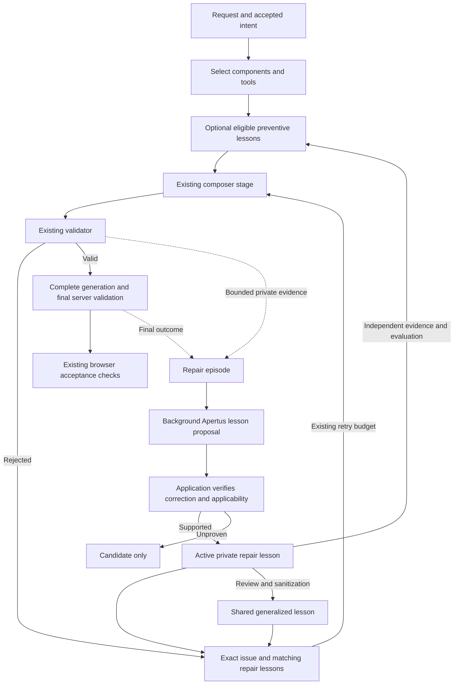

# Composer repair memory

Date: 2026-10-13  
Status: initial implementation and focused verification complete; deployment activation and live quality evaluation pending.  
Scope: learn reusable, scoped corrections from composer validation failures without adding another planner or retry loop.

Implementation: [033 — Composer repair memory](../implementation/033-COMPOSER-REPAIR-MEMORY.md).  
Existing architecture: [Simulation creation and editing pipeline](SIMULATION_GENERATION_AND_EDITING_PIPELINE.md).

## 1. Purpose

When Apertus produces an invalid composition or edit, the application already rejects it and supplies feedback for a bounded retry. This feature preserves useful evidence from those attempts, extracts supported corrections, and retrieves applicable lessons for later requests.

The intended outcomes are fewer repeated mistakes, more successful repairs, and eventually better first attempts. These are outcomes to measure, not assumed benefits of adding a vector database.

Here, a **memory lesson** means reusable guidance for the composer. It is distinct from the learner-facing simulation lesson stored in a recipe. Memory changes inference context; it does not train model weights.

## 2. Agreed decisions

| Decision | Required behavior |
| --- | --- |
| PostgreSQL + pgvector from the start | Store repair evidence and memory lessons in PostgreSQL. Existing accounts, projects, libraries, and agent runs remain in MongoDB. |
| Automatic private activation | Automatically activate supported lessons after a verified correction and successful final server validation. Apertus cannot approve its own explanation. |
| Reviewed sharing | Evidence stays private. A generalized lesson becomes shared only after explicit review and sanitization. |
| Both retrieval points | Begin with retrieval after rejection. Enable preventive retrieval before the relevant composer stage after independent evidence and evaluation support it. |
| Existing pipeline ownership | Keep validators deterministic and reuse existing transport, repair limits, transactions, and final-result checks. |

The last two rows describe the agreed architectural direction and staged rollout. They do not defer PostgreSQL or replace automatic private activation with mandatory human review.

## 3. User experience

For ordinary generation and editing, the user continues using the same prompt, progress, result, and error flows. The application can repair a familiar failure more effectively without asking the user to manage memories or approve each private correction.

Memory is advisory. It cannot change the user's goal, introduce tools or targets outside the accepted plan, remove requested behavior, bypass validation, or spend additional composition retries.

An unavailable memory database or embedding service causes generation to continue with existing feedback. A failed validator still rejects the result. The feature must not make memory availability a prerequisite for creating or editing an experiment.

The initial durable private scope is the verified account. Guests continue using the existing repair loop and may receive reviewed shared lessons, but their requests do not create persistent private evidence until a trustworthy guest identity and retention policy are deliberately added. Offline deployments skip this feature in the first release. These are proposed implementation defaults, not claims that guest or offline memory already exists.

No new learner controls or memory dashboard are required. The project-wide [simplicity requirements](../implementation/IMPORTANT.md) apply to any later interface.

## 4. The feedback loop

Final server validation is not evidence of browser activation, user satisfaction, or scientific correctness. Browser session/revision checks remain authoritative for acceptance. Record the strongest outcome actually observed rather than calling every valid server response a successful user experience.

## 5. What the system remembers

| Record | Source | Purpose |
| --- | --- | --- |
| Validation issue | Application | Stable code, stage, path, expected contract, and actionable repair hint. |
| Repair episode | Application | Connect rejected attempts, their corrections, the relevant context, and the final outcome. |
| Memory lesson | Deterministic evidence plus an Apertus proposal where useful | Concise applicability, mistake to avoid, supported correction, and evidence references. |

A lesson contains enough scope to avoid inappropriate reuse: stage, supported operation/component, compatible contract version, and any verified applicability conditions. Its wording describes a general action rather than copying transient argument IDs, user values, or a complete prior answer.

Example:

> Applies when: an accepted edit requests a relative change to a current configuration value.  
> Avoid: calculating from the registered default.  
> Do: calculate from the current value supplied for the accepted field.  
> Evidence: the rejected and corrected attempts, plus the checks that verify the calculation and preserved scope.

This is an example of lesson shape, not a production prompt constant or evidence that this category is already automatically verifiable. If the application cannot check the claimed relationship, the lesson stays a candidate.

## 6. Deterministic feedback and generated lessons

Straightforward errors already have authoritative corrections. Unknown fields, invalid enum values, and missing required keys should receive feedback derived from the current contract. Do not ask Apertus to rediscover every schema rule or persist a lesson for every typo.

Apertus is useful when the correction needs a concise contextual explanation. Give it a bounded evidence package containing the relevant failure, corrected output, and application-established facts. It proposes structured guidance. The application owns identity, scope, verification status, and activation.

Automatic private activation requires all of the following:

1. The original issue is identified and its correction is supported by recorded evidence.
2. The corrected stage passes its schema and semantic checks under the same accepted request and contract.
3. The final generation passes the existing server checks; a successful intermediate stage followed by final failure is insufficient.
4. The lesson describes a correction category and applicability conditions that the application can verify.
5. Verification did not relax constraints, substitute another request, or drop requested behavior to obtain a pass.
6. The lesson has a valid scope, bounded content, and inspectable proof summary.

Unknown errors, unresolved failures, and unsupported claims remain evidence or candidates. Provider outages, credentials, rate limits, timeouts, and cancellations do not become composition advice.

An active private repair lesson can be tried after the same kind of failure. Eligibility for preventive retrieval is a separate, stronger decision. A single corrected example must not become broad advice injected into every similar-looking prompt.

## 7. Retrieval behavior

| Point | Available context | Retrieval policy |
| --- | --- | --- |
| After rejection | Selected stage/tool/component, compatible contract, exact issue, relevant current state | Prefer matching issue families and verified applicability; use semantic similarity to rank suitable lessons. |
| Before composition | Accepted intent and selected stage/tool/component | Retrieve only preventive-eligible lessons after selection, not a global collection of prompt-similar failures. |

Authorization and applicability are filters, not ranking preferences. Vector similarity cannot make a private lesson accessible to another account or make an incompatible lesson valid.

Start with at most two lessons in any one inference call and a small combined context budget. An empty result is correct when nothing clearly applies. Current contract and exact feedback take precedence over remembered advice. Repeated retries must not accumulate an expanding transcript of lessons.

Use exact filtered vector search initially. Approximate indexes, reranking models, and a separate retrieval agent require measured need. pgvector supports exact search without an approximate index. [pgvector documentation](https://github.com/pgvector/pgvector#querying)

## 8. Duplicate handling

Repeated occurrences are useful evidence; duplicate reusable lessons are noise.

Group failures using a deterministic fingerprint of stable stage, issue code, tool/component, compatible contract, and normalized semantic field path. Exclude timestamps, request IDs, generated node IDs, and complete prompt text. Normalize incidental array indices without collapsing distinct domain fields or roles.

A failure family can have several causes. Therefore a lesson identity also includes its verified applicability and correction. Equivalent corrections update the existing lesson's evidence; different corrections remain separate. Reprocessing the same episode cannot increase its support count.

Generated wording is not an identity. Two paraphrases of the same supported correction should converge on the same application-derived key. Similar vectors alone are insufficient grounds to merge records.

## 9. Private evidence and shared guidance

Private reads and writes use identity derived from the server's verified session. A caller-supplied account ID, request ID, or recipe session ID is never authorization.

Shared promotion creates a separate sanitized lesson. It does not make the private evidence record public. The reviewer confirms the general rule, supported scope, safe examples, and absence of private names, values, prompt text, or imported content. Editing approved shared guidance requires renewed review of the changed content.

Historical text is untrusted data. Retrieved advice cannot introduce executable code, change policies, request credentials, or expand the available tools. Raw diagnostic logs and provider responses are not injected into unrelated users' requests.

## 10. Success measures and release conditions

Compare the same representative requests and starting states with:

1. Existing repair behavior.
2. Improved structured feedback alone.
3. Structured feedback plus repair memory.
4. Repair memory plus eligible preventive retrieval.

Measure first-pass validity, final validated correctness, repeated issue rate, inference calls/tokens, and latency. Track which lessons were injected, but do not count a successful request as proof that a retrieved lesson caused success.

Include negative examples where similar wording should not retrieve the same lesson. Keep evaluation requests separate from the evidence used to generate the tested lessons. Use the existing test entry point and real application flow for live checks; do not create a new benchmark platform.

Release requires account isolation, idempotent ingestion, retirement of incompatible guidance, bounded retrieval, graceful memory outages, and preserved request/transaction/retry behavior. A successful database integration alone does not establish improvement.

## 11. Deliberately outside the first release

- Model fine-tuning, a new agent framework, or another retry coordinator.
- Moving existing MongoDB application data into PostgreSQL.
- Unlimited logs, complete conversation archives, or storing every failure as a lesson.
- Automatic global sharing or unsupported self-assigned confidence scores.
- An administrative dashboard, generic rule language, distributed job platform, or speculative vector indexes.
- Durable guest memory, offline synchronization, or claims of scientific correctness beyond existing checks.

The initial implementation covers evidence capture, PostgreSQL persistence, Apertus selection of verified correction patterns, scoped vector retrieval, and operational review/lifecycle commands. Its automatic verifier currently supports argument envelopes and numeric strings corrected to the same JSON number. Unsupported semantic claims remain private evidence; they are not active lessons. Trusted guidance is rendered from verified facts rather than arbitrary generated prose.

Memory defaults to off. See the [operations runbook](../../../deploy/repair-memory/README.md) for database roles, the required 384-dimensional embedding endpoint, processing, review, and activation. Production endpoint/credentials and live quality evaluation remain pending; this status does not claim that the feature is already learning from deployed traffic.
