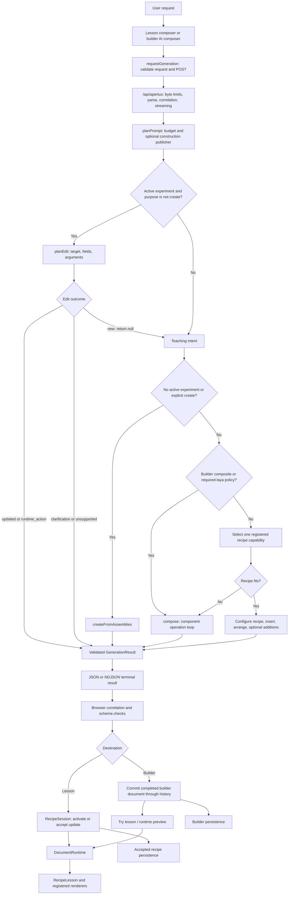
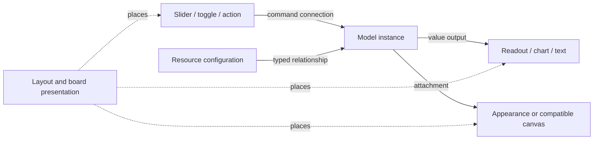
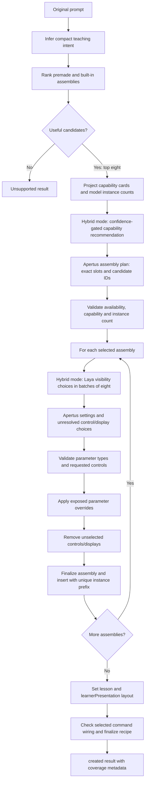
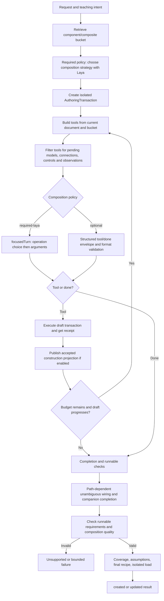
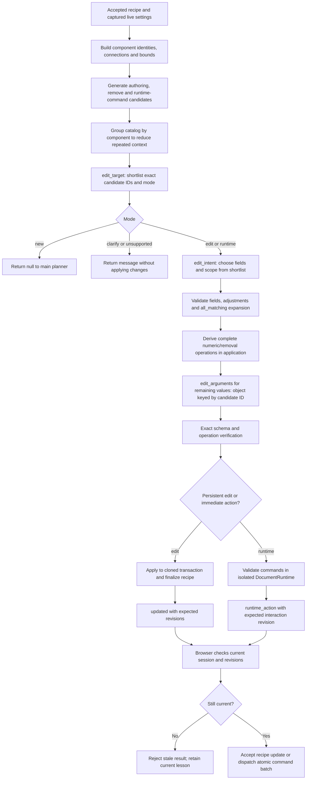
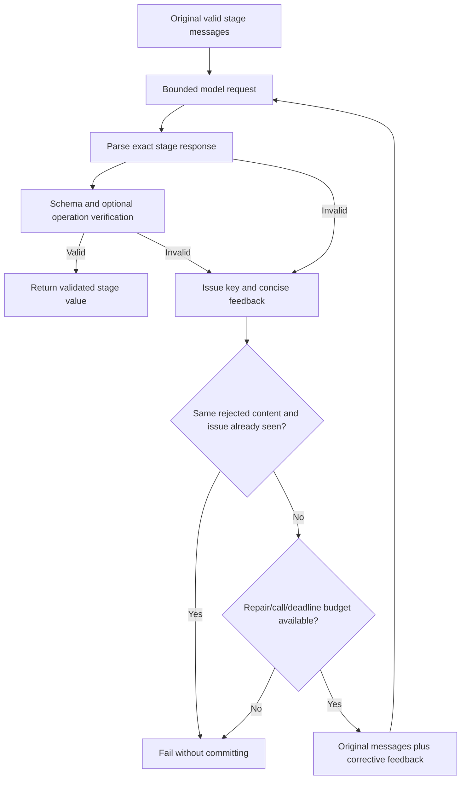
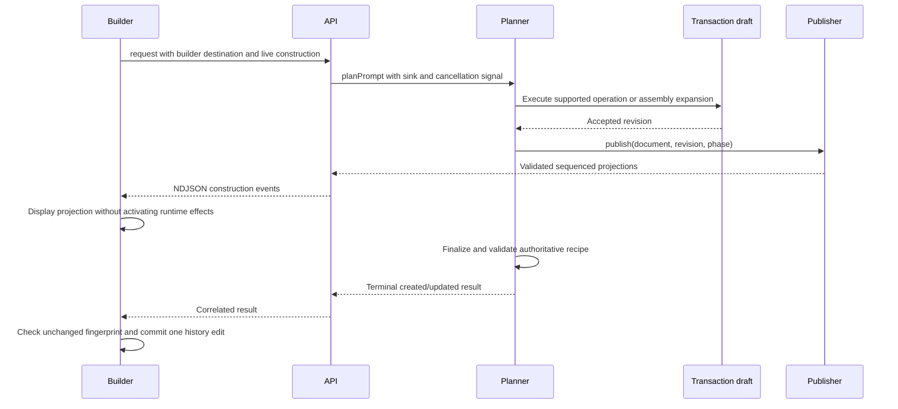
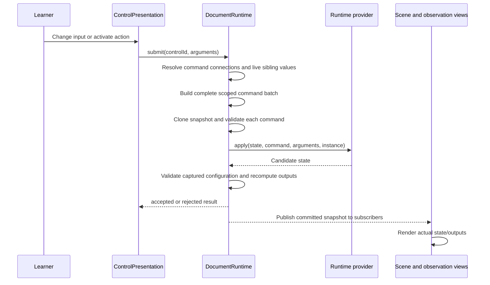

# Simulation generation and editing: current implementation

Implementation snapshot: October 13, 2026, including the uncommitted 030 infrastructure changes. This document describes the code that exists in the working tree, not a proposed architecture or a claim that every path works reliably.

The application turns a request into a **recipe**: a data document containing component instances, connections, settings and presentation. The browser runs that document through the existing component runtime. Inference chooses supported capabilities and produces structured settings or operations; it does not generate a new JavaScript simulation engine for each request.

Fresh creation currently selects and configures existing assemblies. A separate component-by-component composition loop also exists, but it is not an automatic fallback for every failed fresh creation. Follow-up edits have their own target, field and argument planning stages.

Related documents: [manual builder processes](MANUAL_BUILDER_PROCESSES.md), [manual builder domain composition](MANUAL_BUILDER_DOMAIN_COMPOSITION.md), [030 implementation plan](../implementation/030-APERTUS-CREATION-AND-FOLLOW-UP-LOOP.md), and [latest browser evidence](../implementation/030-validation/README.md).

## 1. System map



Important routing details:

- `planEdit` runs before new teaching intent when the request is not explicitly `purpose: "create"`.
- If it returns an edit, runtime action, clarification or unsupported result, that is the terminal planner outcome.
- If it classifies the request as `new`, it returns `null`; the planner then performs teaching-intent interpretation.
- A fresh or explicit creation directly calls `createFromAssemblies`. Failure there does not automatically call `compose`.
- After a `new` classification in an active session, a builder composite or `required-laya` policy bypasses the older single-recipe selector and uses `compose`.
- The older recipe selection/configuration branch remains implemented for other active-session routing conditions. It should not be confused with the current fresh-creation path.

Owners: [planner/index.ts](../../../src/web/src/lib/planner/index.ts), [assemblyCreation.ts](../../../src/web/src/lib/planner/assemblyCreation.ts), [edit.ts](../../../src/web/src/lib/planner/edit.ts), [compose.ts](../../../src/web/src/lib/planner/compose.ts).

## 2. The data model: definition → instance → document → recipe

| Concept | What it contains | Owner |
| --- | --- | --- |
| Public definition | Versioned capability contract, configuration schema/defaults, inputs, outputs, commands, lifecycle and teaching metadata | `PublicDefinition` in `runtime/authoring/types.ts`; registration in `components/catalog/index.ts` |
| Component instance | Stable instance ID, definition ID/version, label, scope and configuration | `ComponentInstance` |
| Connection | Source/destination endpoints, relationship kind, optional fixed command arguments and output-based argument bindings | `Connection` |
| Authored document | Nodes, resources, connections, scopes, groups, lesson text, layout, editor positions and optional board presentation | `AuthoredDocument`, format version 3 |
| Composite recipe | Document plus recipe identity/version, dependencies, parameters, external ports, assumptions and optional catalog/discovery metadata | `CompositeRecipe` |
| Runtime snapshot | Per-instance mutable state and calculated outputs | `DocumentRuntime`'s `Snapshot` |
| Session | Active recipe/runtime, session identity, authored/interaction revisions, request identity, undo/redo | `RecipeSession` |

The public contract is data. Executable behavior belongs to runtime providers. Rendering belongs to registered views. This separation lets the same authored recipe be generated, edited manually, saved, reopened and rendered without asking inference to recreate its physics or mathematics.

### 2.1 Component categories

The public catalog includes `models`, `controls`, `displays`, `canvases`, `appearance`, `behaviors`, `resources` and `layout`. A supported component declares configuration and typed ports; a model may also declare commands such as a setter, reset or playback action.

`Port.kind` has a wider vocabulary than authored connection kinds: value, dataset, grid, event, command, attachment and layout. Actual `Connection.kind` is `value`, `command` or `attachment`. The validator checks compatibility; matching a string name alone is insufficient.

Typical relationships:



### 2.2 Catalogs and assemblies

- [components/catalog/index.ts](../../../src/web/src/simulations/components/catalog/index.ts) registers data-only public definitions and adapts existing object definitions into the public contract.
- [components/registry.ts](../../../src/web/src/simulations/components/registry.ts) owns existing object implementations and contracts used by those adapters.
- [components/composites/catalog.ts](../../../src/web/src/simulations/components/composites/catalog.ts) supplies built-in component assemblies, `modelRecipe`, schema defaults and learning-configuration capture.
- [runtime/recipes/registry.ts](../../../src/web/src/simulations/runtime/recipes/registry.ts) resolves premade recipes from the generated registry. It parses each returned recipe rather than returning mutable shared runtime state.
- [simulations/pre-made/](../../../src/web/src/simulations/pre-made/) contains the authored premade recipe sources.
- [scripts/recipes/generate-registry.cjs](../../../src/web/scripts/recipes/generate-registry.cjs) generates the premade registry; it is not a per-request inference step.

Current recipe version 2 represents an expanded document: nested recipe references must be resolved. Dependencies identify the component definition versions used. Exposed parameters map named recipe settings to real component configuration fields. Groups can retain source identity and reusable boundaries after insertion.

Owners: [types.ts](../../../src/web/src/simulations/runtime/authoring/types.ts), [parameterSchema.ts](../../../src/web/src/simulations/runtime/parameterSchema.ts), [recipes.ts](../../../src/web/src/simulations/runtime/authoring/recipes.ts), [recipe schema](../../../src/web/src/simulations/runtime/recipes/schema.ts).

## 3. Browser request and API boundary

### 3.1 Lesson composer

[ExperimentsShell.tsx](../../../src/web/src/app/experiments/_components/ExperimentsShell.tsx) creates a `GenerationRequest` with:

```text
protocolVersion: 1
requestId: a fresh browser UUID
prompt: user text
purpose: create or edit
viewport: current width and height
active: null, or the active session's captured request context
clarification: optional original prompt and pending question
```

It cancels a previous owned request before starting another. A request owner object prevents late callbacks from an old request changing current UI state. Clarification context is tied to the current session.

### 3.2 Builder composer

[useBuilderAi.ts](../../../src/web/src/simulations/builder/composition/useBuilderAi.ts) uses the same browser transport, with `destination: "builder"` and `construction: "live"`. It assigns a `builder-…` session ID and tracks an authored-document fingerprint/revision. Existing nonempty content means edit; an empty workspace means create.

The builder locks relevant authoring while generation is active, displays construction projections separately, and checks the document fingerprint again before accepting a result. It applies a completed result as one history edit. A `runtime_action` result is not executed in the builder; the UI directs the learner to Try lesson.

### 3.3 HTTP and stream validation

[requestGeneration](../../../src/web/src/lib/planner/browser.ts) parses the request before POSTing to `/api/apertus`. Progress or construction callbacks request `application/x-ndjson`; otherwise the endpoint supports a normal JSON response.

[route.ts](../../../src/web/src/app/api/apertus/route.ts) bounds incoming bytes, decodes UTF-8/JSON, validates the request, preserves a valid caller request ID even for validation errors, and starts diagnostics. Responses include `X-Request-ID` and disable caching.

The browser validates:

1. HTTP correlation header matches the request ID.
2. Every stream event has the same request ID.
3. Progress stages and construction documents have valid shapes.
4. Construction sequence increases exactly by one and draft revision never decreases.
5. No event follows the terminal result.
6. The stream actually contains a terminal result.
7. The final result matches the request and its result schema.

Construction events are accepted only for a live builder request with a construction callback. The stream is not a stream of freely executable model tokens: it contains application-owned progress, validated draft projections and a terminal structured result.

Owners: [schema.ts](../../../src/web/src/lib/planner/schema.ts), [eventStream.ts](../../../src/web/src/lib/planner/eventStream.ts), [construction.ts](../../../src/web/src/lib/planner/construction.ts), [progress.ts](../../../src/web/src/lib/planner/progress.ts).

## 4. Fresh creation: selection and expansion of assemblies



### 4.1 Teaching intent

The `teaching_intent` stage extracts a goal, concepts, interactions, observations, explicit constraints, single/comparison structure, requested independent instance count and optional learning question. The model returns source IDs for constraints; the application attaches the original source text. Intent describes the request, not a proof that a capability exists.

Owners: [planner/index.ts](../../../src/web/src/lib/planner/index.ts), [schema.ts](../../../src/web/src/lib/planner/schema.ts), [context.ts](../../../src/web/src/lib/planner/context.ts).

### 4.2 Candidate retrieval

`createFromAssemblies` combines premade and built-in recipes, inspects their model nodes and public definitions, and scores terms from the request and intent against titles, tags, descriptions and capability names. Less-common terms receive greater weight. It keeps the highest-ranked eight useful assemblies.

It derives `requiredCapabilities` from adjustable numeric-field vocabulary and the inferred interaction wording. This is an implemented heuristic; it is not a general semantic proof of the requested learning outcome.

A candidate card contains activity identity, descriptions, model summaries, command descriptions, observations and limitations. Homogeneous multi-model assemblies expose their model count as `instanceCount`; mixed-model assemblies count as one activity instance for this selection contract.

### 4.3 Capability selection and independent instances

In hybrid mode, [selectCapability.ts](../../../src/web/src/lib/planner/selection/selectCapability.ts) asks the configured decision provider for a capability choice. [questions.ts](../../../src/web/src/lib/planner/selection/questions.ts) supplies teaching concepts, actions and observations. [acceptance.ts](../../../src/web/src/lib/planner/selection/acceptance.ts) validates choice membership, probability distribution and configured gates.

The assembly planner treats the recommendation as advisory. Apertus selects exact `experiment1`, `experiment2`, etc. slots. `covered` represents a slot already supplied by a multi-instance assembly; `unavailable` indicates unsupported core behavior. Application checks reject a plan that creates the wrong number of independent instances or lacks required capabilities.

The application derives the title from the learning question/goal and limits it to 100 Unicode code points; it retains the full instruction separately.

### 4.4 Visibility and initial configuration

For each selected assembly, the planner projects:

- Control cards from actual wired model command endpoints and their descriptions.
- Observation cards from actual display nodes and the contracts of their bound output sources, including resource sources.
- Exposed parameter schemas and the source document's authored starting values.

The current uncommitted visibility stage asks Laya include/omit questions in batches of eight. Accepted choices are stored in application memory; rejected/unavailable choices are left for Apertus. This uses the configured decision gates and adds bounded decision calls for the actual card count.

Apertus then returns three objects: `overrides`, `controls` and `observations`. Overrides contain actual parameter values. Controls/observations are boolean maps for unresolved IDs. The application validates the wire shape, combines it with accepted visibility decisions, and translates chosen controls into real command endpoints.

This is the stage that currently fails on some requests: the model mixes boolean visibility values with numeric parameter overrides. Validation rejects those responses. The flow diagram shows intended execution order, not guaranteed inference fidelity.

### 4.5 Materialization and presentation

The planner applies parameter overrides before pruning, so parameter targets still exist during application. It removes unselected controls/displays through `removeNodes`, which also reconciles references. Playback controls associated with a clocked target receive special preservation handling in pruning.

Each selected assembly is finalized, expanded and inserted with a unique prefix such as `activity_1/`. Insertion remaps IDs and references so independent copies do not share model identity. Selected command endpoints are remembered and checked again after layout.

[learnerPresentation.ts](../../../src/web/src/lib/planner/learnerPresentation.ts) consolidates compatible object canvases and lays out scenes, companion controls and displays. It gives measurements full width. In the current version it does not perform a second lexical observation-selection pass; it lays out the accepted selection.

The final recipe contains registered component dependencies, actual connections, lesson text and assumptions. Assembly coverage is marked full unless the plan lists omissions. That coverage field must not be interpreted as a measured visual/teaching pass.

Owners: [assemblyCreation.ts](../../../src/web/src/lib/planner/assemblyCreation.ts), [authoring/recipes.ts](../../../src/web/src/simulations/runtime/authoring/recipes.ts), [learnerPresentation.ts](../../../src/web/src/lib/planner/learnerPresentation.ts), [operations.ts](../../../src/web/src/simulations/runtime/authoring/operations.ts).

## 5. Component-by-component composition: the separate open path

[compose.ts](../../../src/web/src/lib/planner/compose.ts) builds a draft through bounded authoring turns. It can begin with an existing document or a fresh document. `replaceTopic` and explicit start-over wording determine whether it preserves the active document.



The bucket comes from [bucket.ts](../../../src/web/src/lib/planner/bucket.ts). It projects public component cards and registered composite cards, and keeps relevant active definitions available. Existing discovery/ranking code includes domain keyword associations and teaching requirements; this path is not purely a model-driven semantic search.

Each turn builds tools from the current accepted draft, then focuses them on outstanding work. A tool is selected from known capabilities, not invented by inference. The required-Laya path uses [focusedTurn.ts](../../../src/web/src/lib/planner/focusedTurn.ts) to separate operation choice from argument generation; [compositionStrategy.ts](../../../src/web/src/lib/planner/selection/compositionStrategy.ts) chooses the supported structure/definition strategy.

Repeated identical payloads, stalled revisions, premature completion and budget exhaustion are checked. The loop publishes only accepted draft states. Completion uses [runnable.ts](../../../src/web/src/simulations/runtime/authoring/runnable.ts), [compositionQuality.ts](../../../src/web/src/lib/planner/compositionQuality.ts), coverage calculation, recipe finalization and an isolated `loadRecipe` check.

There are path-dependent automatic completions for wiring, appearances, controls and observations. They are existing application behavior, not additional inference-generated operations in every path. Read the policy branches in `compose.ts` before assuming the same completion behavior under optional and required-Laya modes.

## 6. Follow-up editing: capture → select → validate → commit

### 6.1 Capture the actual active context

`RecipeSession.requestContext()` provides session ID, authored revision, interaction revision, captured recipe and compact runtime state. The current implementation builds the request recipe from `runtime.capture()`, allowing accepted learner settings to become edit starting values without copying animation checkpoints into authoring.

Runtime capture is provider-owned. Math learning models use `learningConfiguration`; other providers have their own capture rules. Compact runtime context excludes large token/joint/member/response arrays and bounds nesting/array size. It gives inference useful state without dumping the entire animated world.

Owner: [recipeSession.ts](../../../src/web/src/simulations/runtime/recipeSession.ts), [providers.ts](../../../src/web/src/simulations/runtime/authoring/providers.ts), [composites/catalog.ts](../../../src/web/src/simulations/components/composites/catalog.ts).

### 6.2 Editing flow



### 6.3 Candidate ownership

[buildTurnTools](../../../src/web/src/lib/planner/turnSchema.ts) derives available authoring operations from real definitions, current nodes, recipe catalog and presentation. `planEdit` adds removal candidates and runtime command candidates. Candidate metadata includes visible name, category, definition, editable fields and, where relevant, live configuration or current presentation bounds.

`editableFields` projects leaf configuration fields rather than offering a parent object and all its children as overlapping decisions. Nested edits are converted back into complete top-level configuration records by `configurationPatch`, preserving untouched siblings.

The shared `hasBoundControl` rule is used both when offering add-control candidates and when accepting an add-control operation. It recognizes explicit parameter paths, inferred single scalar leaves, empty-payload buttons and existing compound activity controls.

Owners: [edit.ts](../../../src/web/src/lib/planner/edit.ts), [editFields.ts](../../../src/web/src/lib/planner/editFields.ts), [turnSchema.ts](../../../src/web/src/lib/planner/turnSchema.ts), [bindings.ts](../../../src/web/src/simulations/runtime/authoring/bindings.ts).

### 6.4 Three inference stages and their current wire shapes

| Stage | Model response | Application responsibility |
| --- | --- | --- |
| `edit_target` | `mode`, distinct candidate ID strings, optional message | Validate routing and narrow later candidate choices |
| `edit_intent` | `mode`, `selections` object keyed by candidate ID, optional root adjustments/message | Validate field strings, scope, numeric operations and overlap; expand equivalent instances when explicitly selected |
| `edit_arguments` | Closed object keyed by accepted candidate ID, each value containing that operation's arguments | Validate exact keys/types and build internal operations |

Selection values contain `scope` and `fields`. Fields are strings from the candidate's real editable leaves. Numeric adjustments live in a separate root array with candidate, field, `set`/`scale`/`offset` operation and numeric operand. Application code computes relative values from current accepted settings or presentation bounds.

Complete numeric changes can be derived without another argument call. Removal arguments can also be derived from selected IDs. Remaining values are inferred against operation-specific schemas. The internal operation representation remains separate from the model's wire representation.

The shortlist can discard extra candidates in the field stage, but cannot recover an excluded target there. This explains the observed angle-removal failure: the target stage selected the model; later stages were restricted to that model, and validation rejected its removal.

### 6.5 Persistent configuration versus immediate action

- `edit` changes authored configuration or structure and returns a new recipe.
- `runtime` returns a scoped command batch to operate the current runtime immediately.
- The planner forbids mixing these candidate modes in one accepted edit plan.
- Runtime commands are checked against an isolated runtime before returning; the real browser runtime still validates them when dispatching.
- The lesson browser accepts a persistent update only when session and expected revisions still match.
- The builder edits authored content and declines to execute runtime actions.

### 6.6 Resize semantics

`resize` is an authoring operation on an unlocked board component. It changes presentation width/height, not model quantities. Validation enforces actual component minima, bounded dimensions, aspect-ratio handling and a real size change. Nearby content may move to remain reachable; moving locked peers is rejected. The board start extent is recomputed.

The edit planner exposes width/height from the actual presentation item, derives numeric adjustments where supplied, and otherwise asks the argument stage for selected dimensions. Unselected dimensions come from existing bounds.

These are implementation capabilities. Latest live evidence does not yet prove successful triangle enlargement or preservation after reopening.

Owners: [operations.ts](../../../src/web/src/simulations/runtime/authoring/operations.ts), [board.ts](../../../src/web/src/simulations/runtime/authoring/board.ts), [edit.ts](../../../src/web/src/lib/planner/edit.ts).

## 7. Shared authoring execution and validation

The authoring operation family is:

| Operation | Meaning |
| --- | --- |
| `insert_recipe` | Expand a known recipe with validated overrides and remapped identity |
| `insert_component` | Add a registered component instance |
| `configure` | Patch accepted configuration fields |
| `connect` | Add a compatible typed relationship |
| `add_control` | Create and bind a learner input/action |
| `add_observation` | Create a display bound to an actual output |
| `regenerate_truss` | Existing specialized supported structural regeneration |
| `remove` | Remove nodes and reconcile dependent references |
| `arrange` | Apply a supported layout arrangement |
| `resize` | Change board component presentation dimensions |
| `set_lesson` | Set supported lesson metadata |

[AuthoringTransaction](../../../src/web/src/simulations/runtime/authoring/transaction.ts) owns an isolated draft, handles, draft revision, operation count and bounded receipt history. Envelopes carry draft ID, expected revision, operation ID and one operation or a bounded batch.

Execution checks envelope identity and limits, rejects stale revisions, and handles repeated operation IDs idempotently only when payloads match. It clones state, applies the operations to the clone and accepts the batch only if execution succeeds. An exception produces a rejected receipt without accepting partial staged changes.

[applyAuthoringOperation](../../../src/web/src/simulations/runtime/authoring/operations.ts) resolves handles and delegates to the real owner: recipe insertion, bindings, connection validation, arrangement, resize or structural regeneration. [validate.ts](../../../src/web/src/simulations/runtime/authoring/validate.ts) checks authored data and reference/contract invariants. `finalizeRecipe` produces the current expanded recipe, dependencies and metadata; recipe parsing validates it again.

Draft validation, final runnable checks and browser interaction checks answer different questions. A valid incomplete draft can be shown in the builder without being a runnable lesson. A valid finalized recipe can still be confusing or semantically wrong for the user's request.

## 8. Inference transport, decisions and bounded repair

### 8.1 Generative model versus decision provider

| Layer | Role | Files |
| --- | --- | --- |
| Generative model | Intent, assembly selection/configuration, edit planning/arguments, composition operations | `lib/apertus/transport.ts`, `lib/llm/config.ts`, `lib/llm/adapters.ts` |
| Decision provider | Probability-bearing choices used for capability, composition strategy and current visibility classification | `lib/decisions/`, `planner/selection/` |
| Application | IDs, envelopes, budgets, schema checks, transaction execution and state activation | Planner and authoring runtime |
| Local inference services | Serving configured Apertus and Laya models | `src/inference/serve_apertus.py`, `src/inference/laya/` |

The naming `lib/apertus/transport.ts` does not mean every request necessarily uses Apertus: it resolves shared LLM configuration and provider adapters. Actual provider/model evidence comes from diagnostics.

### 8.2 Structured output is checked, not assumed

`requestStructured` freezes the request's model configuration through its budget, creates a provider request, bounds response bytes/text and parses the result using the caller's schema/validator. Optional `verify` callbacks exercise candidate operations before a response is accepted.

In Apertus `auto` structured-output mode, a cached probe intentionally conflicts with an object/enum/optional/union schema. Only observed compliance enables constrained requests for that provider URL/model cache key. Merely returning HTTP 200 or ordinary JSON does not prove enforcement.

The latest browser runs reported `constrained: false`. Therefore the current schema vocabulary was being validated after generation, not reliably enforced during model decoding.

### 8.3 Repair loop



Repairs do not replay the rejected response as an assistant turn. They retain the original task and attach bounded error feedback. A set of rejected issue/content pairs detects repeats, including cycles. Editing can track repairs per issue while remaining bounded by its overall budget.

`formatFixer.ts` also remains in older/general composition paths for bounded format/reference normalization. It is not the same as the strict latest edit wire parser. Do not infer that every path has identical normalization rules.

One current inconsistency: `edit_arguments` uses a candidate-keyed object, but its repair metadata still declares `response_keys: ["operations"]`. This stale metadata should not be treated as the authoritative current wire format. Documentation records it; no correction is made here.

Owners: [transport.ts](../../../src/web/src/lib/apertus/transport.ts), [structuredSchema.ts](../../../src/web/src/lib/apertus/structuredSchema.ts), [argumentJson.ts](../../../src/web/src/lib/planner/argumentJson.ts), [formatFixer.ts](../../../src/web/src/lib/planner/formatFixer.ts), [edit.ts](../../../src/web/src/lib/planner/edit.ts).

### 8.4 Current limits and policy

| Boundary | Current implementation |
| --- | --- |
| Generation request body | 1,100,000 bytes |
| Inference stage messages | 28,000 serialized characters |
| Provider response body | 128,000 bytes |
| Accepted inference content | Nonempty, at most 16,000 characters |
| Stream frame | 2,200,000 bytes |
| Total stream | 64,000,000 bytes |
| Construction events | 256 |
| Planner concurrency | Process-local counter; default 1, configurable up to 16 |
| General generation budget | Initially 6 calls, 3 repairs, 10 turns |
| Composition budget | 14 calls/10 turns, or 28 calls/24 turns for required-Laya policy |
| Edit budget | Temporarily raised to at least 12 calls and 10 repairs |
| Planner deadline | Default 120 seconds; 240 seconds for required-Laya policy; configurable within validated bounds |
| Decision calls | Initially one; assembly visibility extends allowance from actual batches |

These are distinct limits. A configured token count does not remove byte/context bounds; a larger repair allowance does not bypass the deadline. Counters are in-process safeguards, not distributed admission control across multiple server processes.

Owners: [budget.ts](../../../src/web/src/lib/planner/budget.ts), [compositionPolicy.ts](../../../src/web/src/lib/planner/compositionPolicy.ts), [decision policy](../../../src/web/src/lib/planner/selection/policy.ts), [LLM config](../../../src/web/src/lib/llm/config.ts).

## 9. Builder construction previews and final commit

Live construction is currently enabled by `planPrompt` only for live builder requests that are explicit creations or have no existing nodes. Not every edit streams construction previews.

[ConstructionPublisher](../../../src/web/src/lib/planner/constructionPublisher.ts) projects accepted draft documents without mutating the transaction. An atomic assembly insertion can be displayed as multiple safe component additions. It removes references to not-yet-visible nodes, uses an empty lesson layout and flow presentation for incomplete projections, and later reveals connections and arrangement.



[ConstructionBoardPreview.tsx](../../../src/web/src/simulations/builder/composition/ConstructionBoardPreview.tsx) is presentation only; it does not initialize a runtime, run effects or create editable bindings. [constructionPreview.ts](../../../src/web/src/simulations/builder/composition/constructionPreview.ts) and [CompositionGraph.tsx](../../../src/web/src/simulations/builder/composition/CompositionGraph.tsx) display the graph/projection. Final graph positions are copied into the authoritative final document by publisher finalization.

## 10. Browser activation, stale-result protection and history

For a `created` result, `acceptGenerationResult` constructs a candidate `RecipeSession` before disposing the previous session. Parsing/loading failures therefore happen before replacing the active lesson. The candidate owns a new `DocumentRuntime` and starts only after activation.

For an `updated` result, `RecipeSession.acceptUpdate` checks expected session ID, authored revision and optional interaction revision. It loads the candidate before changing the active runtime, updates the document, saves a bounded history checkpoint, clears redo and increments authored revision. Identical documents avoid a new authored edit.

For a `runtime_action`, activation checks current session/interaction identity and the request's authored revision, then dispatches the real command batch. The runtime can still reject invalid arguments. Successful learner interactions increment interaction revision independently of authored edits; ordinary animation stepping is a separate runtime concern.

Session undo/redo uses recipe checkpoints and `runtime.updateDocument`. The history is bounded to 20 entries on normal update insertion. Builder undo/redo belongs to [useDocumentHistory.ts](../../../src/web/src/simulations/builder/history/useDocumentHistory.ts), not the lesson session's history stack.

Owner: [recipeSession.ts](../../../src/web/src/simulations/runtime/recipeSession.ts), [loadRecipe.ts](../../../src/web/src/simulations/runtime/recipes/loadRecipe.ts), [ExperimentsShell.tsx](../../../src/web/src/app/experiments/_components/ExperimentsShell.tsx).

## 11. Runtime execution: controls become model commands



`DocumentRuntime` initializes model/resource state through [providers.ts](../../../src/web/src/simulations/runtime/authoring/providers.ts), then calculates outputs. `updateDocument` compares definition, scope and authored configuration excluding presentation fields; unchanged models preserve state, while changed models use provider reinitialization or initialization rules.

`submit` resolves command connections from a control. Scalar controls resolve their bound field and obtain unchanged sibling arguments from current accepted target state. Buttons may use configured initial command arguments. Fixed connection arguments and output-based argument bindings are applied before dispatch.

`dispatch` stages the entire batch on a cloned snapshot, validates supported target commands and argument schemas, applies provider behavior, validates capture where supplied, recomputes observations and commits. Rejection leaves the previous snapshot intact. This is how one shared action can operate several independent model instances atomically.

`step` advances supported clocked models. `reset` restores authored settings through runtime ownership. `capture` produces a validated authored configuration document through provider capture hooks. Renderers consume runtime snapshots; they do not independently initialize or step model instances.

Related contracts: [controlContract.ts](../../../src/web/src/simulations/components/controls/controlContract.ts), [commandPresentation.ts](../../../src/web/src/simulations/components/controls/commandPresentation.ts), [runtime.ts](../../../src/web/src/simulations/runtime/authoring/runtime.ts).

## 12. Rendering: recipe graph and presentation become the lesson

[RecipeLesson.tsx](../../../src/web/src/simulations/components/views/RecipeLesson.tsx) accepts an existing runtime or creates a local one when needed. It subscribes to snapshots, supplies authoring/motion contexts and renders flow or board presentation. A supplied session runtime retains ownership of model stepping and effects.

- [RecipeLayout.tsx](../../../src/web/src/simulations/components/views/recipe/RecipeLayout.tsx): recursive layout, conditional visibility/disabled state and component placement.
- [NodeView.tsx](../../../src/web/src/simulations/components/views/recipe/NodeView.tsx): routes a node to its appropriate presentation.
- [ControlPresentation.tsx](../../../src/web/src/simulations/components/views/recipe/ControlPresentation.tsx): renders controls against the actual target contracts.
- [DisplayPresentation.tsx](../../../src/web/src/simulations/components/views/recipe/DisplayPresentation.tsx): displays bound observations.
- [CanvasPresentation.tsx](../../../src/web/src/simulations/components/views/recipe/CanvasPresentation.tsx) and [RecipeAppearance.tsx](../../../src/web/src/simulations/components/views/recipe/RecipeAppearance.tsx): canvas/appearance routing.
- [SpatialBoard.tsx](../../../src/web/src/simulations/components/views/board/SpatialBoard.tsx): board item rectangles, navigation and presentation interactions.

Editor graph positions and learner board rectangles have different meanings. Moving a graph card does not change physical model values. A board resize does not itself prove the useful drawable geometry became larger; that requires rendered measurement and visual inspection.

Compatibility views and recipe parsing still adapt older representations. They are existing bridges into current runtime/rendering, not a second inference-created simulation engine.

## 13. Persistence and reopening

Accepted lesson results are persisted after activation by [recipePersistence.ts](../../../src/web/src/app/experiments/_lib/recipePersistence.ts). The shell reports save failures separately; acceptance and persistence are distinct operations.

The persistence path serializes the session, converts it to the builder document representation, validates/normalizes the title, avoids local name collisions, and uses the normal `saveEntry` conflict workflow. Writes for the same owner/recipe key are queued. Per-session receipts and expected saved entries support subsequent saves. A session-storage key identifies the last accepted lesson to reopen.

Guests reopen from the browser library; signed-in owners can reopen through the project service. Returned data is serialized back to a recipe-compatible representation and parsed before activation. Builder persistence/history uses its own document workflow while sharing serialization and library/project storage.

Important distinction: `requestContext()` captures live runtime configuration for follow-up inference; ordinary `session.serialize()` serializes the authored session document. Do not assume every transient learner interaction is automatically persisted just because it appears in an edit request.

Owners: [recipePersistence.ts](../../../src/web/src/app/experiments/_lib/recipePersistence.ts), [builder/document/serialization.ts](../../../src/web/src/simulations/builder/document/serialization.ts), [builder/persistence/storage.ts](../../../src/web/src/simulations/builder/persistence/storage.ts), [projects/client.ts](../../../src/web/src/lib/projects/client.ts), [recipes/serializeRecipe.ts](../../../src/web/src/simulations/runtime/recipes/serializeRecipe.ts).

## 14. Diagnostics and current reliability gaps

[diagnostics.ts](../../../src/web/src/lib/planner/diagnostics.ts) records planner stages, budgets, retrieval, actual inference metadata, decision acceptance/rejection, validation and failures. [planner-diagnostics/route.ts](../../../src/web/src/app/api/planner-diagnostics/route.ts) exposes gated diagnostic traces. Progress text is derived from trace events through `progress.ts`; it is not proof that an edit has committed.

The latest closing browser pass is documented in [030-validation/README.md](../implementation/030-validation/README.md). It found:

| Area | Observed result and first failing transition |
| --- | --- |
| Circles creation | Arithmetic selected; visible addition and subtraction produce correct object counts |
| Projectile comparison | Two independent angles change actual ranges; numeric readouts omitted |
| Pendulum | Controls/model work; excessive visibility shrinks and clutters presentation |
| Line | Slope/intercept work; raw and redundant observations remain |
| Ladder, gas, fractions | Correct activities selected; settings/visibility contracts mixed during configuration |
| Angle removal | Target selection chooses the model; final recipe validation rejects removal |
| Seven minus three follow-up | Field planning returns objects instead of field-name strings; repair repeats |
| Triangle enlargement | Blocked by failed latest ladder creation; latest resize/persistence unverified |

Existing tests, TypeScript and a webpack production build passed. Those checks establish useful contract/build evidence, not reliable request interpretation or learner-facing simplicity. Rejected edits preserved prior accepted state in the observed checks. Earlier successful edit replays do not establish that the latest rewritten wire contracts are successful.

No new inference run, test suite or production change was performed to write this document. This snapshot was produced by source inspection and references the already-recorded browser evidence.

## 15. Relevant file structure

This is a focused map, not an exhaustive repository listing. Domain definition/provider/view modules continue beneath the shown directories.

```text
docs/agent-only/
├── features/
│   ├── SIMULATION_GENERATION_AND_EDITING_PIPELINE.md  # This snapshot
│   ├── MANUAL_BUILDER_PROCESSES.md
│   └── MANUAL_BUILDER_DOMAIN_COMPOSITION.md
└── implementation/
    ├── 030-APERTUS-CREATION-AND-FOLLOW-UP-LOOP.md
    └── 030-validation/
        ├── README.md                                # Live evidence ledger
        └── screenshots/                             # Local captures; Git ignored

src/inference/
├── serve_apertus.py                                  # Apertus serving entry point
└── laya/
    ├── app.py                                       # Decision API
    ├── schemas.py                                   # Request/answer models
    ├── config.py                                    # Serving configuration
    └── runtime.py                                   # Decision model runtime

src/web/
├── scripts/recipes/
│   ├── generate-registry.cjs
│   └── verify-contract.cjs                          # Existing recipe/runtime checks
└── src/
    ├── app/
    │   ├── api/apertus/route.ts                      # Generation HTTP boundary
    │   ├── api/planner-diagnostics/route.ts
    │   └── experiments/
    │       ├── _components/ExperimentsShell.tsx       # Lesson composer/activation
    │       ├── _lib/recipePersistence.ts
    │       └── builder/page.tsx
    ├── lib/
    │   ├── planner/
    │   │   ├── index.ts                             # Routing and shared lifecycle
    │   │   ├── schema.ts                            # Request/intent/result contracts
    │   │   ├── browser.ts                           # Correlated browser transport
    │   │   ├── assemblyCreation.ts                  # Current fresh creation
    │   │   ├── learnerPresentation.ts               # Accepted assembly layout
    │   │   ├── edit.ts                              # Follow-up stages
    │   │   ├── editFields.ts                        # Leaf fields and nested patches
    │   │   ├── compose.ts                           # Component authoring loop
    │   │   ├── bucket.ts                            # Component retrieval
    │   │   ├── catalog.ts                           # Recipe capability retrieval
    │   │   ├── focusedTurn.ts                       # Operation/argument split
    │   │   ├── compositionTools.ts                  # Focus current turn tools
    │   │   ├── turnSchema.ts                        # Tools from current contracts
    │   │   ├── stages.ts                            # Older recipe-stage contracts
    │   │   ├── formatFixer.ts                       # Existing normalization paths
    │   │   ├── coverage.ts                          # Coverage accounting
    │   │   ├── constraints.ts                       # Explicit quantity checks
    │   │   ├── compositionQuality.ts                # Composition fidelity checks
    │   │   ├── budget.ts / compositionPolicy.ts
    │   │   ├── constructionPublisher.ts             # Safe draft projections
    │   │   ├── construction.ts / eventStream.ts
    │   │   ├── diagnostics.ts / progress.ts
    │   │   └── selection/
    │   │       ├── selectCapability.ts
    │   │       ├── compositionStrategy.ts
    │   │       └── questions.ts / policy.ts / acceptance.ts
    │   ├── apertus/
    │   │   ├── transport.ts                         # Structured request/repair
    │   │   └── structuredSchema.ts                  # Schema projection
    │   ├── llm/config.ts / adapters.ts              # Generative providers
    │   ├── decisions/                              # Choice providers and HTTP transport
    │   └── projects/                               # Signed-in project persistence
    └── simulations/
        ├── pre-made/                               # Authored recipe sources
        ├── components/
        │   ├── catalog/                            # Public capability definitions
        │   ├── registry.ts                         # Existing object implementations
        │   ├── contracts/                          # Object/action/output contracts
        │   ├── composites/catalog.ts               # Built-in assemblies
        │   ├── controls/                           # Input components and binding contracts
        │   ├── systems/                            # Executable domain behavior
        │   └── views/
        │       ├── RecipeLesson.tsx
        │       ├── recipe/                         # Node/control/display/canvas routing
        │       └── board/SpatialBoard.tsx
        ├── runtime/
        │   ├── recipeSession.ts                     # Active session and revisions
        │   ├── parameterSchema.ts                   # Typed value validation
        │   ├── recipes/
        │   │   ├── registry.ts / premadeRegistry.generated.ts
        │   │   ├── schema.ts / loadRecipe.ts / serializeRecipe.ts
        │   │   └── compatibility/                  # Legacy representation adapters
        │   └── authoring/
        │       ├── types.ts / validate.ts           # Canonical authored document
        │       ├── operations.ts / transaction.ts   # Atomic authoring executor
        │       ├── runtime.ts / providers.ts        # Model state and commands
        │       ├── recipes.ts / composites.ts       # Insertion and expansion
        │       ├── bindings.ts / connections.ts     # Control/output relationships
        │       ├── board.ts / arrangement.ts        # Presentation geometry
        │       ├── runnable.ts                     # Completion requirements
        │       └── graphLayout.ts / responsiveLayout.ts
        └── builder/
            ├── Builder.tsx                         # Manual workspace and persistence
            ├── document/serialization.ts
            ├── history/useDocumentHistory.ts
            ├── persistence/storage.ts
            └── composition/
                ├── CompositionBuilder.tsx
                ├── useBuilderAi.ts                  # AI requests and final commit
                ├── constructionPreview.ts
                ├── ConstructionBoardPreview.tsx
                └── CompositionGraph.tsx
```

## 16. Where to start when diagnosing a failure

| Symptom | Read first | What to establish |
| --- | --- | --- |
| Wrong activity | `assemblyCreation.ts`, decision trace, teaching intent | Retrieval versus final capability selection |
| Too many copies | Assembly slots and instance counts | Whether one assembly already contains the comparison |
| Missing or excessive controls/results | Assembly visibility/configuration and learner presentation | Accepted selection versus layout/rendering |
| Invalid JSON or copied schemas | `transport.ts`, exact stage schema and repair trace | Enforced decoding, output type and repeated error |
| Wrong edit target | `edit_target`, grouped component identities | First shortlist before field/value generation |
| Wrong changed value | `edit_intent`, `edit_arguments`, `editFields.ts` | Current values, selected leaves and relative adjustment |
| Lost unrelated values | `requestContext`, provider capture, runtime `updateDocument` | Captured configuration and state reinitialization rules |
| Button/input has no effect | Control bindings, `submit`, `dispatch`, provider | Actual command wiring and accepted action result |
| Resize changes blank space only | Board rectangles and domain renderer | Actual drawable bounds at the same viewport |
| Result arrives but is not applied | Browser correlation, session revisions, builder fingerprint | Stale request versus current content |
| Preview seems complete but lesson fails | Construction publisher versus final runnable checks | Projection is not active runnable state |
| Save/reopen differs | Session serialization, recipe persistence and builder storage | Authored snapshot versus live/transient runtime state |

Always locate the first incorrect transition. Schema validity, successful HTTP, an assistant message or a readable screenshot alone does not establish the full learning task.
