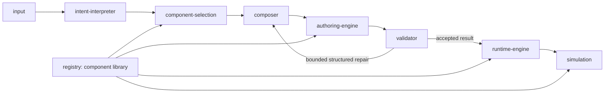

# Simulation creation and editing refactor plan

Date: October 13, 2026. Status: structural refactor implemented; functional acceptance incomplete (E01/E02 remain unresolved).

Current ownership is documented in [the implementation walkthrough](SIMULATION_GENERATION_AND_EDITING_PIPELINE.md). Browser outcomes and preserved failures are recorded in [030-validation](../implementation/030-validation/README.md). The requirements below remain the completion criteria; a successful build does not establish the functional mission.

This plan follows the requested module diagram. All orchestration for AI creation/editing, authoring execution, validation, runtime activation and lesson rendering lives under `src/web/src/simulations/creation-and-editing/`. The component/recipe catalog lives beside it in `simulations/registry/`. Components that are not explicitly promoted remain under `simulations/legacy/components/`.

The accompanying [file manifest](SIMULATION_PIPELINE_REFACTOR_FILE_MANIFEST.md) lists individual existing files, proposed destinations, newly extracted files and affected callers. The tree below is the complete proposed pipeline/catalog file set for this migration. The manifest expands the preserved legacy files separately.

## 1. What the refactor must change

The goal is coherent ownership, not renaming the current spaghetti:

1. One server orchestration entry for creation/editing; no alternate planner hidden elsewhere.
2. Intent interpretation determines the requested outcome and whether the request creates, edits, acts immediately or needs clarification.
3. Component selection resolves capabilities and edit targets, independently of writing argument values.
4. Composer produces a supported plan. It does not mutate active state or build its own runtime.
5. Authoring engine applies the plan to an isolated draft using existing transaction guarantees.
6. Validator verifies proposed state and reports structured issues. Domain rules remain with their implementations.
7. Runtime engine owns accepted state, commands, time, capture and revisions.
8. Simulation module renders accepted state and safe builder previews. It does not own scientific execution.
9. Registry provides immutable definitions, recipes and runtime/client lookup projections. It does not perform inference.

There are two entry points, `createSimulation` and `editSimulation`, coordinated by `pipeline.ts`. They share the same authoring engine, validator and registry. Existing composition/assembly branches become explicit creation strategies, not separate public pipelines.

## 2. Complete proposed target tree

Legend: existing code is relocated unless listed as a new extraction in the manifest. New files replace responsibilities currently mixed in larger files; they are not additional inference stages. No empty per-module `index.ts` files, plugin framework, generic event bus or duplicate runtime is proposed.

```text
src/web/src/simulations/
├── creation-and-editing/
│   ├── authoring-engine/
│   │   ├── compatibility/
│   │   │   ├── assemblyDocument.ts
│   │   │   └── importedRecipe.ts
│   │   ├── presentation/
│   │   │   ├── arrangement.ts
│   │   │   ├── board.ts
│   │   │   ├── graphLayout.ts
│   │   │   └── responsiveLayout.ts
│   │   ├── bindings.ts
│   │   ├── composites.ts
│   │   ├── configurationPatch.ts
│   │   ├── connections.ts
│   │   ├── document.ts
│   │   ├── drawings.ts
│   │   ├── finalizeRecipe.ts
│   │   ├── insertion.ts
│   │   ├── normalizeOperations.ts
│   │   ├── operations.ts
│   │   ├── recipes.ts
│   │   ├── references.ts
│   │   ├── regenerateTruss.ts
│   │   ├── requireValue.ts
│   │   ├── serializeRecipe.ts
│   │   ├── tools.ts
│   │   └── transaction.ts
│   ├── component-selection/
│   │   ├── decisions/
│   │   │   ├── providers/
│   │   │   │   ├── jev.ts
│   │   │   │   ├── laya.ts
│   │   │   │   └── validation.ts
│   │   │   ├── transport/
│   │   │   │   └── http.ts
│   │   │   ├── acceptance.ts
│   │   │   ├── config.ts
│   │   │   ├── contracts.ts
│   │   │   ├── errors.ts
│   │   │   ├── factory.ts
│   │   │   ├── policy.ts
│   │   │   └── questions.ts
│   │   ├── assemblyCandidates.ts
│   │   ├── componentCandidates.ts
│   │   ├── editCandidates.ts
│   │   ├── recipeCapabilities.ts
│   │   ├── selectAssemblies.ts
│   │   ├── selectCompositionStrategy.ts
│   │   └── selectEditTargets.ts
│   ├── composer/
│   │   ├── availableOperations.ts
│   │   ├── choosePresentation.ts
│   │   ├── composeFromComponents.ts
│   │   ├── configureAssembly.ts
│   │   ├── create.ts
│   │   ├── createFromAssemblies.ts
│   │   ├── edit.ts
│   │   ├── editArguments.ts
│   │   ├── editPlan.ts
│   │   ├── operationArguments.ts
│   │   ├── policy.ts
│   │   └── recipeArguments.ts
│   ├── input/
│   │   ├── inference/
│   │   │   ├── adapters.ts
│   │   │   ├── apertusConfig.ts
│   │   │   ├── config.ts
│   │   │   ├── messages.ts
│   │   │   ├── parseJson.ts
│   │   │   ├── prompts.ts
│   │   │   ├── structuredSchema.ts
│   │   │   └── transport.ts
│   │   ├── api.ts
│   │   ├── browser.ts
│   │   ├── context.ts
│   │   ├── contracts.ts
│   │   ├── errorFormatting.ts
│   │   ├── eventStream.ts
│   │   ├── progress.ts
│   │   └── results.ts
│   ├── intent-interpreter/
│   │   ├── contracts.ts
│   │   ├── interpretCreation.ts
│   │   └── interpretEdit.ts
│   ├── runtime-engine/
│   │   ├── agents/
│   │   │   ├── capabilities.ts
│   │   │   ├── client.ts
│   │   │   ├── contracts.ts
│   │   │   ├── handleStore.ts
│   │   │   ├── memoryRepository.ts
│   │   │   ├── providers.ts
│   │   │   ├── runner.ts
│   │   │   ├── scenarios.ts
│   │   │   └── scheduler.ts
│   │   ├── composition/
│   │   │   ├── createScene.ts
│   │   │   ├── index.ts
│   │   │   ├── observations.ts
│   │   │   ├── projectCanvas.ts
│   │   │   ├── runtimeState.ts
│   │   │   ├── types.ts
│   │   │   └── useCanvasRuntime.ts
│   │   ├── imported/
│   │   │   ├── contract.ts
│   │   │   ├── provider.ts
│   │   │   └── runner.ts
│   │   ├── providers/
│   │   │   ├── data.ts
│   │   │   ├── exploration.ts
│   │   │   ├── index.ts
│   │   │   └── spatial.ts
│   │   ├── DocumentRuntime.ts
│   │   ├── RecipeSession.ts
│   │   ├── commands.ts
│   │   └── loadRecipe.ts
│   ├── simulation/
│   │   ├── board/
│   │   │   ├── DrawingEditor.tsx
│   │   │   ├── DrawingIcon.tsx
│   │   │   ├── DrawingInspector.tsx
│   │   │   ├── SpatialBoard.tsx
│   │   │   ├── board.css
│   │   │   └── drawings.css
│   │   ├── construction/
│   │   │   ├── contracts.ts
│   │   │   └── publisher.ts
│   │   ├── layout/
│   │   │   └── learnerLayout.ts
│   │   ├── recipe/
│   │   │   ├── CanvasPresentation.tsx
│   │   │   ├── ControlPresentation.tsx
│   │   │   ├── DisplayPresentation.tsx
│   │   │   ├── ImportedHTMLView.tsx
│   │   │   ├── NodeView.tsx
│   │   │   ├── RecipeAppearance.tsx
│   │   │   ├── RecipeLayout.tsx
│   │   │   ├── contexts.tsx
│   │   │   ├── formatObservation.ts
│   │   │   ├── imported-component.css
│   │   │   └── snapshotAdapters.ts
│   │   ├── RecipeLesson.tsx
│   │   └── recipe-lesson.css
│   ├── validator/
│   │   ├── canvas/
│   │   │   ├── validateBindings.ts
│   │   │   ├── validateScene.ts
│   │   │   ├── validateSingleScene.ts
│   │   │   └── validateWorkspace.ts
│   │   ├── compositionQuality.ts
│   │   ├── coverage.ts
│   │   ├── document.ts
│   │   ├── edit.ts
│   │   ├── imported.ts
│   │   ├── parseRecipe.ts
│   │   ├── recipe.ts
│   │   ├── requestConstraints.ts
│   │   └── runnable.ts
│   ├── budget.ts
│   ├── diagnostics.ts
│   ├── errors.ts
│   ├── pipeline.ts
│   └── server.ts
├── registry/
│   ├── contracts/
│   │   ├── objects/
│   │   │   ├── ActionContract.ts
│   │   │   ├── ComponentDefinition.ts
│   │   │   ├── LineParameters.ts
│   │   │   ├── Observation.ts
│   │   │   ├── OutputContract.ts
│   │   │   ├── PropertyContract.ts
│   │   │   ├── composition.ts
│   │   │   ├── numericField.ts
│   │   │   └── objectFields.ts
│   │   ├── commandPresentation.ts
│   │   ├── controlContract.ts
│   │   ├── dataPresentation.ts
│   │   ├── defaults.ts
│   │   ├── domainContribution.ts
│   │   ├── interactionPolicy.ts
│   │   ├── observations.ts
│   │   ├── parameterSchema.ts
│   │   └── publicDefinition.ts
│   ├── controls/
│   │   ├── ActionButton.tsx
│   │   ├── ActivityControl.tsx
│   │   ├── FractionEntry.tsx
│   │   ├── IntegerStepper.tsx
│   │   ├── NumberField.tsx
│   │   ├── PlaybackControl.tsx
│   │   ├── RangeInput.tsx
│   │   ├── ScalarControl.tsx
│   │   └── SchemaForm.tsx
│   ├── definitions/
│   │   ├── canvases.ts
│   │   ├── controls.ts
│   │   └── displays.ts
│   ├── models/
│   │   └── domainModels.ts
│   ├── objects/
│   │   ├── Building.ts
│   │   ├── FractionBar.ts
│   │   ├── GasContainer.ts
│   │   ├── Ground.ts
│   │   ├── Line.ts
│   │   ├── Person.ts
│   │   ├── Road.ts
│   │   ├── Square.ts
│   │   └── registry.ts
│   ├── recipes/
│   │   ├── builtIn.ts
│   │   ├── learningConfiguration.ts
│   │   ├── modelRecipe.ts
│   │   ├── premade.generated.ts
│   │   └── premade.ts
│   ├── discovery.ts
│   ├── index.ts
│   ├── legacyDefinitions.ts
│   └── presets.ts
├── builder/  # Manual UI, history and persistence remain
├── domains/  # Scientific implementations remain for this pass
├── legacy/  # Every preserved file is expanded in the manifest
└── pre-made/  # Recipe JSON and assets remain
```

`app/api/apertus/route.ts` and `app/api/planner-diagnostics/route.ts` remain Next.js entry points. They delegate to the new modules. `app/experiments`, the manual builder, project storage and Python inference serving stay in their existing application locations, with imports updated. Scientific implementations in `simulations/domains/` remain in place for this pass and are accessed through registry integration.

## 3. Responsibilities and dependency boundaries



This diagram describes control flow, not permission for circular imports. Validation returns data to orchestration, which decides whether to retry the composer. The validator does not import/call the composer. Runtime and simulation never call the model provider to repair scientific state.

| Folder | Owns | Must not own |
| --- | --- | --- |
| `input/` | Request/result parsing, browser transport, API response stream, captured-context boundary, inference adapters | Capability selection, recipe mutation |
| `intent-interpreter/` | Teaching goal, operation intent, ambiguity and clarification interpretation | Catalog registration, execution, rendering |
| `component-selection/` | Retrieval, capability/target candidates, decision-provider choices and gates | Argument calculation, document mutation |
| `composer/` | Creation/edit plans, operation-specific arguments, explicit strategy coordination | Committing active state, provider initialization |
| `authoring-engine/` | Transactions, handles, insertion, wiring, configuration patches, removal, presentation edits, serialization | Model inference or browser activation |
| `validator/` | Shared document/recipe/runnable invariants, request constraints, coverage and structured issues | Network calls, domain-specific equations |
| `runtime-engine/` | Loading, state, stepping, commands, provider adapters, capture, session identity/revisions | UI layout or choosing teaching intent |
| `simulation/` | Lesson shell, generic node/control/display routing, board, construction projections | Model initialization/stepping, inference |
| `registry/` | Authoritative contracts, core component metadata, recipe sources and lookup projections | Generation loop, transactions, UI state |

Server entry points import server inference adapters explicitly. Browser modules import data contracts and client rendering explicitly. A registry entry must not import a barrel that pulls React scenes into server selection or inference credentials into the browser bundle.

## 4. Component migration: promote owners, preserve the rest

Current inventory: 411 files under `components/`, 458 public definitions, 144 runtime providers, 49 built-in recipes and 90 premade recipes. 316 definitions occur in those recipe documents. The 142 absent definitions are not a deletion list: manual composition, default presets and saved-document compatibility use a different set.

### 4.1 Promote these currently used foundations

- The eight authored object definitions and their registry/property helpers. They have current manual-builder/runtime consumers, including authored road support that is absent from the recipe census.
- Existing object/action/output contracts and shared parameter validation.
- Shared control contracts, command metadata and interaction policy used by planning, execution and rendering.
- Generic scalar/action/form/activity control implementations used by current lessons. UI implementations go under `registry/controls/`, with server-safe metadata in separate files.
- Shared observation metadata and data-presentation contracts. They must not remain hidden in a view directory while server planning imports them.
- Existing premade recipe registration; keep recipe JSON sources at their existing `pre-made/` paths and update the generated registry's relative imports.
- The generic recipe/board rendering host goes into the requested `simulation/` module, not into the component catalog.

Do not move the entire old `catalog/index.ts` into the new registry unchanged. Extract the core definitions, preserve domain contribution adapters and make the root registry a lookup/integration owner. Do not move the 811-line composite catalog wholesale and label that a cleaned catalog: separate defaults, built-in recipe construction and learning-configuration capture.

### 4.2 Preserve domain implementations through a declared legacy boundary

Domain-specific scenes, systems, traits, old sessions and specialized controls stay under legacy initially. Current recipes and manual builder behavior must still resolve them through `registry/legacyDefinitions.ts` and the existing runtime provider adapters.

The compatibility resolver is a concrete adapter for existing definitions, not a second catalog for new features. Native IDs and legacy IDs must be disjoint in the returned projection; duplicate IDs fail startup checks. Where a promoted native definition replaces an existing legacy ID, the adapter excludes that legacy entry explicitly. Stable IDs and versions do not change.

`registry/legacyDefinitions.ts` imports legacy declarations; legacy declarations must not import the new registry root. Shared types and helper contracts can be imported directly. This rule prevents the catalog/assembly/provider cycle that a superficial move could create.

Native components must be added to the new registry. Legacy directories receive only compatibility fixes, import updates and removals justified by proven reachability. A later domain migration promotes a complete dependency closure, not a scene file detached from its model and contracts.

### 4.3 Separate components, presets and recipes

- A component can exist as a document instance.
- A preset applies data to a compatible component; it need not create a resource node.
- A recipe creates a connected teaching activity with intentional opening controls/results.
- A historical definition is resolvable for loading, but need not appear in current discovery.

Keep discovery APIs separate from identity resolution. Do not advertise retired controls just because compatibility resolution still supports their IDs. Do not generate a visible preset entry for every model automatically unless that preset is useful; preserve existing IDs through compatibility before removing author-facing entries.

## 5. Untangle creation and editing without multiplying inference

### Creation

`composer/create.ts` coordinates candidate selection, a declared assembly/component strategy, settings, presentation and final application. `createFromAssemblies.ts` remains a strategy but loses embedded retrieval and model-provider classification code. `composeFromComponents.ts` remains the bounded operation strategy but loses duplicated finalization/activation concerns.

`component-selection/assemblyCandidates.ts` owns retrieval/cards/instance counts. `selectAssemblies.ts` owns choosing supported assemblies. `composer/configureAssembly.ts` owns typed initial values; `choosePresentation.ts` owns supported control/result selection. Extracting these functions must not automatically add extra model calls. First retain the observed call count; then correct the mixed settings/visibility wire with a targeted behavioral change.

Generated lesson defaults should come from supported authored recipes where available. Generic assembly construction should not expose every model command/output and depend on several classifiers to discover that most are unnecessary.

### Editing

Split the current `edit.ts` by actual job:

1. `intent-interpreter/interpretEdit.ts`: requested change, immediate action/new topic/clarification.
2. `component-selection/editCandidates.ts` and `selectEditTargets.ts`: targets and operation availability.
3. `composer/editPlan.ts`: exact selected fields/scope and numeric adjustment semantics.
4. `composer/editArguments.ts`: concrete values for the accepted operations.
5. `authoring-engine/configurationPatch.ts`: preserve untouched configuration siblings.
6. `validator/edit.ts`: overlap, operation/result and preservation checks.
7. `composer/edit.ts`: bounded coordination, explicit recovery and final result construction.

Keep current session/captured values as the starting point. A failed target choice must be able to return a meaningful clarification or trigger bounded reselection after validation; it must not trap every later repair inside a demonstrably wrong shortlist. Arguments remain validated against executor-owned contracts.

Remove stale `response_keys: ["operations"]` feedback when the accepted wire is candidate-keyed. Do not coerce invalid field objects into strings to hide the existing E02 failure. Restore successful behavior through a consistent contract and actual browser replay.

### One repair owner

Keep the existing structured transport's bounded retry and repeated-response detection. Stage owners supply schemas and structured issues; orchestration decides whether target reselection versus argument correction is appropriate. Do not add a second repair framework or allow the validator to mutate the proposal silently.

## 6. Files edited outside the new folders

The manifest includes concrete import/export consumers found by source resolution, plus explicit route, persistence and generator entry points. This includes files inside legacy that must redirect imports to promoted owners; not every affected file needs a behavioral change.

Required application adapters:

- `app/api/apertus/route.ts`: delegate request handling to `input/api.ts`, planner work to `pipeline.ts`.
- `app/api/planner-diagnostics/route.ts`: import the relocated diagnostics owner.
- `app/experiments/_components/ExperimentsShell.tsx`: new browser/session/rendering imports; unchanged activation/persistence responsibilities initially.
- `app/experiments/_lib/recipePersistence.ts`: new session and recipe serialization imports.
- `simulations/builder/composition/useBuilderAi.ts`: new browser/result contracts; preserve live preview and fingerprint checks.
- Builder graph, preview, library, input/settings and history consumers: new catalog, authoring and rendering imports.
- Existing agent/model API consumers of shared inference configuration/transport: update imports, do not duplicate the adapters.
- Existing recipe generation/check scripts: update hardcoded source and generated output paths. Preserve existing test runners.
- The current implementation walkthrough and component README: update ownership/path references after the code migration, not ahead of it.

Next.js route files and React shell components remain framework entry points. "All implementation in the pipeline folder" means the generation machinery is there, not that Next.js routes, project storage or every domain equation must physically be in it.

## 7. Migration sequence and reviewable commits

1. **Freeze the behavior inventory.** Preserve the latest failures and earlier passes. Establish active/compatibility discovery and IDs; do not change prompts or provider configuration.
2. **Move and update imports mechanically.** Use the manifest; preserve IDs, schemas, serialization, runtime capture and state ownership. Verify imports/build and existing recipe round trips. Avoid combining file moves with inference-contract fixes.
3. **Extract the registry.** Promote the listed foundations, isolate legacy adapters, separate presets/recipes, and check every currently supported premade/built-in recipe can still resolve definitions/providers/views. No arbitrary exclusion of legacy-supported lessons.
4. **Extract the pipeline modules.** Replace large planner functions with stage-owned functions and one coordinator. Functions take explicit request/context/registry/budget data; they do not register globals or reach into UI state.
5. **Consolidate orchestration.** Remove the old public planner entry after all callers move. Preserve needed legacy recipe configuration as an explicitly named strategy while consolidating equivalent finalization. No permanent parallel implementation under `lib/planner`.
6. **Correct demonstrated behavioral failures.** Fix settings/visibility contamination, target recovery and inconsistent edit wire/feedback in separate changes. Replay each affected creation/edit through the actual browser. Do not claim successful refactoring merely because relocated code compiles.
7. **Finish current ownership docs.** Remove old path references and any temporary forwarding exports. Do not delete compatibility IDs without an explicit saved-document migration.

No new benchmark harness, verification runner or unbounded inference campaign. Reuse existing recipe/runtime checks and the agreed Playwright creation/edit cases. The baseline is currently failing; a mechanical migration should preserve those recorded outcomes, while the completed functional refactor must resolve the requested reliability problems.

## 8. Completion conditions

- The module tree reflects real ownership; old pipeline implementations are no longer callable duplicates.
- No browser import reaches server-only model configuration or credentials.
- Registry lookup resolves existing recipe IDs/versions and compatibility imports; discovery distinguishes native supported, preset, recipe and historical entries.
- Rejected authoring batches and invalid/stale browser results preserve the last valid state.
- Successful edits preserve unrelated live values, wiring and presentation; save/reopen is checked where capture/serialization changed.
- Fresh creation and editing each have one reviewable orchestration flow.
- Creation, edit-target selection, value arguments and presentation selection have validated owner contracts rather than repeated unrestricted metadata.
- Existing seven creations and three follow-ups have observed outcomes on the refactored implementation. Remaining failures mean the functional mission is incomplete.
- File migrations and behavioral fixes are independently reviewable.

## 9. Inventory limits

The manifest is a current-source migration inventory, not an assertion that every legacy file is dead or active. Import resolution covers static imports/exports, literal dynamic imports and known source strings in existing check scripts. Saved-document identities, generated imports, CSS/asset URLs and dynamic string-based lookup need separate compatibility attention during implementation.

No production files were moved for this plan. The exact promotion set can expand only when a real dependency or current consumer requires it; it must not expand to "all components" merely to make import rewriting easier.
