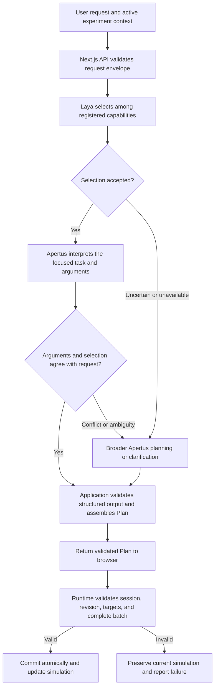

# Apertus and Laya collaboration

**Status:** Implemented as an opt-in experimental planner, 2026-10-03. Software checks pass; live model accuracy does not meet adoption criteria. See delivery notes below.

**Objective:** Use Laya to select from implemented capabilities and Apertus to handle focused natural-language interpretation tasks. Keep application code responsible for validation, assembly, and execution.

Build on [Apertus component integration](003-APERTUS_COMPONENT_INTEGRATION.md), [Component Architecture](../../COMPONENT_ARCHITECTURE.md), and [Component Contracts](../COMPONENT_CONTRACTS.md). The existing capability catalog and runtime schemas remain authoritative.

## 1. Responsibility split

| Component | Responsibility | Example |
| --- | --- | --- |
| Laya | Select among finite, explicitly supplied choices | Choose an edit intent, the existing second projectile, and its `SET_ANGLE` operation |
| Apertus | Interpret language and produce structured arguments for a focused task | Interpret “forty-five degres” as an angle of 45 degrees |
| Application code | Build model questions, validate outputs, assemble plans, and manage requests | Check that angle is a finite number in the supported range |
| Simulation runtime | Resolve trusted components, stage changes, check session/revision, and commit atomically | Change the selected projectile only if the complete edit is valid |

Laya's selection questions may include scene family, composition, component, target, action, or an enumerated preset. Each question must use actual supported choices. Its choice probabilities express model preference; they do not establish that a selection is correct.

Apertus receives the original request, relevant context, and the selected capability's argument schema. It can interpret spelling mistakes, number words, units, and context-dependent phrasing without requiring the user to match a fixed command grammar. This is intended behavior that requires evaluation, not a guarantee of perfect interpretation.

TypeScript validates the structured result. Parsing model-returned JSON is appropriate; using regex to understand the user's entire request is not the intended language boundary.

## 2. Intended request flow

The initial practical scope is follow-up edits on existing experiments. Premade experiments already open without inference. Creation and broader component selection can adopt the same division once their questions and handoffs are evaluated.

For edits, prefer dependent selections: intent → actual target → operations exposed by that target. Session-wide operations use the `session` target. Independent questions can be batched; dependent questions must receive the accepted parent decisions.

## 3. Example: imperfect spelling and number words

Request:

> set the secnd ball to forty-five degres

1. The API passes the original text and exposed projectile identities to the selection workflow.
2. Laya selects the existing second projectile and the angle-setting operation from the provided choices.
3. Apertus receives a focused argument task: interpret the requested angle for that operation, using its units and schema. It returns an argument object such as `{"value":45}`.
4. Application code validates the object against the authoritative operation schema and assembles an edit Plan. Session identity and expected revision come from validated context rather than model invention.
5. The browser runtime checks the Plan against current state and applies the change atomically.

The example illustrates the intended handoff; it is not a recorded successful model result.

Neither Laya nor application code needs to infer the angle through a score question, a fixed list of numerical candidates, or an English regex. Laya selects the supported action and target; Apertus supplies the interpreted arguments.

## 4. Focused Apertus tasks

The handoff should reduce the interpretation scope rather than ask Apertus to regenerate the entire capability catalog on every request.

Examples include:

- Extract an angle from digits or number words.
- Normalize an explicit unit into the capability's required unit.
- Interpret pause/resume as the boolean required by `SET_PLAYING`.
- Resolve a relative change using the selected instance's current configuration.
- Produce a structured object for a grouping, fraction, or coordinate operation.

Relative requests require enough information to resolve a value. “Increase speed by 5 m/s” can use the current speed; “make it a little faster” has no defined amount unless the product establishes an explicit policy. Ask for clarification when that policy or value is missing. Do not invent, silently clamp, or change the user's requested quantity.

An operation with no arguments uses `{}` after Apertus checks the intent and target. The initial implementation always performs this semantic check; skipping Apertus for such requests remains a possible future optimization.

## 5. Selection conflicts and uncertainty

Laya's selections should be treated as proposals that Apertus can challenge. A high probability does not justify forcing a request into an incompatible action or target.

For a focused handoff, Apertus should return one of:

- Validated arguments consistent with the proposed action and target.
- A clarification explaining what information is missing.
- A conflict outcome indicating that the proposal does not fit the original request.

A conflict must not silently replace the selected target or operation. The focused wire format uses `schemaVersion:1`, `outcome`, and `message`. The `arguments` outcome additionally requires `arguments` and `confirmedSelection:{action,target}`. Apertus must infer that confirmation from the request; application code compares it with Laya's proposal and turns a mismatch into conflict. This confirmation was added after a live response described the second projectile while supplying arguments for a proposal targeting the first. It is a consistency check, not permission to retarget.

Clarify, unsupported, and conflict responses accept only `schemaVersion`, `outcome`, and `message`. Composition and session envelope fields are never accepted in the focused response. Explicit conflict invokes one broader Apertus planning pass. Malformed output gets one repair on the same task; a failed repair or inference transport error propagates without restarting planning.

Broader requests may require multiple actions. An initial single-action selector should route these to broader planning or clarification rather than discard part of the request.

Keep inference failures separate from language ambiguity. Unavailable Laya can invoke the configured Apertus fallback; a cancelled request must stop rather than initiate another model call. No failed interpretation should modify the active experiment.

## 6. Repository ownership

| Location | Intended ownership |
| --- | --- |
| `src/inference/laya/` | Python model loading, warmup, serialized inference, status, and decision API |
| `src/inference/Makefile` | Local commands for running Laya and Apertus separately |
| `src/web/src/lib/laya/` | Typed decision transport, capability-derived questions, answer validation, and selection traces |
| `src/web/src/lib/apertus/` | Focused language interpretation and broader planning transport |
| `src/web/src/lib/planner/` | Shared contracts, orchestration, selection/argument handoff, fallback, and request lifecycle |
| `src/web/src/app/api/apertus/` | Single browser-facing request endpoint |
| `src/web/src/simulations/runtime/` | Authoritative capabilities, parameter schemas, trusted execution, and atomic session changes |

Keep model serving separate from simulation mechanics. Credentials stay on the server. Generate choices and argument descriptions from the existing catalog and exposed instance actions rather than maintain a second registry of capabilities.

The public API can continue returning the existing versioned `create`, `edit`, `clarify`, and `unsupported` Plan outcomes. Intermediate model outputs do not execute directly.

## 7. Current implementation versus this proposal

The first integration used a deterministic English parser to extract an action, target hint, and value before calling Laya. Laya then confirmed those preselected choices. This restricted harmless spelling and phrasing variations and made selection largely redundant.

The current revision removes that parser, uses dependent Laya selections, and introduces a separate Apertus argument/conflict contract. Application code constructs the final edit envelope. Broader fallback for an active experiment uses only its exposed operations, targets, schemas, and context; creation retains the existing full Apertus planner. Hybrid mode is opt-in; the default remains Apertus.

The [saved Laya evaluation](LAYA_LIVE_EVALUATION.json) belongs to the earlier parser-gated implementation. At its 0.9 gate, 1 of 5 supported edit cases produced an accepted direct plan, and four intentionally ineligible requests returned no plan. Those results do not measure this proposed collaboration or establish typo tolerance, combined-model latency, or a calibrated confidence threshold.

## 8. Verification needed before adoption

Evaluate selection correctness, argument interpretation, and final-state correctness separately. Include spelling mistakes, paraphrases, number words, unit conversion, negation, ambiguous references, relative changes, compound instructions, out-of-range values, and multilingual requests relevant to the product.

Test confidently wrong Laya choices as well as low-confidence ones. Confirm that Apertus can challenge a wrong proposal and that invalid arguments or stale revisions preserve the scene. Deterministic transport fixtures prove integration behavior; actual model runs are required to assess language understanding.

Measure the complete Laya → Apertus → validation path, including fallback frequency and both runtimes sharing the intended hardware. Adding Laya introduces another inference step; reduced Apertus task scope does not automatically imply lower latency or better accuracy.

The implemented policy sends compound requests to broader planning, either through rejected Laya selection or explicit Apertus conflict. The total hybrid deadline is controlled by `PLANNER_TIMEOUT_MS`, and `LAYA_TIMEOUT_MS` bounds the selection phase. Apertus transport shares concurrency and one-repair behavior between focused interpretation and broader planning. Cancellation never starts a fallback request.

## 9. Delivery and verification

The shared `/api/apertus` route now dispatches through `src/web/src/lib/planner`. Set `PLANNER_MODE=hybrid` to use the collaboration; `apertus` remains the default. There is no Laya-only execution mode. Start the separate inference services using the instructions in [the web README](../../../src/web/README.md). Credentials remain server-side.

Verification passed: six Python service tests, simulation/integration tests, Apertus transport tests, hybrid planner fixtures, browser regression tests, lint, TypeScript checks, and a production build. Fixtures cover dependent choices, operation exposure, malformed probabilities, argument bounds, confirmation mismatch, repair limits, conflict fallback, cancellation, capacity limits, deadlines, targeted state changes, and stale revisions. These checks establish orchestration and validation behavior, not language accuracy.

Real local model runs on October 3 used `aac6fef/laya-multilingual-mlx` and `m1rkocasu/Apertus-v1.5-8B-text-MLX-mxfp4`:

| Evaluation | Result | Meaning |
| --- | --- | --- |
| [Full collaboration](004-LAYA_APERTUS_LIVE_EVALUATION.json) | 3/11 correct; 0 accepted Laya selections at gate 0.9; 11 broader calls | This run exercised fallback, not successful focused collaboration |
| Final-state failures in that run | 4 incorrect mutations | Structurally valid output can still misinterpret the request |
| End-to-end latency in that run | Median 9.14 s; p95 21.05 s | Measured with both local runtimes running |
| [Latest focused argument contract](004-APERTUS_ARGUMENTS_LIVE_EVALUATION.json) | 1/8 correct | Evaluator-supplied proposals isolate Apertus interpretation; this is not Laya selection accuracy |

The full report's embedded focused evaluation predates the final required confirmation contract. The separate focused report records the latest contract. Other prompt iterations were inconsistent; none established reliable performance. The latest model often returned conflict with forbidden argument fields, failed its bounded repair, and once changed a correctly inferred relative value during repair. Validation rejected malformed results, but cannot detect every valid yet incorrect value.

Keep hybrid opt-in while selection calibration and focused model behavior are improved and reevaluated. Do not lower the selection gate merely to increase coverage. Agreement between two models does not prove user intent, and the broad Apertus fallback also needs better semantic accuracy. The implementation completes the responsibility split; the current checkpoint does not satisfy the live accuracy requirements for adopting it as the default.
