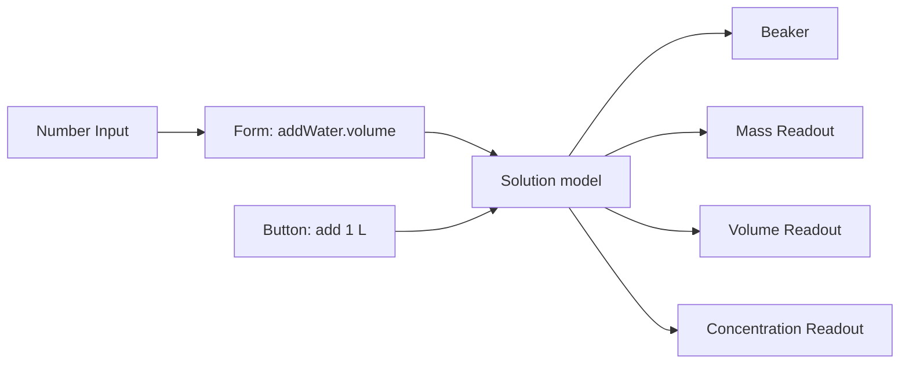

# 009 — Public component catalog and editable composite builder

Date: 2026-10-05.

Status: proposed implementation specification. The audit records the working-tree source inspected during this discussion. The target contracts, catalog entries, recipes, folder structure, and five implementation phases below are not claims of completed implementation.

Implementation checkpoint: the version-3 catalog/composite path now includes physical comparisons, projectile flight/sampling, generated editable bridges, explicit town instance/presentation nodes, authored Scheduled Trip worlds, the remaining generic controls/displays/data resources, exposed parameters for saved user prebuilts, compatibility/contract previews, and responsive conditional themed layout settings. Public renderers receive scoped snapshots; supported topology, identity/reference preservation, atomic command policies, migration recovery, regeneration transactions, bounded data evaluation/conversion, and layout-binding remapping have permanent verification. Existing prompt/session protocols and saved-input readers remain as explicit compatibility adapters; their private lesson/control assemblies are retired. See [009 implementation evidence](009-IMPLEMENTATION-EVIDENCE.md) for the exact verified scope and commands run.

Manual-builder integration correction: the separate catalog workspace was an implementation deviation. The original 2D/3D setup now opens the common authored document in `CompositionBuilder`; catalog discovery/import is in Add component, composites use the existing graph, and settings remain focused dialogs. `catalog-editor/` has been removed. Older documents migrate at opening rather than requiring a workspace switch. See the implementation evidence for current verification.

## Reading map

- [Purpose and product promise](#1-purpose-and-product-promise)
- [Philosophy and invariants](#2-philosophy-and-architectural-invariants)
- [Current findings](#3-findings-from-the-current-working-tree)
- [Audit method](#4-audit-method-and-required-ledger)
- [2D, 3D, Cartesian, and other spaces](#5-space-and-presentation-taxonomy)
- [Public catalog and existence status](#6-target-public-catalog-and-implementation-readiness)
- [Unified contracts](#7-contract-unification)
- [Documents and composite recipes](#8-canonical-document-and-composite-recipe)
- [Builder feature workflows](#9-builder-features)
- [Composite breakdown matrix](#10-composite-catalog-and-decomposition-matrix)
- [Implementation slices](#11-detailed-composite-implementation-slices)
- [Source disposition](#12-source-disposition-rules)
- [Target folder structure](#13-target-folder-structure)
- [Migration and compatibility](#14-migration-and-compatibility)
- [Five implementation phases](#15-implementation-phases--exactly-five)
- [Verification](#16-verification-strategy)
- [Risks and established decisions](#17-risks-and-decisions-to-keep-explicit)
- [Source links](#18-related-sources)
- [All 238 current source files](#appendix-a-complete-inspected-source-file-inventory)

## 1. Purpose and product promise

The builder must become the place where authors can assemble the same experiments that developers currently assemble in code.

The public contents of `src/web/src/simulations/components/` are the builder's library. This includes small controls, domain models, visuals, displays, behaviors, resources, and larger prebuilt composites. A capability must not remain available only to a premade lesson because its implementation happens to live in a shared folder.

The central promise is:

> Every public component is discoverable and authorable in the builder. Every public composite is a recipe built from public components. Inserting a composite creates real, independently editable components, connections, and layout in the document.

An author must be able to insert a polished Dilution Lab, expand it in Connections, see its Solution model, Beaker, controls, readouts, layout, and reset scope, and edit those pieces. The author must also be able to construct the equivalent lab from the small components and save the selection as a new prebuilt component.

Premade experiments are curated configurations of this same authoring vocabulary. They must not have a separate privileged assembly mechanism that authors cannot use.

### 1.1 Relationship to refactor 008

[008 — Shared components and manual builder refactor](008-SHARED_COMPONENT_BUILDER_REFACTOR.md) improved ownership and reuse. It explicitly preserved supported capabilities and described itself as an architectural refactor rather than a capability expansion.

This specification extends that foundation. It changes the public authoring contract, introduces editable composite recipes, broadens library coverage, and migrates existing premade/domain experiences into that system.

Preserve the useful work from 008:

- Shared geometry, gas, fraction, navigation, and schedule calculations.
- Separation between editor concerns and simulation execution.
- Independent builder-canvas state.
- Authoring state versus learner runtime state.
- Schema-driven property metadata where already present.
- Renderer-free definition lookup.
- History, recovery, save conflicts, and legacy readers.

Do not interpret 008's completion status as evidence that all shared components are already builder-selectable.

### 1.2 What successful completion looks like

An author can:

1. Find every supported public primitive and prebuilt component in the builder.
2. Understand whether an item is a model, visual, control, resource, or composite.
3. Filter by subject, use case, presentation, and compatibility.
4. Start with an empty canvas or insert a complete lab.
5. Expand an inserted lab into its actual constituent components.
6. Rewire controls, swap displays, change layout, and remove pieces.
7. Save a selection as a reusable composite with tags and exposed parameters.
8. Insert two copies without shared mutable state or duplicate identities.
9. Save, export, import, undo, and reload without losing internal references.
10. Open a premade experiment as an editable recipe using the same runtime.

### 1.3 Scope boundaries

This is a large authoring refactor with capability exposure. It does not silently introduce new scientific models.

- Preserve each model's assumptions and supported topology.
- A model may remain a meaningful atomic component even when its internal mathematics is complex.
- Arbitrary circuit networks, arbitrary traffic road networks, volumetric town physics, and a general structural solver are separate model features.
- Do not present unsupported internal pieces as freely editable merely to make a graph appear more decomposed.
- Do not expose arbitrary executable JavaScript in imported recipes.
- Do not introduce mandatory external hosting, collaboration services, or cloud storage for this feature.

## 2. Philosophy and architectural invariants

### 2.1 Public packages, not every source file, are selectable

The product promise concerns public packages. It does not require a library card for a stylesheet, TypeScript interface, numerical helper, or React hook.

A public package has a stable definition, authoring semantics, and a supported insertion/application operation. Its implementation files may remain private inside the package. Shared infrastructure belongs outside the public component tree.

This distinction keeps the folder aligned with the builder without overwhelming authors with implementation details.

### 2.2 Compose meaningful authoring responsibilities

Decompose when a part can be independently configured, replaced, connected, reused, inspected, or removed by an author.

Good boundaries include a Number Input, Solution model, Beaker display, concentration Readout, and layout Panel. A concentration calculation can remain inside a Solution model when it is an invariant of that model. An integration substep does not need to become a node merely because it is a function.

A composite must expose all of its public children. A primitive is permitted to have private implementation details. The primitive/composite distinction must be explicit, not determined by file size.

### 2.3 One owner for each mutable field

Every mutable field has one normal runtime owner. Initialization, migration, reset, and validated authoring edits are explicit lifecycle operations.

Avoid splitting a board into several nodes that all mutate the same token array. Either define real command boundaries between owners or keep the coherent state in one model until a safe decomposition is available.

Outputs are read-only. Controls invoke supported commands or write declared inputs. Visuals consume snapshots. Layout changes do not write model state.

### 2.4 One implementation for overlapping behavior

Builder and premade paths use the same model operations, controls, displays, and renderers. Adapters may translate representations during migration, but must not become permanent duplicate calculations.

Existing coefficient-based and endpoint-based line representations require explicit adapters. Preserve their supported behavior, including vertical lines, rather than forcing lossy conversion.

### 2.5 Composition is data

A composite declares component instances, connections, layout, resource references, exposed parameters, and external ports. It does not recreate those relationships inside a custom lesson React component.

Trusted providers implement primitive behavior. Recipes select/configure those providers through stable definitions. Built-in recipe files may export validated JSON-like data; user recipes are stored as data.

### 2.6 Design is authorable

The builder needs enough layout and presentation capability to recreate the existing polished lessons: panels, rows, grids, disclosures, charts, feedback, labels, spacing, and responsive arrangements.

Moving a hardcoded lesson to a new folder is not a substitute for authorable design. If a premade layout can only be recreated with custom JSX, the builder vocabulary is still incomplete.

### 2.7 Graph clarity without hidden behavior

The Connections view may collapse groups and filter appearance/layout nodes to reduce clutter. Those are visibility operations. The children and relationships remain real document content.

Ordinary insertion can create a model with a compatible default appearance. The author must be able to inspect and change the appearance attachment. A default must not become a hidden runtime dependency.

### 2.8 Explicit runtime scope

No migrated component should depend on the global assembly, town, projectile, or bridge session singleton. It receives scoped runtime access.

Two copies of a composite have different identities, mutable state, and default reset scopes. Shared clocks or shared controls exist only when the document explicitly connects them.

### 2.9 Compatibility is typed; tags are descriptive

Tags such as `chemistry`, `beginner`, and `comparison` support discovery. Port types, units, coordinate frames, capabilities, and scope rules determine whether components can connect.

Do not use subject tags as an execution compatibility system.

### 2.10 Keep the catalog finite and useful

Prefer variants when semantics are shared:

- Text can have heading/body/callout variants.
- Select can have dropdown/choice-group variants.
- Chart can have XY/time-series/multi-series variants.
- Literal can contain scalar, record, or list data through its schema.

Use composites for reusable combinations such as Integer Stepper, Fraction Input, Vector Input, and Playback Panel. Avoid a new primitive for each cosmetic variation.

## 3. Findings from the current working tree

### 3.1 Inventory versus actual builder availability

The inspected component tree contains 238 files, including styles, types, and helpers. These are file counts, not counts of independent capabilities.

| Folder | Files | Current responsibility mix |
| --- | ---: | --- |
| `definitions/` | 8 | Objects registered for manual composition |
| `controls/` | 34 | Inputs, panels, command adapters, parsers |
| `views/` | 48 | Canvases, charts, whole lessons, hooks, styles |
| `visuals/` | 34 | Drawings, domain diagrams, geometry helpers |
| `systems/` | 34 | Domain mechanics, observations, utilities |
| `traits/` | 24 | Types, state schemas, entity contracts |
| `resources/` | 17 | Defaults, appearance, tasks, layouts |
| `prefabs/` | 15 | Constructors, boards, assemblies, identifiers |
| `compositions/` | 11 | Experiment definitions and selections |
| `behaviors/` | 2 | Town behavior |
| Contracts, registry, README | 11 | Shared contracts and infrastructure |

[The registry](../../../src/web/src/simulations/components/registry.ts) contains eight manual object definitions: Line, Square, Ground, Building, Road, Person, Gas Container, and Fraction Bar.

[CompositionLibrary](../../../src/web/src/simulations/builder/composition/CompositionLibrary.tsx) filters these by scene kind and adds a hardcoded set of canvas, slider, number, toggle, button, readout, intersection, comparison, and trip choices. It does not discover all component folders or runtime catalog entries.

### 3.2 Duplicated control mechanics

Numeric inputs exist in `NumberField`, `ChemistryNumberControl`, `DynamicNumberControl`, physical/natural private `NumberControl` functions, and math-foundations `ExactNumberControl`.

They repeat parsing, local draft state, submission, range display, dispatch, and feedback with different policies. The differences should become explicit control/form configuration, with domain semantics declared by command contracts.

An additive command such as `addWater` must remain explicit-submit. It must not execute on every valid keystroke merely because a property-oriented Number Input supports immediate changes.

### 3.3 Policy hidden in controls

Physical controls choose which model instances receive shared parameter changes and which peers restart. Natural controls contain special action arguments. Some physical/natural controls dispatch to the singleton `assembly` session.

These policies should become explicit recipe relationships, scoped commands, and atomic action batches.

### 3.4 Whole lessons embedded in views

`ChemistryLesson`, `DynamicSystemsLesson`, `NaturalSystemsView`, `PhysicalSystemsView`, and `AssemblyView` assemble model-specific controls, drawings, titles, details, tables, playback, and feedback.

These contain both useful primitive implementations and authored compositions. Extract the primitives; convert the assembly into recipes. Do not simply register the whole view as an opaque selectable widget.

### 3.5 Restricted graph and document vocabulary

[Current composition types](../../../src/web/src/simulations/runtime/composition/types.ts) support four control widgets, fixed measurement relationships, and `primary`/`details` slots.

[Graph derivation](../../../src/web/src/simulations/builder/graph/deriveGraph.ts) handles specific control/property, object/canvas, result, pair-measurement, and town-trip relationships. A general component graph requires typed ports and definitions for controls, displays, behaviors, and layout as well as objects.

The existing scene-kind restriction also prevents treating a workspace as a collection of independently typed canvases. Mixed-space workspaces must be implemented deliberately, with compatibility and cross-scope rules.

### 3.6 Multiple composition contracts

Manual `CompositionScene`, premade `CompositionDefinition`, and domain `Assembly` describe overlapping structures. `Assembly` has useful instance/action/output metadata, but its connections explicitly describe observation sources rather than arbitrary executable links.

Converge these through adapters into one authored representation and catalog. Do not introduce a fourth permanent authoritative contract.

### 3.7 Existing foundations to reuse

- `DomainModel` declares parameters, defaults, outputs, actions, assumptions, initialization, measurement, and optional stepping.
- `runtime/providers.ts` already separates trusted system implementations from recipe selection.
- Shared tables/charts and dataset validation exist.
- Clipboard logic already allocates IDs and remaps supported relationships.
- Builder projection, capture, reset, validation, and history provide useful lifecycle patterns.
- Truss generation already creates joints and members with identities.

### 3.8 Scientific and representation limits

- Circuit calculations support restricted series/parallel configurations with a common bulb resistance; they are not an arbitrary network solver.
- Bridge response is heuristic and depends on supported structure assumptions.
- Gas particle motion illustrates the model; it does not calculate pressure.
- Town navigation is primarily XZ-planar although rendering is 3D.
- Diffusion is a numerical grid, not an individually authored particle simulation.
- Predator–prey is an aggregate population model, not individual animal agents.

These distinctions must remain visible in model metadata and preserved during decomposition.

### 3.9 Audit confidence

The complete path inventory is recorded in Appendix A. Behavioral findings came from targeted inspection of active builder paths, contracts, and representative domain implementations. Inventory coverage does not mean every execution branch was tested. Runtime verification from 008 is historical evidence, not a test run performed for this document.

## 4. Audit method and required ledger

For every source file, and every independently meaningful export in bundled files, record:

| Field | Required answer |
| --- | --- |
| Source path/export | Exact current owner |
| Active consumers | Builder, premade, runtime, verification, or unused |
| Responsibility | Model, operation, control, visual, display, layout, behavior, resource, composite, infrastructure |
| Public classification | Primitive, model, resource, composite, private, compatibility |
| Readiness | Existing builder, existing implementation, extraction, new |
| State ownership | Mutable fields, writer, initialization/reset exceptions |
| Commands | Arguments, limits, timing, rejection behavior |
| Outputs | Schema, quantity, units, availability |
| Space/presentation | Model frame, renderer, placement constraints |
| Coupling | Singleton reads, global dispatch, builder imports, hidden clocks |
| Dependencies | Public children versus private helpers |
| Identity | Existing catalog IDs and saved representations |
| Destination | Target public package or infrastructure owner |
| Verification | Observable behavior and migration fixtures |
| Completion | Consumer migration and deletion evidence |

Audit every active consumer before deleting code. Search for re-exports and provider IDs as well as direct imports. A file that appears unused may supply a stable serialized identifier.

Classify each responsibility into one of these destinations:

1. Public primitive/model package.
2. Public recipe made from smaller packages.
3. Public resource or preset.
4. Private implementation colocated with its owner.
5. Shared infrastructure outside the public tree.
6. Compatibility adapter retained for old inputs.

Never classify an entire domain `models.ts` file as one public component merely because it is one file.

## 5. Space and presentation taxonomy

Replace the overloaded scene category with separate metadata:

| Dimension | Examples |
| --- | --- |
| Subject tags | Chemistry, geometry, ecology, mechanics |
| Model space | None, scalar, XY, XZ, grid-2D, topology |
| Renderer | HTML, SVG, Three |
| Placement | Lesson layout, 2D canvas, 3D world, model attachment |
| Frame | Mathematical XY, metres, normalized diagram coordinates |
| Compatibility | Geometry, dataset, entity capabilities, runtime scope |

Catalog notation below:

- **UI:** HTML lesson content, usable alongside any simulation.
- **C2:** Cartesian XY canvas.
- **D2:** 2D SVG/diagram presentation.
- **W3:** Three/3D world presentation.
- **Logic:** Nonvisual graph node.
- **Resource:** Data/configuration applied or referenced through a declared operation.

| Domain family | Model space | Existing presentation |
| --- | --- | --- |
| Lines, squares, coordinates | XY | C2 |
| Fractions, counting, arithmetic | Exact/discrete state | D2/UI |
| Gas | Nonspatial thermodynamics | D2 |
| Projectile | XY | D2 |
| Bridge | Planar structure | D2 |
| Town | XZ navigation | W3/UI |
| Pendulum | Planar motion | D2 |
| Rolling track | Along-track distance | D2 |
| Circuit | Restricted topology | D2 |
| Dilution, balancing | Nonspatial chemistry | D2/UI |
| Reaction rate | Time/scalars | Charts/UI |
| Growth | Scalar series | Charts/UI |
| Traffic | Ring coordinate | D2 |
| Queue | Discrete-event state | D2/UI |
| Diffusion | Grid-2D | Heatmap |
| Predator–prey, plant growth | Population/scalar state | Charts/UI |

A Chart consuming a town dataset is a UI/D2 component, not a 3D object. A model does not gain 3D support until a compatible renderer actually exists. Defaults may insert a matching canvas; incompatible placement must explain the missing capability.

## 6. Target public catalog and implementation readiness

### 6.1 Status legend

- **B:** behavior is already selectable in the active builder, though its new package/contract may require extraction.
- **E:** relevant implementation exists; public authoring integration is missing.
- **X:** responsibility exists embedded in a larger implementation and needs extraction.
- **N:** reusable implementation is new work.

These statuses describe today's source, not target completion. All public target entries must be selectable by the end of this plan. For resources, selectable means a meaningful apply/reference/import flow; not every resource must occupy a canvas or default graph card.

### 6.2 Controls and interactions

| Target entry | Placement | Status | Source and work |
| --- | --- | --- | --- |
| Slider | UI | B | `ParameterSlider`; typed property/value binding |
| Number Input | UI | B | `NumberField`; unify submit modes and domain duplicates |
| Toggle | UI | B | `ToggleControl`; boolean contract |
| Action Button | UI | B | `ActionButton`; typed arguments and target scope |
| Select | UI | E | `OptionSelect`; enum schema and options |
| Text Input | UI | N | Text value/command argument input |
| Entity Picker | UI | N | Typed reference to compatible node |
| Form | UI | X | Extract domain apply/set forms; atomic command submission |
| Drag Interaction | C2/D2 | E | `DragHandleControl` and canvas gestures; frame-aware |
| Selection Interaction | D2/W3 | X | Extract instance-scoped selection; current bridge selector is narrow |
| Orbit Camera | W3 | E | `OrbitCameraControl`; target world and permissions |

Choice Group is a Select variant. Vector Input, Integer Stepper, Fraction Input, Parameter Form, and Playback Panel are composites.

### 6.3 Layout and displays

| Target entry | Placement | Status | Source and work |
| --- | --- | --- | --- |
| Stack | UI | X | Declarative vertical layout |
| Row | UI | X | Declarative horizontal layout |
| Grid | UI | X | Existing result/control grids |
| Panel | UI | X | Existing cards/sections |
| Disclosure | UI | X | Existing details sections |
| Tabs | UI | N | Authorable tab content and state |
| Split Pane | UI | X | Existing scene/panel arrangements |
| Repeater | UI/D2 | X | Existing mapped controls/visuals; stable item scope |
| Text | UI | X | Heading/body/callout variants |
| Status Message | UI | X | Bound feedback with severity and live-region policy |
| Value Readout | UI | B | Separate formatting from observation calculation |
| Formula Display | UI/D2 | X | Embedded equation/fraction rendering |
| Data Table | UI | E | `ResultsTableView`; configurable columns |
| Inspector | UI | E | Entity/member inspectors; typed selection |
| Legend | UI/D2 | E | `LegendView`; entries and layout |
| Chart | UI/D2 | E | XY/time-series and domain charts; common dataset contract |
| Histogram | UI/D2 | E | `HistogramView`; categorical observed/expected data |
| Heatmap | D2 | X | Extract diffusion heatmap; typed grid |

Chart variants cover XY, time series, multiple series, and current/previous-run comparisons. A variant must still declare its data requirements; a UI switch does not make every dataset compatible.

### 6.4 Canvases

| Target entry | Placement | Status | Source and work |
| --- | --- | --- | --- |
| Cartesian Canvas | UI host/C2 | B | `CartesianView`; coordinate frame and geometry contract |
| Diagram Canvas | UI host/D2 | B | Generalize `DisplayView` physical/diagram hosts |
| World Canvas | UI host/W3 | B | Town canvas exists; remove town-only host assumptions |

### 6.5 Models and operations

| Target entry | Model space / presentation | Status | Source |
| --- | --- | --- | --- |
| Point | XY / C2 | E | Coordinate point/elementary model |
| Line | XY / C2 | B | Line definition and geometry |
| Square | XY / C2 | B | Square definition and geometry |
| Rectangle | XY / C2/D2 | E | Rectangle board/metrics; placement adapter needed |
| Circle | XY / C2 | E | Math-foundations model |
| Equation | Nonspatial / UI/D2 | E | Math-foundations equation operations |
| Rational Value | Exact scalar / UI/D2 | X | Fraction types/math |
| Fraction Bar | Shading mask / D2 | B | Fraction definition; exact mask remains authoritative |
| Token Collection | Discrete / D2 | X | Board token arrays and constructors |
| Group Collection | Discrete / D2 | X | Grouping board and baskets |
| Number Line | 1D / D2 | X | Number-line board/system |
| Ratio | Scalar / UI/D2 | E | Ratio board/system |
| Random Trial | Seeded discrete / UI/D2 | E | Trial board/system |
| Counting | Discrete / Logic | E | Counting system |
| Arithmetic | Scalar/discrete / Logic | E | Arithmetic system |
| Equal Grouping | Discrete / Logic | E | Grouping system |
| Fraction Comparison | Exact / Logic | B | Pair comparison; make independent operation |
| Line Intersection | XY / Logic | B | Pair measurement; make independent operation |
| Gas Container | Thermodynamic / D2 | B | Gas definition and ideal-gas calculation |
| Projectile | XY / D2/C2 | E | Projectile prefab/ballistic system |
| Pendulum | Planar / D2 | E | Physical domain |
| Rolling Track | 1D / D2 | E | Physical domain |
| Resistive Circuit | Restricted topology / D2 | E | Physical domain |
| Bridge Joint | Planar / D2 | E | Joint prefab |
| Bridge Member | Joint references / D2 | E | Member prefab/endpoints |
| Bridge Load | Structure-relative / D2 | E | Load prefab |
| Bridge Support | Planar / D2 | X | Existing support assumptions/visual; entity contract needed |
| Bridge Response | Structural / Logic | E | Existing heuristic; preserve valid geometry limits |
| Ground | XZ / W3 | B | Ground definition |
| Building | XZ / W3 | B | Building definition |
| Road | XZ / W3 | B | Road definition |
| Person | XZ / W3 | B | Person definition |
| Solution | Nonspatial / D2 | E | Chemistry dilution |
| Reaction Balance | Stoichiometric / UI/D2 | E | Chemistry conservation |
| Reaction Kinetics | Time/scalars / UI/D2 | E | Chemistry rate |
| Compound Growth | Scalar series / UI/D2 | E | Dynamic growth |
| Traffic Ring | Ring coordinate / D2 | E | Dynamic traffic |
| Checkout Queue | Discrete events / UI/D2 | E | Dynamic queue |
| Diffusion Field | Grid-2D / D2 | E | Natural diffusion |
| Predator–Prey | Coupled populations / UI/D2 | E | Natural population model |
| Plant Growth | Scalar / UI/D2 | E | Natural growth |

Token/group/operation separation is an intended boundary, subject to the single-writer invariant. If extraction requires a staged compatibility model, document it and complete the boundary before claiming these are independently composable. Do not expose a nominal node that secretly depends on an unselected board singleton.

### 6.6 Visuals

All entries below have existing implementation (**E**) unless marked **X**. They are not currently independently selectable merely because their containing object is selectable.

| Target entry | Space | Source / extraction |
| --- | --- | --- |
| Shape | D2/C2 | `ShapeVisual2D` |
| Line Appearance | C2 | `LineVisual` |
| Square Appearance | C2 | `SquareVisual` |
| Dimension Label | D2/C2 | `ElementaryVisuals` |
| Coordinate Axes | C2 | Existing axes/canvas rendering |
| Ratio Bar | D2 | `RatioBarVisual` |
| Fraction Bar Appearance | D2 | `FractionBarVisual` |
| Number Line Appearance | D2 | `NumberLineVisual` |
| Fraction Jump | D2 | `FractionJumpVisual` |
| Counter Token | D2 | `CounterTokenVisual` |
| Counting Box | D2 | `CountingBoxVisual` |
| Group Basket | D2 | `BasketVisual` |
| Operation Zones | D2 | `OperationZonesVisual` |
| Gas Container Appearance | D2 | `GasContainerVisual` |
| Gas Particle Illustration | D2 | Particle visual + illustration system |
| Launcher | D2/C2 | `LauncherVisual` |
| Trajectory | D2/C2 | `TrajectoryVisual` |
| Velocity Arrow | D2/C2 | `VelocityArrowVisual` |
| Beam | D2 | `BeamVisual` |
| Bridge Support Appearance | D2 | `BridgeSupportVisual`; split current paired drawing |
| Load Truck | D2 | `LoadTruckVisual` |
| Beaker | D2 | Chemistry visuals |
| Molecule Diagram | D2 | Chemistry visuals |
| Pendulum Diagram | D2 | Physical visuals |
| Track Diagram | D2 | Physical visuals |
| Circuit Diagram | D2 | Physical visuals; restricted topology |
| Traffic Ring Diagram | D2 | Dynamic visuals |
| Queue Diagram | D2 | Dynamic visuals |
| Ground Appearance | W3 | `GroundVisual3D` |
| Building Appearance | W3 | `BuildingVisual3D` |
| Road Appearance | W3 | `RoadVisual3D` |
| Person Appearance | W3 | `CitizenVisual3D`; separate session subscription |
| Market Appearance | W3 | `MarketVisual3D` |
| World Label | W3 | `TownLabel` |
| Scenery Object | W3 | **X:** tree/bench/fountain helpers; built-in variants |
| Environment Lighting | W3 | **X:** day/night rig and environment presentation |

Population, plant, growth, and reaction curve views become Chart configurations where compatible. Internal building windows, mesh fragments, formatting helpers, and bridge deformation drawing utilities are private implementation.

### 6.7 Behaviors, data, and resources

| Target entry | Placement | Status | Work |
| --- | --- | --- | --- |
| Clock | Logic | X | Declare scoped time; runtime schedules execution |
| Scheduled Trip | Logic, XZ references | B | Existing trip component |
| Navigation | Logic, XZ | E | Existing search/following; explicit policies |
| Rule Behavior | Logic | X | Bounded DailyRoutine/BehaviorRunner vocabulary |
| Action Batch | Logic | E | Existing batch dispatch; graph contract needed |
| Action Sequence | Logic | X | Extract ordering/timing from existing sequencing |
| Reset Scope | Logic | X | Explicit targets and reset policy |
| Sample Recorder | Logic | E | Probe and sampling system |
| Snapshot | Logic | X | Domain comparison state; generalize ownership |
| Literal | Logic | N | Typed scalar/record/list data |
| Field Selector | Logic | N | Schema-checked field/column selection |
| Expression | Logic | N | Bounded declarative expression language |
| Unit Conversion | Logic | N | Explicit dimension-compatible conversion |
| Dataset | Resource/Logic | E | Schema/consumers exist; authorable source needed |
| Parameter Preset | Resource | X | Domain defaults and named comparison inputs |
| Theme | Resource | X | Existing style/appearance resources |

Resource migration:

- Gravity and Walking Profile become named parameter presets.
- Task lists become validated datasets.
- Chemistry reactions become a typed reaction dataset.
- Daily Schedule becomes schedule data.
- Town Layout becomes a scene recipe.
- Appearance constants become theme tokens/presets.
- Model defaults stay with definitions unless a named preset has authoring value.
- Learning Policies split into model constraints, defaults, and pedagogical presets. Constraints cannot be bypassed by selecting a preset.

## 7. Contract unification

### 7.1 One catalog with separate executable providers

Converge existing contracts; do not add a competing permanent registry. A definition describes authoring and runtime interfaces. Runtime providers implement state transitions. Presentation providers implement React/SVG/Three rendering. Recipes contain data.

Illustrative types below are design sketches, not compilable implementation commitments:

```ts
type ComponentDefinition = {
  id: string;
  version: number;
  category: ComponentCategory;
  title: string;
  description: string;
  tags: string[];
  configuration: Schema;
  defaults: JsonObject;
  inputs: Record<string, InputPort>;
  outputs: Record<string, OutputPort>;
  commands: Record<string, CommandContract>;
  placement: PlacementContract[];
  lifecycle: LifecycleContract;
  assumptions: string[];
  limits: ComponentLimits;
  runtimeProvider?: string;
  presentationProvider?: string;
};
```

Definitions must not contain React elements, renderer imports, or model functions. Register trusted provider implementations separately by stable IDs. Missing providers prevent an entry from being advertised as ready.

### 7.2 Schema is authoritative

Configuration and command argument schemas own ranges, enum members, required fields, and structured references. UI hints describe preferred controls, labels, grouping, and step sizes. Hints do not override validation.

For temperature, declare a numeric range, temperature dimension, canonical unit, and a preferred editor. The same declaration drives settings, defaults, binding validation, import validation, and command validation.

Extend the existing `ParameterSchema` machinery where practical. Avoid maintaining a separate property-range table, action-to-parameter table, and renderer-only range constants.

### 7.3 Typed ports

Ports distinguish:

- Values: scalar, boolean, text, exact rational, point/vector, record, list.
- Datasets: columns, types, units, sample semantics.
- Grids: shape, axes, units, cell values.
- Entity references: required capabilities and allowed scopes.
- Events: discrete triggers with payload schemas.
- Commands: supported mutation and argument schema.
- Attachments: compatible model/geometry source.
- Layout membership: child type, ordering, cardinality.

Each port declares direction, cardinality, optionality, scope constraints, and diagnostics. A numeric temperature output cannot connect to volume merely because both are numbers.

Exact values, unavailable results, and model errors require explicit result shapes. Do not serialize infinity/NaN to represent vertical slopes or missing observations. Preserve distinct parallel/coincident/intersection outcomes.

### 7.4 Property changes versus actions

Treat continuous value binding and discrete commands differently.

```text
Slider value → model writable input

Number Input draft → Form argument
Form submit event → model command(argument)
```

`addWater({ volume })` is a command. `setTemperature({ value })` may be submitted immediately or explicitly according to its declared update policy. Model reset/relaunch behavior must be declared, not guessed by a control.

A Form collects local drafts, validates all arguments, and submits one operation. Invalid drafts do not mutate runtime state. Feedback comes from the accepted/rejected command result.

### 7.5 Runtime provider boundary

Providers receive instance identity, runtime scope, clock access, declared inputs, and scoped dispatch. They initialize state, apply commands, step if needed, observe outputs, and capture authored configuration through declared lifecycle methods.

Rendering receives snapshots and callbacks. Mounting another visual does not start another clock. A hidden visual does not change scientific outputs. Visual-only animation state must be distinct from authoritative model state.

### 7.6 Lifecycle contract

Declare at least:

- Which fields are authored configuration.
- Which fields are presentation.
- Which state is reset on configuration change.
- Which accepted state survives presentation edits.
- Whether commands are live, relaunching, or rebuilding.
- What reset restores.
- What capture writes back to authored configuration.
- Whether a clock is required.
- Which datasets/snapshots reset or persist.

Preserve learner changes separately from authored defaults. A palette or layout edit must not accidentally restart a simulation.

### 7.7 Execution semantics

Compile authored connections into a validated plan:

1. Resolve definitions/providers/versions.
2. Validate identities and structured references.
3. Validate port schemas, quantities, frames, and scopes.
4. Check writer conflicts and cardinality.
5. Order pure data dependencies.
6. Identify explicit state/time boundaries.
7. Reject unsupported immediate cycles.
8. Construct staged instances and commit only after validation.

Commands are event-triggered, not repeatedly executed by output recomputation. Atomic batches stage all affected changes and either commit all or none. Ordered action sequences are distinct from atomic batches and need explicit failure semantics.

Physical topology cycles belong to a domain solver; they are not generic value-flow feedback. Do not use a generic DAG rule to prohibit a valid circuit loop, and do not use circuit topology as permission for arbitrary execution cycles.

### 7.8 Expressions and conversions

Expressions use a small parsed vocabulary with declared input/output types. Bound evaluation cost and collection sizes. No `eval`, source imports, filesystem access, or user-supplied provider code.

Conversions validate quantity dimensions and distinguish absolute quantities from differences where relevant. Avoid silently converting coordinate frames or units. Insert a visible conversion/transform only when implemented and selected.

### 7.9 Transition sequence

Adapt the eight manual definitions first. Adapt DomainModel metadata and functions second. Register controls, displays, and canvases through the same definitions. Generate settings and ports from contracts. Translate premade/assembly structure to recipes. Remove transitional metadata only after all consumers migrate.

## 8. Canonical document and composite recipe

### 8.1 Authored document

```ts
type ExperimentDocument = {
  formatVersion: number;
  nodes: ComponentInstance[];
  connections: Connection[];
  layout: LayoutTree;
  resources: ResourceInstance[];
  scopes: RuntimeScope[];
  groups: CompositeGroup[];
  lesson: LessonContent;
  editor: EditorMetadata;
};
```

The representation is authoritative. Graph wires, settings, preview, and runtime compilation derive from it. Do not retain separately editable legacy bindings and new connections.

Every instance has a definition ID/version and authored configuration. Runtime snapshots remain outside the saved starting configuration unless explicitly captured. Layout references node IDs and cannot introduce duplicate runtime instances by rendering a node twice.

Multiple typed canvases may coexist. Ordinary placement does not imply shared model time or permission to connect cross-scope state. Pure read-only observations may cross scopes only where their contracts allow it; mutating cross-scope relationships require explicit support.

### 8.2 Recipe

```ts
type CompositeRecipe = {
  id: string;
  version: number;
  title: string;
  description: string;
  tags: string[];
  nodes: RecipeNode[];
  connections: RecipeConnection[];
  layout: RecipeLayout;
  resources: RecipeResource[];
  scopes: RecipeScope[];
  parameters: ExposedParameter[];
  externalPorts: ExposedPort[];
  dependencies: ComponentVersion[];
  assumptions: string[];
};
```

A recipe can describe a control, scene fragment, comparison, lesson section, or entire lab. An exposed parameter is a mapping to child configuration or a validated binding; it must not create a second unsynchronized copy of the same value.

### 8.3 Groups and provenance

On insertion, recipe children become ordinary document nodes. A group records member IDs, label, source recipe/version, exposed parameter mappings, and optional editor collapse state.

Collapsing hides children in the editor; it does not replace them at runtime. Ungrouping removes organization/provenance mappings as appropriate while preserving nodes and connections.

Use snapshot semantics initially. Updating a built-in recipe does not silently change existing inserted documents. Component migration and recipe upgrade are separate operations.

### 8.4 Nested composites

Allow recipes to reference recipes for reuse, but expand recursively before document commit. Detect cycles, cap depth and expanded size, and allocate identity once across the complete expansion.

Preserve a nested group hierarchy where useful. A child can belong to an ancestor group without being duplicated. Deleting/ungrouping follows explicit hierarchy rules rather than relying on the current flat group assumptions.

## 9. Builder features

### 9.1 Library

Provide categories for Models, Controls, Displays, Canvases, Appearance, Behaviors, Data/Resources, Layout, and Prebuilt. Search title, description, tags, and capability labels.

Show current compatibility based on selection/active canvas, but provide an All view so incompatible items do not seem missing. Explain why an item cannot be placed and offer a compatible canvas when available.

Each entry shows:

- Name and short purpose.
- Primitive/model/resource/composite badge.
- Subject and use-case tags.
- Supported placement/rendering.
- Assumptions/limits where relevant.
- Preview and default configuration.
- For composites, approximate child count and required external inputs.

During migration, distinguish implemented authorable entries from unavailable roadmap entries. Do not advertise an entry as functional before providers and serialization exist. By completion, every target public entry is authorable.

### 9.2 Insert composite

1. Select a prebuilt entry.
2. Inspect its child summary and exposed parameters.
3. Choose destination canvas/layout or create compatible hosts.
4. Resolve required external references, or insert as an explicitly incomplete draft.
5. Preview the insertion scope.
6. Commit one validated transaction.
7. Reveal the group with an Expand action and select the inserted content.

No destructive document replacement is implied by inserting a lab. If a recipe includes a full canvas/layout, its insertion policy must be explicit.

### 9.3 Atomic import algorithm

```text
parse → validate format → resolve versions → expand nesting
      → allocate IDs → rewrite declared references → apply overrides
      → resolve external ports → validate final graph/layout/scopes
      → commit document + history once
```

Identity rewriting covers node IDs, connection endpoints, layout children, command targets, entity references, scope membership, resource references, recorder sources, reset targets, and group membership.

Reference fields must be identified by schema. Never rewrite arbitrary strings that happen to resemble an ID.

On failure, commit nothing, retain the submitted recipe for repair, and show path-specific errors. Estimate expanded size before allocating large graphs. Apply existing product limits deliberately and document any changes to them.

### 9.4 Create composite from selection

1. Expand selection membership according to explicit group rules.
2. Find all dependencies crossing the selection boundary.
3. For each, include the dependency, expose an external port, or retain an intentional incomplete binding.
4. Reject accidental references to objects outside the saved recipe.
5. Include relevant layout ancestors or create a portable layout root.
6. Name the recipe, describe its use case, and add tags.
7. Choose exposed parameters with validated defaults.
8. Validate that expansion into an empty compatible workspace succeeds or reports declared external inputs.
9. Save to the local composite library and make it immediately discoverable.

User composites are stored as data through a repository abstraction. Local storage is a starting backend; handle quota/parse/conflict errors. Do not bake large previews into every document snapshot. Retain existing save conflict and recovery guarantees for experiments, and add equivalent explicit semantics for the recipe library.

### 9.5 Connections UX

- Expanded composites show ordinary editable children and wires.
- Collapsed groups show exposed ports and a count of hidden components.
- Editing a group parameter updates its actual child mapping in one transaction.
- If an author deletes a mapped child, repair/remove the exposed mapping with a clear diagnostic.
- Filters can hide layout/appearance nodes without deleting relationships.
- Deleting a wire removes the relationship, not both components.
- Ungroup preserves content.
- Duplicate and clipboard reuse the same reference-remapping engine as import.
- Keyboard interaction, focus restoration, error announcements, and touch targets remain supported.

### 9.6 Layout design

Add an authorable layout tree using Stack, Row, Grid, Panel, Disclosure, Tabs, Split Pane, and Repeater. Support bounded responsive settings, spacing, alignment, typography/theme tokens, and ordering.

Layout coordinates, model coordinates, canvas viewport bounds, and graph-card positions are four different concerns. Store them separately. Diagram resizing must not change gas volume or fraction value.

Visible/disabled conditions must use declared bindings; hiding a control must not imply permission to invoke an unavailable command. Authoring permissions and learner permissions remain separate.

### 9.7 Premade editing

Offer an Open in builder path that copies the premade recipe into an authored document. It uses the same expansion path as library insertion. Editing the copy does not mutate the built-in recipe.

Premade rendering uses the same compiled nodes/providers and layout renderer. The premade wrapper may supply routing and initial lesson content, not private simulation assembly.

## 10. Composite catalog and decomposition matrix

Every expandable graph recipe below is **new work**. “Existing experience” means corresponding React/premade/model behavior exists today; it does not mean the target recipe already exists.

All lesson recipes also select layouts, Text, feedback, assumptions, and reset scope as needed.

| Composite | Space | Existing experience | Required public children |
| --- | --- | --- | --- |
| Integer Stepper | UI | Yes | Number Input, two Buttons, Row |
| Fraction Input | UI | Yes | Numeric input/Stepper, Select, Form, rational command |
| Vector Input | UI | No | Number Inputs, Form, Row |
| Playback Panel | UI | Yes, duplicated | Toggle/Button, Step, Restart, optional Readout |
| Parameter Form | UI | Embedded | Form, Repeater, controls, Status Message |
| Coefficient Editor | UI | Yes | Repeater, Number Inputs, species references |
| Line Explorer | C2/UI | Yes | Line, appearance, canvas, controls, Formula |
| Line Intersection Lab | C2/UI | Yes | Two Lines, Intersection, controls, canvas, Readout |
| Shape Metrics Lab | C2/UI | Yes | Square/Rectangle/Circle, appearance, controls, metrics |
| Equation Lab | UI/D2 | Yes | Equation, operation Form, Formula, step Table |
| Counting Activity | D2/UI | Yes | Counting/tokens, visuals, actions, Readout |
| Arithmetic Activity | D2/UI | Yes | Arithmetic/tokens, Operation Zones, controls |
| Equal Groups Activity | D2/UI | Yes | Grouping/groups/tokens, baskets, controls |
| Fraction Comparison Lab | D2/UI | Yes | Two Fraction Bars, Comparison, fraction inputs |
| Fraction Number Line Lab | D2/UI | Yes | Number Line, rational inputs, jumps, controls |
| Ratio Lab | D2/UI | Yes | Ratio, Ratio Bar, controls, readouts |
| Coordinates Lab | C2/UI | Yes | Point, canvas, Vector Input, Drag |
| Probability Lab | UI/D2 | Yes | Random Trial, controls, Histogram, Table |
| Gas Pressure Lab | D2/UI | Yes | Gas, visuals, controls, pressure Readout |
| Projectile Lab | D2/C2/UI | Yes | Projectile, Clock, launcher/trajectory/arrow, controls, Chart |
| Projectile Comparison | D2/C2/UI | Yes | Multiple projectiles, explicit shared bindings, charts |
| Truss Assembly | D2 | Yes, generator | Joints, Members, Supports, Load, response, visuals |
| Bridge Lab | D2/UI | Yes | Expanded truss, controls, Drag, Inspector, Legend |
| Market | W3 | Yes | Configured Building, Market Appearance, label |
| Town Environment | W3 | Yes | Ground, roads, buildings, scenery, lighting |
| Daily Routine | Logic | Yes | Rule Behavior, schedule dataset, navigation references |
| Town Lab | W3/UI | Yes | Environment, people, clock, trips/routines, controls |
| Dilution Lab | D2/UI | Yes | Solution, Beaker, Form, buttons, readouts |
| Reaction Balance Lab | D2/UI | Yes | Reaction Balance, Coefficient Editor, Molecule, Table |
| Reaction Rate Lab | UI/D2 | Yes | Kinetics, temperature, playback, Snapshot, Chart |
| Pendulum Comparison | D2/UI | Yes | Pendulums, diagrams, shared controls, Clock, charts |
| Rolling Comparison | D2/UI | Yes | Tracks, diagrams, shared controls, Clock, readouts |
| Circuit Lab | D2/UI | Yes | Restricted circuit, topology Select, controls, diagram |
| Growth Lab | UI/D2 | Yes | Growth, controls, Chart, Table |
| Traffic Lab | D2/UI | Yes | Traffic, diagram, playback, controls, observations |
| Queue Lab | D2/UI | Yes | Queue, diagram, controls, tables/charts |
| Diffusion Lab | D2/UI | Yes | Field, Heatmap, playback, controls |
| Predator–Prey Lab | UI/D2 | Yes | Population model, controls, playback, Chart |
| Plant Growth Lab | UI/D2 | Yes | Plant model, resource inputs, actions, Chart |

## 11. Detailed composite implementation slices

These are delivery slices within the five phases in section 15, not additional implementation phases. Each slice includes contracts, editable recipe, premade migration, serialization, and behavior checks.

### 11.1 Shared control recipes

**Integer Stepper:** the Number Input owns local editing draft; the target model owns accepted value. Buttons submit increment/decrement through a validated expression or supported command. Disable states derive from bounds. Do not keep an independent mutable value in the wrapper.

**Fraction Input:** use numerator/denominator controls and an atomic rational update. Preserve positive denominator and existing proper/improper policies. Denominator changes must not briefly commit an invalid numerator. Fraction Bar conversion uses a supported model command that maintains its exact mask.

**Vector Input:** submit all coordinates atomically; declare dimension and frame. A three-number vector does not automatically imply a compatible world-space point.

**Playback Panel:** bind play/pause, step, restart, and time display to an explicit clock/model scope. Different models may expose different step sizes; obtain supported arguments from the contract.

**Parameter Form:** render a known schema through declared control mappings. Unsupported field schemas produce a clear editor error, not silently missing inputs.

**Coefficient Editor:** bind repeated controls by stable species identity and submit validated coefficient updates. A recipe must not depend on array order as permanent identity.

### 11.2 Existing manual-builder parity

Adapt current objects, controls, canvases, results, and trips before retiring old representation. Preserve incomplete bindings, object limits, canvas configuration, group positions, capture/reset, and permissions.

Translate current pair measurements into operation nodes plus display nodes. This makes the calculated result reusable by multiple displays instead of hiding calculation inside one readout.

### 11.3 Dilution Lab — first complete feature proof



Implementation:

1. Adapt dilution initialize/apply/measure functions without changing equations.
2. Declare `addWater` arguments and mass/volume/concentration outputs.
3. Extract Beaker from `ModelInstance`/lesson assumptions into typed presentation inputs.
4. Implement explicit-submit Form and action-argument wiring.
5. Compose the quick-add button from a fixed command argument.
6. Build editable Split Pane, readout Grid, and Disclosure details.
7. Add reset scope and feedback.
8. Save as a recipe and render the premade dilution experience from it.

Acceptance: water addition changes volume and concentration while salt mass remains fixed; invalid input makes no change; two inserted copies are independent; children can be edited/reordered; insertion/undo/reload preserve all references.

### 11.4 Reaction Balance Lab

Use Reaction Balance, a selected reaction dataset, Coefficient Editor, Molecule Diagram, atom-count Table, and balanced Status Message.

Extract repeated controls and table presentation. Keep formula/species constraints in the model. Expose equation and atom totals as typed outputs. Selecting a new reaction rebuilds the relevant species bindings through stable item identities and an explicit transaction.

Acceptance: formulas are unchanged by coefficient edits; conservation results match existing behavior; invalid coefficient edits reject atomically; no stale repeated control survives a reaction change.

### 11.5 Reaction Rate Lab

Use Kinetics, temperature Form, Clock/Playback Panel, Snapshot, Chart, and half-life/rate readouts.

Parameter submission explicitly captures the previous comparison and restarts according to existing policy. Decide whether snapshot ownership remains in the model during migration or moves to Snapshot; never keep two authoritative copies.

Generalize Chart columns, units, multiple series, and previous/current styling. Preserve model sample timing and limits. UI animation must not determine chemical elapsed time.

Acceptance: pause adds no model steps; stepping is deterministic; temperature change preserves the intended comparison and restarts correctly; reset semantics are explicit.

### 11.6 Geometry, shape metrics, coordinates, and equation labs

**Line Explorer:** one Line, compatible appearance/canvas, slope/intercept controls, equation output, optional direct manipulation.

**Intersection:** two Lines feed one Intersection operation; its result can feed both a point display and readout. Preserve vertical, parallel, and coincident cases.

**Shape Metrics:** configure Square/Rectangle/Circle, appearance, numeric inputs, dimensions, area/perimeter/circumference outputs as supported. Keep geometric dimensions separate from screen scaling.

**Coordinates:** Point plus Vector Input and Drag Interaction in a declared XY frame. Screen-to-model transformations belong to canvas/interaction providers.

**Equation:** Equation model, exact operation form, formula display, and history table. Keep rational arithmetic exact and preserve valid inverse-operation rules. A displayed decimal is not the stored authoritative fraction.

Acceptance: control and direct-manipulation paths agree; coordinate transforms survive resize; invalid geometry rejects; repeated presentation changes do not erase accepted runtime geometry.

### 11.7 Early mathematics labs

Before extraction, map board-owned fields and write authority for tokens, groups, fractions, sequence progression, and feedback.

- **Counting:** counting progression and token placement, token visual, target controls, count readout.
- **Arithmetic:** operation/operands, token projection, operation zones, result and sequence controls.
- **Equal Groups:** group count/per-group or total/share configuration, baskets/tokens, quotient/remainder outputs.
- **Fraction Comparison:** independent bars, comparison operation, fraction input/subdivision actions, exact output.
- **Fraction Number Line:** rational inputs, line divisions, operation, jump displays, placement interaction.
- **Ratio:** numerator/denominator model, bar display, ratio/percentage readouts.
- **Probability:** seeded Random Trial, preset/trial inputs, observed/expected Histogram and Table.

Use existing exact arithmetic and seeded generation. Do not regenerate token identities on every render. Preserve animation/sequence semantics with an explicit owner and reset policy. If a sequence is view-only, keep it out of scientific state.

Acceptance includes exact fractions, subdivision preserving value, deterministic seeds, stable token references, valid grouping remainders, and independent copies of each lesson.

### 11.8 Gas Pressure Lab

Adapt current builder gas node to the unified definition. Separate its appearance, particle illustration, sliders, readout, and reset bindings into recipe children.

Particle illustration consumes model inputs and animation time but remains non-authoritative for pressure. Diagram width/height affect layout only. Capture stores physical inputs separately from presentation configuration.

Acceptance compares existing ideal-gas outputs, verifies visual-only resizing, and preserves particle/show/hide behavior without altering calculation.

### 11.9 Projectile Lab and comparison

Adapt ballistic model and remove global session reads from views. Bind launcher, trajectory, velocity arrow, metrics, and charts to explicit instance outputs. Preserve analytic assumptions and launch/reset timing.

A comparison recipe inserts independent projectile models, then explicitly shares selected controls or clocks. Parameter sweeps, if retained, must expand into real instances or a declared bounded generator output; they cannot remain hidden extra projectiles inside a renderer.

Acceptance covers output equivalence, independent launch state, explicit shared gravity, sampling reset, and no extra clock when another chart is mounted.

### 11.10 Pendulum and Rolling Comparison

Move current shared-control policies out of `physicalCommand` into recipe Action Batches and scope rules.

```text
Shared gravity submit
  → validate batch for both models
  → update model A and model B
  → restart declared comparison scope
```

Each model has its own state and diagram binding. Atomic update/restart preserves fair comparisons. Length/resistance can remain independent controls while gravity/launch settings are explicitly shared.

Acceptance: failed batch changes neither model; separate comparisons do not affect one another; pause/step/restart preserve existing semantics; chart and diagram use the same accepted state.

### 11.11 Circuit Lab

Use the current Resistive Circuit model with topology Select, bulb-count/voltage/resistance inputs, Circuit Diagram, and readouts.

Preserve its supported series/parallel and common-resistance constraints. Do not offer an arbitrary wire editor as if the current model solved arbitrary networks.

A future circuit-parts feature requires source/resistor/bulb/terminal definitions, network validation, and a solver. That future feature is outside these five phases unless explicitly added to scope.

### 11.12 Growth, Traffic, and Queue labs

**Growth:** numeric inputs feed Compound Growth; structured output feeds Chart and Table. Preserve financial/mathematical assumptions and evaluation behavior without implying investment guidance.

**Traffic:** Clock and controls feed Traffic Ring; diagram and measurements consume its outputs. Preserve seed, vehicle identities, ring geometry, and model stepping.

**Queue:** arrival/service/cashier configuration feeds Checkout Queue; scenario results feed diagram/tables/charts. Preserve whether the implementation computes a scenario or advances state. Do not add an artificial clock merely to fit a common lesson template.

Acceptance: deterministic seeded results, no cross-instance parameters, correct observation units, and rendering independent of state ownership.

### 11.13 Diffusion, Predator–Prey, and Plant Growth labs

**Diffusion:** numerical field, controls, scoped playback, Heatmap, and supported measurements. Preserve boundary conditions, grid interpretation, and conservation behavior.

**Predator–Prey:** coupled model, population controls, playback, multi-series Chart. Preserve integration policy and reject unsupported configuration consistently.

**Plant Growth:** resource inputs, model, special action buttons expressed through validated arguments/expressions, Chart, and readouts. For example, a button computing light relative to water must expose that dependency rather than hiding it in the UI implementation.

Acceptance: preserved numerical behavior within justified tolerances, bounded datasets, deterministic stepping, reset/capture correctness, and no duplicated hidden snapshots.

### 11.14 Bridge Lab and generated truss

Treat Truss Assembly as an author-time recipe generator. It emits ordinary Joint, Member, Support, Load, response, and appearance nodes with references. The generated graph is validated and inserted as one transaction.

After expansion, changes are real authored changes. Regeneration is explicit and previews replaced nodes/connections; it must not silently erase manual edits.

Audit whether each proposed structural edit is supported by the existing heuristic. Restrict unsupported shapes/topologies with precise diagnostics. Keep the heuristic limitation in the catalog and lesson assumptions.

Extract bridge selection, load dragging, legend, response inspection, and reveal presentation. Reveal animation must not temporarily remove structural members from the calculation unless that is a deliberate model command.

Acceptance: stable endpoint references, correct import/remapping, valid member removal behavior, independent trusses, and unchanged supported response calculations.

### 11.15 Town Lab, Market, Environment, and Daily Routine

Extract a World Canvas host, environment lighting, scenery variants, instance-scoped appearances, Navigation, and Rule Behavior. Market is a configured Building plus appearance/label; it must not imply unsupported purchasing behavior.

Town Environment is a recipe of ground, roads, buildings, scenery, and lighting. Daily Routine uses the existing bounded conditional vocabulary and schedule resource. Authored Scheduled Trips remain explicit departure/reference nodes.

Do not replace conditional routines with fixed trips without preserving semantics. Premade and authored routing policies may differ; supply them explicitly to shared mechanics.

Acceptance: independent clocks and routes across towns; valid destination references after duplication/import; appearance edits preserve travel; shared lighting/time only when connected; reset restores routes, tasks, and initial poses correctly.

## 12. Source disposition rules

| Existing location/family | Destination |
| --- | --- |
| `definitions/*` | Corresponding model package definitions |
| Generic controls | Public control packages |
| Domain numeric controls | Shared Number Input/Form plus binding configuration |
| Domain control panels | Composite recipes |
| `BoundControl` | Presentation binding infrastructure |
| Command parsers/matchers | Runtime interaction/command interpretation |
| Model traits/state | Owning model schema/state files |
| Shared references/geometry contracts | `component-kit/contracts` |
| Domain model bundles | Split by public model; private helpers stay colocated |
| Model systems | Owning runtime provider or independently useful operation |
| Simple prefabs | Model initialization code |
| Multi-object prefabs | Recipes or bounded author-time generators |
| Defaults | Model definitions or named parameter presets |
| Tasks/reactions/schedules | Typed datasets |
| Town layout | Scene recipe |
| Appearance constants | Theme/configuration |
| Whole lessons/views | Recipes plus shared lesson renderer |
| Tables/charts | Public displays |
| Drawing helpers | Private visual internals |
| Portals/hooks/view selection | Presentation infrastructure |
| Existing compositions | Editable recipes |
| Legacy IDs/contracts | Explicit compatibility adapters/aliases |

`PromptControl` currently names a parser rather than an actual input widget. Keep the parser in interaction infrastructure. A future Prompt Input is a separate explicitly implemented UI feature; it is not implied by this rename.

## 13. Target folder structure

Each leaf below denotes a public package unless explicitly marked infrastructure. Not every package needs the same files. Domain folders organize domain knowledge; generic controls/layouts remain domain-independent.

```text
simulations/
├── components/
│   ├── controls/
│   │   ├── slider/
│   │   ├── number-input/
│   │   ├── toggle/
│   │   ├── select/
│   │   ├── action-button/
│   │   ├── text-input/
│   │   ├── entity-picker/
│   │   └── form/
│   ├── interactions/
│   │   ├── drag/
│   │   ├── selection/
│   │   └── orbit-camera/
│   ├── layouts/
│   │   ├── stack/
│   │   ├── row/
│   │   ├── grid/
│   │   ├── panel/
│   │   ├── disclosure/
│   │   ├── tabs/
│   │   ├── split-pane/
│   │   └── repeater/
│   ├── displays/
│   │   ├── text/
│   │   ├── status-message/
│   │   ├── value-readout/
│   │   ├── formula/
│   │   ├── data-table/
│   │   ├── inspector/
│   │   ├── legend/
│   │   ├── chart/
│   │   ├── histogram/
│   │   └── heatmap/
│   ├── canvases/
│   │   ├── cartesian/
│   │   ├── diagram/
│   │   └── world/
│   ├── models/
│   │   ├── geometry/
│   │   │   ├── point/
│   │   │   ├── line/
│   │   │   ├── square/
│   │   │   ├── rectangle/
│   │   │   └── circle/
│   │   ├── mathematics/
│   │   │   ├── equation/
│   │   │   ├── rational-value/
│   │   │   ├── fraction-bar/
│   │   │   ├── token-collection/
│   │   │   ├── group-collection/
│   │   │   ├── number-line/
│   │   │   ├── ratio/
│   │   │   └── random-trial/
│   │   ├── physical/
│   │   │   ├── gas-container/
│   │   │   ├── projectile/
│   │   │   ├── pendulum/
│   │   │   ├── rolling-track/
│   │   │   └── resistive-circuit/
│   │   ├── bridge/
│   │   │   ├── joint/
│   │   │   ├── member/
│   │   │   ├── support/
│   │   │   └── load/
│   │   ├── town/
│   │   │   ├── ground/
│   │   │   ├── building/
│   │   │   ├── road/
│   │   │   └── person/
│   │   ├── chemistry/
│   │   │   ├── solution/
│   │   │   ├── reaction-balance/
│   │   │   └── reaction-kinetics/
│   │   ├── dynamic/
│   │   │   ├── compound-growth/
│   │   │   ├── traffic-ring/
│   │   │   └── checkout-queue/
│   │   └── natural/
│   │       ├── diffusion-field/
│   │       ├── predator-prey/
│   │       └── plant-growth/
│   ├── operations/
│   │   ├── counting/
│   │   ├── arithmetic/
│   │   ├── equal-grouping/
│   │   ├── fraction-comparison/
│   │   ├── line-intersection/
│   │   └── bridge-response/
│   ├── behaviors/
│   │   ├── clock/
│   │   ├── scheduled-trip/
│   │   ├── navigation/
│   │   ├── rule-behavior/
│   │   ├── action-batch/
│   │   ├── action-sequence/
│   │   └── reset-scope/
│   ├── data/
│   │   ├── literal/
│   │   ├── field-selector/
│   │   ├── expression/
│   │   ├── unit-conversion/
│   │   ├── sample-recorder/
│   │   └── snapshot/
│   ├── resources/
│   │   ├── dataset/
│   │   ├── parameter-preset/
│   │   └── theme/
│   ├── visuals/
│   │   ├── geometry/
│   │   │   ├── shape/
│   │   │   ├── line/
│   │   │   ├── square/
│   │   │   ├── dimension-label/
│   │   │   └── coordinate-axes/
│   │   ├── mathematics/
│   │   │   ├── ratio-bar/
│   │   │   ├── fraction-bar/
│   │   │   ├── number-line/
│   │   │   ├── fraction-jump/
│   │   │   ├── counter-token/
│   │   │   ├── counting-box/
│   │   │   ├── group-basket/
│   │   │   └── operation-zones/
│   │   ├── physical/
│   │   │   ├── gas-container/
│   │   │   ├── gas-particles/
│   │   │   ├── launcher/
│   │   │   ├── trajectory/
│   │   │   ├── velocity-arrow/
│   │   │   ├── pendulum/
│   │   │   ├── track/
│   │   │   └── circuit/
│   │   ├── bridge/
│   │   │   ├── beam/
│   │   │   ├── support/
│   │   │   └── load-truck/
│   │   ├── chemistry/
│   │   │   ├── beaker/
│   │   │   └── molecule/
│   │   ├── dynamic/
│   │   │   ├── traffic-ring/
│   │   │   └── queue/
│   │   └── town/
│   │       ├── ground/
│   │       ├── building/
│   │       ├── road/
│   │       ├── person/
│   │       ├── market/
│   │       ├── label/
│   │       ├── scenery/
│   │       └── environment-lighting/
│   └── composites/
│       ├── controls/
│       │   ├── integer-stepper/
│       │   ├── fraction-input/
│       │   ├── vector-input/
│       │   ├── playback-panel/
│       │   ├── parameter-form/
│       │   └── coefficient-editor/
│       ├── mathematics/
│       │   ├── line-explorer/
│       │   ├── line-intersection-lab/
│       │   ├── shape-metrics-lab/
│       │   ├── equation-lab/
│       │   ├── counting-activity/
│       │   ├── arithmetic-activity/
│       │   ├── equal-groups-activity/
│       │   ├── fraction-comparison-lab/
│       │   ├── fraction-number-line-lab/
│       │   ├── ratio-lab/
│       │   ├── coordinates-lab/
│       │   └── probability-lab/
│       ├── physical/
│       │   ├── gas-pressure-lab/
│       │   ├── projectile-lab/
│       │   ├── projectile-comparison/
│       │   ├── pendulum-comparison/
│       │   ├── rolling-comparison/
│       │   └── circuit-lab/
│       ├── bridge/
│       │   ├── truss-assembly/
│       │   └── bridge-lab/
│       ├── town/
│       │   ├── market/
│       │   ├── environment/
│       │   ├── daily-routine/
│       │   └── town-lab/
│       ├── chemistry/
│       │   ├── dilution-lab/
│       │   ├── reaction-balance-lab/
│       │   └── reaction-rate-lab/
│       ├── dynamic/
│       │   ├── growth-lab/
│       │   ├── traffic-lab/
│       │   └── queue-lab/
│       └── natural/
│           ├── diffusion-lab/
│           ├── predator-prey-lab/
│           └── plant-growth-lab/
├── component-kit/
│   ├── contracts/
│   ├── schema/
│   ├── rendering/
│   └── forms/
├── catalog/
│   ├── definitions.ts
│   ├── runtimeProviders.ts
│   ├── presentationProviders.ts
│   ├── recipes.ts
│   └── aliases.ts
├── runtime/
│   ├── graph/
│   ├── scopes/
│   ├── commands/
│   └── compatibility/
├── builder/
│   ├── document/migrations/
│   ├── library/
│   ├── graph/
│   ├── layout/
│   ├── composites/
│   └── ... history, persistence, preview, editor
├── lessons/
│   └── RecipeLesson.tsx
└── pre-made/
    └── ... recipe selection and lesson configuration
```

Example model package: `definition.ts`, `schema.ts`, `runtime.ts`, `internal/calculations.ts`, focused behavior tests. Example visual/control: `definition.ts`, `View.tsx`, styles, private helpers. Example composite: `recipe.ts`, optional preview asset, and an expansion fixture.

Do not add empty files to match a template. Avoid global barrels that import all renderers. A composite package must not reintroduce a custom whole-lesson renderer.

## 14. Migration and compatibility

### 14.1 New document version

Introduce an explicit next document format version, chosen after inspecting all current readers. Preserve old input readers and route every opening/import/recovery/playback entry point through migration.

| Old structure | Target translation |
| --- | --- |
| Scene object | Model node plus appearance and placement |
| Scene control | Control node plus typed binding |
| Measurement | Operation when needed plus Readout |
| Canvas | Canvas node with coordinate frame |
| Workspace placement | Declared placement relation |
| Trip | Scheduled Trip with entity references |
| Primary/details slot | Generated layout preserving order |
| Assembly instance | Model node |
| Assembly observation | Output/display/recorder binding |
| Assembly controls | Explicit supported control recipe |
| Premade composition | Recipe with nodes, resources, scopes, layout |
| Editor group | Organizational group |
| Graph positions | Preserve mapped nodes; position newly introduced children |

### 14.2 Pure migration and storage behavior

Migration reads old input, validates its supported form, translates in memory, validates the result, and returns it. Opening an old experiment must not silently overwrite its persisted source.

Retain existing saved IDs, recovery copies, conflict detection, and unsupported-entry retention. Explicit save writes the new representation. Failed migration retains the old data and diagnostics.

Unknown definition versions become unresolved preserved nodes or a blocked document with repair information. Never drop unknown nodes silently and claim successful migration.

### 14.3 IDs and aliases

Catalog IDs are stable identifiers independent of filesystem paths. Maintain aliases for old IDs such as authored prefab identities and domain provider references. An alias selects a versioned migration when shapes differ; it is not permission to reinterpret incompatible parameters.

Structured reference schemas drive remapping. Migration fixtures must cover collisions between old object, control, group, resource, and canvas IDs.

### 14.4 Runtime transition

Keep old runtime adapters only for unmigrated consumers. Avoid two live implementations of a migrated model. Transition a family by adapting its model, migrating presentation, routing both builder and premade through the new provider, and then removing old subscriptions/dispatch paths.

Do not dual-write legacy structures and graph nodes. New documents have one source of truth. Older structures exist only as inputs to translation.

### 14.5 Removal gate

Delete an old implementation only when all are true:

1. Its responsibilities have named target owners.
2. Production imports and provider selections use those owners.
3. Required old serialized inputs translate correctly.
4. Behavior/instance-isolation checks pass.
5. New recipe presentation covers the required interactions.
6. Tests and documentation use the new owner or intentional legacy fixtures.
7. No hidden singleton/duplicate calculation remains authoritative.

## 15. Implementation phases — exactly five

The slices in section 11 are work packages within these phases. Each phase ends with a reviewable running result and recorded evidence. A phase is not complete merely because files have been relocated.

### Phase 1 — Audit, unified contracts, and current builder parity

**Outcome:** the currently supported manual builder runs through the common catalog/document boundary without losing behavior.

Work:

- Complete the audit ledger for every path/export and active consumer.
- Capture old-document, assembly, and premade fixtures before changing representations.
- Record existing unrelated failures separately.
- Define component/port/command/lifecycle/placement/reference contracts.
- Separate pure definitions from runtime and presentation providers.
- Add adapters for the eight manual definitions and current controls/results/canvases/trips.
- Introduce the canonical document version and pure old-document migration.
- Generate library entries, settings, and graph ports from definitions.
- Preserve existing incomplete-draft, undo, capture, save, recovery, and permissions behavior.
- Move files only as their responsibilities and consumers are understood.

Deliverables:

- Completed source ledger and authoritative readiness catalog.
- Common definition/provider registration.
- New document schema and migrations.
- Existing builder scenarios working through adapters.

Exit criteria:

- All existing manual object/control/result choices remain available.
- Legacy fixture translation preserves identities, bindings, values, and draft incompleteness.
- Definitions load without React/Three.
- No settings or graph path invents its own range/action contract for migrated entries.
- Representative independent canvases remain isolated.

### Phase 2 — Composite authoring, expansion, layout, and Dilution proof

**Outcome:** authors can create, insert, expand, edit, and save a real composite, demonstrated by Dilution Lab.

Work:

- Implement recipe schema, dependency/version resolution, nested expansion, and reference remapping.
- Implement groups/provenance without opaque runtime wrappers.
- Add Prebuilt library browsing, tags, compatible insertion, and child summaries.
- Implement Save selection as prebuilt and external-dependency handling.
- Add local recipe repository, import/export, failure retention, and storage errors.
- Implement core layout primitives, Text, Status Message, Form, and Number Input submit modes.
- Reuse remapping across import, duplicate, and clipboard.
- Implement Dilution Lab using only public children.
- Route its premade lesson through the same recipe renderer.

Deliverables:

- End-to-end composite feature.
- Editable layout tree.
- Dilution recipe and primitive packages.
- One transaction for insertion/removal/undo.

Exit criteria:

- Build Dilution manually, save it, insert it twice, expand it, and independently modify both copies.
- Save/reload preserves all nodes, bindings, layout, and provenance.
- Failed import leaves the current document unchanged.
- Nested recipe cycles and unresolved required providers report precise errors.
- Ungroup leaves a working ordinary graph.
- Premade and builder dilution use the same implementation and layout mechanism.

### Phase 3 — Shared controls/displays and nonspatial/2D domain migration

**Outcome:** chemistry, geometry, mathematics, gas, dynamic, and natural experiences are public recipes with reusable controls/displays.

Work in dependency order:

1. Finish control recipes, Repeater, typed datasets, Chart/Histogram/Heatmap, and resource entries.
2. Implement balancing and reaction-rate slices, including snapshot/clock semantics.
3. Migrate geometry, equation, coordinates, and shape metrics.
4. Resolve board/token ownership and migrate early mathematics, ratio, and probability.
5. Migrate Gas Pressure using the existing shared calculation.
6. Migrate growth, traffic, queue, diffusion, predator–prey, and plant growth.
7. Implement remaining layout variants and declarative special-action arguments.
8. Replace domain number controls and whole-lesson assembly for migrated families.

Deliverables:

- Target generic controls/displays/data components.
- All listed phase-3 domain recipes in Prebuilt.
- Preserved premade entry points backed by recipes.

Exit criteria:

- Every migrated experience can be opened and edited in the builder.
- No migrated domain has a private numeric-input or whole-lesson implementation providing unavailable behavior.
- Exact math, seeds, command rejection, numerical stepping, and units preserve supported behavior.
- Model output does not depend on how many displays are mounted.
- Repeater and dataset bindings survive import and configuration changes.

### Phase 4 — Physical comparisons, bridge, and 3D town migration

**Outcome:** the remaining existing physical/spatial experiences become editable recipes with explicit scope and topology policies.

Work:

- Migrate Projectile and Projectile Comparison, including sampling/trajectory views.
- Migrate Pendulum and Rolling Comparison with explicit atomic shared-control policies.
- Migrate the restricted Circuit Lab without implying a new network solver.
- Implement truss generation into ordinary nodes, supported editing, and regeneration transaction UX.
- Migrate Bridge Lab controls, selection, load dragging, inspection, and visuals.
- Extract World Canvas, environment lighting, scenery, and town instance visuals.
- Migrate Market, Environment, Daily Routine, Scheduled Trip, and Town Lab recipes.
- Complete typed mixed-canvas workspaces and supported cross-scope observation rules.
- Remove singleton dependencies from these migrated public components.

Deliverables:

- Physical, bridge, and town public packages and recipes.
- Scoped command/clock execution across comparisons and worlds.
- Validated procedural recipe expansion.

Exit criteria:

- Two inserted comparisons, bridges, or towns operate independently unless explicitly connected.
- Batch failures do not partially modify comparisons.
- Truss and town references survive expansion, duplicate, save, and migration.
- Unsupported topology edits fail clearly rather than producing plausible incorrect results.
- 3D presentation and camera changes do not alter model calculations or start clocks.

### Phase 5 — Coverage closure, retirement, hardening, and documentation

**Outcome:** the public component folder and builder library agree, premade assembly uses recipes, and obsolete parallel paths are retired.

Work:

- Reconcile every audit record against a final owner and consumer list.
- Verify every target public package is registered and meaningfully selectable/applicable.
- Verify every composite contains only public children and supported recipe references.
- Remove old lesson/control assemblies and transitional adapters whose removal gates pass.
- Keep compatibility readers/aliases required for saved inputs.
- Add permanent architecture and catalog coverage checks.
- Run the focused model, migration, composite, browser, accessibility, and production checks relevant to the final change.
- Validate reasonable expanded graph/recipe limits and lazy loading for large libraries.
- Update component architecture, manual-builder process, domain composition, and contributor documentation.
- Record remaining model limits and any explicitly deferred capability expansions.

Deliverables:

- Final catalog and source ledger with no unclassified public implementation.
- One supported authoring/runtime composition path.
- Updated docs and recorded verification evidence.

Exit criteria:

- Every listed existing experience can be reconstructed through the public catalog and saved as an expandable composite.
- No public component is hidden solely because the library uses an outdated hardcoded list.
- Premade lessons do not assemble private controls/layout/model links outside recipes.
- Old supported inputs remain readable without silent data loss.
- No phase is marked complete solely on compilation or folder appearance.

## 16. Verification strategy

### 16.1 Architecture and catalog

- Public packages have stable registered definitions and providers where required.
- Composite dependencies resolve and expansion produces valid references.
- Pure definitions do not import rendering backends.
- Public implementations do not import builder modules or migrated singleton sessions.
- Premade selections do not contain duplicate lesson assembly.
- Every catalog entry has a meaningful insertion/application path.
- No bundled file hides an unclassified authoring responsibility.

### 16.2 Data and migration

- Migrate representative old documents, domain assemblies, and recipes.
- Round-trip new documents with nested groups/resources/layout.
- Preserve disconnected drafts and unsupported data for repair.
- Detect ID collisions and rewrite all declared references.
- Test unknown versions/providers, invalid overrides, nested cycles, and excessive expansion.
- Confirm failed imports/migrations do not modify existing saved records.
- Preserve save-conflict/recovery behavior.

### 16.3 Runtime semantics

- Compare shared model outputs through premade and builder adapters.
- Validate single-writer enforcement and atomic batches.
- Verify clock isolation, pause/step/reset/capture, and presentation-only edits.
- Verify deterministic seeded and exact-arithmetic behavior.
- Use justified tolerances for numerical systems, not arbitrary screenshot equality.
- Ensure extra charts/visuals do not duplicate execution.

### 16.4 Authoring and browser acceptance

For each recipe family: insert, expand, edit a child, reconnect a supported binding, rearrange layout, duplicate, undo, save/reload, and run as learner.

At least one test must construct a lab from individual primitives and save it as a new composite. Testing built-in insertion alone does not prove the authoring feature.

Cover keyboard selection/connection, focus after dialogs, accessible validation messages, small-screen layout, and pointer cancellation for direct manipulation.

### 16.5 Completion evidence

Record commands actually run, pass/fail results, environment limitations, and relevant fixtures. Do not copy 008's historical passing status into this feature's verification record.

Prefer meaningful contract, lifecycle, and end-to-end checks. Do not add tests that merely duplicate every registry row without validating real readiness.

## 17. Risks and decisions to keep explicit

| Risk | Required response |
| --- | --- |
| Catalog becomes an implementation dump | Public package boundary; private helpers stay private |
| Composites remain opaque | Expanded children are document nodes, not renderer internals |
| New abstractions duplicate contracts | Adapt/converge existing definition and DomainModel metadata |
| More nodes create multiple writers | Declare field ownership and command boundaries |
| Import breaks hidden IDs | Reference-aware schemas and one remapping engine |
| Layout changes reset models | Separate presentation and configuration lifecycle |
| Shared controls affect unrelated labs | Explicit scopes and atomic batches |
| General graph implies unsupported physics | Preserve model limits; separate solver expansion |
| Premade UI loses polish | Layout/theme capability is part of each migration slice |
| Recipe upgrades overwrite authors | Snapshot insertion; explicit future upgrade flow |
| Procedural regeneration destroys edits | Previewed replacement transaction |
| Folder cleanup breaks saved IDs | Stable IDs and explicit aliases/migrations |
| Repeater children lose identity | Stable item keys and schema-declared references |
| Large expansion freezes editor | Bound size/depth, estimate before commit, lazy-load renderers |

Decisions already established by this specification:

- Composite insertion expands into editable document content.
- Public recipes belong in the builder library.
- Default insertion uses snapshots, not automatically linked upgrades.
- Source-folder names are not stable serialized IDs.
- Domain models may remain coherent primitives with explicit limitations.
- User-created recipes are data, not source code.
- Five phases above define delivery; domain slices do not add more phases.

## 18. Related sources

- [008 refactor](008-SHARED_COMPONENT_BUILDER_REFACTOR.md)
- [Manual builder processes](../features/MANUAL_BUILDER_PROCESSES.md)
- [Physical and diagram composition](../features/MANUAL_BUILDER_DOMAIN_COMPOSITION.md)
- [Component architecture](../../COMPONENT_ARCHITECTURE.md)
- [Manual builder guide](../../MANUAL_EXPERIMENT_BUILDER.md)
- [Current component README](../../../src/web/src/simulations/components/README.md)
- [Current library](../../../src/web/src/simulations/builder/composition/CompositionLibrary.tsx)
- [Current graph](../../../src/web/src/simulations/builder/graph/deriveGraph.ts)
- [Current composition types](../../../src/web/src/simulations/runtime/composition/types.ts)
- [Current component contract](../../../src/web/src/simulations/components/contracts/ComponentDefinition.ts)
- [Domain contribution contract](../../../src/web/src/simulations/runtime/contribution.ts)
- [Runtime catalog](../../../src/web/src/simulations/runtime/catalog.ts)
- [Clipboard/group operations](../../../src/web/src/simulations/builder/editor/selection.ts)


## Appendix A. Complete inspected source-file inventory

Snapshot: 2026-10-05 working tree. Paths below are relative to `src/web/src/simulations/components/`. Every current file is listed once. The destination column is an initial disposition, not proof that migration or full behavioral audit has finished. Phase 1 must attach consumer lists, field ownership, stable IDs, and verification evidence to these records.

A file may split into several public packages. Conversely, several old files may converge into one package. File count is not a target component count.

### README.md (1 file)

| Current file | Proposed disposition |
| --- | --- |
| `README.md` | Documentation: rewrite around public catalog and private package boundaries |

### behaviors (2 files)

| Current file | Proposed disposition |
| --- | --- |
| `behaviors/DailyRoutine.ts` | Daily Routine recipe + Rule Behavior provider |
| `behaviors/ScheduledTrip.ts` | Public Scheduled Trip contract/runtime |

### compositions (11 files)

| Current file | Proposed disposition |
| --- | --- |
| `compositions/AngleComparisonExperiment.ts` | Editable public recipe; split bundled experiments; premade selects same recipe |
| `compositions/ArithmeticExperiment.ts` | Editable public recipe; split bundled experiments; premade selects same recipe |
| `compositions/BridgeExperiment.ts` | Editable public recipe; split bundled experiments; premade selects same recipe |
| `compositions/CountingExperiment.ts` | Editable public recipe; split bundled experiments; premade selects same recipe |
| `compositions/ElementaryExperiments.ts` | Editable public recipe; split bundled experiments; premade selects same recipe |
| `compositions/EqualGroupsExperiment.ts` | Editable public recipe; split bundled experiments; premade selects same recipe |
| `compositions/FractionBuilderExperiment.ts` | Editable public recipe; split bundled experiments; premade selects same recipe |
| `compositions/FractionNumberLineExperiment.ts` | Editable public recipe; split bundled experiments; premade selects same recipe |
| `compositions/GasPressureExperiment.ts` | Editable public recipe; split bundled experiments; premade selects same recipe |
| `compositions/ProjectileExperiment.ts` | Editable public recipe; split bundled experiments; premade selects same recipe |
| `compositions/TownExperiment.ts` | Editable public recipe; split bundled experiments; premade selects same recipe |

### contracts (9 files)

| Current file | Proposed disposition |
| --- | --- |
| `contracts/ActionContract.ts` | component-kit/contracts or owning model schema; preserve schema authority |
| `contracts/ComponentDefinition.ts` | component-kit/contracts or owning model schema; preserve schema authority |
| `contracts/LineParameters.ts` | component-kit/contracts or owning model schema; preserve schema authority |
| `contracts/Observation.ts` | component-kit/contracts or owning model schema; preserve schema authority |
| `contracts/OutputContract.ts` | component-kit/contracts or owning model schema; preserve schema authority |
| `contracts/PropertyContract.ts` | component-kit/contracts or owning model schema; preserve schema authority |
| `contracts/composition.ts` | component-kit/contracts or owning model schema; preserve schema authority |
| `contracts/numericField.ts` | component-kit/contracts or owning model schema; preserve schema authority |
| `contracts/objectFields.ts` | component-kit/contracts or owning model schema; preserve schema authority |

### controls (34 files)

| Current file | Proposed disposition |
| --- | --- |
| `controls/ActionButton.tsx` | Public Action Button |
| `controls/ArithmeticControls.tsx` | Domain control recipe built from public controls; preserve supported actions |
| `controls/BoundControl.tsx` | Presentation binding infrastructure |
| `controls/BridgeCommands.ts` | Command interpretation/adaptation infrastructure |
| `controls/BridgeControls.tsx` | Domain control recipe built from public controls; preserve supported actions |
| `controls/CountingControls.tsx` | Domain control recipe built from public controls; preserve supported actions |
| `controls/DragHandleControl.tsx` | Public Drag Interaction |
| `controls/EqualGroupsControls.tsx` | Domain control recipe built from public controls; preserve supported actions |
| `controls/FractionBuilderControls.tsx` | Domain control recipe built from public controls; preserve supported actions |
| `controls/FractionInputControl.tsx` | Fraction Input recipe |
| `controls/FractionNumberLineControls.tsx` | Domain control recipe built from public controls; preserve supported actions |
| `controls/IntegerStepper.tsx` | Integer Stepper recipe |
| `controls/MathCommands.ts` | Command interpretation/adaptation infrastructure |
| `controls/MathObjectControl.tsx` | Parameter Form recipe/adapters |
| `controls/MathPlayback.tsx` | Playback Panel recipe |
| `controls/MathPrimaryControls.tsx` | Domain control recipe selection |
| `controls/NumberField.tsx` | Public Number Input |
| `controls/OptionSelect.tsx` | Public Select |
| `controls/OrbitCameraControl.tsx` | Public Orbit Camera |
| `controls/ParameterSlider.tsx` | Public Slider |
| `controls/PlaybackControls.tsx` | Playback Panel recipe |
| `controls/ProjectileCommands.ts` | Command interpretation/adaptation infrastructure |
| `controls/ProjectileControls.tsx` | Domain control recipe built from public controls; preserve supported actions |
| `controls/PromptControl.ts` | Command interpretation infrastructure; parser is not a UI widget |
| `controls/SelectionControl.ts` | Extract public Selection Interaction; retain command adapter in runtime |
| `controls/ToggleControl.tsx` | Public Toggle |
| `controls/TownCommands.ts` | Command interpretation/adaptation infrastructure |
| `controls/TownControls.tsx` | Domain control recipe built from public controls; preserve supported actions |
| `controls/YoungLearnerControls.tsx` | Disclosure/layout configuration |
| `controls/chemistry/ChemistryControls.tsx` | Split shared controls/forms and domain recipes; remove singleton dispatch where present |
| `controls/dynamic-systems/DynamicControls.tsx` | Split shared controls/forms and domain recipes; remove singleton dispatch where present |
| `controls/natural-systems/NaturalControls.tsx` | Split shared controls/forms and domain recipes; remove singleton dispatch where present |
| `controls/physical-systems/PhysicalControls.tsx` | Split shared controls/forms and domain recipes; remove singleton dispatch where present |
| `controls/promptMatchers.ts` | Command interpretation infrastructure |

### definitions (8 files)

| Current file | Proposed disposition |
| --- | --- |
| `definitions/Building.ts` | Corresponding public model package definition; keep serialized identity migration |
| `definitions/FractionBar.ts` | Corresponding public model package definition; keep serialized identity migration |
| `definitions/GasContainer.ts` | Corresponding public model package definition; keep serialized identity migration |
| `definitions/Ground.ts` | Corresponding public model package definition; keep serialized identity migration |
| `definitions/Line.ts` | Corresponding public model package definition; keep serialized identity migration |
| `definitions/Person.ts` | Corresponding public model package definition; keep serialized identity migration |
| `definitions/Road.ts` | Corresponding public model package definition; keep serialized identity migration |
| `definitions/Square.ts` | Corresponding public model package definition; keep serialized identity migration |

### prefabs (15 files)

| Current file | Proposed disposition |
| --- | --- |
| `prefabs/BridgeLoad.ts` | Owning public model initialization; compose default appearance explicitly |
| `prefabs/Building.ts` | Owning public model initialization; compose default appearance explicitly |
| `prefabs/Citizen.ts` | Person initialization plus population recipe generation; preserve identity/policy |
| `prefabs/CounterToken.ts` | Owning public model initialization; compose default appearance explicitly |
| `prefabs/ElementaryBoards.ts` | Split model initialization and multi-component recipes; preserve state ownership |
| `prefabs/GasContainer.ts` | Owning public model initialization; compose default appearance explicitly |
| `prefabs/Joint.ts` | Owning public model initialization; compose default appearance explicitly |
| `prefabs/Market.ts` | Market recipe: Building + Market Appearance + label |
| `prefabs/MathBoards.ts` | Split model initialization and multi-component recipes; preserve state ownership |
| `prefabs/Member.ts` | Owning public model initialization; compose default appearance explicitly |
| `prefabs/Projectile.ts` | Owning public model initialization; compose default appearance explicitly |
| `prefabs/TrussAssembly.ts` | Author-time Truss Assembly generator producing editable public nodes |
| `prefabs/dynamic-systems/objects.ts` | Owning domain model initialize provider or catalog aliases; not a whole opaque recipe |
| `prefabs/natural-systems/objects.ts` | Owning domain model initialize provider or catalog aliases; not a whole opaque recipe |
| `prefabs/physical-systems/objects.ts` | Owning domain model initialize provider or catalog aliases; not a whole opaque recipe |

### registry.ts (1 file)

| Current file | Proposed disposition |
| --- | --- |
| `registry.ts` | Catalog definition registration and compatibility aliases |

### resources (17 files)

| Current file | Proposed disposition |
| --- | --- |
| `resources/ArithmeticTasks.ts` | Arithmetic task Dataset |
| `resources/BridgeStyles.ts` | Theme/configuration resource; separate model constraints from appearance |
| `resources/CountingTasks.ts` | Counting task Dataset |
| `resources/DailySchedule.ts` | Typed schedule dataset |
| `resources/EqualGroupsTasks.ts` | Grouping task Dataset |
| `resources/FractionTasks.ts` | Fraction task Dataset |
| `resources/GravityPresets.ts` | Gravity Parameter Preset |
| `resources/LearningPolicies.ts` | Split model constraints/defaults and educational presets |
| `resources/MathAppearance.ts` | Theme/configuration resource; separate model constraints from appearance |
| `resources/ProjectileStyles.ts` | Theme/configuration resource; separate model constraints from appearance |
| `resources/TownAppearance.ts` | Theme/configuration resource; separate model constraints from appearance |
| `resources/TownLayout.ts` | Town Environment scene recipe |
| `resources/WalkingProfile.ts` | Navigation Parameter Preset |
| `resources/chemistry/definitions.ts` | Reaction Dataset and model defaults |
| `resources/dynamic-systems/defaults.ts` | Owning model defaults; named Parameter Presets where useful |
| `resources/natural-systems/defaults.ts` | Owning model defaults; named Parameter Presets where useful |
| `resources/physical-systems/defaults.ts` | Owning model defaults; named Parameter Presets where useful |

### systems (34 files)

| Current file | Proposed disposition |
| --- | --- |
| `systems/ArithmeticSystem.ts` | Arithmetic model/operation provider; resolve token ownership |
| `systems/BallisticMotionSystem.ts` | Projectile runtime calculation |
| `systems/BehaviorRunnerSystem.ts` | Rule Behavior runtime provider |
| `systems/BuildingGeometrySystem.ts` | Building model private geometry |
| `systems/ComposedFractionSystem.ts` | Fraction Bar runtime; preserve mask semantics |
| `systems/CountingSystem.ts` | Counting model/operation provider; resolve token ownership |
| `systems/ElementarySystems.ts` | Split Ratio, Rectangle, Random Trial implementations |
| `systems/EqualGroupingSystem.ts` | Equal Grouping provider; resolve collection ownership |
| `systems/FractionBuilderSystem.ts` | Fraction model/comparison runtime |
| `systems/FractionNumberLineSystem.ts` | Number Line runtime |
| `systems/FractionObservationSystem.ts` | Fraction model/comparison outputs |
| `systems/GasParticleIllustrationSystem.ts` | Gas Particle Illustration private animation provider |
| `systems/HeuristicBridgeResponseSystem.ts` | Public Bridge Response; preserve heuristic limits |
| `systems/IdealGasSystem.ts` | Gas Container runtime calculation |
| `systems/LineGeometrySystem.ts` | Line model private geometry |
| `systems/LineIntersectionSystem.ts` | Public Line Intersection operation |
| `systems/LineObservationSystem.ts` | Line model outputs |
| `systems/MeasurementSamplingSystem.ts` | Public Sample Recorder runtime |
| `systems/NavigationSystem.ts` | Navigation runtime provider |
| `systems/PathFollowingSystem.ts` | Navigation runtime adapter; preserve premade policy |
| `systems/RouteFollowingSystem.ts` | Navigation private route following |
| `systems/RouteSearchSystem.ts` | Navigation private route search |
| `systems/ScheduleSystem.ts` | Town schedule/rule runtime; audit consumers |
| `systems/ScheduledTripSystem.ts` | Scheduled Trip runtime provider |
| `systems/SquareGeometrySystem.ts` | Square model private geometry |
| `systems/TownObservationSystem.ts` | Town models/clock observations |
| `systems/chemistry/models.ts` | Split by domain model provider; keep numerical helpers private and assumptions explicit |
| `systems/dynamic-systems/models.ts` | Split by domain model provider; keep numerical helpers private and assumptions explicit |
| `systems/fractionMath.ts` | Rational/Fraction private exact-arithmetic helpers |
| `systems/math-foundations/models.ts` | Split by domain model provider; keep numerical helpers private and assumptions explicit |
| `systems/mathSequence.ts` | Action Sequence or private presentation sequence after ownership audit |
| `systems/natural-systems/models.ts` | Split by domain model provider; keep numerical helpers private and assumptions explicit |
| `systems/physical-systems/models.ts` | Split by domain model provider; keep numerical helpers private and assumptions explicit |
| `systems/townNavigation.ts` | Navigation policies/private helpers |

### traits (24 files)

| Current file | Proposed disposition |
| --- | --- |
| `traits/BallisticMotion.ts` | Owning model state/schema; split bundled types; interfaces are not library nodes |
| `traits/BehaviorBinding.ts` | Owning model state/schema; split bundled types; interfaces are not library nodes |
| `traits/BehaviorState.ts` | Owning model state/schema; split bundled types; interfaces are not library nodes |
| `traits/BridgeLoad.ts` | Owning model state/schema; split bundled types; interfaces are not library nodes |
| `traits/Building.ts` | Owning model state/schema; split bundled types; interfaces are not library nodes |
| `traits/ElementaryBoards.ts` | Owning model state/schema; split bundled types; interfaces are not library nodes |
| `traits/FlightMetrics.ts` | Owning model state/schema; split bundled types; interfaces are not library nodes |
| `traits/GasState.ts` | Owning model state/schema; split bundled types; interfaces are not library nodes |
| `traits/LaunchSettings.ts` | Owning model state/schema; split bundled types; interfaces are not library nodes |
| `traits/MathBoards.ts` | Owning model state/schema; split bundled types; interfaces are not library nodes |
| `traits/MeasurementProbe.ts` | Sample Recorder schema and shared Dataset contract |
| `traits/MemberEndpoints.ts` | Owning model state/schema; split bundled types; interfaces are not library nodes |
| `traits/MemberResponse.ts` | Owning model state/schema; split bundled types; interfaces are not library nodes |
| `traits/NavigationAgent.ts` | Owning model state/schema; split bundled types; interfaces are not library nodes |
| `traits/NavigationObstacle.ts` | Owning model state/schema; split bundled types; interfaces are not library nodes |
| `traits/Resident.ts` | Owning model state/schema; split bundled types; interfaces are not library nodes |
| `traits/SceneObjects.ts` | Split model schemas; retain legacy union only in compatibility readers |
| `traits/Transform2D.ts` | Shared attachment/frame contracts or owning model fields |
| `traits/TrussSettings.ts` | Owning model state/schema; split bundled types; interfaces are not library nodes |
| `traits/VisualBinding.ts` | Shared attachment/frame contracts or owning model fields |
| `traits/chemistry/ChemistryState.ts` | Owning model state/schema; split bundled types; interfaces are not library nodes |
| `traits/dynamic-systems/state.ts` | Owning model state/schema; split bundled types; interfaces are not library nodes |
| `traits/natural-systems/state.ts` | Owning model state/schema; split bundled types; interfaces are not library nodes |
| `traits/physical-systems/state.ts` | Owning model state/schema; split bundled types; interfaces are not library nodes |

### views (48 files)

| Current file | Proposed disposition |
| --- | --- |
| `views/ArithmeticScene.tsx` | Extract public displays/interactions; replace whole scene/lesson assembly with recipe |
| `views/AuthoredTownView.tsx` | World Canvas and town recipe/rendering adapters |
| `views/BridgeScene.tsx` | Extract public displays/interactions; replace whole scene/lesson assembly with recipe |
| `views/CartesianView.tsx` | Public Cartesian Canvas |
| `views/ComparisonView.tsx` | Grid/Split Pane comparison recipe |
| `views/CompositionCanvas.tsx` | Presentation provider dispatch infrastructure |
| `views/ControlsOverlay.tsx` | Lesson portal infrastructure |
| `views/CountingScene.tsx` | Extract public displays/interactions; replace whole scene/lesson assembly with recipe |
| `views/DisplayView.tsx` | Public Diagram Canvas |
| `views/DomainObservationViews.tsx` | Observation/display binding infrastructure |
| `views/ElementaryExperimentView.tsx` | Extract public displays/interactions; replace whole scene/lesson assembly with recipe |
| `views/EntityInspectorView.tsx` | Public Inspector |
| `views/EqualGroupsScene.tsx` | Extract public displays/interactions; replace whole scene/lesson assembly with recipe |
| `views/ExperimentLessonFrame.tsx` | Shared lesson shell and authorable layout contracts |
| `views/ExperimentView.tsx` | Extract public displays/interactions; replace whole scene/lesson assembly with recipe |
| `views/FractionBuilderScene.tsx` | Extract public displays/interactions; replace whole scene/lesson assembly with recipe |
| `views/FractionNumberLineScene.tsx` | Extract public displays/interactions; replace whole scene/lesson assembly with recipe |
| `views/GasPressureView.tsx` | Extract public displays/interactions; replace whole scene/lesson assembly with recipe |
| `views/HistogramView.tsx` | Public Histogram |
| `views/LegendView.tsx` | Public Legend |
| `views/MathExperimentView.tsx` | Extract public displays/interactions; replace whole scene/lesson assembly with recipe |
| `views/MathReadoutView.tsx` | Model observations plus Readout/Formula |
| `views/MemberInspector.tsx` | Inspector configured for bridge members |
| `views/MetricsView.tsx` | Readout/Grid recipe |
| `views/ProjectileObservationViews.tsx` | Observation/display binding infrastructure |
| `views/ProjectileScene.tsx` | Extract public displays/interactions; replace whole scene/lesson assembly with recipe |
| `views/ResultsTableView.tsx` | Public Data Table |
| `views/SVGWorldView.tsx` | Diagram Canvas host/private projection helpers |
| `views/ThreeWorldView.tsx` | World Canvas, Environment Lighting, and town recipe |
| `views/TimeSeriesView.tsx` | Public Chart with time-series variant |
| `views/XYGraphView.tsx` | Public Chart; remove projectile session coupling |
| `views/bridge.css` | Split component styles, shared presentation tokens, and recipe themes |
| `views/chemistry/ChemistryLesson.css` | Split component styles, shared presentation tokens, and recipe themes |
| `views/chemistry/ChemistryLesson.tsx` | Extract public displays/interactions; replace whole scene/lesson assembly with recipe |
| `views/dynamic-systems/DynamicSystemsLesson.css` | Split component styles, shared presentation tokens, and recipe themes |
| `views/dynamic-systems/DynamicSystemsLesson.tsx` | Extract public displays/interactions; replace whole scene/lesson assembly with recipe |
| `views/experiment-lesson.css` | Split component styles, shared presentation tokens, and recipe themes |
| `views/learning.css` | Split component styles, shared presentation tokens, and recipe themes |
| `views/math-foundations/AssemblyView.css` | Split component styles, shared presentation tokens, and recipe themes |
| `views/math-foundations/AssemblyView.tsx` | Extract public displays/interactions; replace whole scene/lesson assembly with recipe |
| `views/math.css` | Split component styles, shared presentation tokens, and recipe themes |
| `views/natural-systems/NaturalSystemsView.tsx` | Extract public displays/interactions; replace whole scene/lesson assembly with recipe |
| `views/natural-systems/natural-systems.css` | Split component styles, shared presentation tokens, and recipe themes |
| `views/physical-systems/PhysicalSystemsView.tsx` | Extract public displays/interactions; replace whole scene/lesson assembly with recipe |
| `views/physical-systems/physical-systems.css` | Split component styles, shared presentation tokens, and recipe themes |
| `views/projectile.css` | Split component styles, shared presentation tokens, and recipe themes |
| `views/town.css` | Split component styles, shared presentation tokens, and recipe themes |
| `views/useCompactDiagram.ts` | Presentation utility |

### visuals (34 files)

| Current file | Proposed disposition |
| --- | --- |
| `visuals/BasketVisual.tsx` | Corresponding public appearance package; private helpers colocated |
| `visuals/BeamVisual.tsx` | Corresponding public appearance package; private helpers colocated |
| `visuals/BridgeSupportVisual.tsx` | Corresponding public appearance package; private helpers colocated |
| `visuals/BuildingVisual3D.tsx` | Corresponding public appearance package; private helpers colocated |
| `visuals/CitizenVisual3D.tsx` | Corresponding public appearance package; private helpers colocated |
| `visuals/CounterTokenVisual.tsx` | Corresponding public appearance package; private helpers colocated |
| `visuals/CountingBoxVisual.tsx` | Corresponding public appearance package; private helpers colocated |
| `visuals/ElementaryVisuals.tsx` | Split Ratio Bar, Dimension Label, Coordinate Axes public visuals |
| `visuals/FractionBarVisual.tsx` | Corresponding public appearance package; private helpers colocated |
| `visuals/FractionJumpVisual.tsx` | Corresponding public appearance package; private helpers colocated |
| `visuals/GasContainerVisual.tsx` | Corresponding public appearance package; private helpers colocated |
| `visuals/GasParticleVisual.tsx` | Corresponding public appearance package; private helpers colocated |
| `visuals/GroundVisual3D.tsx` | Corresponding public appearance package; private helpers colocated |
| `visuals/LauncherVisual.tsx` | Corresponding public appearance package; private helpers colocated |
| `visuals/LineVisual.tsx` | Corresponding public appearance package; private helpers colocated |
| `visuals/LoadTruckVisual.tsx` | Corresponding public appearance package; private helpers colocated |
| `visuals/MarketVisual3D.tsx` | Corresponding public appearance package; private helpers colocated |
| `visuals/NumberLineVisual.tsx` | Corresponding public appearance package; private helpers colocated |
| `visuals/OperationZonesVisual.tsx` | Corresponding public appearance package; private helpers colocated |
| `visuals/RoadVisual3D.tsx` | Corresponding public appearance package; private helpers colocated |
| `visuals/ShapeVisual2D.tsx` | Corresponding public appearance package; private helpers colocated |
| `visuals/SquareVisual.tsx` | Corresponding public appearance package; private helpers colocated |
| `visuals/TownEnvironment.tsx` | Town Environment recipe; remove store subscription |
| `visuals/TownLabel.tsx` | Corresponding public appearance package; private helpers colocated |
| `visuals/TownSceneryVisual3D.tsx` | Scenery recipe/public variants; split assembled contents |
| `visuals/TrajectoryVisual.tsx` | Corresponding public appearance package; private helpers colocated |
| `visuals/VelocityArrowVisual.tsx` | Corresponding public appearance package; private helpers colocated |
| `visuals/bridgeDeformation.ts` | Bridge visual private deformation helper |
| `visuals/chemistry/ChemistryVisuals.tsx` | Split named public visual packages; replace general curves with Chart configurations |
| `visuals/dynamic-systems/DynamicVisuals.tsx` | Split named public visual packages; replace general curves with Chart configurations |
| `visuals/natural-systems/NaturalVisuals.tsx` | Split named public visual packages; replace general curves with Chart configurations |
| `visuals/physical-systems/PhysicalVisuals.tsx` | Split named public visual packages; replace general curves with Chart configurations |
| `visuals/townGeometry.tsx` | Scenery variants plus private mesh helpers |
| `visuals/townSurface.ts` | Town geometry/surface private helper |
