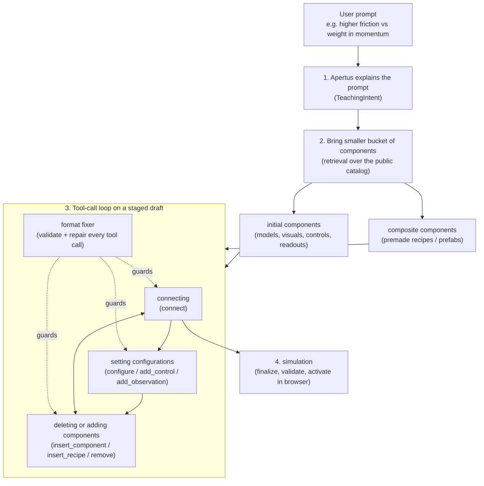
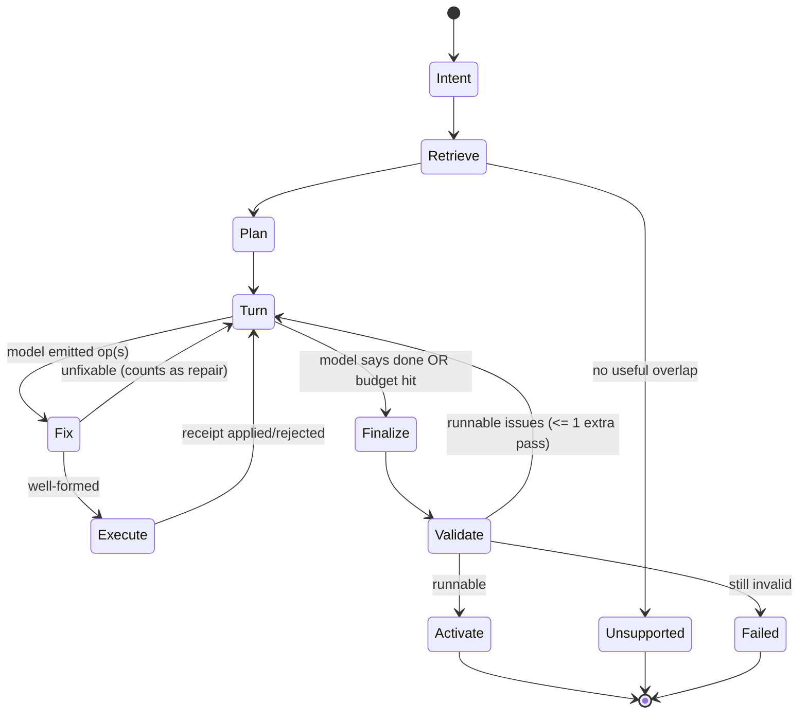

# 016 — Agentic component composition loop, running Apertus 8B on Ollama

Date: 2026-10-07
Status: **Specification for an implementing agent.** Nothing in §4–§9 is implemented unless §2 says so. Mark progress in §12 as you go.
Audience: an LLM coding agent with shell + file access, working in this repo.

---

## 0. TL;DR

Today `POST /api/apertus` can only build **three premade recipes** (arithmetic, area-perimeter, bridge) via fixed stages (intent → retrieve one recipe → fill override args). See [015](015-TOOL-BASED-SIMULATION-GENERATION.md).

The product owner wants an **open-ended, tool-call loop** that lets Apertus assemble a simulation from a *small, relevant bucket of components*, wire them together, add/remove parts, tune configuration, and run it — with a **format fixer** that guarantees every tool call is well-formed before it touches the draft. Example user prompt:

> "I wanna know the difference if I have higher friction or weight in momentum"

The model must run **locally through Ollama** (`michelrosselli/apertus:latest`, already set in `src/web/.env.local`) because the dedicated inference endpoint isn't ready. The existing `src/inference` MLX/Laya servers are **not** needed for this work.

Most low-level machinery already exists (`AuthoringTransaction`, `insert_component`, `connect`, `remove`, `configure`, schema-constrained transport). **The new work is the orchestration loop, retrieval of a component bucket, a format fixer, an Ollama-compatible transport, and the coverage honesty rules for what the runtime cannot simulate.**

---

## 1. Target flow (from the product owner's diagram)



Mapping of diagram boxes to concrete responsibilities:

| Diagram box | Responsibility | Owner |
| --- | --- | --- |
| "apertus explains the prompt" | Produce a bounded `TeachingIntent` (goal, concepts, interactions, observations, explicit constraints with source text). Also a short learner-facing explanation shown while building. | Apertus (1 call) |
| "bring smaller bucket of components" | Deterministic retrieval over the public catalog → ≤ 12 cards split into **initial** and **composite**. Never dump the full catalog into the prompt. | Application code |
| "initial components" | Single public definitions (`PublicDefinition`: models, visuals, controls, displays, canvases). Inserted with `insert_component`. | Catalog |
| "composite component" | Registered recipes / prefabs that already wire several nodes (`insert_recipe`, `addCatalogComponent`). | Recipe registry |
| "tool call" | The model emits **one small JSON op envelope per turn** (or a short batch); application executes. | Apertus → executor |
| "connecting" | `connect` with typed endpoints; validated by `validateConnection`. | Executor |
| "deleting or adding components" | `remove`, `insert_component`, `insert_recipe`. | Executor |
| "setting configurations" | `configure`, `add_control`, `add_observation`, `set_lesson`, `arrange`. | Executor |
| "format fixer" | A deterministic-first (then LLM-assisted) layer that normalizes/repairs malformed tool calls **before** execution. Detailed in §6. | New module |
| "simulation" | `finalizeRecipe` → `loadRecipe` headless validation → browser atomic activation via shared `RecipeLesson`. | Existing runtime |

> [!IMPORTANT]
> The "friction / weight / momentum" prompt is a **coverage test**, not a promise. Per 015 §1.2, the repo has no friction/momentum model and this task **must not** invent one or relabel arithmetic/bridge as momentum. If the catalog has no useful overlap the correct outcome is `status: "unsupported"` with an honest message; if there is partial overlap (e.g. a generic mass/force/velocity model, if any exists after you audit the catalog) the outcome is `partial` coverage with the omissions stated. See §8 for acceptance.

---

## 2. Current state (verified at spec time; re-verify before relying)

Git history shows 015 is largely implemented (`feat: implement tool-based simulation generation`, `feat(generation): harden AI tool flows…`).

**Exists and must be reused (do not rewrite):**

| Area | Path (under `src/web/src/`) | Notes |
| --- | --- | --- |
| Authoring tool union | `simulations/runtime/authoring/operations.ts` | `ToolRequest`: `insert_recipe`, `configure`, `add_control`, `add_observation`, `insert_component`, `connect`, `regenerate_truss`, `remove`, `arrange`, `set_lesson`. `validateToolRequest` enforces exact keys. |
| Transaction | `simulations/runtime/authoring/transaction.ts` | `AuthoringTransaction`, `ToolEnvelope`, `OperationReceipt`; atomic, idempotent by `operationId`, rolls back failed batch. |
| Connections | `…/authoring/connections.ts`, `connections` validators in `validate.ts` | `connectAuthored`, `disconnectAuthored`. |
| Bindings/arrangement | `…/authoring/bindings.ts`, `arrangement.ts`, `board.ts` | Controls/observations, layout. |
| Catalog + discovery | `simulations/components/catalog/{index,discovery,generic,spatial,learningModels,operations,scopedLearningContracts,teaching}.ts` | `publicDefinitions`, `definitionDiscovery`, `searchRank`. **Single source of truth for retrieval.** |
| Recipes | `simulations/runtime/recipes/{registry,loadRecipe,serializeRecipe,schema}.ts` | Only registry/loader/serializer allowed. |
| Planner | `lib/planner/{index,schema,stages,catalog,context,coverage,budget,constraints,diagnostics,errors,browser}.ts` | Staged state machine currently specialised to the 3 recipes (`stages.ts:allowedOperations` hardcodes `["arithmetic","area-perimeter","bridge"]`). |
| Transport | `lib/apertus/transport.ts` | OpenAI-compatible `/chat/completions`; auto-probes `response_format: json_schema`; 2 attempts with repair; 28 000-char context cap; 128 KB response cap. |
| Config | `lib/apertus/config.ts` | `APERTUS_PROVIDER=local` + `APERTUS_LOCAL_BASE_URL/MODEL`. |
| Laya | `lib/laya/*` | Optional. **Not needed for this task**; keep `PLANNER_MODE=apertus`. |
| API route | `app/api/apertus/route.ts` | Reuse; extend protocol only if required. |
| Tests | `scripts/generation/{verify-contract,verify-architecture,verify-faults,verify-fixture-browser,verify-live-browser,verify-ux-browser}.cjs` | `pnpm test` already chains contract/architecture/faults. |

**Does not exist yet (this task creates it):**
1. An open loop over primitives (`insert_component` + `connect` + `remove` + `configure`) driven by the model turn-by-turn.
2. A component **bucket** retriever returning initial + composite cards (the current `capabilityCards()` only emits the 3 recipe cards).
3. A **format fixer**.
4. Ollama-specific transport handling (§3).
5. Tests/evidence for open composition.

> [!WARNING]
> `stages.ts:allowedOperations` filters `insert_recipe` by a hardcoded slug list and `insert_component` by `compatibleComponents()`. Audit what `compatibleComponents()` returns and whether any *combination* of public definitions can actually form a runnable lesson before promising free assembly. Some definitions are only valid inside recipes (see 009 and 013).

---

## 3. Running Apertus 8B on Ollama

### 3.1 What's already configured
`src/web/.env.local` (do **not** print tokens; this file has none):

```
APERTUS_PROVIDER=local
APERTUS_LOCAL_BASE_URL=http://127.0.0.1:11434/v1
APERTUS_LOCAL_MODEL=michelrosselli/apertus:latest
APERTUS_MAX_TOKENS=4096
PLANNER_MODE=apertus
```

At spec time Ollama (0.35.1, `C:\Users\Zero\AppData\Local\Programs\Ollama\ollama.exe`) was installed but **its server was not reachable** on :11434 (`ollama list` timed out: "timed out waiting for server to start"), so model presence was **unverified**.

### 3.2 Setup checklist (Windows / PowerShell)
1. Start the server in its own terminal: `ollama serve`. (If the tray app is wedged, quit it from the tray / `Stop-Process -Name ollama*` first.)
2. `ollama pull michelrosselli/apertus:latest` (confirm that this tag really is Apertus 8B instruct; run `ollama show michelrosselli/apertus:latest` and record parameters, quantization, context length, template). If it is missing or wrong, ask the user before substituting another tag. Do not silently switch models.
3. Smoke test the OpenAI endpoint:
   ```powershell
   $b = @{ model="michelrosselli/apertus:latest"; messages=@(@{role="user";content="Reply with the word ok"}); stream=$false } | ConvertTo-Json -Depth 6
   Invoke-RestMethod http://127.0.0.1:11434/v1/chat/completions -Method Post -ContentType application/json -Body $b
   ```
4. **Context length — critical.** Ollama silently truncates prompts to `num_ctx` (historically 2048–4096). `/v1` cannot pass `options`. Fix one of:
   - Environment: set `OLLAMA_CONTEXT_LENGTH=16384` (or the model's verified maximum) **before** `ollama serve`, or
   - Bake a derived model: `Modelfile` with `FROM michelrosselli/apertus:latest` and `PARAMETER num_ctx 16384`, then `ollama create apertus-8b-16k -f Modelfile`, and set `APERTUS_LOCAL_MODEL=apertus-8b-16k`.
   Then set `APERTUS_CONTEXT_TOKENS` to the value actually in effect so `transport.ts` can enforce its input+output budget. Verify by sending a long prompt and checking `usage.prompt_tokens`.
5. Keep `APERTUS_MAX_CONCURRENT_REQUESTS=1` (8B on a single GPU/CPU) and raise `APERTUS_TIMEOUT_MS`/`PLANNER_TIMEOUT_MS` only if measured latency requires it (015 caps total at 120 s; discuss with the user before exceeding).
6. Expose these steps as a Makefile/README target (e.g. `make -C src/inference ollama-check`, or a short section in `src/web/README.md`) so the next human can repeat them. Do not touch the MLX targets.

### 3.3 Transport changes required (`lib/apertus/transport.ts`)
The current request body assumes MLX:

- `chat_template_kwargs: { enable_thinking: false }` is sent for every `local` provider. Ollama ignores unknown fields, but **verify** it neither errors nor changes behavior. Add a provider flavor: `APERTUS_LOCAL_RUNTIME=mlx|ollama` (default `mlx` to preserve behavior; `.env.local` sets `ollama`). Only send MLX-specific fields for `mlx`.
- `response_format: {type:"json_schema", json_schema:{…strict:true…}}` — Ollama's OpenAI-compat layer supports `json_schema` (grammar-constrained). Keep the existing probe (`APERTUS_STRUCTURED_OUTPUT=auto`); it already tests that the schema is actually enforced. Record the probe result in diagnostics. Known risks to test explicitly:
  - `anyOf`/`oneOf` unions (used by `followupContract`) may be only partially supported by the grammar converter. If the probe or a real union schema fails, fall back to **one tool per call** with a flat schema, or to `strict-json` mode.
  - Large schemas slow down grammar compilation; keep each stage schema small (the loop in §5 uses a narrowed per-turn schema).
- Ollama returns `usage` in `/v1` responses; keep recording tokens, and record "unknown" if absent.
- Error message `Cannot reach local Apertus. Start it with make -C src/inference run.` must be provider-aware (`ollama serve`).
- Handle Ollama-specific failure modes: model not pulled (`404 model not found`) → surface a clear `503` message with the `ollama pull` command; model loading latency on first request (first call can take tens of seconds — do not treat as a failure; consider a warm-up request on server start or a one-time longer first-call timeout).
- Keep `temperature: 0`. Add `seed` only if Ollama honors it and determinism helps tests.

### 3.4 Tool calling mode
Do **not** depend on Ollama's native `tools` API. Apertus' Ollama template may not include tool support and 015 §4.6 states native function calling is optional. Use the existing **JSON op-envelope + schema-constrained decoding** pattern. If you want to experiment with native tools, gate it behind a flag and prove it with a live evaluation first.

---

## 4. Design principles (binding)

1. **Never ask the model to do what code can do.** The model chooses components and supplies small typed arguments. Application code allocates IDs/aliases, validates ports, builds layout, serializes, and activates. (015 §1 item 6; OVERVIEW §4.2.)
2. **Fresh, small context per call** (015 §4.7). No transcript replay; each turn contains: stable instructions + original request + accepted constraints + current draft *summary* + bucket cards needed *now* + last receipt / unresolved issue.
3. **Single catalog authority.** Bucket cards are projections of `publicDefinitions` / recipe registry. No second hand-maintained component list in prompts.
4. **No executable content** from the model; no arbitrary properties; unknown fields rejected.
5. **Transactional.** A failed op leaves the draft untouched. Activation replaces the learner's previous lesson only after a runnable candidate validates.
6. **Honest coverage.** Unsupported parts are omitted *and stated*; never fabricated (no fake mm readout, no relabelled arithmetic).
7. **Reuse the builder/recipe format.** The output is a canonical `CompositeRecipe`; no AI-only renderer, loader, or theme (013, 015 §3).
8. **Protected reference:** Gas Pressure (`simulations/pre-made/gas/gas-pressure.recipe.json`, `composites/gas.ts`) must not change. Run `pnpm test:gas-recipe` after shared edits.
9. Follow `src/web/AGENTS.md`: read the relevant guides in `node_modules/next/dist/docs/` before changing Next.js route/app code.

---

## 5. The orchestration loop

New module: `lib/planner/compose.ts` (name flexible). Replaces nothing in the 3-recipe fast path at first; it is selected when retrieval cannot satisfy the request with a single recipe (or when the recipe path reports partial/none and an open build is plausible). Keep the recipe fast path as a fallback so the three acceptance prompts of 015 keep passing.

### 5.1 State machine



### 5.2 Stages

1. **Intent** — reuse `intentResponseSchema` / `parseIntentResponse` / `intentSources`. Add one field if needed: `learnerExplanation` (≤ 280 chars) for the "apertus explains the prompt" box; surface it through the browser loading state (additive, optional; do not break `GenerationResult` consumers).
2. **Retrieve bucket** — `lib/planner/bucket.ts`:
   ```ts
   type ComponentCard = {
     id: string; version: number;
     kind: "initial" | "composite";
     summary: string;          // from definitionDiscovery / curated description
     supports: string[];       // concepts it can teach
     limitations: string[];
     inputs: PortSummary[];    // typed input ports (name, type, unit)
     outputs: PortSummary[];   // typed outputs
     commands: string[];       // names only
   };
   ```
   - Lexical + concept + tag ranking via `definitionDiscovery`/`searchRank`; diversity pass so one family does not crowd out the bucket.
   - Budget: **≤ 12 cards**, ≤ ~160 tokens each. Hard cap on serialized bucket size (e.g. 6 000 chars). One broader search allowed (015 §4.3).
   - Always include required scaffolding for a runnable lesson (the canvas/host and at least one observation-capable display) if the audit shows the runtime needs them — otherwise the model will build non-runnable drafts.
   - Zero cards with real overlap → `unsupported` (no token-match lessons).
3. **Turn loop** — each turn asks for **one `ToolRequest`** (or `done`). Narrowed schema:
   ```json
   { "action": "tool" | "done", "tool": { "tool": "connect", "arguments": { … } }, "note": "≤120 chars" }
   ```
   Build the per-turn schema from the *current* draft: tool enum restricted to what is currently legal; `target`/`source`/`from`/`to` enums generated from live handles/ports (reuse `activeHandles`, `parameterLeaves`, `patchSchema`, `acceptsScalar` from `stages.ts` — extract rather than copy). Prefer a flat per-tool schema over a big `anyOf` if the Ollama probe shows union weakness.
   - Suggested turn order (guidance in the prompt, enforced softly by code): (a) insert components, (b) connect, (c) configure from intent constraints, (d) add control/observation, (e) set_lesson/arrange, (f) done.
   - After each executed op, give the model a **draft summary**: node aliases + definition + key config, connections as `alias.port -> alias.port`, unconnected required ports, outstanding constraints not yet reflected. Never the full document.
4. **Finalize** — code, not model: `arrange` default if none, `finalizeRecipe`, enforce lesson title/instruction/explanation (model-provided via `set_lesson`, else derived from intent), append coverage limitation text to the lesson explanation (015 §4.1).
5. **Validate** — `validateAuthoredDocument`, `loadRecipe` headless, plus *runnable checks* (every required port connected; at least one control or an explicitly static lesson; at least one observation; no orphan nodes). Issues are fed back to **at most one** extra turn series.
6. **Activate** — existing browser path (`planner/browser.ts` + shared `RecipeLesson`). No builder UI, no approval step.

### 5.3 Budgets (initial, tune with measurement)
- Request deadline 120 s (existing `PLANNER_TIMEOUT_MS`).
- Apertus calls: intent 1 + turns ≤ 10 + repairs ≤ 3. On an 8B local model measure wall-clock; if the loop cannot finish in the deadline, reduce turns by **batching** (allow ≤ 3 ops per turn when each references earlier aliases, per 015 §4.4) rather than raising the deadline.
- Total authored operations ≤ 24 (above the old 12 because composition takes more steps; keep documented).
- Stage output ≤ 512 tokens typically; detect truncation (`finish_reason: "length"`).
- Stop early on repeated identical ops (loop detection): if the same op (by canonical JSON hash) is proposed twice, or the draft revision doesn't change for 2 consecutive turns, force `Finalize`/`Failed`.

Extend `GenerationBudget` (`planner/budget.ts`) with turn counters; do not add a parallel budget object.

---

## 6. Format fixer

Purpose: a model can emit near-valid JSON. The fixer must make execution robust **without** guessing meaning (015 §4.6: no renaming unknown references, no coercing words to numbers, no extracting objects from multiple responses, no guessing truncated documents).

New module: `lib/planner/formatFixer.ts`. Pipeline per model response, **in order**:

1. **Syntax (deterministic, safe only):** strip ```` ```json ```` fences; trim leading/trailing prose *only if exactly one balanced JSON object remains*; reject if multiple objects. Remove trailing commas. No bracket "closing" for truncated output — truncation is a hard error (`finish_reason: "length"`).
2. **Envelope normalization (deterministic):** accept `{tool, arguments}` or the turn envelope; reject unknown keys via `validateToolRequest`'s exact-key rule. Normalize safe aliases only if they are in a small documented table (e.g. `"args"→"arguments"`). Everything else is rejected, not guessed.
3. **Reference resolution (deterministic):** case/whitespace normalization of `target`/`alias` against the **exact** live handle set *only when the match is unique*; otherwise error. Never create a new handle.
4. **Schema check:** validate against the per-turn schema (`validateValue`) — numeric bounds, enums, integer-ness. No silent clamping (015 §4.7).
5. **LLM-assisted repair (bounded):** if 1–4 fail, run **one** repair call: stage context + original request + the *exact* failing path/message + the allowed schema (+ the rejected JSON truncated to 600 chars). The existing `requestStructured` repair mechanism already does this; the fixer reuses it rather than adding a second retry loop. Counts toward `repairs ≤ 3`.
6. **Report:** emit a diagnostics event `fixer.{applied|rejected}` with which deterministic rule fired. Never hide a fix from diagnostics.

Anti-patterns to reject in review: regex-extracting "the first `{…}`", string-to-number coercion of prose, retrying with the whole transcript, relaxing `additionalProperties`.

---

## 7. Components, connecting, and "composite" semantics

- **Initial components** = single `PublicDefinition`s inserted via `insert_component` (aliases are model-chosen, application-uniquified/remapped).
- **Composite components** = registered recipes inserted via `insert_recipe` with `recipeOverrideSchema` overrides, or catalog composites via `addCatalogComponent`. After insertion the composite's *exposed handles* become targets like any other.
- **Connect** uses typed `Endpoint`s; code decides legality via `validateConnection`. Provide the model only legal candidate pairs (generate `from`/`to` enums from compatible port pairs) — do not make it guess port names. Add a deterministic helper `suggestConnections(draft)` that lists legal unconnected required pairs; this both narrows the schema and lets code auto-complete *unambiguous single-candidate* connections (log them as `autoConnected`, and count them in coverage evidence).
- **Remove** is reference-safe: `removeNodes` must handle dependent controls/observations/connections; surface the receipt's side effects in the next turn summary.
- **Configure** merges against the *complete* configuration (nested records such as arithmetic `task` are full replacements) — see `patchSchema` doc comment.
- Control/observation ops must bind to **real** commands/outputs (no placeholders).

---

## 8. Coverage and the friction/momentum prompt

Coverage rules (extend `planner/coverage.ts`):
- `covered` items must come from card `supports` evidence of components that are actually present **and connected** in the final draft.
- `omitted` must list requested concepts with no backing component. Prompt text for the visible limitation is generated by code from `omitted`, not free-form model prose, to avoid hallucinated capabilities.
- Zero overlap → `unsupported`; keep the learner's previous lesson.

**Acceptance prompt A (primary, from the diagram):**
> I wanna know the difference if I have higher friction or weight in momentum

Expected behaviors, depending on audit of the catalog (document which branch applies in the evidence):
1. If no friction/momentum/mass-force model exists → `unsupported`, message names the missing capabilities (friction, momentum), suggests nothing unrelated, no lesson activated, previous lesson retained.
2. If some real overlap exists (e.g., a generic mass/velocity/force model) → `partial`, comparison structure (`suggestedStructure: "comparison"`: two instances differing in mass vs friction if both are parameters of a real model), omissions stated, numeric outputs are the model's real outputs.
3. Never: arithmetic or bridge relabelled as momentum.

**Regression prompts (must still pass, unchanged semantics):** the three exact prompts of 015 §7 (arithmetic 7+4, rectangles A/B, truss bridge with partial deflection). They may use the recipe fast path **or** the new loop, but their oracles in `scripts/generation/cases.cjs` must pass either way.

**Additional open-composition prompts** to add to `cases.cjs` (choose only ones the audited catalog can truly support; each needs an independent numeric oracle):
- a two-rectangle comparison built from *primitive* area/perimeter components rather than the recipe (proves insert+connect+configure+add_control/observation),
- a "remove the perimeter readout" follow-up (proves `remove`),
- an unsupported-only prompt (proves honest refusal).

---

## 9. Files to create / modify

| Path (under `src/web/src/`) | Action |
| --- | --- |
| `lib/apertus/config.ts` | Add `APERTUS_LOCAL_RUNTIME` (`mlx`\|`ollama`) + validation. Keep defaults backward compatible. |
| `lib/apertus/transport.ts` | Runtime-flavored request body, Ollama error messages, first-call latency handling, probe result logged. |
| `lib/apertus/prompts.ts` | Add stable system prompt for the turn loop (extends 015 §4.6 text; adds "one tool per turn, or done"). |
| `lib/planner/bucket.ts` | **New.** Component bucket retriever (§5.2.2). |
| `lib/planner/compose.ts` | **New.** Loop/state machine (§5). |
| `lib/planner/formatFixer.ts` | **New.** §6. |
| `lib/planner/stages.ts` | Extract per-turn schema builders; remove hardcoded 3-slug assumption where the loop needs generality (keep behavior for the fast path). |
| `lib/planner/index.ts` | Route: exact recipe → existing path; else → `compose`. Keep follow-up logic working. |
| `lib/planner/coverage.ts`, `budget.ts`, `diagnostics.ts` | Extend as above; diagnostics add `turn`, `fixer`, `bucket`, `autoConnected`, token usage per call. |
| `simulations/runtime/authoring/*` | Only additive helpers (`suggestConnections`, runnable checks). Mutations stay in `operations.ts`/`transaction.ts`. |
| `app/experiments/_components/*`, `lib/planner/browser.ts` | Surface optional learner explanation while loading; no new approval UI. |
| `.env.example` | Document `APERTUS_LOCAL_RUNTIME` and Ollama values (placeholders only). |
| `scripts/generation/*` | Add cases, fixer unit tests in `verify-contract.cjs`, fault cases in `verify-faults.cjs`, live runner updates. Wire any new script into `package.json` and the `test` chain. |
| `docs/agent-only/implementation/016-validation/` | Evidence (see §11). |

Do not: add a second recipe loader/registry; add AI-only rendering; edit the gas recipe; import builder modules from `runtime/`; install new test frameworks (use Node + `playwright` as existing).

---

## 10. Implementation phases

**Phase 0 — Environment & baseline (no feature code).**
- Get Ollama serving and the model pulled; record `ollama show` output, context length, quantization, GPU/CPU, versions (§3.2). Save to `016-validation/environment.json` (no secrets).
- Run baseline: `pnpm exec tsc --noEmit`, `pnpm test`, `pnpm test:gas-recipe`. Record failures that pre-exist; do not "fix" unrelated ones.
- Catalog audit: list `publicDefinitions`, their ports/commands, and decide which components can legally compose into a runnable lesson. Write the result to `016-validation/catalog-audit.md`. This determines §8's branch for the friction/momentum prompt.

**Phase 1 — Transport & Ollama.**
- Implement §3.3; add a **live probe script** (`scripts/generation/probe-ollama.cjs`) that checks: reachability, model listed, context actually honored, `json_schema` enforcement (incl. `anyOf`, optional fields, enums, nested objects, arrays) and a latency benchmark for a 300-token response. Output a table into the evidence folder.
- Unit tests (mock fetch): MLX body unchanged; Ollama body has no MLX fields; error mapping.

**Phase 2 — Bucket, fixer, schemas (pure code, no model).**
- Implement `bucket.ts`, `formatFixer.ts`, turn-schema builders, `suggestConnections`, runnable checks.
- Deterministic tests: bucket size/diversity limits; fixer accepts/rejects table (fenced JSON, trailing comma, extra keys, truncated JSON, ambiguous reference, unknown reference, out-of-range number); legal-pairs enums; remove side effects; atomic rollback; runnable checks flag orphan nodes.
- **Gate:** a hand-scripted sequence of ops (no model) builds a runnable open composition that loads in `RecipeLesson`.

**Phase 3 — Loop & integration.**
- Implement `compose.ts`, wire `index.ts`, coverage, budgets, diagnostics, browser explanation text. Keep the fast path.
- Fixture-transport tests (scripted model replies) for: happy path, wrong tool, bad reference, repeated op (loop detection), budget exhaustion, cancellation, stale response, unsupported.
- **Gate:** `pnpm test` (including generation contract/architecture/faults) and `pnpm exec tsc --noEmit` green; gas unchanged.

**Phase 4 — Live evaluation on Ollama.**
- Start: `ollama serve`; `pnpm dev --port 43100` with `PLANNER_DIAGNOSTICS=true NEXT_PUBLIC_EXPERIMENT_DIAGNOSTICS=true` (set env in PowerShell: `$env:PLANNER_DIAGNOSTICS="true"; …; pnpm dev --port 43100`).
- Submit each prompt (§8 + 015 §7) **through the home page UI** with Playwright; do not call planner functions directly or mock `/api/apertus` in live runs.
- 5 serial runs per prompt, keep failures in the report. Record first-attempt schema validity separately from post-repair success; tokens/latency per stage; fixer-fired counts.
- Classify failures (retrieval, intent, structured output, fixer, connect, config, layout, activation). Fix at the owning module. Max 3 documented cycles per symptom before reassessing design.

**Phase 5 — UX acceptance.**
- Follow 015 Phase 5 against arithmetic/gas references: no card scrolling, no native number inputs, independent editable items, keyboard + touch, reset/save/remix/Try-lesson parity. Open compositions must meet the same bar.

---

## 11. Verification commands

From `src/web` unless noted. Run commands individually; servers in separate terminals.

```powershell
pnpm exec tsc --noEmit
pnpm exec biome check src          # changed files at minimum
pnpm test                          # full deterministic chain
pnpm test:generation:contract
pnpm test:generation:architecture
pnpm test:generation:faults
pnpm test:gas-recipe
$env:UX_TEST_URL="http://localhost:43100"; $env:GENERATION_RUNS="5"; $env:GENERATION_EVIDENCE_DIR="<absolute path>"; pnpm test:generation:live
$env:UX_TEST_URL="http://localhost:43100"; pnpm test:generation:ux
pnpm exec next build --webpack     # if default build stalls, label which builder passed
```

Evidence goes under `docs/agent-only/implementation/016-validation/` (`environment.json`, `catalog-audit.md`, `ollama-probe.md`, `phase-4/<run-id>/…`, `final-report.md`). Never fabricate results; unknown token counts are recorded as unknown.

---

## 12. Definition of done (checklist for the implementing agent)

- [ ] Ollama serving `michelrosselli/apertus:latest` (or user-approved alternative) with verified context length; probe results recorded.
- [ ] `APERTUS_LOCAL_RUNTIME` supported; MLX path behavior unchanged and tested.
- [ ] `bucket.ts` returns ≤ 12 cards split initial/composite, derived from the catalog, with tests.
- [ ] `formatFixer.ts` implemented with the §6 pipeline; tests include anti-guessing cases.
- [ ] `compose.ts` loop: intent → bucket → tool turns → finalize → validate → activate; budgets, loop detection, cancellation, stale-response handling.
- [ ] Open composition (insert + connect + remove + configure + control/observation) demonstrably produces a runnable lesson in the shared `RecipeLesson`, with save/reload/remix parity.
- [ ] Friction/momentum prompt yields the correct honest outcome (§8) with evidence; no relabelled unrelated lessons.
- [ ] 015's three prompts still pass.
- [ ] Gas Pressure sources unchanged (hash-compare) and `pnpm test:gas-recipe` green.
- [ ] `pnpm test`, `tsc --noEmit`, lint, build green; new scripts wired into `package.json`.
- [ ] `.env.example` and README/Makefile document the Ollama workflow (no secrets).
- [ ] Final report lists residual limitations and any deleted/retained legacy code per 015's ledger (do not delete legacy paths still used by the fast path).

## 13. Product decisions (resolved 2026-10-07) and remaining questions

Resolved by the product owner:

1. **Hardware target:** RTX 5070 (12 GB VRAM), Ryzen 7 7800X3D, 32 GB DDR5-5600 CL40. Run the model **fully on GPU**. Required settings:
   - Context: `OLLAMA_CONTEXT_LENGTH=16384` (acceptable range 12288–24576; do not exceed what Phase 0 measurement shows stays within VRAM). Set `APERTUS_CONTEXT_TOKENS` to the same value.
   - Quantization: prefer **Q8_0 (~8.5 GB weights)** if it fits at 16k context; otherwise **Q4_K_M/Q5_K_M (~5–6 GB)**. Run `ollama show` and `ollama ps` to confirm the loaded size and that PROCESSOR reports **100% GPU**. If any CPU offload appears, lower quantization or context; offload would cut speed several-fold and break the 120 s budget.
   - Do not use fp16 (~16 GB, will not fit).
   - Expected speed (an estimate that Phase 0/1 must measure, not assume): Q4 roughly 80–120 tok/s generation, Q8 roughly 50–70 tok/s. First request includes model load time.
   - Record `nvidia-smi` VRAM usage and measured tok/s in `016-validation/environment.json`.
   - Keep `APERTUS_MAX_CONCURRENT_REQUESTS=1`; close other VRAM-heavy apps during live evaluation.
2. **Fast path policy:** the open-composition loop runs **only when no single recipe fits**. The recipe fast path stays first; fall back to the loop on no-fit or zero useful single-recipe coverage. Do not replace the fast path.
3. **Visible explanation:** **yes.** Show the "Apertus explains the prompt" text (`learnerExplanation`) in the loading state as an additive optional field. It must not block activation.

Still open:

4. Should adding a friction/momentum model be a follow-up task? (Out of scope here per 015 §1.2.)


## 14. References

- [OVERVIEW](../OVERVIEW.md), [COMPONENT_CONTRACTS](../COMPONENT_CONTRACTS.md), [Component Architecture](../../COMPONENT_ARCHITECTURE.md)
- [003 Apertus component integration](003-APERTUS_COMPONENT_INTEGRATION.md), [015 Tool-based generation](015-TOOL-BASED-SIMULATION-GENERATION.md), [009 Public catalog](009-PUBLIC_COMPONENT_CATALOG_AND_COMPOSITE_BUILDER.md), [013 Recipe convention](013-PREMADE-JSON-RECIPE-CONVENTION.md)
- Design: [001](../design/001-EXPERIMENT-BUILDER-DESIGN-PHILOSOPHY.md), [002](../design/002-COMPONENT-DESIGN-PHILOSOPHY.md), [003](../design/003-SIMULATION-DESIGN-PHILOSOPHY.md)
- Features: [Manual builder processes](../features/MANUAL_BUILDER_PROCESSES.md), [Domain composition](../features/MANUAL_BUILDER_DOMAIN_COMPOSITION.md)
