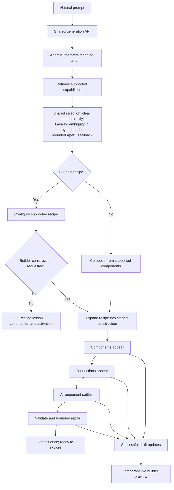

# 025 — Live experiment builder construction from natural prompts

Date: 2026-10-10  
Status: Implementation plan; no feature implementation or live verification is claimed by this document.  
Audience: implementing and reviewing agents, followed by product-owner testing.

## 1. Product requirement

In `/experiments/builder`, a person asks:

> Show me how springs work.

The application infers a useful experiment through the same interpretation, supported-capability retrieval, and selection process used by the main experiment prompt interface. The person does not have to name models, ports, graphs, or layout templates.

The visible sequence is **components appear → connections appear → arrangement settles → experiment is ready**. Intermediate construction must be visible while generation is still pending. A finished document animated only after the response arrives does not satisfy this requirement.

Preserve the simplicity requirements in [IMPORTANT](IMPORTANT.md) and the design guides for [builder](../design/001-EXPERIMENT-BUILDER-DESIGN-PHILOSOPHY.md), [components](../design/002-COMPONENT-DESIGN-PHILOSOPHY.md), [simulations](../design/003-SIMULATION-DESIGN-PHILOSOPHY.md), and [usability QA](../design/004-USABILITY-QA-GUIDE.md). Keep the experiment prominent, explanations short, and essential actions obvious. Do not turn construction progress into a diagnostic dashboard.

## 2. Current implementation and gaps

Paths below are relative to `src/web/src/` unless otherwise stated.

| Existing part | Current behavior | Required change |
| --- | --- | --- |
| `app/experiments/_components/ExperimentsShell.tsx` | Main prompt interface requests streamed progress and activates the final lesson. | Reuse its progress behavior without changing normal lesson activation. |
| `lib/planner/browser.ts` | Calls `/api/apertus`; accepts progress stages and a final result. | Add validated construction events and a draft-update callback. |
| `app/api/apertus/route.ts` | Streams NDJSON stage identifiers and final results. | Stream public construction updates through an explicit planner callback. |
| `lib/planner/index.ts` | Interprets intent, retrieves capabilities, selects/configures recipes, or falls back to composition. | Preserve shared selection; add explicit builder destination and construction preference. |
| `lib/planner/compose.ts` | Apertus executes successive operations against an authoring transaction. | Publish successful draft revisions, including automatic connections and repairs. |
| `lib/planner/compositionPolicy.ts` | `required-laya` requires hybrid mode, Laya decisions, and Apertus; forces composition. | Retain this strict verification branch; do not confuse it with ordinary recipe-first behavior. |
| `simulations/builder/composition/useBuilderAi.ts` | Waits for the result, checks for concurrent edits, commits the entire recipe once. | Maintain a separate temporary construction preview; preserve final validated commit. |
| `simulations/builder/composition/CompositionBuilder.tsx` | Connections uses `doc`; Build uses the validated document. | Route preview state deliberately into both views. |
| `simulations/builder/ConnectionNode.tsx`, `composition/CompositionGraph.tsx` | Blocks use direct coordinates; wire paths derive from endpoints. | Animate blocks and wires from shared displayed positions. |
| `simulations/builder/history/useDocumentHistory.ts` | Normal authored edits validate and enter undo history. | Keep intermediate previews outside this path; use it once at completion. |

Builder follow-ups currently use `builder-` session IDs to reach composition. An empty builder has no active experiment, so session-ID inference is insufficient for explicit construction behavior.

The `arrange` tool currently chooses lesson templates and content roles. It does not give Apertus arbitrary connection-graph coordinates. Graph layout and lesson-board placement must be treated separately.

Spring capability is an audit requirement, not an established fact. Composer suggestion text is not proof of an executable spring model or compatible visual. Resolve exact catalog IDs, commands, units, bounds, and observations before implementation or expected-output assertions.

## 3. Shared process and builder output



The strict `required-laya` branch bypasses normal recipe selection and asks Laya to select a composition strategy. Test it independently. Laya selects supported capabilities; Apertus authors/configures; the executor validates; the UI presents accepted state. Laya is not currently a per-connection or coordinate planner.

## 4. Construction semantics

### Recipe-first requests

Keep proven recipe configuration and constraints. A single `insert_recipe` currently inserts an assembly, so streaming that receipt alone would reveal everything together.

Add a staged expansion mechanism that preserves resolved IDs, scopes, resources, groups, configuration, exposed interfaces, bindings, and presentation metadata. Prefer executing the resolved assembly incrementally in the actual staged transaction. Structural draft validation must permit known incomplete wiring; final runnable validation remains mandatory.

If existing atomic authoring contracts prevent safe incremental execution, document the alternative explicitly: validate the assembled transaction, then publish genuine intermediate presentation states during request processing. Identify this as staged recipe expansion, not independent model decisions. Never present an unvalidated attempted connection as successful. Never replace the requirement with playback after the final response.

### Open composition and follow-ups

Emit updates after accepted operations. Some operations create controls together with their connections; separate those mutations where safe, or stage the visible reveal while retaining correct transaction semantics. Establish a dependency-aware phase controller for creation, wiring, arrangement, and validation. Request components before wiring where dependencies permit.

Repairs may revisit a phase. Show a short “Adjusting connections…” status rather than pretending the process is strictly monotonic. Follow-up configuration-only requests do not need fabricated insertions: highlight the affected component and show its real update.

## 5. Implementation work packages

### A. Explicit request mode and shared prompt behavior

- Extend `lib/planner/schema.ts` with a backward-compatible destination/construction preference. Existing callers without it retain current behavior.
- Send builder intent even from an empty workspace; keep active document/revision context for edits.
- Reuse teaching-intent extraction, catalog retrieval, constraint preservation, coverage reporting, and provider configuration. Do not add a competing keyword router for builder prompts.
- Audit spring support. If missing, record the gap and add focused reusable model/view adapters with public contracts and behavioral checks before claiming the primary scenario passes. Do not substitute a pendulum and label it a spring.

Gate: a short prompt selects a supported experiment without requiring technical details or unnecessary clarification.

### B. Public construction event contract

Start with full bounded draft snapshots after successful revisions. Avoid client-side re-execution of model operations, which could diverge from server state. Optimize to patches only when measurements justify it.

Proposed construction payload, subject to the repository's schema conventions:

```ts
type ConstructionUpdate = {
  type: "construction";
  requestId: string;
  sequence: number;
  draftRevision: number;
  phase: "components" | "connections" | "arrangement" | "checking";
  document: AuthoredDocument;
  affected: { nodes: string[]; connections: string[] };
  activity: string; // brief application-produced description
};
```

Sequence numbers order public events independently of transaction revisions; staged presentation may share a revision. Define stable connection identity and validate every field. Retain existing progress and result events. Final result remains authoritative.

- Add an explicit construction sink through the planner; do not expose raw diagnostic traces or internal model reasoning.
- Emit after successful mutations, including recipe expansion, extensions, auto-connections, repairs, and final reconciliation.
- Establish snapshot/frame size limits, bounded pending buffers, cancellation checks, and terminal-event rules. Reject malformed streams and events after a terminal result.
- Preserve JSON responses for existing callers. Define how interrupted NDJSON streams fail without committing partial state.

Gate: correlated intermediate revisions arrive before the final result; stale or malformed updates cannot activate content.

### C. Temporary preview and completion

- Extend `useBuilderAi` with preview state, current phase/activity, and an active-request owner.
- Keep committed document, saved draft, and history separate from preview state.
- Display a preview adapter in Connections. Build displays safe authored placeholders until dependencies allow faithful rendering; do not run an incomplete simulation accidentally.
- During generation allow pan, zoom, view switching, and Stop. Disable document mutations, undo/redo, saving, import, and preview export; inspect all entry points rather than only disabling the prompt button. Viewport navigation must not trigger the concurrent-content-edit guard.
- Stop aborts inference, clears preview/animation queues, preserves prompt text, and restores committed content. Failure does the same with useful feedback.
- On success validate the authoritative result, synchronize the last preview, commit through normal editing exactly once, then clear temporary state without a visual jump. A valid no-op follow-up should receive an appropriate status rather than a generic rejection.
- Unmount and new requests invalidate old callbacks. One Undo restores the pre-request document; Redo restores the result.

Gate: no unfinished state enters persistence or history, and completion matches the final server document.

### D. Layout, animation, and simple progress

- Give new graph components stable provisional positions near related components. Preserve existing positions, locked placement, and group relationships. Avoid rearranging all blocks on every insertion.
- Apply final graph arrangement separately from lesson-board arrangement. Extend placement tools only if an audited board requirement needs them.
- Animate entrances, wire creation, configuration highlights, and movement with stable IDs. Drive moving blocks and SVG endpoints from the same displayed coordinates so wires stay attached.
- Use short bounded animations and a bounded presentation queue; catch up/coalesce updates under load without dropping authoritative state. Completion must not wait behind a long theatrical backlog.
- Add optional “Follow build”; manual navigation suspends following. Avoid repeated fit-to-all zooms. Honor reduced motion and keyboard operation; announce concise phase changes, not every frame.
- Show one compact activity message and Stop. Keep developer diagnostics outside the ordinary interface. Update component counts from the displayed preview.

Gate: the creation/wiring/arrangement sequence is legible on desktop and narrow screens, without camera fighting or obstructive overlays.

## 6. Natural prompts and expected outcomes

| Prompt | Expected intent and behavior |
| --- | --- |
| “Show me how springs work.” | A supported spring–mass visual experiment; a stiffness control and simple release/start action where supported. Components first, then connections, then final arrangement. |
| “What happens if the spring is stronger?” | Interpret stronger as stiffness in this context, preserve existing work, and update/highlight supported controls or configuration. |
| “Make it stop bouncing so much.” | Interpret as damping where supported, explain the visible effect briefly, and preserve unrelated content. |
| “Show me how pendulums work.” | A second supported topic checks shared retrieval and construction rather than a spring-specific shortcut. |
| “Show me something that isn't supported.” | Honest unsupported/partial coverage, bounded execution, and preservation of the prior experiment. |

For springs, start with one learning question: how stiffness changes the motion. A displacement graph is optional and should be included only if it improves this task; avoid automatically exposing every measurement. Keep the opening learner controls minimal. Choose exact defaults and numerical assertions only after catalog/model audit.

Expected physical oracle for an ideal linear spring model: at fixed mass, small-amplitude angular frequency is `sqrt(k/m)`; quadrupling stiffness doubles frequency. For damping, use the audited model's supported regime and verify decay rather than asserting every setting is underdamped. A moving visual alone does not prove correct behavior.

## 7. Real Apertus and Laya inference setup

Run commands from the repository root. Inspect existing setup and model availability first; do not overwrite unrelated environment configuration or print secrets. Prefer the existing working Apertus runtime. MLX is the reference local path provided by the repository, not a requirement to replace a working Ollama deployment.

```sh
# If the respective virtual environments are missing:
make -C src/inference setup
make -C src/inference setup-laya

# Separate long-running terminals:
make -C src/inference run-apertus
make -C src/inference run-laya

# Readiness and warm-up:
make -C src/inference smoke
make -C src/inference smoke-laya
```

Reference MLX configuration for a strict two-provider verification run:

```dotenv
LLM_PROVIDER=apertus
APERTUS_PROVIDER=local
APERTUS_LOCAL_RUNTIME=mlx
APERTUS_LOCAL_BASE_URL=http://127.0.0.1:43101/v1
APERTUS_LOCAL_MODEL=m1rkocasu/Apertus-v1.5-8B-text-MLX-mxfp4
PLANNER_MODE=hybrid
DECISION_PROVIDER=laya
LAYA_BASE_URL=http://127.0.0.1:43102
COMPOSITION_DECISION_POLICY=required-laya
```

An explicit `LLM_MODEL` or other unified configuration may override legacy Apertus values; check effective non-secret configuration. Confirm service model identity and readiness, warm Laya inference rather than relying only on a status response, and measure latency before changing capped timeouts or budgets.

Start the web application with `pnpm --dir src/web dev`. Reuse an existing compatible server if available. Record the actual port and configurations. Restart when necessary to apply policy changes.

Test normal recipe-first mode with `COMPOSITION_DECISION_POLICY=optional` separately. In that mode Laya may legitimately be skipped for a clear match; record it as skipped. A strict run only passes if evidence shows an accepted real Laya decision plus successful real Apertus authoring. Mocks, provider names in configuration, and Ollama-only runs do not prove both participated.

## 8. Implementation and review loop before user testing

1. **Audit:** read applicable `AGENTS.md`, design guidance, current contracts, provider configuration, and spring capabilities. Follow the local Next.js guidance before editing affected framework code. Record gaps and resolve exact catalog IDs.
2. **Implement the smallest end-to-end path:** stream successful snapshots into a temporary Connections preview, with cancellation and one final commit. Then add phased recipe expansion, coherent motion, and safe Build previews.
3. **Verify deterministic mechanics:** controlled streams test intermediate rendering, correlation, revision ordering, split frames, malformed/oversized events, failure, cancellation, stale replies, and one Undo/Redo. Include no-op follow-ups and preservation of existing content. Register focused checks in the appropriate package scripts.
4. **Verify real inference:** warm both services, submit the short primary prompt through the actual builder, and correlate request ID with selection, provider/model, tool receipts, revisions, elapsed time, repairs, coverage, and result. Keep diagnostics developer-only; missing usage is unknown.
5. **Inspect through Playwright MCP where available:** navigate to `/experiments/builder`, submit the prompt, observe the request still pending, inspect visible components/wires, capture intermediate phases and final state, and operate the resulting experiment. Use the available MCP tool's supported browser actions; do not invent tool names.
6. **Fallback transparently:** this planning session has no callable Playwright MCP tools. If still unavailable during implementation, use the repository's local Playwright dependency and scripts for reproducible browser checks and screenshots. State the actual method in the report; do not label local scripts MCP verification. Read the browser skill if using its in-app browser capabilities.
7. **Review behavior and appearance:** inspect the opening state, construction motion, port attachment, arrangement, control effects, reduced motion, narrow viewport, camera following, and errors. Use time-stamped video or intermediate captures plus event timings; a final screenshot cannot prove live construction.
8. **Fix and rerun:** classify each issue as capability/inference, transaction, transport, state, rendering, layout, or interaction. Fix its cause and repeat the failing scenario, then relevant regression checks. Keep prompts unchanged when evaluating improvements; do not replace the lazy prompt with a technical prompt to obtain a pass.
9. **Bound attempts:** use a predeclared cap of three real attempts per scenario per candidate and at most three fix/review cycles before reporting unresolved blockers. Record every failure and actual timings; never retry indefinitely or report only the best run. These limits bound agent work, not learner interaction time.
10. **Handoff only with evidence:** analyze results before asking the product owner to test. If inference/runtime access remains unavailable, mark dependent checks Not tested and report the blocker; do not declare the feature verified.

Run type checking and relevant existing generation contract, progress, composition, builder, and provider checks. Run browser checks for affected surfaces. Use the existing full suite/build when required by repository instructions or cross-cutting protocol changes; broaden again only for new failures or unresolved concerns.

## 9. Acceptance and evidence

- [x] A natural short prompt works without technical component instructions.
- [x] Main experiment prompts retain their existing selection and activation behavior.
- [x] Empty and existing builder documents use explicit builder construction mode.
- [x] Components are visible while generation is pending; connections follow; arrangement completes before ready.
- [x] Atomic recipe expansion and open composition both meet the visible sequence requirement.
- [x] Repairs and configuration-only follow-ups show honest changes rather than fabricated construction.
- [x] Moving wires stay attached; provisional layout remains readable; navigation remains usable.
- [x] Build preview tolerates incomplete content without starting invalid runtime behavior.
- [x] Stop/failure/stale events preserve committed content and clear temporary queues.
- [x] Final state matches the authoritative result; persistence excludes previews; one Undo/Redo works.
- [x] The real spring experiment passes its audited behavioral oracle and has simple opening controls.
- [x] Strict verification proves actual Apertus and Laya participation; normal recipe-first behavior is also checked.
- [x] Desktop, narrow viewport, keyboard, reduced motion, and relevant save/Try lesson flows are reviewed.
- [x] All blocking/major issues are resolved or explicitly reported; no screenshot-only reliability claim.

Create `025-validation/implementation-report.md` during implementation, with linked intermediate captures, recordings where available, sanitized event timelines, provider evidence, prompt attempts including failures, checks and findings, and remaining limitations. Use Pass / Concern / Fail / Not tested. Separate observed interaction evidence from inferred usability concerns; agent review is not proof of first-time human understanding.

The final handoff includes the tested route, actual browser method, exact natural prompts, expected visible sequence, service startup instructions, known limitations, and a short outcome-only user test: ask “Show me how springs work,” watch construction, change stiffness, stop/retry a build, and undo a completed change.

## 10. Progress tracker

- [x] Capability and contract audit
- [x] Explicit builder request mode and public construction schema
- [x] Planner/API emission and staged recipe expansion
- [x] Temporary preview and safe completion/recovery
- [x] Graph and board layout/motion
- [x] Deterministic checks
- [x] Real recipe-first and strict Apertus/Laya runs
- [x] Playwright inspection, analysis, and fixes
- [x] Evidence report and product-owner handoff

Related plans: [015 — Tool-based generation](015-TOOL-BASED-SIMULATION-GENERATION.md), [016 — Agentic composition](016-AGENTIC-COMPONENT-COMPOSITION-AND-OLLAMA.md), [019 — Realistic prompts with Laya and Apertus](019-REALISTIC-PROMPT-COMPOSITION-WITH-LAYA-AND-APERTUS.md). Treat older documents' runtime assumptions as historical; confirm current code and the user's chosen inference setup.

## Implementation handoff

Implemented and verified with real local Apertus/Laya inference, the normal recipe-first path, deterministic contracts/physics, repository Playwright, the full test suite, type checking and a production build. See [implementation and validation report](025-validation/implementation-report.md) for evidence, failed attempts and fixes, rerun commands, the precise transaction guarantees and remaining canvas/model limits. The checklists record implementation and review; they do not certify database ACID or universal prompt success.
