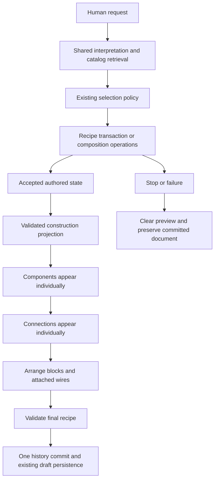

# Live experiment builder: implementation and validation

Implementation of [plan 025](../025-LIVE-EXPERIMENT-BUILDER-CONSTRUCTION.md).

## Follow-up correction: optional mass controls

The request **“can you add mass changing”** exposed a defect in the completed-graph tool filter: it excluded optional `add_control` operations, and the addition detector required technical words such as “slider.” The planner could interpret this request as a configuration edit instead of adding an interactive component.

Control additions now resolve against actual catalog command names and argument fields. Completed graphs expose the requested extension. For an existing experiment, the planner adds missing requested controls, verifies their command connections, arranges the result, and finishes without unrelated configuration calls. Operation choices expose their exact command/output values. Empty arrangement roles remain empty, and SpringMass coverage correctly acknowledges mass support. Final camera fitting uses the actual prompt overlay bounds and runs after construction completes.

The full planner regression asserts `add_control → arrange`, one added node, two bounded Apertus argument calls, and unchanged model settings. All repository tests, TypeScript, and changed-source Biome checks passed. Live local Playwright run `runs/1791627459675-live/report.json` passed with real Apertus inference and an accepted Laya decision using the exact informal request on an existing spring experiment. It verified one connected mass slider, bounds of 0.2–5 kg, enabled interaction and an accepted value change, preserved settings and existing wires, a visible final overview, one undo/redo step, reload persistence, and opening the completed lesson. Earlier failed runs remain in the ignored evidence directory, including the transaction discard after an unnecessary configure call and the prompt-overlay camera defect.

## What is implemented

The builder accepts a short request such as **“Show me how springs work.”** through the same planner entry point used by the main experiment page. Builder requests explicitly opt into construction events. Normal lesson requests retain their existing activation behavior and progress protocol.



The projection publishes accepted transaction state while the request is running. A recipe inserted atomically is expanded into individual presentation snapshots. With Follow build enabled, final checking shows an overview of the arranged graph and reserves space for the prompt bar. In open composition, accepted operations publish their actual state. The activity text describes public work such as adding a component; it does not expose model reasoning. Existing objects stay visible for follow-up edits, and changed objects are highlighted.

Connections and their blocks use one displayed position source during motion. Camera following can be disabled, and manual navigation suspends it. Reduced motion removes entrance and movement animation. The Build tab uses safe placeholders while construction is incomplete, then mounts the existing simulation renderer after completion.

A registered spring/mass model and appearance now support this request. The model solves the damped harmonic oscillator, including underdamped, critical and overdamped motion. The initial generated spring lesson has stiffness and Release controls. Mass, damping and amplitude remain available through the model's existing configuration interface.

## Engineering and transaction guarantees

Responsibilities are separated into a public event contract, a planner-side projection, a byte-bounded stream writer, a strict browser consumer, preview/commit adapters, and graph presentation. The planner accepts an injected construction sink; headless authoring and physics do not import builder UI code. The public catalog remains the source of component and command contracts. Focused edits separate operation choice, setting-name selection and value generation. Names recognized by the shared interpreted intent constrain the legal configuration patch; a successful focused parameter refinement completes in one patch. This bounds relative changes and preserves unrelated settings. Updated experiments retain recipe identity, and repeated follow-ups do not append duplicate scientific assumptions.

| Property | Implemented guarantee | Boundary |
| --- | --- | --- |
| Atomicity | Preview changes never enter history or draft storage. A successful final result is validated and applied through one existing history edit. Stop/failure clears the preview. | Browser authoring transaction; partial updates are presentation only. |
| Consistency | Public component contracts, structural snapshots and the final runnable recipe are validated. Event IDs, revisions, sequence and byte limits are checked. | Unsupported model output is rejected rather than committed. |
| Isolation | Mutation controls and keyboard history are locked during construction. A content fingerprint rejects a result if the committed document changed. Request ownership rejects stale callbacks. Pan/zoom remain independent. | No cross-tab or multi-user serializable transaction is introduced. |
| Durability | Only the completed document enters existing persistence; successful reload recovery is exercised. Existing storage error handling remains in use. | Local browser storage can be cleared or fail. This is not a database ACID certification or a new MongoDB transaction layer. |

Stream backpressure pauses production when a consumer is slow. Cancellation and the generation deadline unblock a paused producer. Event count, frame size and total bytes are bounded. Diagnostics remain development-only and are not part of learner-facing construction events.

## Validation evidence

The browser automation uses the repository's **local Playwright**, since a callable Playwright MCP server was unavailable. Captures, network observations, diagnostics and traces are retained locally under `runs/`, which is ignored by Git.

| Check | Evidence |
| --- | --- |
| Real Apertus + accepted Laya spring selection, progressive build, working Release, one Undo/Redo, reload | [Real spring report](runs/1791626085425-live/report.json) |
| Final overview geometry, progressive UI, history/reload and Try lesson | [Overview report](runs/1791626019995-fixture/report.json) |
| Manual camera-follow and keyboard mutation locks, narrow navigation | [Navigation report](runs/1791624655529-fixture/report.json) |
| Real natural stiffness follow-up, unrelated setting preservation, runtime, history and Try lesson | [Stiffness report](runs/1791625207961-live/report.json) |
| Real normal recipe-first area/perimeter build, staged construction, runtime, history and Try lesson | [Recipe-first report](runs/1791625288395-live/report.json) |
| Real natural damping follow-up, unrelated setting preservation, runtime, history and Try lesson | [Damping report](runs/1791625166658-live/report.json) |
| Terminal validation failure preserves original content and prompt | [Failure report](runs/1791625645725-fixture/report.json) |
| Stop preserves original content and prompt | [Cancellation report](runs/1791625648067-fixture/report.json) |
| Reduced-motion construction and recovery | [Reduced-motion report](runs/1791625643743-fixture/report.json) |

The deterministic construction suite additionally checks separate operation/setting/value inference contracts and completion, recipe expansion, schema rejection, order/correlation, truncated streams, byte limits, cancellation under backpressure, operation deadlines, isolated preview/commit preparation and zoom independence. Spring physics is compared with an independent RK4 integration oracle; energy conservation/decay and command execution are checked through the real authored runtime.

The existing home-page progress browser suite verifies streamed stages, Stop, restart, Retry, narrow layout and lesson activation. The full repository test suite has passed. Verification completed for this change (composition, construction, browser and production-build checks repeated after the final camera refinement):

| Command/check | Result |
| --- | --- |
| `pnpm --dir src/web test` | Pass, exit 0 |
| `pnpm --dir src/web exec tsc --noEmit` | Pass |
| Isolated `pnpm --dir src/web build` | Pass, exit 0 |
| Biome checks on all changed/new TypeScript and CSS | Pass; seven existing `!important` style warnings |
| `git diff --check` | Pass |
| Final real spring build plus both follow-ups and overview geometry in one browser session | Pass, no browser errors |
| Normal recipe-first real build | Pass |
| Final Stop, failed-validation and reduced-motion browser checks | Pass |

Issues found during inspection were fixed: an invalid client-directive placement, a headless/UI import boundary, repeated preview-driven selection updates, hidden camera controls on narrow screens, and focused follow-up tools that could not terminate, missing active-experiment context for pronoun-based Laya selection, a final camera that cropped the completed graph, and camera following that redundantly wrote unchanged zoom values. Entrance now fades without a separate block translation, so wire endpoints use the same geometry throughout arrangement. Browser observation races were fixed separately from product behavior.

## Reproduce and review loop

1. Start the configured local Apertus and Laya services using the project's existing inference setup. This implementation does not replace provider setup or change `.env.local`.

   ```sh
   make -C src/inference run-apertus
   make -C src/inference run-laya
   # In another terminal, verify actual inference readiness:
   make -C src/inference smoke
   make -C src/inference smoke-laya
   ```

   Use separate terminals for the long-running servers. The verified local setup uses Apertus at `127.0.0.1:43101` and Laya at `127.0.0.1:43102`.
2. Start Next.js with an isolated build directory and diagnostics enabled:

   ```sh
   APERTUS_BROWSER_TEST_DIR=.next-live-builder PLANNER_DIAGNOSTICS=true pnpm --dir src/web dev --hostname 127.0.0.1 --port 43125
   ```

3. Run deterministic contract/physics checks and browser checks:

   ```sh
   pnpm --dir src/web test:generation:construction
   UX_TEST_URL=http://127.0.0.1:43125 pnpm --dir src/web test:builder:construction:browser
   CONSTRUCTION_CANCEL=true pnpm --dir src/web test:builder:construction:browser
   CONSTRUCTION_FAILURE=true pnpm --dir src/web test:builder:construction:browser
   CONSTRUCTION_REDUCED_MOTION=true pnpm --dir src/web test:builder:construction:browser
   ```

4. Run the real-provider browser scenario:

   ```sh
   UX_TEST_URL=http://127.0.0.1:43125 pnpm --dir src/web test:builder:construction:live
   ```

   Strict `required-laya` mode must show an accepted Laya decision and applied Apertus-authored operations. A normal recipe-first run uses an isolated process with `COMPOSITION_DECISION_POLICY=optional`; do not change the user's environment file to switch policies. A deterministic fixture is not evidence of real inference.

5. Inspect each report, provider diagnostics, intermediate/final captures and trace. Check operation timing and behavior rather than inferring correctness from screenshots. Fix the observed issue, rerun the affected scenario, then run the relevant regressions. For follow-ups, `CONSTRUCTION_FOLLOWUPS=true` runs both human prompts after the initial spring build; `CONSTRUCTION_NAVIGATION=true` adds camera-follow and keyboard-lock checks to a fixture run. Preserve failed reports as evidence of the repair process.
6. For manual testing, open `/experiments/builder`, ask **“Show me how springs work.”**, watch Components → Connections → Arrangement → Ready, open Build, change stiffness and press Release. Stop during another generation to check rollback. Use Undo once to restore the preceding document.

## Practical limits

The narrow builder remains an infinite canvas using the existing shared editor zoom. Fitting a large graph can make the Build board small; pan and zoom are available. The reviewed narrow captures verify accessible navigation and the construction flow, rather than establishing that every simulation board has a finished responsive lesson layout.


Generation remains constrained to registered capabilities and the existing provider budgets. A broad rectangle request in optional composition mode returned malformed Apertus tool arguments and was safely rejected; see [failed real run](runs/1791622883512-live/report.json). This feature improves construction visibility and transaction safety, but does not guarantee that every natural request will generate successfully.

Account-backed save/publish integration is not newly implemented by this change. Preview states are never submitted to it. Local reload, history and storage failure contracts are checked; external persistence still depends on the existing account/database configuration.

## Review scope

Pass: recorded structural and runtime assertions, final combined real-model scenario, recovery checks, and reviewed desktop captures. Concern: narrow authoring boards retain canvas scaling; this review is not proof of first-time learner understanding. Not tested: authenticated remote save/publish with a real account or multi-user database transactions.

The fix/review work required more iterations than the plan's proposed three-cycle review cap. Failed fixture, browser and real-provider attempts are retained under `runs/`; the final passing combined scenario was not obtained by substituting technical prompts for the human prompts. The results demonstrate the recorded scenarios, rather than a universal model success rate.

## Handoff

The isolated validation server is available at `http://127.0.0.1:43125/experiments/builder` for manual testing. The final combined real run increased stiffness from 20 to 40 N/m, then damping from 0.3 to 0.6 N s/m, preserving mass, amplitude and wiring. Its diagnostic trace contains an accepted actual Laya decision and applied Apertus-authored operations. Desktop construction, the final complete Connections overview and final spring views were visually reviewed; narrow captures show the canvas behavior described above.
