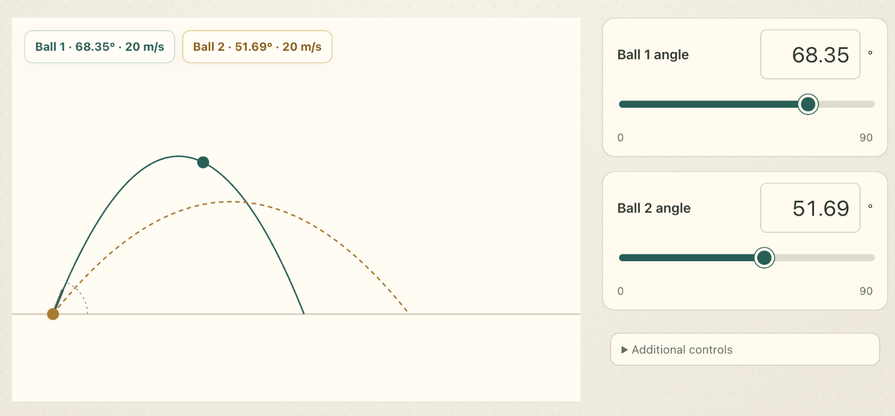
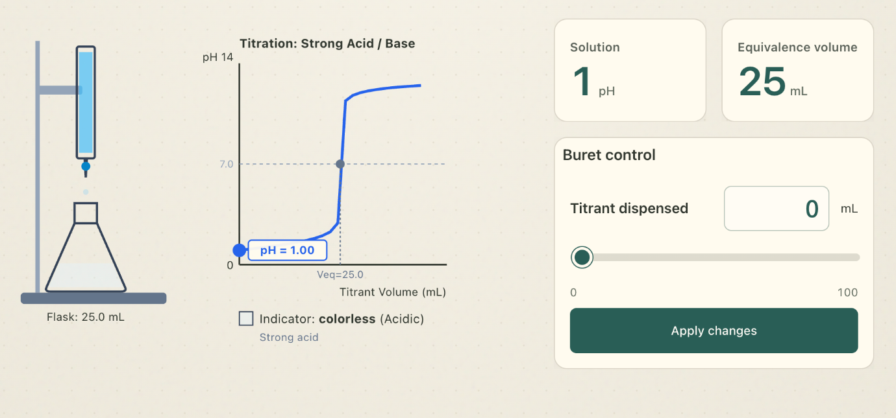
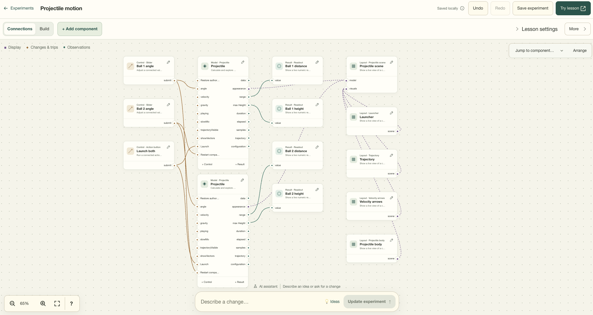
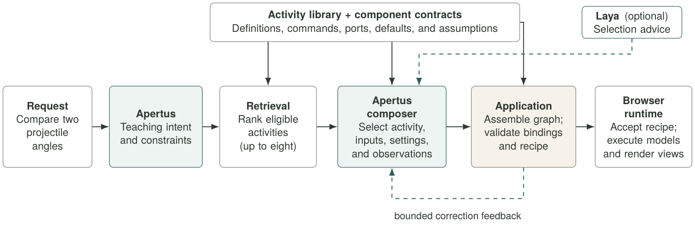
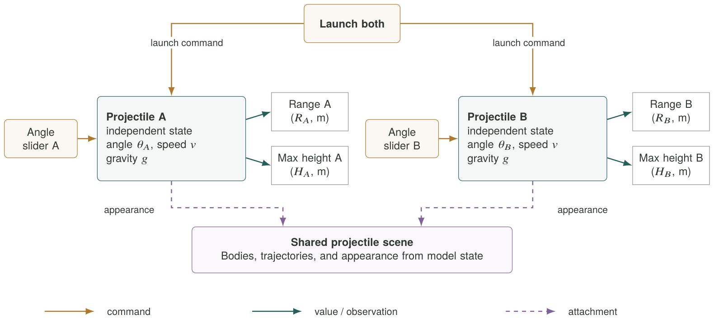

# pAperSim: Apertus-Assisted Component-Based Simulation Authoring for Accessible Education

> Track: 2B — Own Project. Team and member names: confirm before submission. Demo video URL: pending.
> Application source: `ea95d04d030228dd8816c5a9938d160173ff163a` from the development repository. Benchmark source: `9f0c351b5aef3b063029509e425075facdb52f2e`.
> Target architecture: on-premise. The Docker entry point builds the existing Apertus/Laya CPU services for the Docker host architecture. AMD64 execution and Raspberry Pi performance are unverified. Initial image builds and approximately 5.7 GB of model downloads require internet; inference uses the local services. Earlier Docker AI generation failed despite healthy services; these deployment changes do not establish usable AI generation.
> Reproduction: install Docker with Compose and GNU Make, then run `make run`. Open `http://localhost:43100`. Guest browser saves are supported; accounts, MongoDB, and community features are disabled by this offline deployment. See [startup instructions](README.md).
> This Markdown manuscript and the imported PDF are existing report versions; review their content together before the final upload.

pAperSim Project Team  
Hack Apertus Online 2026 — Apertus Adoption, Own Project  
15 October 2026

| (a) Projectile motion comparison simulation | (b) Simple Titration experiment | (c) AI-assisted simulation builder |
|:---:|:---:|:---:|
|  |  |  |

**Figure 1. Apertus-assisted simulation authoring in pAperSim.** Apertus assembled the projectile motion comparison (a) and simple titration experiment (b) from registered components. The AI-assisted simulation builder (c) exposes the editable component graph and supports refinement through natural-language instructions. Interface captures illustrate the application, not identified scored authoring runs.

**TL;DR.** Apertus assembles editable simulations from registered components. Local 8B inference achieved 95.0% render completion and received 46 selections in 157 human reviews.

## Abstract

Interactive simulations combine computational models, learner controls, and visual explanations, but creating them requires expertise across all three. We present pAperSim, an Apertus-assisted framework that turns natural-language teaching requests into editable recipes assembled from registered components. A staged pipeline handles interpretation and configuration, while the application validates and executes the recipes. We evaluated seven model deployments on 40 fixed prompts, producing 280 outcomes. Local Apertus 1.5 8B in MXFP4 format rendered 38/40 requests (95.0%) and completed 30/40 without repairs (75.0%), with a median successful-generation time of 28.98 seconds. A completed screenshot evaluation by four project-team members produced 157 reviewed answers. Apertus received 46 selections, compared with 49 for Qwen3 8B, 50 for Llama, and 75 for Mistral, which was selected most often. These findings support practical local simulation authoring and identify task matching and learner controls as priorities for improvement. Raspberry Pi performance and classroom learning outcomes remain unmeasured.

**Keywords:** Apertus; educational simulations; component-based authoring; local inference; human evaluation.

# 1. Introduction

Technology has played a significant role in education to improve learning effectiveness and expand access to knowledge (Mdhlalose & Mlambo, 2023) changing how education is delivered and experienced (McCarthy et al.,2023). Schools have increasingly integrated various technologies into their teaching practices, including Google Docs, Google Forms, YouTube, Zoom, SurveyMonkey, and Artificial Intelligence (AI) tools  like ChatGPT and DALL-E (Allman et al., 2024). Compared to traditional teaching, immersive technology such as virtual reality and interactive whiteboards enhanced students’ learning comprehension of abstract concepts (Neiroukh et al., 2025). The use of AI for education in particular has brought many changes to the field of learning by supporting productive inquiry, motivation, and learning by teaching (Dai & Ke, 2022). It aids teachers in tasks such as making exams and tools to assist learning (Ben-Zion et al., 2025) and assists students’ in enhancing computational thinking skills, motivation to learn, and their self-efficiency (Huang & Qiao, 2022).

pAperSim is a browser-based, component-based simulation authoring framework assisted by Apertus. Its component registry contains 458 public definitions spanning mathematics, physics, chemistry, biology, economics, and social and environmental processes. Users can explore prepared experiments, describe a new investigation in natural language, and refine its components in a visual builder. Developers can extend the framework with reusable models, controls, displays, and explicitly imported components. Apertus supplies authoring decisions; registered implementations supply the native simulation behavior.

The engineering question is how to translate a teaching request into an executable, inspectable activity without requiring the language model to implement every scientific calculation and interface behavior. We address this by making the simulation a portable component graph, rather than a newly generated program. The model selects supported capabilities and settings; the application assembles them into an editable recipe.

The development of pAperSim aims to meet the following objectives:

1. To make learning more visually interactive and easy to comprehend especially for subjects with abstract concepts;
2. To provide a framework for AI-assisted component based simulation creation programs;
3. To stress test the Apertus model in order to find its limitations in understanding, piecing components together, and simulating a variety of scenarios;
4. To offer opportunities for other developers to create their own component based simulation within pAperSim; and,
5. To make simulations more accessible for public schools in the Philippines by running pAperSim with Raspberry pi 5.

**Contributions.** We present (1) a shared, typed simulation representation for manual and AI-assisted authoring; (2) a staged interpretation, selection, configuration, and validation pipeline with revision-safe editing; and (3) a seven-model benchmark separating render completion, repair-free completion, and latency, complemented by a completed screenshot evaluation by four project-team members. The educational-access objective motivates local inference and reusable lessons; it is not a claim of measured learning gains.

# 2. Related Works

Improvements in technology have opened opportunities for AI-assisted simulations in application-based and high-risk training. Torun and Özer Şanal (2025) review their potential for individualized instruction. Yuan (2025) discusses engagement, knowledge retention, and adaptive challenges in finance simulations. Ben Ouahi et al. (2025) report positive changes in physics attitudes and performance when interactive simulations accompany the 5E learning model. These findings motivate our application, but do not establish its educational effectiveness.

Several works contributed to the vision for pAperSim. **Text2Sim** creates executable, editable physical simulations from text through a planner, specialized writers, a critic, and retrieved diagnostic experience (Xiong et al., 2026). **SceneCraft** converts written descriptions into Blender-executable Python scripts for scenes with up to a hundred assets, using relational graphs and iterative visual feedback (Hu et al., 2024). **Holodeck** generates diverse 3D environments, customizes styles, and accommodates fine-grained requirements such as an apartment whose resident has a cat (Yang et al., 2024).

Related frameworks also inform the separation of planning and execution. **LLMCompiler** decomposes requests into function calls with explicit dependencies and executes independent calls in parallel (Kim et al., 2024); pAperSim instead uses sequential, bounded authoring stages. **Voyager** combines an executable skill library with iterative feedback and self-verification (G. Wang et al., 2024). **GenSim** distinguishes syntax correctness, runtime verification, and task completion while acknowledging that these checks can miss instruction–behavior misalignment (L. Wang et al., 2024).

pAperSim applies these ideas to an educational artifact: a recipe of existing computational models, supported learner commands, observations, and views. Native generation neither writes unrestricted engine code nor learns new executable skills during the benchmark. Its contribution is the authoring system and its measured behavior within a declared component scope, not a general-purpose physical simulator.

# 3. System Design and Method

pAperSim turns teaching requests into editable recipes (Figure 2). Apertus interprets intent and selects activities and settings; application code assembles and validates the recipe; registered providers execute it. Prepared lessons, manual authoring, and AI-assisted composition share this representation.

## 3.1. Components and simulation recipes

The snapshot has 458 public definitions (126 models) and 92 prepared recipes. Apertus discovers only the active catalog's 40 experiments and 135 admitted component identities.

Definitions declare versions, configuration schemas, defaults, typed ports, commands, units, assumptions, and runtime providers. Instances share implementations but keep independent configurations and state. Table 1 lists their public categories.

**Table 1. Registered component categories.**

| Type | Purpose |
|:---|:---|
| Models | Compute simulation state and outputs. |
| Controls | Modify parameters or issue commands. |
| Displays | Present graphs, values, or text. |
| Canvases | Host visual scenes. |
| Appearance | Represent simulation objects visually. |
| Behaviors | Define supported actions and rules. |
| Resources | Provide supporting data and presets. |
| Layout | Arrange interface elements. |

Reusable composites package connected component assemblies; they are not a separate public component category.

A **recipe is the saved, executable description of an experiment**. It records versioned instances, configurations, typed connections, scopes, layout, and instructional text, rather than new native solver code. Recipe format version 2 embeds document format version 3; both are distinct from component implementation versions.

```jsonc
{
  "recipeVersion": 2, "version": 1,
  "id": "prebuilt/models-acid-base-titration",
  "document": {"formatVersion":3, "nodes":[ ... ],
    "connections": [{"kind":"value",
      "from":{"node":"model","port":"currentPH"},
      "to":{"node":"result/ph","port":"value"}}],
    "layout":{ ... }, "lesson":{ ... }}
}
```

**Listing 1.** Abridged recipe structure from the titration example. Ellipses omit nodes and metadata; this excerpt is not independently loadable.

In this example, `currentPH` feeds a readout, a slider's `submit` targets `CHEM_SET_TITRANT_VOLUME`, and an attachment links the model to its visualization. The full recipe also declares dependencies, initial concentrations and volumes, and scientific assumptions.

The visual builder and community snapshots support editing and reuse. Developer-supplied HTML uses an explicit manifest and isolated iframe, separate from native AI authoring.




**Figure 2. Current fresh-creation pipeline.** Apertus interprets intent and makes bounded authoring decisions. Application code assembles and validates the recipe; browser providers execute it. Laya supplies optional selection advice. Open-operation composition and follow-up editing share the contracts but use distinct orchestration.

## 3.2. Interpretation and capability selection

Figure 2 shows the principal fresh-creation path. Apertus produces a compact teaching intent: goal, concepts, requested interactions and observations, explicit constraints, and a suggested single-instance or comparison structure. The original prompt remains available to later stages. Source-span references distinguish explicitly requested values from inferred defaults.

A lexical retriever ranks eligible activities using the original request, generated intent, and capability metadata, retaining at most eight candidates. Apertus selects an activity and checks whether its actual commands and outputs can support the investigation. A configuration field or displayed quantity alone does not establish an adjustable learner input. Missing mandatory bindings reject a candidate and allow a bounded alternative selection.

Laya is a separate, optional decision provider returning a choice distribution rather than a recipe. Recommendations must satisfy probability and contract checks. In this assembly path, rejected or unavailable advice allows main-model selection to continue. This differs from the stronger Laya acceptance gate in open composition.

## 3.3. Composition and typed authoring operations

The composer preserves required inputs and playback, selects optional controls and observations, and separates setting selection from value generation. Each value is checked against the selected setting's schema. Defaults remain unless the prompt specifies a starting value or a comparison requires distinguishing conditions. Inferred settings remain visible and editable and must not be recorded as explicit user constraints.

The application then applies overrides, inserts independently identified activities, preserves required wires, prunes unselected optional displays, arranges the interface, and finalizes the recipe. Fresh creation uses this **retrieval-and-assembly path**, rather than necessarily proposing each low-level graph edit separately.

Open composition and follow-up editing also expose finite authoring operations, including `insert_component`, `configure`, `connect`, `add_control`, `add_observation`, and `arrange`. Listing 2 illustrates one such operation; it is not a complete simulation or a captured benchmark response.

```json
{"action":"tool","tool":{
  "tool":"insert_component",
  "arguments":{
    "definition":"models/Projectile",
    "version":1,"alias":"projectileA",
    "configuration":{
      "angle":30,"velocity":20,
      "gravity":9.81
    }
  }
}}
```

**Listing 2.** Illustrative composer tool call for the open-operation path. Application code applies the operation; the model does not emit a new physics engine.

A tool call describes a change; a recipe describes the resulting experiment. Insertion alone does not create controls, observations, or complete wiring. Shared authoring helpers construct and check those relationships, whether invoked through an operation transaction or through application-owned assembly.

## 3.4. Validation, repair, and accepted execution

Value edges route observations, command edges bind controls to actions, and attachment edges connect models to views. Validators check versions, references, scope, cardinality, required inputs, and immediate value cycles. Finalization checks recipe dependencies and runtime initialization. A completion signal alone is not proof of success.

Invalid responses receive bounded JSON/schema or semantic feedback. Transactions stage mutations on cloned state and commit only accepted changes. Browser acceptance additionally checks request identity and current authored and interaction revisions. A late result or failed edit cannot silently replace newer accepted work; relative changes use captured current values rather than registry defaults.

Native TypeScript providers initialize state, apply commands, measure outputs, and optionally advance dynamics. React, SVG, and Three.js views consume that state under one shared clock. Ordinary learner controls do not invoke Apertus per frame or interaction. Separate runtime-agent activities can use inference, but are not the native numerical-execution path.




**Figure 3. A worked component architecture for projectile comparison.** Each slider addresses its own model instance; the launch control addresses both. Value connections supply range and height observations, and attachment connections feed the shared scene. The schematic exposes how an executable recipe separates controls, calculations, and presentation.

## 3.5. Worked example: two projectile instances

Figure 3 makes the representation concrete. Two projectiles reuse one implementation but keep independent angles and state. Each angle slider sends a command to its own model; a shared launch control addresses both. Range and maximum-height outputs feed readouts, while appearance attachments feed a shared scene. Explanatory labels in the diagram stand for component instances and their declared ports, not additional model-generated physics.

For level-ground ballistic motion without drag, at constant gravity,

$$R=\frac{v^2\sin(2\theta)}{g},\qquad H=\frac{v^2\sin^2\theta}{2g}.$$

An illustrative pair at 30° and 60°, with $v=20$ m/s and $g=9.81$ m/s², has equal ranges of approximately 35.312 m but maximum heights of 5.097 m and 15.291 m. These analytical values illustrate component behavior; they are not the settings displayed in Figure 1. Apertus's task is to select and configure the investigation, not to generate these equations anew.

# 4. Experimental Evaluation

## 4.1. Workload and conditions

On 14 October 2026, we tested seven deployments on the same 40 fixed prompts, with one scored attempt per model and prompt. All 280 outcomes have terminal measurements and share the same prompt hash and pipeline source fingerprint. Internal repairs were bounded and repair memory was disabled. The prompts cover the benchmark's scoped catalog; they were not an independent held-out set.

Playwright submitted each request in a fresh Chromium context, using one worker, a 1440 × 1000 viewport, and no test retries. The case timeout was 300 seconds and the pipeline deadline was 240 seconds. We retained outcomes, repair counts, timings, screenshots, and browser errors.

Apertus used a local text-only MLX MXFP4 conversion of v1.5 8B on an Apple M5 with 24 GiB system memory (Swiss AI Initiative, 2026; m1rkocasu, 2026). Other models used hosted endpoints. Apertus generated unconstrained responses; hosted stages recorded structured-output enforcement. Qwen3 8B had thinking disabled; no override was confirmed for Qwen3 32B. Luna used reasoning effort `none` and Sol `low`. The comparison therefore includes differences in serving and output settings.

## 4.2. Measures

**Render completion** is the share of all 40 requests that visibly rendered without an observed terminal error. **Repair-free completion** counts those that rendered with no recorded schema repairs, validator returns, or deterministic repairs. A first-validator pass is a separate measure because earlier formatting repairs may already have occurred.

**Generation time** runs from request submission to rendering, including model calls and application processing. Median and nearest-rank P95 use successful attempts only. P95 is the time at or below which 95% of those samples fall. We also compare the same 25 prompts that rendered under every model.

## 4.3. Human evaluation

Four project-team members completed a screenshot preference evaluation. Each reviewed the original prompt and selected any results they preferred, or none, without separate scoring criteria. Result cards hid model names and shuffled their order. A measurements view could reveal model information, so full blinding was not established. We report selections across all reviewed answers and across the common 25 prompts. Missing answers are excluded; an explicit none-preferred answer remains in the denominator. Multiple selections were allowed, so percentages need not sum to 100.

# 5. Results and Human Evaluation

**Table 2. Seven model deployments on the same 40 prompts.** RC = render completion; RF = repair-free completion. Latencies use successful generations only. Human preferences are reported separately in Table 3.

| Model deployment | RC | RF | Median (s) | P95 (s) |
|---|---:|---:|---:|---:|
| **Apertus 1.5 8B (local MXFP4)** | **38/40 (95.0%)** | **30/40 (75.0%)** | **28.98** | **37.72** |
| Llama 3.1 8B Instruct | 39/40 (97.5%) | 34/40 (85.0%) | 18.36 | 58.28 |
| Qwen3 8B | 38/40 (95.0%) | 37/40 (92.5%) | 20.46 | 45.12 |
| Qwen3 32B | 38/40 (95.0%) | 35/40 (87.5%) | 23.26 | 58.46 |
| Mistral Small 3.1 24B Instruct | 39/40 (97.5%) | 39/40 (97.5%) | 24.09 | 50.30 |
| GPT-6 Luna | 30/40 (75.0%) | 28/40 (70.0%) | 13.48 | 51.48 |
| GPT-6.1 Sol | 32/40 (80.0%) | 32/40 (80.0%) | 19.40 | 66.41 |

*Bold identifies the Apertus deployment, not column-wise winners. Serving hardware, output constraints, and reasoning modes differ across deployments.*

**Table 3. Screenshot preferences from four project-team members.** All answers: 157 reviewed answers across 40 prompts. Common subset: 99 reviewed answers across the 25 prompts rendered by every model. Each reviewer could select several results or none.

| Model deployment | All answers (157) | Common subset (99) |
|---|---:|---:|
| **Apertus 1.5 8B (local MXFP4)** | **46 (29.3%)** | **30 (30.3%)** |
| Llama 3.1 8B Instruct | 50 (31.8%) | 35 (35.4%) |
| Qwen3 8B | 49 (31.2%) | 30 (30.3%) |
| Qwen3 32B | 56 (35.7%) | 37 (37.4%) |
| Mistral Small 3.1 24B Instruct | 75 (47.8%) | 49 (49.5%) |
| GPT-6 Luna | 22 (14.0%) | 18 (18.2%) |
| GPT-6.1 Sol | 22 (14.0%) | 12 (12.1%) |

*Entries are selection counts and percentages. All-answer rates include requests with no rendered result; common-subset rates use the same prompts for every model. Three missing answers are excluded.*

## 5.1. Completion and repairs

Apertus rendered 38/40 requests (95.0%), matching both Qwen deployments and finishing one request below Llama and Mistral (Table 2). Across all models, 254/280 requests rendered (90.7%) and 235/280 completed without repairs (83.9%). Mistral completed 39/40 without repairs, the highest count in this campaign.

Apertus completed 30/40 requests without repairs. Eight further successful requests required formatting or schema corrections. It recorded 13 schema-repair attempts, including three in a request that ended with malformed JSON. Its other failure occurred during activity support checking. Across all models, there were 23 schema-repair attempts and two validator returns, with no deterministic repairs.

Of the 26 terminal failures, 23 were unsupported decisions during selection, capability checks, input binding, or the instance limit. The remaining three were exhausted JSON repair, exhausted comparison-setting correction, and a provider HTTP 502 error.

## 5.2. Generation time and selection advice

Apertus's successful median was 28.98 seconds, the slowest of the seven deployments. Its P95 (37.72 seconds) and standard deviation (6.33 seconds) were the lowest observed, indicating a smaller timing spread in this batch. Its median on the common 25 prompts was 28.97 seconds. Luna had the fastest median, 13.48 seconds, but a maximum of 135.12 seconds. These timings include different local and hosted serving conditions.

Laya supplied 279 selection recommendations; 11 passed acceptance checks. Apertus accepted none of its 39 recommendations, and main-model selection continued. A comparison with Laya disabled is needed to measure its contribution.

## 5.3. Human preferences

The completed evaluation contained 157 reviewed answers out of 160 possible answers. Three were missing, 21 selected no result, and 74 selected several results. In total, reviewers made 320 model selections (Table 3).

Apertus received 46 selections (29.3%), compared with 49 for Qwen3 8B and 50 for Llama. Mistral received the most selections, 75 (47.8%), and led within each reviewer's responses. Qwen3 32B followed with 56 (35.7%). The small differences between Apertus, Qwen3 8B, and Llama warrant further evaluation.

The common 25 prompts yielded 99 reviewed answers. Mistral remained first with 49 selections, followed by Qwen3 32B with 37 and Llama with 35. Apertus and Qwen3 8B each received 30. This comparison reduces the effect of differences in render availability, while covering a smaller prompt set.

# 6. Discussion, Limitations, and Deployment

Apertus's 38/40 render completions show that a locally hosted 8B model can support a broad range of simulation requests when the application supplies executable components. Its human selection count was close to Llama and Qwen3 8B. Mistral combined the highest repair-free completion count with the most human selections, making it the strongest observed comparator in this campaign.

The recorded pipeline behavior points to practical improvements. Apertus needed more schema repairs than the hosted deployments, which used structured-output enforcement. Intent wording also changed which activities retrieval offered to the selection stage. The next priority is to match requests more reliably to available activities and explicitly check that required learner controls are available. Enforcing output schemas locally is a further reliability improvement.

Luna and Sol rendered fewer requests, with 30/40 and 32/40 respectively. Some unsupported decisions correctly identified unavailable controls; others involved retrieval or selection problems. Their completion counts therefore reflect both model decisions and application capabilities. Both received 22 human selections overall, while their common-subset counts differed: 18 for Luna and 12 for Sol.

**Limitations.** Each model was tested once per prompt; one request changes its completion rate by 2.5 percentage points. Hardware, quantization, reasoning settings, and output enforcement were not controlled independently. The human study involved four team members with different selection habits and no separate scoring rubric or written reasons. Its 157 answers are repeated judgments from those four people. The study measured screenshot preference; learner interactions, scientific accuracy, and learning gains were not evaluated.

**Deployment.** Local inference was demonstrated on the Mac host. Raspberry Pi 5 school servers remain a deployment target. Saved lessons can be reused without inference on each learner interaction. Pi latency, memory, thermals, disconnected operation, and classroom outcomes remain unmeasured.

**Reproducibility.** Archived runs retain prompts, model settings, pipeline fingerprints, outcomes, screenshots, and repair and timing measurements. The four human exports preserve the recorded choices, but omit screenshot version IDs and complete exposure logs. Common-subset calculations use the fixed campaign's render outcomes.

# 7. Conclusion

pAperSim combines editable simulation components with local Apertus authoring. Apertus achieved 95.0% render completion, 75.0% repair-free completion, and a 28.98-second successful median. Four team members completed the human evaluation, selecting Apertus on 46 of 157 reviewed answers. The results support continued development of local authoring, with task matching and learner controls as the next priorities. Broader external evaluation and Raspberry Pi classroom trials will extend this evidence.

# References

Allman, B., Kimmons, R., Wang, W., Bao, H., Rosenberg, J. M., & Koehler, M. J. (2024). Trends and topics in educational technology, 2024 edition. *TechTrends, 68*, 402–410. doi:10.1007/s11528-024-00950-5.

Ben Ouahi, M., Droui, M., Hida, E., Hassouni, T., & Al Ibrahmi, E. M. (2025). Students’ attitude towards physics: Its influence on their performance before and after the use of interactive simulations. *Knowledge Management & E-Learning, 17*(3), 475–496. doi:10.34105/j.kmel.2025.17.022.

Ben-Zion, Y., Einhorn Zarzecki, R., Glazer, J., & Finkelstein, N. D. (2025). Leveraging AI for rapid generation of physics simulations in education: Building your own virtual lab. *The Physics Teacher, 63*, 424–427. doi:10.1119/5.0252343.

Dai, C.-P., & Ke, F. (2022). Educational applications of artificial intelligence in simulation-based learning: A systematic mapping review. *Computers and Education: Artificial Intelligence, 3*, 100087. doi:10.1016/j.caeai.2022.100087.

Hu, Z., Iscen, A., Jain, A., et al. (2024). SceneCraft: An LLM agent for synthesizing 3D scenes as Blender code. *ICML, PMLR 235*, 19252–19282.

Huang, X., & Qiao, C. (2022). Enhancing computational thinking skills through artificial intelligence education at a STEAM high school. *Science & Education*. Published online 10 October 2022; issue version: *33*, 383–403 (2024). doi:10.1007/s11191-022-00392-6.

Kim, S., Moon, S., Tabrizi, R., et al. (2024). An LLM compiler for parallel function calling. *ICML, PMLR 235*. arXiv:2312.04511.

m1rkocasu. (2026). *Apertus-v1.5-8B-text-MLX-mxfp4*. Model conversion. https://huggingface.co/m1rkocasu/Apertus-v1.5-8B-text-MLX-mxfp4 (accessed 14 October 2026).

McCarthy, A. M., Maor, D., McConney, A., & Cavanaugh, C. (2023). Digital transformation in education: Critical components for leaders of system change. *Social Sciences & Humanities Open, 8*, 100479. doi:10.1016/j.ssaho.2023.100479.

Mdhlalose, D., & Mlambo, G. (2023). Integration of technology in education and its impact on learning and teaching. *Asian Journal of Education and Social Studies, 47*(2), 54–63. doi:10.9734/ajess/2023/v47i21021.

Neiroukh, N., Hamad, N., & Ayyoub, A. (2025). Virtual reality enhances student’s achievement in biology: A comparative study with interactive whiteboards and traditional methods. *Jurnal Ilmiah Ilmu Terapan Universitas Jambi, 9*(4), 1512–1525. doi:10.22437/jiituj.v9i4.43935.

Swiss AI Initiative. (2026). *Apertus-v1.5-8B*. Model card. https://huggingface.co/swiss-ai/Apertus-v1.5-8B (accessed 14 October 2026).

Torun, F., & Özer Şanal, S. (2025). Evolution of simulation technologies: AI-enhanced education. *Necmettin Erbakan Üniversitesi Ereğli Eğitim Fakültesi Dergisi, 7*(Special issue), 267–292. doi:10.51119/ereegf.2025.146.

Wang, G., Xie, Y., Jiang, Y., et al. (2024). Voyager: An open-ended embodied agent with large language models. *Transactions on Machine Learning Research*. arXiv:2305.16291.

Wang, L., Ling, Y., Yuan, Z., et al. (2024). GenSim: Generating robotic simulation tasks via large language models. *ICLR*. arXiv:2310.01361.

Xiong, X., Wang, T.-H., Qiao, Y.-L., Du, T., & Li, M. (2026). Text2Sim: Agentic physics-based simulation generation with distilled expertise. *Preprint*, arXiv:2609.36593v2.

Yang, Y., Sun, F.-Y., Weihs, L., et al. (2024). Holodeck: Language guided generation of 3D embodied AI environments. *CVPR*, 16227–16237. arXiv:2312.09067.

Yuan, G. (2025). Synergistic integration of artificial intelligence and gamification in university finance trading simulation labs. *Simulation & Gaming*. First published online 2025; issue version: *57*(2), 171–204 (2026). doi:10.1177/10468781251377585.

## License

Documentation and report: Creative Commons Attribution 4.0 (CC-BY-4.0). Third-party references retain their original terms.
