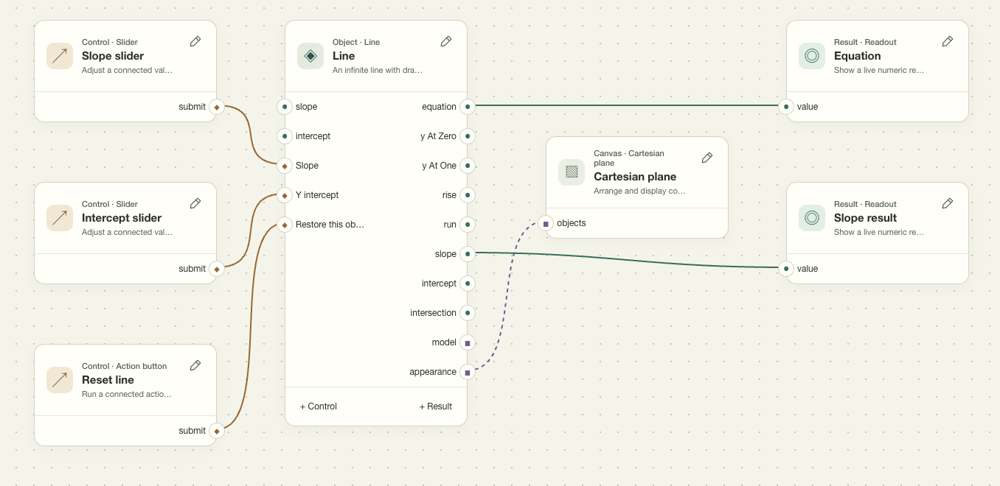
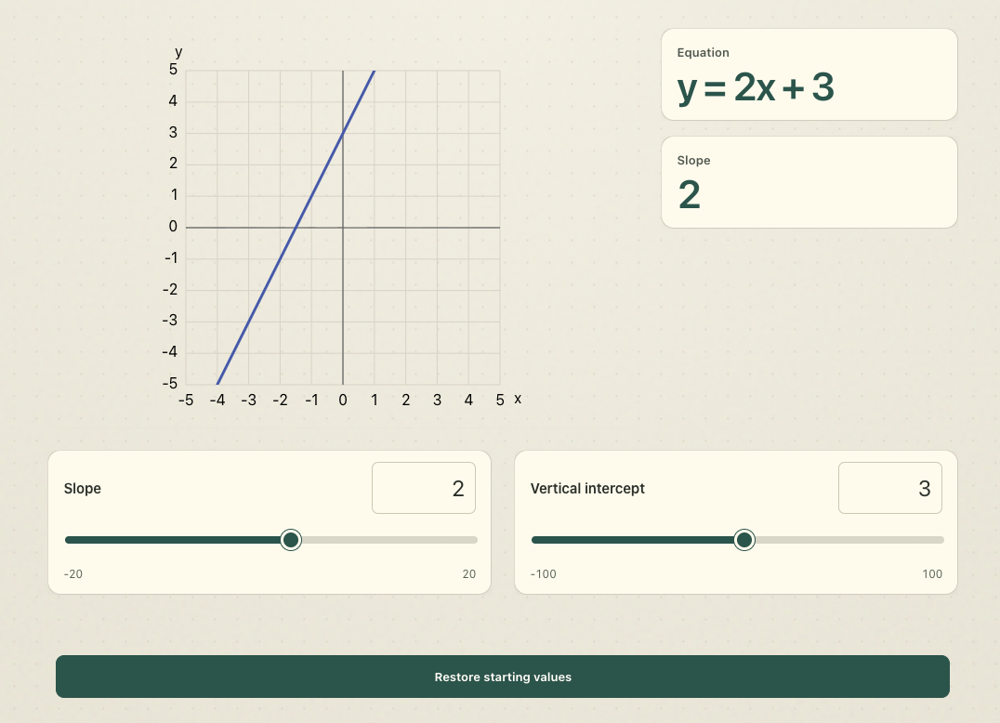

# pAperSim: Apertus-Assisted Component-Based Simulation Authoring for Accessible Education

Louie Dale Cervera, Fides Anna Notes, Mykiell Deovenn Pagayonan, Raine Christine Perez, and Ian Clyde Tejada

Hack Apertus Online 2026 — Apertus Adoption, Own Project

October 2026

[Demo video](https://www.youtube.com/watch?v=bpb16vIsMLg)

## Abstract

Interactive simulations allow learners to explore complex concepts through experimentation. However, creating them requires implementing simulation logic, interactive controls, and visual representations. We present pAperSim, a browser-based educational simulation authoring framework that uses Apertus 1.5 8B, an open-weight large language model (LLM) running locally, and targets offline deployment on a Raspberry Pi 5 with 8 GB RAM. Given a natural-language request, Apertus identifies the intended experiment and selects and configures predefined and community-contributed components. The application assembles these components into an editable simulation recipe, validates their connections, and executes the registered computational models. This architecture allows the LLM to author simulations without generating the underlying simulation code. We evaluated seven model deployments using 40 fixed prompts. Locally hosted Apertus rendered 38 of 40 requests (95%), with 30 (75%) completed without recorded repairs. These results support the feasibility of component-based simulation authoring with a compact LLM running locally, providing a foundation for offline deployment.

**Keywords:** Apertus; educational simulations; component-based authoring; local inference; large language models.


**Figure 1.** Apertus-assisted simulation authoring in pAperSim. Apertus assembled the projectile motion comparison (a) and simple titration experiment (b) from registered components. The AI-assisted simulation builder (c) exposes the editable component graph and supports refinement through manual and natural-language instructions.

## 1. Introduction

Technology has played a significant role in education by improving learning effectiveness and expanding access to knowledge (Mdhlalose & Mlambo, 2023), changing how education is delivered and experienced (McCarthy et al., 2023). Schools have increasingly integrated various technologies into their teaching practices, including Google Docs, Google Forms, YouTube, Zoom, and, more recently, artificial intelligence (AI) tools (Allman et al., 2024). These technologies have introduced new ways for students to engage with learning materials. Immersive educational tools, such as virtual reality and interactive whiteboards, allow learners to explore abstract concepts through experimentation (Neiroukh et al., 2025), while AI has introduced opportunities for personalized learning and adaptive feedback (Dai & Ke, 2022).

Despite these advancements, access to such educational technologies remains unequal. According to the United Nations Educational, Scientific and Cultural Organization (2023), only 40% of primary schools and 50% of lower secondary schools worldwide have internet connectivity, leaving many communities unable to fully benefit from technologies that depend on it.

To address these challenges, we present pAperSim, a browser-based educational simulation authoring framework that uses Apertus 1.5 8B, an open-weight large language model (LLM), to create interactive simulations from natural-language instructions. The system assembles predefined and community-contributed components into editable simulations, allowing educators to create and customize learning activities without developing the underlying simulation code. By supporting local LLM inference and targeting compatibility with resource-constrained devices such as a Raspberry Pi 5 with 8 GB RAM, pAperSim aims to make interactive simulation authoring available across a wider range of environments, including those without reliable internet connectivity.

The primary objective of pAperSim is to provide an extensible framework for creating and customizing interactive educational simulations through natural-language instructions that can operate locally. To support this goal, the development of pAperSim follows five specific objectives:

- To support the visual and interactive exploration of abstract concepts through customizable educational simulations;

- To provide a framework for AI-assisted, component-based simulation creation;

- To evaluate Apertus’s capabilities and limitations in interpreting natural-language requests, selecting and configuring components, and producing executable simulations;

- To allow developers to create and contribute reusable components that extend the simulations available in pAperSim; and

- To make simulation authoring more accessible in environments with limited or no internet connectivity through local LLM inference and potential deployment on resource-constrained devices, such as a Raspberry Pi 5 with 8 GB RAM.

**Contributions.** The main technical contributions are (1) a shared, typed simulation-recipe representation for manual and AI-assisted authoring, and (2) a staged authoring pipeline for interpreting requests, selecting and configuring components, and validating executable recipes, with support for revision-safe editing. We also report a seven-model benchmark measuring render completion, repair-free completion, and generation latency, as well as a human blind side-by-side evaluation of generated results.

## 2. Related Works

Advances in simulation technology have made it possible to introduce AI-assisted learning in fields where practical training can be difficult or high-risk. Torun and Özer Şanal (2025) discuss how simulations have evolved to support more interactive and personalized instruction. In finance trading labs, AI-driven simulations can adapt challenges to learners’ abilities, supporting engagement and knowledge retention (Yuan, 2026). Similarly, interactive simulations in physics have been associated with improvements in students’ attitudes and performance (Ben Ouahi et al., 2025). These findings highlight the educational value of simulations and the importance of making them easier to create and customize.

Several projects have explored how natural-language instructions can be used to create simulations and virtual environments. Text2Sim generates executable and editable physical simulations from written descriptions, including their motion and controls (Xiong et al., 2026). SceneCraft converts text into Blender-executable Python scripts, producing intricate scenes with up to 100 3D assets (Hu et al., 2024). Similarly, Holodeck generates diverse 3D environments and accommodates specific requirements, such as an apartment for a researcher with a cat (Y. Yang et al., 2024). These systems helped shape the direction of pAperSim, particularly the idea of translating natural-language requests into interactive environments. pAperSim applies this approach to educational experiments by assembling existing computational components rather than generating the underlying simulation code.

Other related works have explored how LLMs can coordinate complex tasks through structured operations. LLMCompiler breaks down requests into function calls with defined dependencies, allowing independent tasks to execute in parallel (Kim et al., 2024). Voyager, an LLM-powered Minecraft agent, develops a reusable library of executable skills and improves them through environmental feedback and execution errors (G. Wang et al., 2024). GenSim uses goal-directed and exploratory generation to create robotic simulation tasks and expert demonstrations (L. Wang et al., 2024). These approaches provide relevant examples of how LLMs can organize tasks, reuse existing capabilities, and incorporate feedback. In pAperSim, Apertus selects and configures components, while the application validates their connections and executes the resulting simulation recipes.

Beyond how simulations are created, pAperSim also emphasizes accessibility through local deployment. By using Apertus 1.5 8B, a compact LLM capable of running locally, the framework aims to support offline simulation authoring on resource-constrained hardware, such as a Raspberry Pi 5 with 8 GB RAM, making it potentially accessible in environments with limited computing resources or unreliable internet connectivity.

## 3. System Design and Method

pAperSim represents an educational experiment as connected, reusable components, saved as a simulation recipe. Apertus interprets the user’s request and selects supported activities and settings, while the application assembles and validates the recipe before the components run. Prepared simulations and lessons, manual editing, and AI-assisted authoring share this representation, so an experiment can be inspected and modified regardless of how it was created.

### 3.1. Components and simulation recipes

The registry contains components with different responsibilities: models compute simulation behavior, controls provide learner interactions, and displays present observations. Table 1 lists their categories.

| Type | Purpose |
| --- | --- |
| Models | Compute simulation state and outputs |
| Controls | Modify parameters or issue commands |
| Displays | Present graphs, values, or text |
| Canvases | Host visual scenes |
| Appearance | Represent simulation objects visually |
| Behaviors | Define supported actions and rules |
| Resources | Provide supporting data and presets |
| Layout | Arrange interface elements |

**Table 1.** Registered component categories.

Each component definition describes what can be configured and connected. Configuration schemas specify permitted settings, while typed ports and commands describe how the component exchanges values and responds to actions. Definitions also record defaults, versions, units, assumptions, and runtime providers (the implementations that execute components). Instances share an implementation but maintain independent configurations and state.

A recipe is the saved, executable description of an experiment. It records component instances and versions, their configurations and typed connections, scopes, layout, and instructional text. Listing 1 shows how the titration recipe connects a model output to a display.

```jsonc
{
  "recipeVersion": 2, "version": 1,
  "id": "prebuilt/models-acid-base-titration",
  "document": {
    "formatVersion": 3, "nodes": [ ... ],
    "connections": [{
      "kind": "value",
      "from": {"node": "model", "port": "currentPH"},
      "to": {"node": "result/ph", "port": "value"}
    }],
    "layout": { ... }, "lesson": { ... }
  }
}
```

**Listing 1.** Abridged titration recipe. Ellipses indicate omitted content; this excerpt is not independently loadable. Recipe format version 2 contains document format version 3; both are distinct from component implementation versions.

Here, currentPH supplies the pH readout. The full recipe also connects a slider’s submit to `CHEM_SET_TITRANT_VOLUME` and attaches the model to its visualization. Dependencies, initial concentrations and volumes, and scientific assumptions complete the experiment’s configuration.

Recipes can be edited in the visual builder and reused through community snapshots. Connected components can also be packaged as reusable composites without introducing another component category. The framework separately supports developer-supplied HTML through an explicit manifest and an isolated iframe; these imports are outside native AI component authoring.

The implementation contains 458 public definitions (including 126 models) and 92 prepared recipes. Of these available resources, the active authoring catalog exposes 40 experiments and 135 component identities to Apertus. This catalog defines the scope of initial activity selection.


**Figure 2.** Authoring pipeline. Apertus interprets the input, relevant components are retrieved, and the composer selects and configures them. The authoring engine assembles the recipe, the validator checks it, and the runtime engine executes the simulation. The component library supplies retrieval, authoring, and runtime execution. Validation feedback and repair memory support bounded correction by the composer.

### 3.2. Interpretation and capability selection

For a request such as “compare two projectile angles” in Figure 2, Apertus identifies the teaching goal, concepts, required interactions and observations, explicit constraints, and whether the experiment calls for a single instance or a comparison. The original request remains available throughout authoring, distinguishing user-specified values from inferred defaults.

A lexical retriever then ranks eligible activities using the request, interpreted intent, and capability metadata, retaining at most eight candidates. Apertus selects an activity and checks whether its commands and outputs support the requested experiment. A configurable parameter does not necessarily provide a learner-adjustable control, so the pipeline rejects candidates that lack the required input bindings and tries an alternative within its selection limit.

### 3.3. Composition and typed authoring operations

Once an activity is selected, Apertus chooses optional controls, observations, and settings while preserving required inputs and playback. Setting selection and value generation are separate steps, allowing each proposed value to be checked against its setting’s schema. Defaults remain unless the request specifies starting values or a comparison needs different conditions. Inferred settings remain visible and editable without being recorded as explicit user constraints.

The application applies these choices, creates independently identified activity instances, preserves required connections, removes unselected optional displays, and arranges the interface. This retrieval-and-assembly path constructs a new simulation without requiring Apertus to propose every graph edit individually.

Open composition and follow-up editing also expose defined operations: insert_component, configure, connect, add_control, add_observation, and arrange. Listing 2 illustrates an insertion operation.

```json
{
  "action": "tool",
  "tool": {
    "tool": "insert_component",
    "arguments": {
      "definition": "models/Projectile",
      "version": 1, "alias": "projectileA",
      "configuration": {
        "angle": 30, "velocity": 20, "gravity": 9.81
      }
    }
  }
}
```

**Listing 2.** Illustrative component-insertion operation. This example belongs to the open-operation path. It is neither a complete simulation nor a recorded benchmark response.

A tool call describes a change; a recipe describes the resulting experiment. Inserting a projectile does not create its controls, observations, or complete connections. Shared authoring helpers construct and check these relationships in both operation-based editing and application-managed assembly.

### 3.4. Validation, repair, and execution

Connections determine how the assembled components work together. Value connections carry observations, command connections bind controls to actions, and attachment connections associate models with views. Validators check versions and references, required inputs, connection scope and cardinality, and immediate value cycles. Cardinality checks concern the permitted number of connections. Finalization checks dependencies and runtime initialization, so a model’s completion response alone does not establish that the recipe can run.

Invalid responses receive feedback about JSON formatting, schema violations, or semantic errors. The pipeline allows corrections within a bounded repair process before deciding whether to accept the recipe. The system stores repairs in memory for use in similar future cases. This allows later repair attempts to draw on previous corrections when the same kinds of errors recur.

During execution, registered TypeScript providers initialize state, apply commands, compute outputs, and advance time-dependent models. React, SVG, and Three.js views use this state under a shared clock. Ordinary learner interactions do not invoke Apertus on every action or frame.





**Figure 3.** A line activity assembled from reusable components. (a) Connections link the slope and intercept sliders to the line component, which supplies the visual display and readouts. (b) The resulting activity lets learners adjust slope and intercept and observe changes to the line and its equation.

### 3.5. Worked example: adjusting slope and intercept

Figure 3 connects the component view to the activity presented to learners. In panel (a), the slope and intercept sliders send changes to the line component, and the reset control restores its starting values. The line component supplies the equation and slope readouts and its appearance on the coordinate plane.

Panel (b) shows the resulting activity. Learners can adjust the slope and vertical intercept of a line described by $`y=mx+b`$, where $`m`$ is the slope and $`b`$ is the vertical intercept. The displayed values of $`m=2`$ and $`b=3`$ give $`y=2x+3`$. The example shows how connected components form an activity with controls, a visual display, and readouts; it is an illustration of the authoring interface, not a scored benchmark result.

## 4. Experimental Evaluation

### 4.1. Workload and conditions

We evaluated seven deployments on the same 40 fixed prompts, with one scored attempt per deployment and prompt. All 280 attempts had recorded final outcomes and shared the same prompt hash and pipeline source fingerprint. Internal repairs were bounded and repair memory was disabled. The prompts covered the active benchmark catalog and were not an independent held-out set.

Playwright submitted requests in fresh Chromium contexts using one worker, a 1440 × 1000 viewport, and no test retries. The test timeout was 300 seconds with a 240-second pipeline deadline. Recorded outputs included outcomes, repair counts, timings, screenshots, and browser errors.

Apertus used a local text-only MLX MXFP4 conversion of version 1.5 8B on an Apple M5 with 24 GiB system memory (m1rkocasu, 2026; Swiss AI Initiative, 2026). The other models used hosted endpoints. Local Apertus responses had no structured-output enforcement, whereas hosted stages used it. Qwen3 8B had thinking disabled; no override was confirmed for Qwen3 32B. GPT-6 Luna used reasoning effort none, and GPT-6.1 Sol used low. The comparison therefore covers deployments with different serving and output settings.

Qwen3 8B and 32B are dense models from the Qwen3 family, whose post-training supports instruction following, tool use, and switching between thinking and non-thinking modes (A. Yang et al., 2025). The Mistral baseline was Mistral Small 3.1 24B Instruct. Instruction following and tool use are relevant to the structured component-selection and configuration tasks evaluated here.

### 4.2. Measures

Render completion is the proportion of the 40 requests that are visibly rendered without an observed terminal error. Repair-free completion uses the same denominator but counts only rendered results with no recorded schema repairs, validator returns, or deterministic repairs. Passing the first validator is not equivalent to repair-free completion because formatting corrections may have occurred earlier.

Generation time measures the interval from request submission to rendering, including model calls and application processing. Median and nearest-rank 95th-percentile (P95) times use successful attempts only. We also compare the 25 prompts that are rendered under every deployment, so this additional comparison uses the same requests rather than different sets of successful results.

### 4.3. Human evaluation

Four project-team members conducted a blind side-by-side evaluation of generated results alongside the original prompts. For each prompt, a reviewer could select several preferred results or none; there was no separate scoring rubric. Result cards concealed model names and appeared in shuffled order.

One review response represents one person’s selections for one prompt. Selection rates are reported for all completed responses and for the subset covering prompts successfully rendered by every model. Missing responses are excluded, while explicit none-preferred responses remain in the denominator. Because multiple selections were allowed, percentages can sum to more than 100%.

## 5. Results and Human Evaluation

| Model deployment | RC | RF | Median (s) | P95 (s) |
| --- | --- | --- | --- | --- |
| **Apertus 1.5 8B (local MXFP4)** | **38/40 (95.0%)** | **30/40 (75.0%)** | **28.98** | **37.72** |
| Llama 3.1 8B Instruct | 39/40 (97.5%) | 34/40 (85.0%) | 18.36 | 58.28 |
| Qwen3 8B | 38/40 (95.0%) | 37/40 (92.5%) | 20.46 | 45.12 |
| Qwen3 32B | 38/40 (95.0%) | 35/40 (87.5%) | 23.26 | 58.46 |
| Mistral Small 3.1 24B Instruct | 39/40 (97.5%) | 39/40 (97.5%) | 24.09 | 50.30 |
| GPT-6 Luna | 30/40 (75.0%) | 28/40 (70.0%) | 13.48 | 51.48 |
| GPT-6.1 Sol | 32/40 (80.0%) | 32/40 (80.0%) | 19.40 | 66.41 |

**Table 2.** Results across seven deployments and 40 prompts. RC denotes render completion; RF denotes repair-free completion. Timing statistics include successful generations only.

*Bold identifies Apertus, not column-wise winners. Hardware, output constraints, and reasoning settings differ across deployments.*

| Model deployment | All responses (157) | Common subset (99) |
| --- | --- | --- |
| **Apertus 1.5 8B (local MXFP4)** | **46 (29.3%)** | **30 (30.3%)** |
| Llama 3.1 8B Instruct | 50 (31.8%) | 35 (35.4%) |
| Qwen3 8B | 49 (31.2%) | 30 (30.3%) |
| Qwen3 32B | 56 (35.7%) | 37 (37.4%) |
| Mistral Small 3.1 24B Instruct | 75 (47.8%) | 49 (49.5%) |
| GPT-6 Luna | 22 (14.0%) | 18 (18.2%) |
| GPT-6.1 Sol | 22 (14.0%) | 12 (12.1%) |

**Table 3.** Preference selection frequencies in the blind side-by-side evaluation by four project-team members. The full set contains 157 completed review responses; the common subset contains 99 responses across 25 prompts. Reviewers could select several results or none.

*Entries are selection counts and percentages. Full-set rates retain prompts on which a deployment did not render. Common-subset rates use prompts rendered by every deployment. Three missing responses are excluded.*

### 5.1. Completion and repairs

Apertus rendered 38 of 40 requests, matching both Qwen deployments and finishing one request below Llama and Mistral. Across all deployments, 254 of 280 requests rendered (90.7%), and 235 completed without repairs (83.9%). Mistral had the highest repair-free count, with all 39 successful requests completed without recorded repairs.

For Apertus, 30 requests completed without repairs and eight further requests rendered after formatting or schema corrections. It recorded 13 schema-repair attempts, including three in a request that ultimately failed with malformed JSON. Its other failure occurred during activity support checking. Across the seven deployments, there were 23 schema-repair attempts, two validator returns, and no deterministic repairs.

Of the 26 terminal failures, 23 were recorded as unsupported decisions during selection, capability checks, input binding, or instance-limit checks. The remaining three failures involved exhausted JSON repair, exhausted comparison-setting correction, and a provider HTTP 502 error.

### 5.2. Generation time

Among successful generations, Apertus had the highest median time, 28.98 seconds, but the lowest reported P95, 37.72 seconds, and standard deviation, 6.33 seconds. Its times varied less in this batch despite the slower median. Its median on the common 25 prompts was 28.97 seconds. Luna had the lowest median, 13.48 seconds, but a maximum of 135.12 seconds.

### 5.3. Human preferences

The four reviewers completed 157 of 160 possible responses. Of these, 21 selected no result and 74 selected multiple results, producing 320 model selections in total. Apertus was selected in 46 responses (29.3%), compared with 49 for Qwen3 8B and 50 for Llama. Mistral received the most selections, 75 (47.8%), and led within each reviewer’s responses; Qwen3 32B followed with 56 (35.7%).

Across the common 25 prompts, Mistral remained most frequently selected, with 49 selections. Apertus and Qwen3 8B each received 30. Restricting this comparison to prompts rendered by every deployment reduces the effect of unequal output availability, but it covers fewer prompts. The small differences between Apertus, Qwen3 8B, and Llama warrant further evaluation.

## 6. Discussion, Limitations, and Deployment

Local Apertus successfully rendered 38 of the 40 requested experiments using components available in the catalog. Since the required components were present, the two unsuccessful requests do not demonstrate that components were missing. Of the 38 successful requests, 30 completed without repairs and eight required formatting or schema corrections. Reporting both counts shows how often successful generation required corrections.

Instruction-following post-training is a plausible contributor to Mistral’s 39 repair-free completions. Liu et al. (2026) describe supervised fine-tuning and online preference optimization, including tool execution, for Ministral 3, whose parent is Mistral Small 3.1 Base. Those procedures concern the smaller Ministral 3 family, not the evaluated 24B Instruct checkpoint, so they provide related evidence rather than its confirmed training recipe. Model size, prompt compatibility, and hosted output enforcement may also contribute. A matched Base-versus-Instruct comparison would test this explanation.

Rendering and reviewer preference also need to be considered separately. Mistral rendered one more request than Apertus but received 75 preference selections compared with 46. Render counts alone do not capture this difference in reviewer preference. Without written reasons, however, the difference cannot be attributed to particular features of the generated simulations.

**Limitations.** Each deployment was tested once per prompt; one request changes its completion rate by 2.5 percentage points. The prompts were not held out independently, and hardware, quantization, reasoning settings, and output enforcement were not controlled separately. The results characterize the evaluated deployments rather than isolating differences between the models themselves.

The blind side-by-side evaluation contains repeated judgments from four team members, not 157 independent participants. It used no separate scoring rubric. Preference in this evaluation does not measure learner interaction, scientific correctness, or learning gains; these were not evaluated.

**Deployment.** Local inference was demonstrated on the Mac host. Saved lessons can be reused without an LLM call during ordinary learner interaction. The project aims to support offline simulation authoring on resource-constrained devices, including a Raspberry Pi 5 with 8 GB RAM, to broaden access in environments with limited computing resources or unreliable internet connectivity.

**Reproducibility.** Archived runs retain prompts, model settings, pipeline fingerprints, outcomes, generated-result captures, and repair and timing measurements. The four reviewer exports retain recorded choices but omit result-capture version identifiers and complete exposure logs. Common-subset calculations use the render outcomes of the fixed benchmark.

## 7. Conclusion

pAperSim provides a component-based framework for creating and editing educational simulations through natural-language instructions. Apertus makes authoring decisions, while the application assembles and validates recipes and executes their registered models. This separation supports local AI-assisted authoring without generating the underlying simulation code for each request.

In the seven-deployment benchmark, local Apertus rendered 38 of 40 requests, completed 30 without recorded repairs, and had a median generation time of 28.98 seconds among successful attempts. A blind side-by-side evaluation complemented these measurements with judgments from four project-team members. Further development should improve activity matching, required controls, and output reliability, alongside external evaluation and testing of offline deployment on resource-constrained hardware.

## References

Allman, B., Kimmons, R., Wang, W., Bao, H., Rosenberg, J. M., & Koehler, M. J. (2024). Trends and topics in educational technology, 2024 edition. *TechTrends, 68*(3), 402–410. <https://doi.org/10.1007/s11528-024-00950-5>

Ben Ouahi, M., Droui, M., Hida, E., Hassouni, T., & AL Ibrahmi, E. M. (2025). Students’ attitude towards physics: Its influence on their performance before and after the use of interactive simulations. *Knowledge Management & E-Learning, 17*(3), 475–496. <https://doi.org/10.34105/j.kmel.2025.17.022>

Dai, C.-P., & Ke, F. (2022). Educational applications of artificial intelligence in simulation-based learning: A systematic mapping review. *Computers and Education: Artificial Intelligence, 3*, Article 100087. <https://doi.org/10.1016/j.caeai.2022.100087>

Hu, Z., Iscen, A., Jain, A., Kipf, T., Yue, Y., Ross, D. A., Schmid, C., & Fathi, A. (2024). SceneCraft: An LLM agent for synthesizing 3D scenes as Blender code. In R. Salakhutdinov, Z. Kolter, K. Heller, A. Weller, N. Oliver, J. Scarlett, & F. Berkenkamp (Eds.), *Proceedings of the 41st International Conference on Machine Learning* (Vol. 235, pp. 19252–19282). PMLR. <https://proceedings.mlr.press/v235/hu24g.html>

Kim, S., Moon, S., Tabrizi, R., Lee, N., Mahoney, M. W., Keutzer, K., & Gholami, A. (2024). An LLM compiler for parallel function calling. In R. Salakhutdinov, Z. Kolter, K. Heller, A. Weller, N. Oliver, J. Scarlett, & F. Berkenkamp (Eds.), *Proceedings of the 41st International Conference on Machine Learning* (Vol. 235, pp. 24370–24391). PMLR. <https://proceedings.mlr.press/v235/kim24y.html>

Liu, A. H., Khandelwal, K., Subramanian, S., Jouault, V., Rastogi, A., Sadé, A., Jeffares, A., Jiang, A., Cahill, A., Gavaudan, A., Sablayrolles, A., Héliou, A., You, A., Ehrenberg, A., Lo, A., Eliseev, A., Calvi, A., Sooriyarachchi, A., Bout, B., … Ramzi, Z. (2026). *Ministral 3* \[Preprint\]. arXiv. <https://doi.org/10.48550/arXiv.2601.08584>

McCarthy, A. M., Maor, D., McConney, A., & Cavanaugh, C. (2023). Digital transformation in education: Critical components for leaders of system change. *Social Sciences & Humanities Open, 8*(1), Article 100479. <https://doi.org/10.1016/j.ssaho.2023.100479>

Mdhlalose, D., & Mlambo, G. (2023). Integration of technology in education and its impact on learning and teaching. *Asian Journal of Education and Social Studies, 47*(2), 54–63. <https://doi.org/10.9734/ajess/2023/v47i21021>

m1rkocasu. (2026). *Apertus-v1.5-8B-text-MLX-mxfp4* \[Quantized large language model\]. Hugging Face. Retrieved October 14, 2026, from <https://huggingface.co/m1rkocasu/Apertus-v1.5-8B-text-MLX-mxfp4>

Neiroukh, N., Hamad, N., & Ayyoub, A. (2025). Virtual reality enhances student’s achievement in biology: A comparative study with interactive whiteboards and traditional methods. *Jurnal Ilmiah Ilmu Terapan Universitas Jambi, 9*(4), 1512–1525. <https://doi.org/10.22437/jiituj.v9i4.43935>

Swiss AI Initiative. (2026). *Apertus-v1.5-8B* \[Large language model\]. Hugging Face. Retrieved October 14, 2026, from <https://huggingface.co/swiss-ai/Apertus-v1.5-8B>

Torun, F., & Özer Şanal, S. (2025). Evolution of simulation technologies: AI-enhanced education. *Necmettin Erbakan Üniversitesi Ereğli Eğitim Fakültesi Dergisi, 7*(Özel Sayı), 267–292. <https://doi.org/10.51119/ereegf.2025.146>

United Nations Educational, Scientific and Cultural Organization. (2023). *Global education monitoring report 2023: Technology in education - A tool on whose terms?* <https://doi.org/10.54676/UZQV8501>

Wang, G., Xie, Y., Jiang, Y., Mandlekar, A., Xiao, C., Zhu, Y., Fan, L., & Anandkumar, A. (2024). Voyager: An open-ended embodied agent with large language models. *Transactions on Machine Learning Research*. <https://openreview.net/forum?id=ehfRiF0R3a>

Wang, L., Ling, Y., Yuan, Z., Shridhar, M., Bao, C., Qin, Y., Wang, B., Xu, H., & Wang, X. (2024). GenSim: Generating robotic simulation tasks via large language models. In *The Twelfth International Conference on Learning Representations*. <https://openreview.net/forum?id=OI3RoHoWAN>

Xiong, X., Wang, T.-H., Qiao, Y.-L., Du, T., & Li, M. (2026). *Text2Sim: Agentic physics-based simulation generation with distilled expertise* \[Preprint\]. arXiv. <https://arxiv.org/abs/2609.36593v2>

Yang, A., Li, A., Yang, B., Zhang, B., Hui, B., Zheng, B., Yu, B., Gao, C., Huang, C., Lv, C., Zheng, C., Liu, D., Zhou, F., Huang, F., Hu, F., Ge, H., Wei, H., Lin, H., Tang, J., … Qiu, Z. (2025). *Qwen3 technical report* \[Preprint\]. arXiv. <https://doi.org/10.48550/arXiv.2505.09388>

Yang, Y., Sun, F.-Y., Weihs, L., VanderBilt, E., Herrasti, A., Han, W., Wu, J., Haber, N., Krishna, R., Liu, L., Callison-Burch, C., Yatskar, M., Kembhavi, A., & Clark, C. (2024). Holodeck: Language guided generation of 3D embodied AI environments. In *2024 IEEE/CVF Conference on Computer Vision and Pattern Recognition (CVPR)* (pp. 16277–16287). IEEE. <https://doi.org/10.1109/CVPR52733.2024.01536>

Yuan, G. (2026). Synergistic integration of artificial intelligence and gamification in university finance trading simulation labs. *Simulation & Gaming, 57*(2), 171–204. <https://doi.org/10.1177/10468781251377585>
